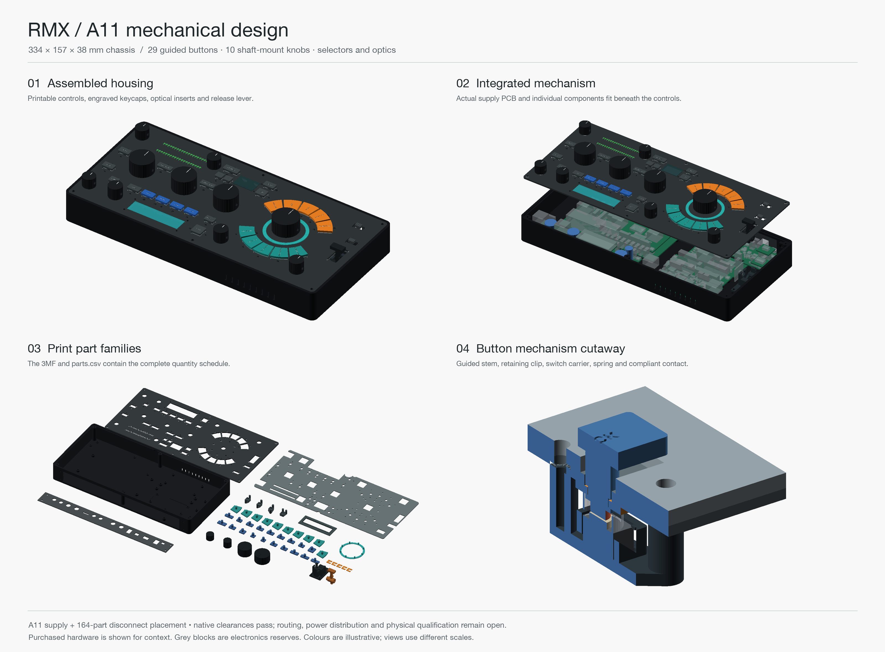
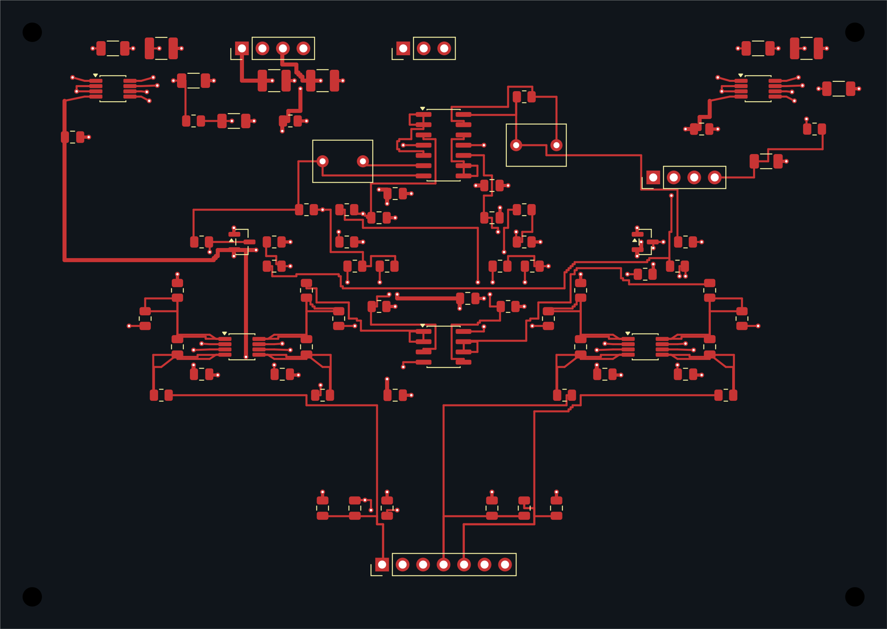
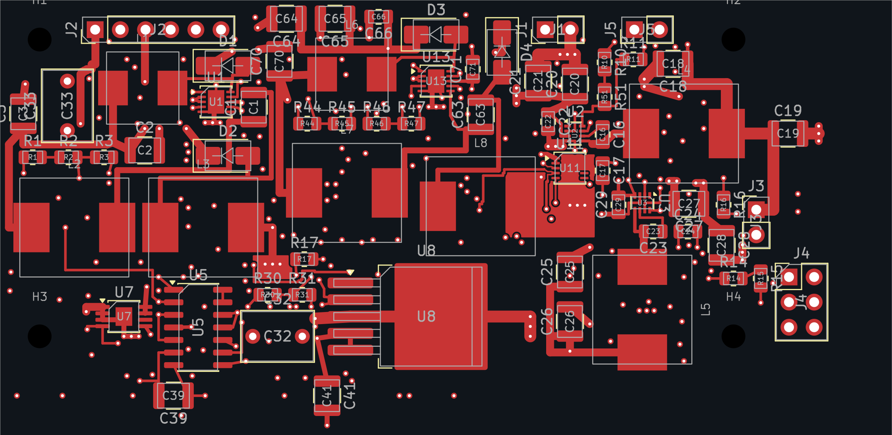
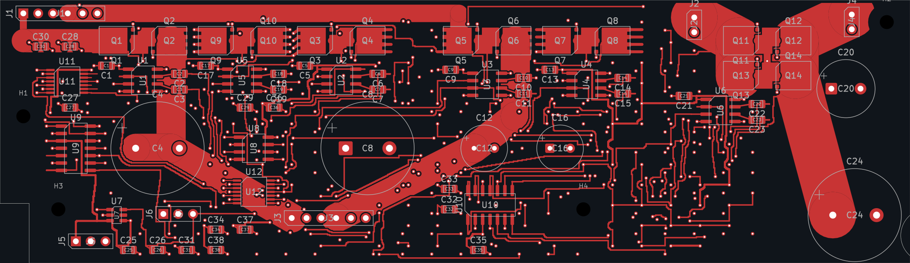
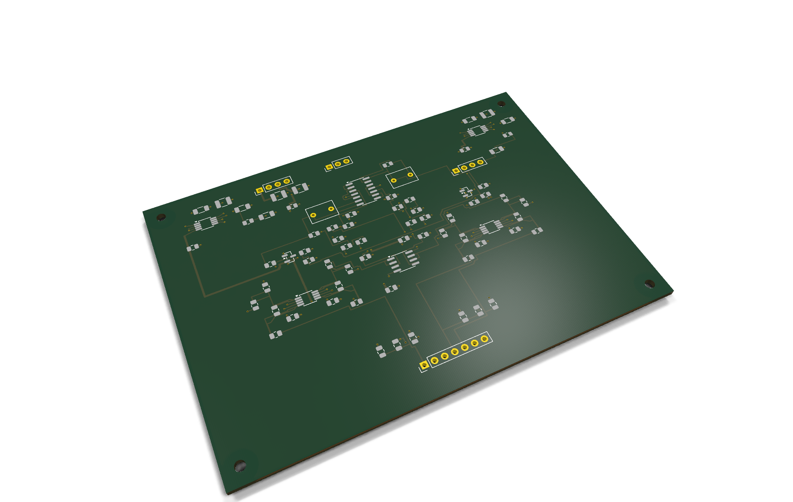

# AFX-1000

[](https://github.com/AxelMcKenna/afx-1000/actions/workflows/build.yml)


**Proprietary — all rights reserved.** Original project code, firmware, PCB and housing designs require a separate written license for reuse, builds, manufacture or redistribution. Public access and build instructions do not grant that permission. Third-party licenses and GitHub's applicable platform permissions remain in effect. See [LICENSE](LICENSE) and [dependency notices](THIRD_PARTY_NOTICES.md).


**AFX-1000** is a take on the RMX-1000, built around a shared C++20 audio engine. Native Mac app, AU and VST3, with a hardware-style amber/teal panel. A standalone Daisy Seed version is in development too.

Use it with rekordbox through app capture or an audio interface. The effects and factory drums are original implementations. Matching the reference unit's sound, timing and full feature set is still work in progress.

## What's in it

- **Scene FX:** BPF Echo, Echo, Noise, Spiral Up, Reverb Up, HPF Echo, LPF Echo, Crush Echo, Spiral Down and Reverb Down.
- **Isolate FX:** three bands, with Isolator, Cut/Add, Trans/Roll and Gate/Drive modes.
- **X-Pad:** four internal drums and four sample banks, 16 bank variants, WAV import, pitch, rolls, hold and overdub.
- **Release FX:** Back Spin, Echo and Vinyl Brake.

Auto BPM, tap tempo, quantized rolls, assignable X-Pad divisions including triplets, MIDI learn, soft takeover and DAW automation are included.

Loop tempo and pitch have separate playback controls. AUTO can follow detected beat phase, and MIDI clock supports Start, Stop, Continue and Song Position Pointer. See [sync](docs/synchronization.md) and [sample stretching](docs/sample-stretching.md) for the implementation limits.

Overdub runs a four-beat pattern. Each bank holds 16 seconds of audio; slot 1 supports BPM-tagged loops. Sample editing includes trim, reverse, normalization and BPM/loop settings. Pad one-shots trigger immediately.

### Latest sound pass

Rebuilt kick, snare, clap and hat voices, with independent gain, decay and envelope choices. Noise now has a resonant filter sweep, shaped modulation and a damped echo return. Faster pitched playback uses a band-limited reader; a linked stereo peak limiter catches output overshoots.

Pitch travel has separate up/down ranges from 1 to 24 semitones. The extra range is a project extension. These changes are implemented, but have not been matched against recordings of an RMX-1000. [DSP notes](docs/dsp-model.md) cover the details and limits.

## Hardware design

The standalone A11 design has a 334 × 157 × 38 mm chassis, 29 guided buttons, ten knobs, selector caps, optical inserts and the release mechanism. It includes mounts and clearances for the routed main supply and the placed E25 disconnect board.

[](docs/assets/hardware/a11-overview.png)

See the [A11 editable CAD](hardware/cad/a11/README.md), [printer handoff](hardware/cad/a11/PRINTING.md), [electronics and wiring status](hardware/validation/disconnect-placement.json) and [saved review package](docs/reviews/standalone-E25-A11/). The unit is not build-ready: disconnect routing, 5 V distribution changes, remaining boards/wiring and physical qualification are unfinished.

### PCB design

Native KiCad layouts from the standalone electronics work. These are engineering candidates; they have not been manufactured or electrically qualified. Click a layout for the full-resolution image.

| E12 ADC driver · 110 × 78 mm | Main supply candidate · 90 × 44 mm |
| --- | --- |
| [](docs/assets/hardware/e12-adc-layout.png) | [](docs/assets/hardware/main-power-layout.png) |
| [Editable PCB and routing checks](hardware/electronics/adc_driver/pcb/) | [Editable PCB and routing checks](hardware/electronics/power_supply/routing/) |

**E26 disconnect pilot · 156 × 45.25 mm**

[](docs/assets/hardware/e26-disconnect-layout.png)

The disconnect remains incomplete: **21 open connections and 30 native DRC warnings**. The ADC driver is a separate characterization board, and the main supply shown predates the proposed P02 source redesign. These layouts do not yet form one integrated assembly. See the [E26 source and findings](hardware/electronics/rail_disconnect/revision26/) and [current development handoff](hardware/DEVELOPMENT.md).

<details>
<summary>3D bare-board preview · E12 ADC driver</summary>



An unpopulated board rendered directly from the KiCad PCB. This is a CAD preview, not a photograph of manufactured hardware.

</details>

The [F06 standalone firmware candidate](hardware/firmware/full_engine/README.md) builds the maintained DSP engine with 152 parameters, bounded SDRAM storage and control-fault recovery. The earlier [preserved runtime and host checks](hardware/runtime/README.md) remain available separately. Earlier [A08 mechanics](hardware/cad/a08/README.md), the [B1 budget prototype](hardware/budget/README.md) and the [A0 enclosure reference](hardware/cad/a0-reference/) also remain separate designs.

## Run it

Requires macOS 12+, Xcode Command Line Tools and CMake 3.24+. The default native app needs no third-party SDK. Ableton Link is optional and disabled by default.

```sh
git clone git@github.com:AxelMcKenna/afx-1000.git
cd afx-1000
./build-app.sh
open build/RMX.app
```

**Cmd+,** opens audio setup. Pick an input and output, then start audio.

Audio setup remembers devices, channel pairs and buffer size. A previously active route can resume on launch when its devices are available. **Stop Audio** disables that automatic resume.

**Space** bypasses. **Esc** resets the effects. **T** taps tempo. **1-4** trigger the pads. Hold **Shift** while dragging for fine adjustments.

### With rekordbox

On macOS 14.2+, select **rekordbox - direct app capture** as the RMX input and choose your speakers or headphones as the output. Start audio, approve macOS capture access if prompted, then play a track in rekordbox.

The capture route mutes duplicate dry playback while active. Stopping it restores normal rekordbox playback. The AU/VST3 versions are for plugin hosts; rekordbox integration uses audio routing.

For an FLX4 or FLX6 with an audio interface:

```text
FLX master RCA -> Interface inputs -> RMX -> Interface outputs -> Speakers
rekordbox cue  -> FLX headphones
```

Physical FLX routing and cue separation still need testing. BlackHole and mixer send/return setups are covered in the [routing guide](docs/routing.md).

## Build

### Python tooling

Install [uv](https://docs.astral.sh/uv/getting-started/installation/), then run from the repository root:

```sh
uv sync --locked
uv run --locked python -m unittest discover -s tests/tooling
uv run --locked python -m unittest discover -s tests -p 'a*_integration_tests.py'
```

uv uses Python 3.12 from `.python-version` and creates an ignored `.venv/`. The root `pyproject.toml` declares NumPy, Pillow and trimesh; `uv.lock` pins the resolved environment. Run Python tools with `uv run --locked python ...`. Use `uv add <package>==<version>` to change a pinned dependency, and commit both project metadata and the lockfile.

Configure CMake through `uv run --locked cmake ...` so its Python tests use this environment. An existing CMake build may retain a previously selected interpreter; use a fresh build directory or explicitly set `-DPython3_EXECUTABLE=/absolute/path/to/.venv/bin/python` when reconfiguring.

The six hardware `requirements.txt` files remain frozen dependency snapshots referenced by historical source hashes. New development and CI use the root uv project. OpenSCAD, KiCad and the ARM toolchain remain separate native dependencies; checks that need KiCad's `pcbnew` module still use KiCad's own Python interpreter.

<details>
<summary>AU, VST3 and JUCE standalone</summary>

```sh
cmake -S . -B build-plugins \
  -DCMAKE_BUILD_TYPE=Release \
  -DRMX_BUILD_PLUGINS=ON
cmake --build build-plugins --parallel 4
```

Fetches JUCE 8.0.6. Use `-DRMX_JUCE_PATH=/path/to/JUCE` for a local checkout. Outputs are in `build-plugins/RMXPlugin_artefacts/Release/`.

For a universal Mac build, use a fresh build directory and add `'-DCMAKE_OSX_ARCHITECTURES=arm64;x86_64'`. Distribution signing and notarization need your Apple credentials. The native build script signs ad hoc for local use.

JUCE's license applies to distribution of the plugin builds.

</details>

<details>
<summary>Core, checks and offline rendering</summary>

The core builds on macOS and Linux, independently of the UI.

```sh
uv run --locked cmake -S . -B build -DCMAKE_BUILD_TYPE=Release
cmake --build build --parallel 4
ctest --test-dir build --output-on-failure
./build/rmx_benchmark
./build/rmx_render input.wav output.wav "assets/presets/Spiral Build.rmx"
```

The renderer's preset argument is optional. Benchmarks measure DSP time, not physical audio latency.

To render 21 drum/pitch/roll and Noise audition clips without opening an audio device:

```sh
cmake --build build --target rmx_sound_preview --parallel 4
./build/rmx_sound_preview build/sound-audition
```

Choose a new output directory each time. These clips use the current engine; they are not recordings of the original hardware.

</details>

## Status

| Area | Current state |
| --- | --- |
| Native Mac audio | Direct rekordbox capture and speaker output have worked in a live session. The latest saved-route/restart behavior still needs a live check. |
| AU / VST3 | Build locally. Earlier universal artifacts include Apple Silicon and Intel slices; the latest sound review builds are arm64. Full DAW validation and Intel runtime checks remain open. |
| Engine and firmware | F06 records 16 passing host groups and clean ARM builds for onboard and external-converter profiles. The source snapshot also records five focused sanitizer groups. Actual MCU timing and hardware operation remain unverified. |
| Synchronization | AUTO, tap, host transport and MIDI clock are implemented. Optional Link needs its SDK; enabled builds and peer synchronization remain unverified. |
| Sound matching | Latest drum/Noise changes are ready for listening. No reference-unit comparison or claim of identical effects. |
| Live use | Physical FLX4/FLX6 routing, cue separation, a live two-hour soak and measured round-trip latency remain open. |

The engine uses stereo floating-point audio and preallocated processing buffers. The core audio callback does no allocation, locking, file I/O or UI work. Signal checks cover 44.1, 48, 88.2 and 96 kHz. Results belong to the revisions and configurations documented in [validation](docs/validation.md); they do not establish MCU deadlines or hardware-equivalent specifications. See [specifications](docs/specifications.md) for the remaining measurements.

### Hardware

**[B1: 5 V budget prototype](hardware/budget/README.md)** is the separate budget standalone design:

- Daisy Seed with 64 MB SDRAM, physical controls, touch strip, SD loading and watchdog-qualified relay bypass.
- Pin-connected KiCad schematics, BOM and a routed 100 x 100 mm four-layer audio/power/bypass carrier. Recorded native ERC and DRC are clean; draft Gerbers and drill files are included for engineering review.
- Split panel STL files, seam joiner, shaft coupon, DXF/SVG and OpenSCAD enclosure source. Full tray/control solids and assembled fit still need validation.
- Boot-time sample banks, User settings and ADC calibration, plus a 50 ms startup fade. Firmware cross-builds with pinned dependencies and checked ELF placement; it has not been flashed or measured on a board.

The provisional cost ledger is **NZ$295.77**, assuming free printing, DIY assembly and reused power/cables. It is not a confirmed delivered basket. B1 targets consumer line levels and does not retain the original's high-level analogue headroom. The earlier [A0.2 higher-headroom carrier](hardware/electrical/README.md) is a separate design.

**No hardware has been ordered or assembled.** Audio performance, relay fault timing, power/thermal behavior, card I/O and physical fit remain unmeasured. Draft fabrication files are not a production release. Start with the [hardware guide](hardware/README.md) and [clone roadmap](docs/clone-roadmap.md).

```sh
./build/rmx_memory_budget
uv run --locked python tools/generate_hardware.py --check
./build/rmx_card_export Performance.rmx /path/to/new-card-folder
```

The exporter writes the project's card layout. `--settings-only` exports User settings without needing audio files; `--samples-only` exports samples. Original RSD/SD interoperability, USB MIDI, live card insertion and complete lighting feedback remain unfinished. See the hardware guide for supported formats and calibration instructions.

## Reference

[Controls](docs/controls.md) / [Routing](docs/routing.md) / [Specifications](docs/specifications.md) / [Validation](docs/validation.md) / [Hardware](hardware/README.md) / [Roadmap](docs/clone-roadmap.md)

[Mac packages](docs/release.md) / [Reference captures and runtime checks](docs/reference-validation.md) / [Engineering update](docs/engineering-update-2026-10-22.md)

The original Swift and browser prototypes are kept in `Sources/` and `prototypes/web/`. Their guide is [here](docs/legacy-prototypes.md).

## Assets and licensing

Original project material is covered by the [AFX-1000 Proprietary Rights Notice](LICENSE), copyright 2026 Axel McKenna, all rights reserved. It covers the project's original software, firmware, legacy prototypes, PCB and mechanical design files, documentation and assets to the extent the owner holds the relevant rights. Reuse, personal builds, manufacture and redistribution require separate written permission, subject to the exceptions in the notice.

Factory drums and the current panel artwork are made by this project. The native and plugin interfaces use a panel generated from [drawing code](tools/generate_panel.mm), with no manufacturer photograph in current builds. Third-party software, footprints and other supplied material retain their own terms. JUCE and optional Link need a compatible licensing route for distribution; the project notice does not override their copyleft obligations. See [source and dependency notices](THIRD_PARTY_NOTICES.md).
