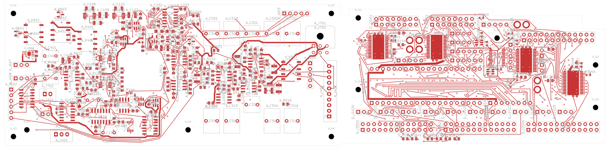
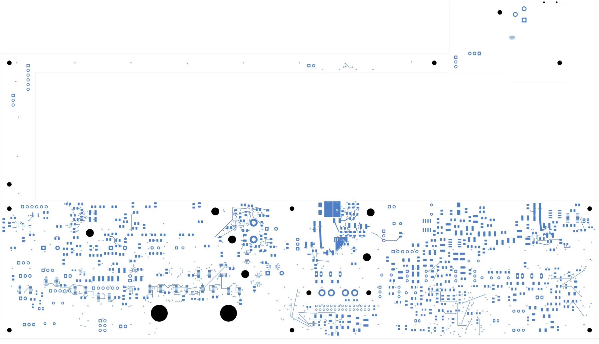
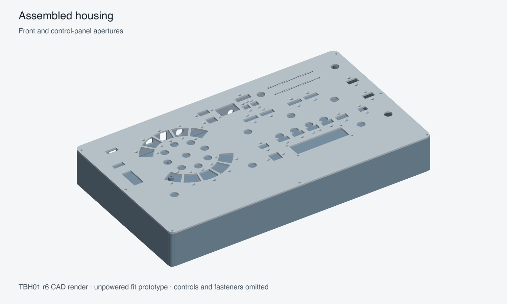
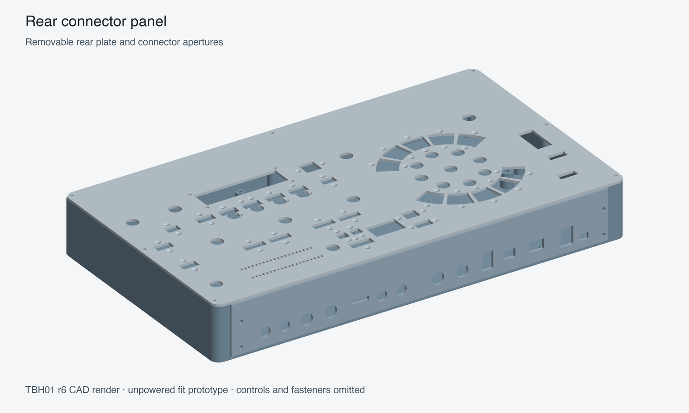
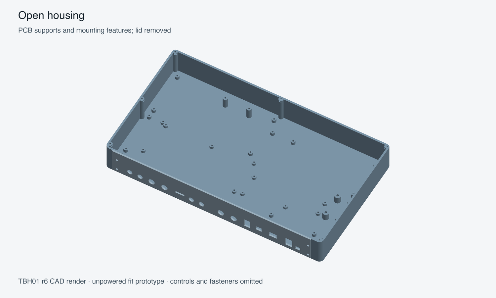
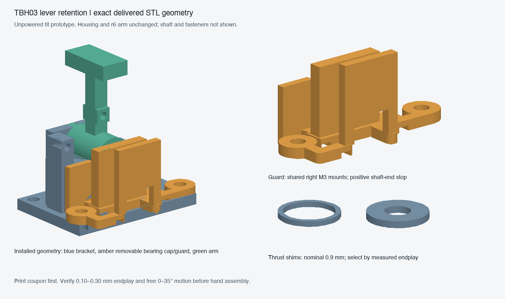

# AFX-1000

[](https://github.com/AxelMcKenna/afx-1000/actions/workflows/build.yml)


**Proprietary — all rights reserved.** Original project code, firmware, PCB and housing designs require a separate written license for reuse, builds, manufacture or redistribution. Public access and build instructions do not grant that permission. Third-party licenses and GitHub's applicable platform permissions remain in effect. See [LICENSE](LICENSE) and [dependency notices](THIRD_PARTY_NOTICES.md).

**AFX-1000** is an RMX-1000-inspired effects processor built around a shared C++20 audio engine, available as a native Mac app, AU and VST3. The standalone hardware design uses **Daisy Seed 3 and two main custom PCBs**—signal and power/protection—in a proposed custom housing.

Use it with rekordbox through app capture or an audio interface. The effects and factory drums are original implementations. Matching the reference unit's sound, timing and full feature set is still work in progress.

## What's in it

- **Scene FX:** BPF Echo, Echo, Noise, Spiral Up, Reverb Up, HPF Echo, LPF Echo, Crush Echo, Spiral Down and Reverb Down.
- **Isolate FX:** three bands, with Isolator, Cut/Add, Trans/Roll and Gate/Drive modes.
- **X-Pad:** four internal drums and four sample banks, 16 bank variants, WAV import, pitch, rolls, hold and overdub.
- **Release FX:** Back Spin, Echo and Vinyl Brake.

Auto BPM, tap tempo, quantized rolls, assignable X-Pad divisions including triplets, MIDI learn, soft takeover and DAW automation are included.

Loop tempo and pitch have separate playback controls. AUTO can follow detected beat phase, and MIDI clock supports Start, Stop, Continue and Song Position Pointer. See [sync](docs/synchronization.md) and [sample stretching](docs/sample-stretching.md) for the implementation limits.

Overdub runs a four-beat pattern. Each bank holds 16 seconds of audio; slot 1 supports BPM-tagged loops. Sample editing includes trim, reverse, normalization and BPM/loop settings. Pad one-shots trigger immediately.

### Latest sound pass

Rebuilt kick, snare, clap and hat voices, with independent gain, decay and envelope choices. Noise now has a resonant filter sweep, shaped modulation and a damped echo return. Faster pitched playback uses a band-limited reader; a linked stereo peak limiter catches output overshoots.

Pitch travel has separate up/down ranges from 1 to 24 semitones. The extra range is a project extension. These changes are implemented, but have not been matched against recordings of an RMX-1000. [DSP notes](docs/dsp-model.md) cover the details and limits.

## Current hardware: two main PCBs

The current standalone design consolidates the earlier eight main boards into **two main custom PCBs**:

- **Signal main:** audio, converter interface, the retained **Daisy Seed 3** module, controls and LED drivers.
- **Power/protection:** supply conversion, inlet and rail protection, monitoring, negative-rail startup and fan health, on a C-shaped board that wraps around the signal-board allocation.

Panel boards and bought-in modules are additional; “two boards” describes the main PCB assembly, not every board in the unit.

**Daisy Seed 3 is retained.** It mounts on the signal PCB in a 40-pin socket. The redesign combines the surrounding audio/control and power/protection circuits into the two main boards.

**The current design is in development and is not ready for fabrication.** The integrated schematics and partial routing are available in KiCad; routing, the ESS codec footprint, manufacturing choices and complete installed housing fit remain unfinished.

| Current board | Functions | Overall size | Checked routing status |
| --- | --- | --- | --- |
| [Signal main](hardware/fabrication/staging/two-board-signal-routed-native-03/signal_main.kicad_pro) | Audio, converter interface, Daisy processor, controls and LED drivers | 268 × 63 mm | 251 open connections; zero geometry/ERC findings; missing ESS codec footprint |
| [Power/protection](hardware/fabrication/staging/two-board-power-monitor-return-planes-native-01/power_protection.kicad_pro) | 12 V supply, inlet, rail protection, monitoring, negative-rail startup and fan health | 320 × 181.1 mm | 2,037 open connections; zero geometry/parity/ERC errors; two retained isolated-reference warnings |

The signal PCB has 466 placed electrical footprints and one unplaced ESS codec. The power PCB has 1,086 electrical components. The latest verified working candidate, **TBP67**, closes five ground connections, including the last four surveyed SN74 logic ground pins. All 75 surveyed SN74 grounds now reach the main ground group. Its audit preserves **2,401 existing reference checks**, all seven quiet-ground networks and nine supply fields. The two DC-input sheets change around fifteen ground vias; their conditional paired resistance rises by 0.6246%, without establishing a current/thermal rating. Four older connector-end reference gaps remain. Across AUX, 73 of 81 IC supply pins still lack regulator connections. See the [TBP67 evidence](hardware/fabrication/staging/two-board-power-monitor-return-planes-native-01/final-review.json); [status-50](hardware/fabrication/staging/two-board-fabrication-status-50/status.json) is an earlier recorded checkpoint.

### Current PCB layouts

These are native KiCad exports of the current copper layouts, with incomplete routing and return paths. The power preview shows TBP67 bottom copper; the linked inner layers contain the updated ground references. Click either image for its native SVG; other layers are linked below.

**Signal main — Daisy Seed 3 and audio/control circuitry**

[](hardware/fabrication/staging/two-board-signal-routed-native-03/plots/front.svg)

[Bottom copper](hardware/fabrication/staging/two-board-signal-routed-native-03/plots/back.png) · [All layers and signal-board evidence](hardware/fabrication/staging/two-board-signal-routed-native-03/README.md)

**Power/protection — C-shaped board, TBP67 control routing and ground returns**

[](hardware/fabrication/staging/two-board-power-monitor-return-planes-native-01/plots/back.svg)

[Front copper](hardware/fabrication/staging/two-board-power-monitor-return-planes-native-01/plots/front.png) · [Bottom copper](hardware/fabrication/staging/two-board-power-monitor-return-planes-native-01/plots/back.png) · [All layers and power-board evidence](hardware/fabrication/staging/two-board-power-monitor-return-planes-native-01/README.md)

### Housing and fabrication status

Start with the [print-first kit](hardware/cad/two_board_print_02/TBH01-r6-print-first-kit.zip) and [print order](hardware/cad/two_board_print_02/README.md): test the four core coupons, then print the tray before the lid. The minimum case uses three one-piece parts or twelve split pieces.

The current [TBH01 r6 housing package](hardware/cad/two_board_print_01/README.md) is available for an **unpowered fit prototype**, with 67 checked STL designs, actual PCB supports, a removable lid and bolted split parts. [Download the print package](hardware/cad/two_board_print_01/TBH01-r6-print-package.zip). The largest split part is **175 × 192.4 × 43.6 mm**, before brim. Printer compatibility and print duration require the actual printer and material.

**Current housing CAD renders** — generated from the delivered r6 STL geometry. Controls and fasteners are omitted; these views show the unpowered fit prototype.

[](docs/assets/hardware/tbh01-r6-front.png)

| Rear connector panel | Open shell and PCB supports |
| --- | --- |
| [](docs/assets/hardware/tbh01-r6-rear.png) | [](docs/assets/hardware/tbh01-r6-open.png) |

[Housing and two-board placement overview](hardware/cad/two_board_print_01/preview-r6.png)

For the lever, use the [TBH03-r5 retention add-on](hardware/cad/two_board_print_03/TBH03-lever-retention-r5.zip) and its [assembly instructions](hardware/cad/two_board_print_03/README.md). Its replacement bracket and removable bearing cap replace the original r6 lever bracket and provide a checked rigid assembly path. Fourteen delivered STLs, fifteen clearance/assembly checks and four retention/stop checks pass independent review. The housing and lever arm remain unchanged.

[](hardware/cad/two_board_print_03/preview-r5.png)

Selector/display/LED/sensor carriers, lever spring and magnet retention, harness integration and operating cooling remain unfinished. The CAD supports use the TBP61 placement snapshot; TBP62–66 preserve those board outlines, mounts and component positions. Both boards use a provisional eight-layer template; the manufacturing stack is not accepted.

Remaining work includes full routing and current returns, approved ESS package/land/stencil inputs, loaded power and startup checks, AUX distribution, installed thermal and assembly qualification, exact BOM and reviewed manufacturing outputs. The [latest power-board review](hardware/fabrication/staging/two-board-power-monitor-return-planes-native-01/README.md) records the current checks; the [fabrication inventory](hardware/fabrication/README.md) retains detailed engineering history.

The [standalone firmware candidate](hardware/firmware/full_engine/README.md) builds the shared DSP engine with 152 parameters, bounded SDRAM storage and control-fault recovery. Full-unit hardware operation remains to be qualified.

## Run it

Requires macOS 12+, Xcode Command Line Tools and CMake 3.24+. The default native app needs no third-party SDK. Ableton Link is optional and disabled by default.

```sh
git clone git@github.com:AxelMcKenna/afx-1000.git
cd afx-1000
./build-app.sh
open build/RMX.app
```

**Cmd+,** opens audio setup. Pick an input and output, then start audio.

Audio setup remembers devices, channel pairs and buffer size. A previously active route can resume on launch when its devices are available. **Stop Audio** disables that automatic resume.

**Space** bypasses. **Esc** resets the effects. **T** taps tempo. **1-4** trigger the pads. Hold **Shift** while dragging for fine adjustments.

### With rekordbox

On macOS 14.2+, select **rekordbox - direct app capture** as the RMX input and choose your speakers or headphones as the output. Start audio, approve macOS capture access if prompted, then play a track in rekordbox.

The capture route mutes duplicate dry playback while active. Stopping it restores normal rekordbox playback. The AU/VST3 versions are for plugin hosts; rekordbox integration uses audio routing.

For an FLX4 or FLX6 with an audio interface:

```text
FLX master RCA -> Interface inputs -> RMX -> Interface outputs -> Speakers
rekordbox cue  -> FLX headphones
```

Physical FLX routing and cue separation still need testing. BlackHole and mixer send/return setups are covered in the [routing guide](docs/routing.md).

## Repository layout

| Directory | Purpose |
| --- | --- |
| `src/`, `include/` | Shared audio engine, public headers and native/plugin adapters |
| `firmware/`, `hardware/` | Embedded targets, electronics, mechanics and qualification evidence |
| [`tools/`](tools/README.md) | Audio tools grouped by effect, C++ probes, command-line utilities and packaging |
| [`tests/`](tests/README.md) | Separate core, audio, hardware, packaging and tooling suites |
| `research/` | Investigations, experiment sources and recorded measurements |
| `docs/`, `assets/`, `prototypes/` | Guides and review records, product assets and earlier UI prototypes |

Former source paths are listed in the [migration index](docs/path-migrations.json). Build outputs and large local artifacts remain under ignored `build*/` directories.

## Build

### Python tooling

Install [uv](https://docs.astral.sh/uv/getting-started/installation/), then run from the repository root:

```sh
uv sync --locked
uv run --locked python -m unittest discover -s tests/tooling
uv run --locked python -m unittest discover -s tests/hardware -p 'a*_integration_tests.py'
```

uv uses Python 3.12 from `.python-version` and creates an ignored `.venv/`. The root `pyproject.toml` declares NumPy, Pillow, SciPy, Shapely and trimesh; `uv.lock` pins the resolved environment. Run Python tools with `uv run --locked python ...`. Use `uv add <package>==<version>` to change a pinned dependency, and commit both project metadata and the lockfile.

Configure CMake through `uv run --locked cmake ...` so its Python tests use this environment. An existing CMake build may retain a previously selected interpreter; use a fresh build directory or explicitly set `-DPython3_EXECUTABLE=/absolute/path/to/.venv/bin/python` when reconfiguring.

The six hardware `requirements.txt` files remain frozen dependency snapshots referenced by historical source hashes. New development and CI use the root uv project. OpenSCAD, KiCad and the ARM toolchain remain separate native dependencies; checks that need KiCad's `pcbnew` module still use KiCad's own Python interpreter.

<details>
<summary>AU, VST3 and JUCE standalone</summary>

```sh
cmake -S . -B build-plugins \
  -DCMAKE_BUILD_TYPE=Release \
  -DRMX_BUILD_PLUGINS=ON
cmake --build build-plugins --parallel 4
```

Fetches JUCE 8.0.6. Use `-DRMX_JUCE_PATH=/path/to/JUCE` for a local checkout. Outputs are in `build-plugins/RMXPlugin_artefacts/Release/`.

For a universal Mac build, use a fresh build directory and add `'-DCMAKE_OSX_ARCHITECTURES=arm64;x86_64'`. Distribution signing and notarization need your Apple credentials. The native build script signs ad hoc for local use.

JUCE's license applies to distribution of the plugin builds.

</details>

<details>
<summary>Core, checks and offline rendering</summary>

The core builds on macOS and Linux, independently of the UI.

```sh
uv run --locked cmake -S . -B build -DCMAKE_BUILD_TYPE=Release
cmake --build build --parallel 4
ctest --test-dir build --output-on-failure
./build/rmx_benchmark
./build/rmx_render input.wav output.wav "assets/presets/Spiral Build.rmx"
```

The renderer's preset argument is optional. Benchmarks measure DSP time, not physical audio latency.

To render 21 drum/pitch/roll and Noise audition clips without opening an audio device:

```sh
cmake --build build --target rmx_sound_preview --parallel 4
./build/rmx_sound_preview build/sound-audition
```

Choose a new output directory each time. These clips use the current engine; they are not recordings of the original hardware.

</details>

## Status

| Area | Current state |
| --- | --- |
| Native Mac audio | Direct rekordbox capture and speaker output have worked in a live session. The latest saved-route/restart behavior still needs a live check. |
| AU / VST3 | Build locally. Earlier universal artifacts include Apple Silicon and Intel slices; the latest sound review builds are arm64. Full DAW validation and Intel runtime checks remain open. |
| Engine and firmware | F06 records 16 passing host groups and clean ARM builds for onboard and external-converter profiles. The source snapshot also records five focused sanitizer groups. Actual MCU timing and hardware operation remain unverified. |
| Synchronization | AUTO, tap, host transport and MIDI clock are implemented. Optional Link builds and controlled local peer tempo/phase checks pass; live rekordbox and audio-loopback alignment remain unverified. See [sync](docs/synchronization.md). |
| Sound matching | Latest drum/Noise changes are ready for listening. No reference-unit comparison or claim of identical effects. |
| Live use | Physical FLX4/FLX6 routing, cue separation, a live two-hour soak and measured round-trip latency remain open. |

The engine uses stereo floating-point audio and preallocated processing buffers. The core audio callback does no allocation, locking, file I/O or UI work. Signal checks cover 44.1, 48, 88.2 and 96 kHz. Results belong to the revisions and configurations documented in [validation](docs/validation.md); they do not establish MCU deadlines or hardware-equivalent specifications. See [specifications](docs/specifications.md) for the remaining measurements.

### Earlier hardware variants

The [B1 5 V budget prototype](hardware/budget/README.md) and [A0.2 higher-headroom carrier](hardware/electrical/README.md) are separate, earlier designs. Their board layouts, enclosure files, cost estimates and draft fabrication outputs apply only to those variants. The current two-main-board design is described above; earlier development checkpoints remain in the [fabrication inventory](hardware/fabrication/README.md).

**No hardware has been ordered or assembled.** Audio performance, relay fault timing, power/thermal behavior, card I/O and physical fit remain unmeasured. Draft fabrication files are not a production release. Start with the [hardware guide](hardware/README.md) and [clone roadmap](docs/clone-roadmap.md).

```sh
./build/rmx_memory_budget
uv run --locked python tools/generate_hardware.py --check
./build/rmx_card_export Performance.rmx /path/to/new-card-folder
```

The exporter writes the project's card layout. `--settings-only` exports User settings without needing audio files; `--samples-only` exports samples. Original RSD/SD interoperability, USB MIDI, live card insertion and complete lighting feedback remain unfinished. See the hardware guide for supported formats and calibration instructions.

## Reference

[Controls](docs/controls.md) / [Routing](docs/routing.md) / [Specifications](docs/specifications.md) / [Validation](docs/validation.md) / [Hardware](hardware/README.md) / [Roadmap](docs/clone-roadmap.md)

[Mac packages](docs/release.md) / [Reference captures and runtime checks](docs/reference-validation.md) / [Engineering update](docs/engineering-update-2026-10-22.md)

The historical browser prototype is kept in `prototypes/web/`. Its guide is [here](docs/legacy-prototypes.md). The retired Swift prototype is available in Git history.

## Assets and licensing

Original project material is covered by the [AFX-1000 Proprietary Rights Notice](LICENSE), copyright 2026 Axel McKenna, all rights reserved. It covers the project's original software, firmware, legacy prototypes, PCB and mechanical design files, documentation and assets to the extent the owner holds the relevant rights. Reuse, personal builds, manufacture and redistribution require separate written permission, subject to the exceptions in the notice.

Factory drums and the current panel artwork are made by this project. The native and plugin interfaces use a panel generated from [drawing code](tools/assets/generate_panel.mm), with no manufacturer photograph in current builds. Third-party software, footprints and other supplied material retain their own terms. JUCE and optional Link need a compatible licensing route for distribution; the project notice does not override their copyleft obligations. See [source and dependency notices](THIRD_PARTY_NOTICES.md).
