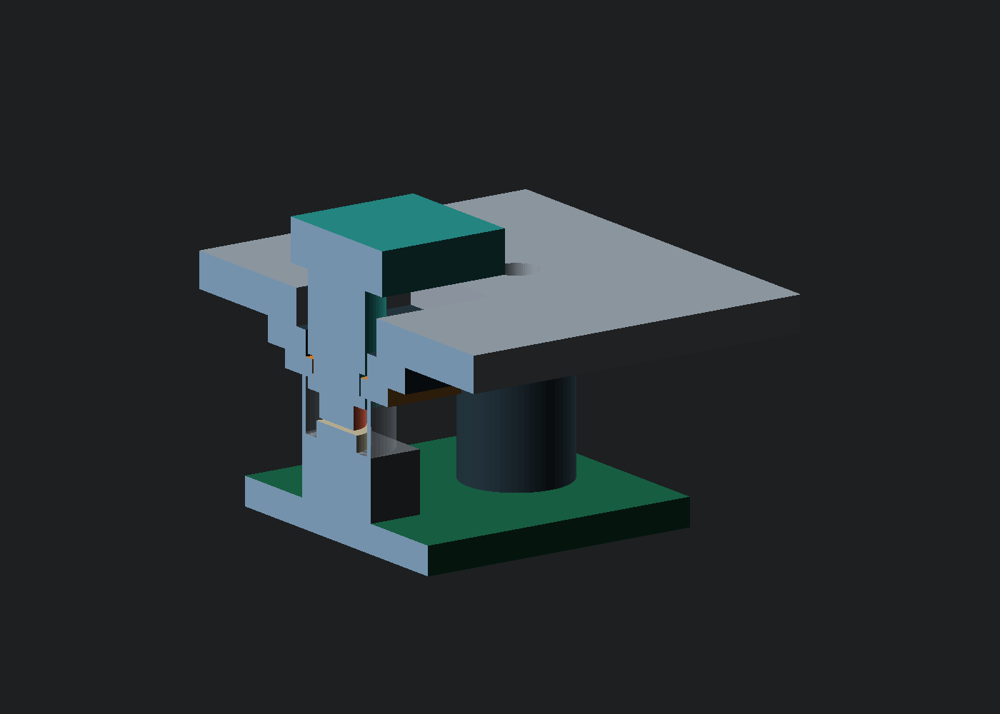
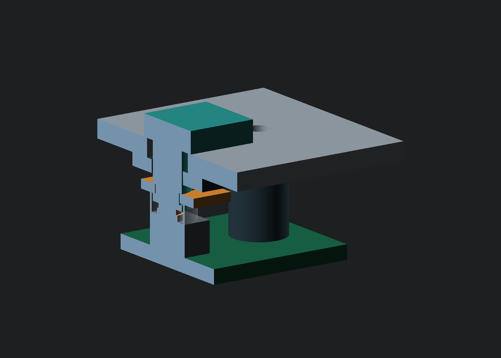

# B01 guided button fit kit

This kit tests the button stack against the selected B3F-1000 switch. It adds two
cap sizes, a D-shaped stem, retaining clip, return-spring reserve, compliant
contact and a positive travel stop. It has **not been printed, assembled or
force-tested** and is not yet installed across the A02 control surface.

The transparent cylinder is the spring's envelope. The red silicone shape only
illustrates contact/compression geometry; it is not a material or force simulation.

## Parts

| Hard part | File | Per fixture |
| --- | --- | ---: |
| Pad key, 15 × 8 mm | `button-key_pad.stl` | 1, or nudge key |
| Nudge key, 9 × 8 mm | `button-key_nudge.stl` | 1, or pad key |
| Matching 2 mm sample panel | `button-panel_pad.stl`, `button-panel_nudge.stl` | 1 |
| Guide, total clearance | `button-guide_020.stl`, `button-guide_040.stl`, `button-guide_060.stl` | 1; trial all three |
| Retaining C clip | `button-clip.stl` | 1 |
| Switch PCB | [Native KiCad project](../electronics/button_test/README.md) | 1 |

All eight STLs passed closed-mesh, winding, positive-volume and connectivity
checks. The [motion record](generated/button-solid-validation.json) checks the
continuous rigid sweep against guide/panel through 1.2 mm. It excludes 0.01 mm
at intended stop faces, switch/silicone contact, spring, fasteners and printed
fit. It does not prove actuation.

STLs place flat print faces at Z=0: key face down, guide plate down with posts
upward, clip/panel flat. Trial PETG or an appropriate nylon process and measure
the result. Check the clip's thin snap mouth for damage, retention and fatigue.
Repeat the test with the intended 2 mm metal panel before accepting stop wear
or feel; the printed panel is an initial motion coupon.

Additional parts:

- One B3F-1000 on the 1.6 mm test board.
- Two M2 × 16 screws, nuts and small washers. The guide bores are clearances.
- One Ø3 × 2 mm soft silicone contact, initially trial approximately 30 Shore A,
  punched from sheet. Supplier, compression curve and final hardness are open.
  Do not replace this compliant contact with a rigid printed pin.
- A compression spring **selection/custom specification**, not an orderable
  part: OD ≤6.0, ID ≥5.4, free length near 4.5, solid height ≤1.2 mm, rate near
  0.2 N/mm, stable closed bearing ends. Verify a supplier drawing and permitted
  working deflection before assembly. It surrounds the stem and seats on the
  switch's metal cover; seat alignment and cover loading need a physical test.

The independent spring returns the cap to its retaining stop, taking up the
small gap above the switch. The switch alone cannot return a cap across that
gap. The D guide controls rotation; the clip carries return force at the upper
stop. After 1.2 mm depression, the cap underside contacts the panel to take
further finger load.

## Stack and adjustment

The [manufacturer drawing, pages 3–4](https://omronfs.omron.com/en_US/ecb/products/pdf/en-b3f.pdf)
specifies 4.3 ±0.2 mm height, 0.15–0.45 mm pretravel and 0.69–1.27 N operating
force. Its unqualified 3.4 mm case dimension uses the general ±0.4 tolerance.

Panel underside is local Z=0; panel top +2; PCB top −8.8; nominal actuator top
−4.5. The rigid stem ends at −3; the silicone extends to −4.3, giving 0.2 mm
nominal gap. Cap underside starts at +3.2 and meets the panel after 1.2 mm.
At that stop, the rigid stem nominally clears the tallest unpressed actuator
by only 0.1 mm. **Printed, PCB and panel tolerances still need measurement.**

The spring's nominal preloaded heights are 3.0 mm at rest and 2.0 mm pressed:
the clip takes up 0.2 mm of groove play before moving down. The clearance screen
also covers the clip's lowest allowed position, 1.8 mm spring height. Case
tolerance alone can reduce that bound to 1.4 mm, so the solid-height target is
≤1.2. Nominal return-force targets are 0.30–0.50 N before friction. These are
selection calculations, not measured forces.

The [stack calculation](generated/button-stack.json) preserves those limits.
It does not sum unknown print, panel, PCB and silicone tolerances. The contact
must close the switch before the cap stop and absorb remaining travel. The
switch-only worst-case calculation calls for ≥3.63 N/mm contact stiffness;
Shore hardness alone does not establish that value.

If preload occurs, lower the PCB with measured insulating shims between the
board and guide posts. Remeasure closure and return: shims also change actuator
travel and spring compression. Do not trim parts before measuring the stack.

At housing panel datum Z=34, this fixture puts PCB top at Z=25.2. A02 switch
reserves currently use Z=27.2. Applying this mechanism across all 29 controls
requires revised board/support heights and complete clearance checks. Scene
wedges, illumination and the production carrier remain separate work.

## Assemble and measure

1. Solder the switch and two test leads/header to the checked PCB. Confirm that
   each same-row pair is common and the two rows join only on press.
2. Insert the key from above the matching panel and guide. Fit the silicone
   contact into its blind pocket and slide the clip into the groove from below.
3. Place the selected spring around the stem, align the switch under it and
   clamp the PCB to both guide posts. Keep the spring off all terminals.
4. Check free return. Connect continuity leads, or a pulled-up 3.3 V logic input
   and ground. The switch must remain open at rest. Press center and corners.
5. Record closure stroke, force/displacement, travel remaining to the cap stop,
   return force, friction, rocking, clip retention and reliable release.
6. Repeat presses/off-axis holds, inspect wear and repeat with the real metal
   panel. Establish a force/cycle acceptance target before reproducing the stack.

## Regenerate

    python3 -m hardware.cad.button_fixture
    build-cad-tools/bin/python hardware/cad/button_render.py --openscad /path/to/openscad
    python3 -m hardware.electronics.button_test.generate
    python3 -m hardware.electronics.button_test.verify --kicad-cli /path/to/kicad-cli

Cap dimensions come from the existing front-panel schedule. Mesh dependencies
are the same as the A02 enclosure. The PCB has its own native electrical/layout
checks and exported-net verification.
