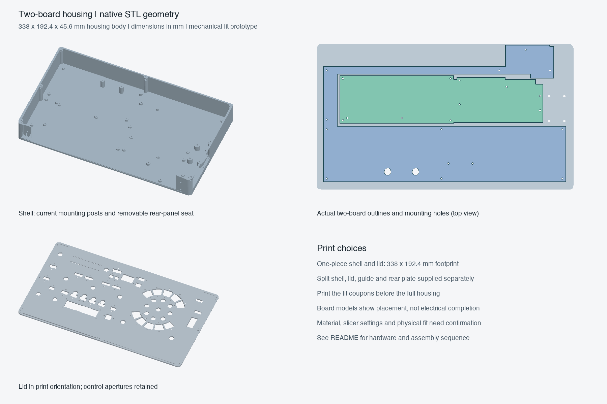
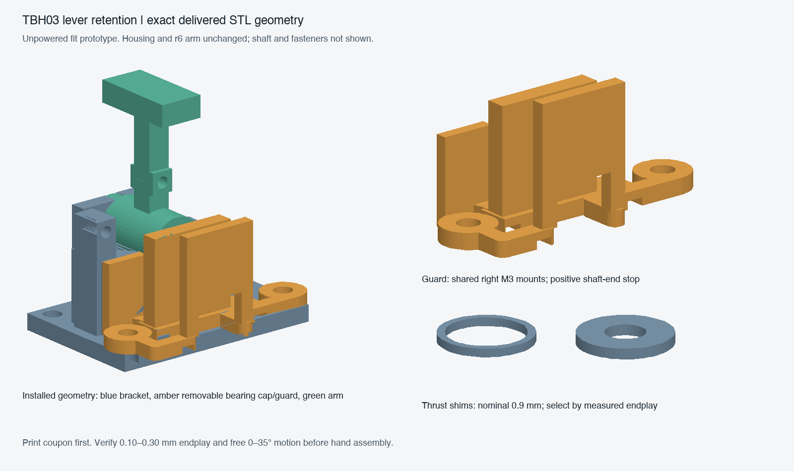

# Enclosure and control CAD

Use the [unified assembly workflow](assembly_workflow/README.md) for current integration: one component registry, one scene entry point, KiCad mechanical freshness and affected-check caching. Run `./hardware/cad/assembly_workflow/run status` from the repository root.

Current completion work adds [BPM/selector carriers and breakout boards](two_board_controls_04/README.md),
a [sensor carrier and spring assembly](two_board_sensor_05/README.md), and an
[external fan-pod alternative](two_board_installation_06/README.md).
[Combined addon checks](two_board_integrated_07/README.md) verified the corrected sensor clamp
against the scene-depth pot allocation, and the corrected ribbon now clears the conditional panel connector receiving boxes. The final fan routes clear the
controls and guide; complete harness integration and physical/thermal acceptance
remain open. They do not
silently replace the sealed r6 print package below.

Start with the [print-first kit](two_board_print_02/TBH01-r6-print-first-kit.zip) and [minimum print list](two_board_print_02/README.md). Its small core-coupon layout checks the critical fits before the full case print; the sealed r6 housing geometry is unchanged.

## Current two-board print package

Use [TBH01 print instructions and files](two_board_print_01/README.md) for the current two-board housing. It includes one-piece and split shell, lid, rear plate and guide exports, current PCB supports, captive lid fasteners, joining hardware and fit coupons. The body is 338 × 192.4 × 45.6 mm; the largest split shell footprint is 175 × 192.4 mm before adding a brim.

The current geometry is for an **unpowered physical fit prototype**. Selector, display/LED and angle-sensor carriers remain unfinished. Printer/material settings, actual hardware tolerances, complete wiring and operational cooling still require verification. Mesh integrity and modeled clearance checks do not establish electrical or thermal readiness.



## Current lever retention add-on

Use the [TBH03-r5 lever retention ZIP](two_board_print_03/TBH03-lever-retention-r5.zip) and [assembly/print instructions](two_board_print_03/README.md) with the r6 housing. Its replacement bracket and removable right-bearing cap resolve rigid arm insertion and positively retain the steel pivot. Use this bracket instead of the original r6 lever bracket; the r6 housing and arm remain unchanged.

Print the small pivot coupon first, then the bracket, cap and selected left/right thrust shims. The default pair is 0.9 mm, accepted only after measuring free endplay. The largest add-on part is 49 × 17 mm before brim. The package includes exact hardware specifications, a demonstrated horizontal assembly sequence, editable sources and [independent verification](two_board_print_03/independent-review.json): 14 valid delivery meshes, 15 empty clearance/path checks and four positive retention/stop checks. This completes the modeled lever retention for the unpowered fit prototype; the other carrier and operational qualifications above remain open.



## Earlier A07 design

The files below retain the earlier standalone housing, lever mechanism, control layout and component reserves. A07 reads the output, input-hub, processor-carrier, LED-driver and E23 power-input placement records. Its historical checks do not qualify the current two-board housing; see the current package above and the [validation record](../validation/README.md).

### Earlier files

| Location | Purpose |
| --- | --- |
| `enclosure.scad` | Housing, panel, rear plate, mounts and assembly views |
| `mechanisms.scad` | Lever, touch backer and fit coupon |
| `generate.py` | Control coordinates, apertures and parameter schedule |
| `standalone.py` | Board/component reserves, fixing bounds and rear I/O |
| `input_power.py` | Actual E23 profile/footprints, inlet/switch bounds and rear-panel alignment |
| `render.py` | Mechanical exports, mesh/motion checks and preview generation |
| `button_fixture.scad`, `button_fixture.py`, `button_render.py` | [Button-fit fixture](BUTTON-FIT.md) |
| `generated/*.scad`, `*.svg`, `controls.csv` | Small generated coordinates and review drawings |
| `generated/*validation.json`, `internal-clearance.json` | Verification records |
| `../../build/artifacts/cad/` | Ignored STL, DXF and PNG exports |
| `../../docs/assets/hardware/` | Selected, tracked documentation previews |

The [dated CAD design notes](../../docs/hardware/history/2026-10-23-cad-design.md) retain dimensions, allowances and the earlier placement discussion. Component investigations live in [research](../../research/hardware/components.md). Review ZIPs are listed in the [release catalog](../releases/README.md).

## Earlier A07 regeneration

Run from the repository root with the [uv environment](../../README.md#python-tooling), KiCad and OpenSCAD installed:

```sh
uv sync --locked
uv run --locked python -m hardware.cad.generate
uv run --locked python -m hardware.electronics.output_stage.generate
uv run --locked python -m hardware.electronics.output_stage.place --kicad-cli /path/to/kicad-cli
uv run --locked python -m hardware.electronics.output_stage.route
uv run --locked python -m hardware.electronics.output_stage.check_placement --kicad-cli /path/to/kicad-cli
uv run --locked python -m hardware.electronics.control_inputs.generate
uv run --locked python -m hardware.electronics.control_inputs.board --kicad-cli /path/to/kicad-cli
uv run --locked python -m hardware.electronics.processor_carrier.generate
uv run --locked python -m hardware.electronics.processor_carrier.board --kicad-cli /path/to/kicad-cli
uv run --locked python -m hardware.electronics.processor_carrier.verify --kicad-cli /path/to/kicad-cli
uv run --locked python -m hardware.electronics.control_inputs.verify --kicad-cli /path/to/kicad-cli
uv run --locked python -m hardware.electronics.led_driver.generate
uv run --locked python -m hardware.electronics.led_driver.place --kicad-cli /path/to/kicad-cli
uv run --locked python -m hardware.electronics.led_driver.route
uv run --locked python -m hardware.electronics.led_driver.cleanup --kicad-cli /path/to/kicad-cli
uv run --locked python -m hardware.electronics.input_protection.generate
uv run --locked python -m hardware.electronics.input_protection.place --kicad-cli /path/to/kicad-cli
uv run --locked python -m hardware.electronics.input_protection.route
uv run --locked python -m hardware.electronics.input_protection.cleanup --kicad-cli /path/to/kicad-cli
uv run --locked python -m hardware.electronics.input_protection.check_board --kicad-cli /path/to/kicad-cli
uv run --locked python -m hardware.electronics.power_supply.verify --kicad-cli /path/to/kicad-cli
uv run --locked python -m hardware.electronics.input_protection.verify --kicad-cli /path/to/kicad-cli
uv run --locked python -m hardware.electronics.rail_disconnect.verify --kicad-cli /path/to/kicad-cli
uv run --locked python -m hardware.electronics.led_driver.verify --kicad-cli /path/to/kicad-cli
uv run --locked python -m hardware.cad.standalone
uv run --locked python -m hardware.cad.render --openscad /path/to/openscad
```

Refresh `power_supply`, `input_protection` and `rail_disconnect` verification in
that order before E20 verification when their source fingerprints differ. The
[E20 guide](../electronics/led_driver/README.md) records its unclosed power
allocation and unfinished front-panel emitters/harnesses. The housing includes
four E20 M2 insert bosses and conditional component/tail/harness envelopes;
those bounds do not qualify selected parts or physical assembly.

A07 adds four input-board M2 insert bosses, profile reliefs around the rear web
and output-stage parts, a rectangular jack-body aperture and a lower power-switch
slot. The nominal jack face reaches the rear plate outer plane. The native input
collision check includes the rear plate and the complete allocated actuator sweep.
Plug mating, switch access/feel, exact part tolerances, insert/screw selection and
physical fit remain unqualified. Main rail-generation/disconnect PCBs and complete
analog/control placement still do not fit by inference from the generic power reserve.

Meshes and previews are written to `build/artifacts/cad/`; small verification records remain in `hardware/cad/generated/`. Add `--update-previews` to copy the selected PNGs into the tracked documentation after a successful render. The button renderer supports the same option. Documentation previews represent their last reviewed snapshot.

The rendering checks require the OpenSCAD backends used by the model. Their recorded scope and version are in the generated validation JSON. Mesh closure, clearances and source-level checks remain separate from a physical print or full-unit fit test.

The [conditional panel ground-chain amendment](two_board_controls_04/panel_ground_amendment/README.md) updates the 29 switch terminal notes for the r12 electrical topology. It passes strict native ERC and exact panel netlist parity; formed wire routes remain under development.
