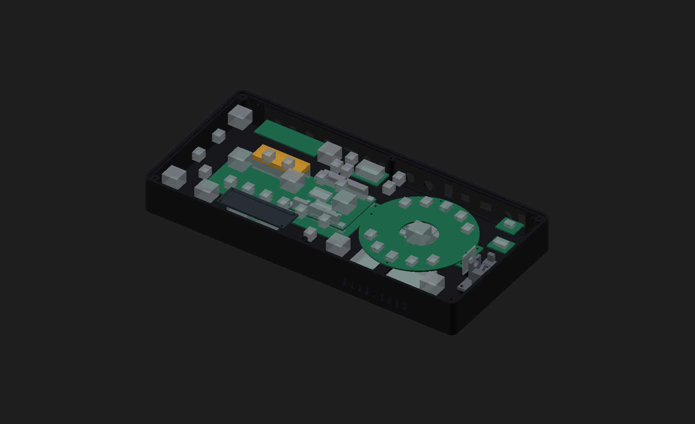
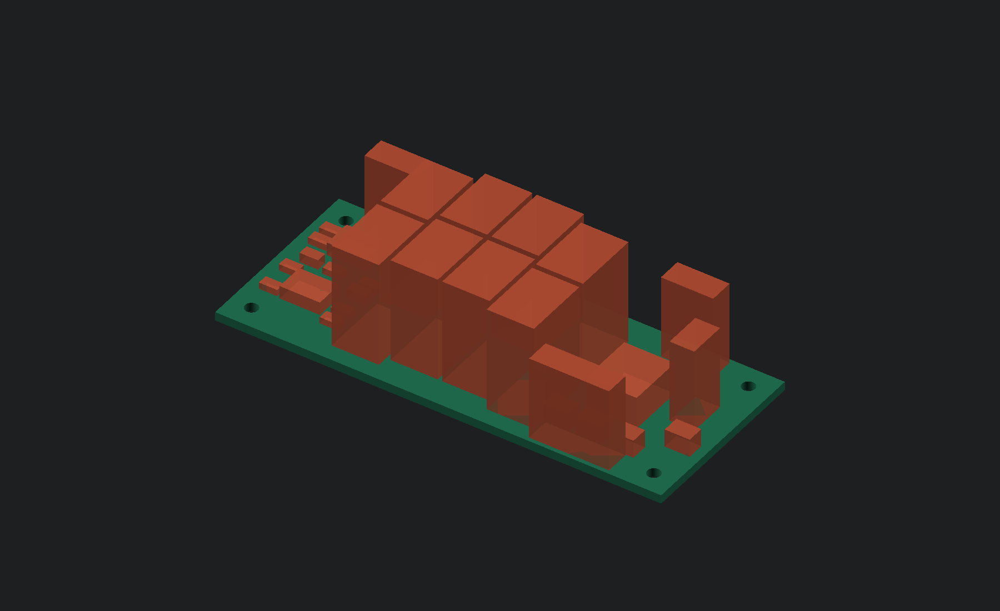

# Standalone housing and controls - A04 / E07 / E18

The physical unit is a standalone stereo effects processor. The RMX-style layout
includes a removable rear I/O plate, processor/power reserves, routed output and digital-input
PCBs, mounting bosses, optical apertures, a draft release mechanism and ventilation.




This is a prototype design, not a fabrication release. The seven exported
mechanical parts passed closed-mesh, winding, connectivity and positive-volume
checks. The lever's conservative swept envelope clears the modeled housing,
bracket and named component reserves. Springs, fasteners, wiring, printed fit,
board layout, analog performance and thermal behavior still need verification.

E07 places all 41 output-stage footprints on an 82 × 34 mm native KiCad board.
A03 lowers that board, recesses the floor and uses staggered film capacitors.
The actual-PCB-derived component/solder envelopes clear the modeled shell,
controls, conservative switch leads and scene PCB. The output board is routed,
with a saved AGND plane and zero native DRC/parity issues or open connections.
The converter/input and final power circuits still need
placement, so this is not proof that the complete electronics fit.

[E18](../electronics/control_inputs/README.md) adds a routed64 ×54mm digital
input hub above the processor-carrier reserve. Its15 circuit components,
four mounting holes,32 front inputs and four rear/status inputs pass native
ERC/DRC/parity with zero open connections. Actual PCB courtyards, THT lead
bounds, connector allocations and spacer/screw-head bounds are now part of
A04's241-reserve model. The [F04 map](../firmware/control-inputs.json) retains
logical control order and avoids the MCP23017's output-only GPA7/GPB7 pins.


The hub uses nominal4mm spacers, with board seat Z=12.1mm. Matching processor-
carrier holes and routing keepouts are proposed, not implemented on a routed
carrier. Connector/harness height11mm, maximum3mm trimmed solder/lead
protrusion, spacer/screw sizes and stated assembly allowances still need exact
parts and physical qualification. This models the digital input hub; pots,
LED drivers, touch electrodes and the angle-sensor board remain unfinished.

E08–E17 converter, analog-input, sequencing, monitoring and power circuits are
still outside this placement. That includes E17's six bulk capacitors and12
FETs, E14's inductors/regulators, and the E09 codec with its unresolved land
pattern. The complete electronics, cooling and wiring have no fit approval.
The current [A04/E18 review package](generated/standalone-review-A04-E18.zip)
includes F04 firmware, the routed input hub and updated CAD evidence.



## Source and generated files

| File | Purpose |
| --- | --- |
| `enclosure.scad` | Base, lid, rear panel, mounts, optical openings and assembly |
| `mechanisms.scad` | Lever bracket/rotor, touch backer and 90 x 60 mm fit coupon |
| `generate.py` | Front control positions, apertures, graphics and parameter schedule |
| `standalone.py` | Internal component reserves, board outlines, mounts and rear I/O |
| `render.py` | Solid export, mesh checks, lever sweep check and review image generation |
| `generated/panel-layout.svg` | Dimensioned front layout |
| `generated/panel-apertures.svg` | Nominal 1:1 lid outline and aperture study |
| `generated/rear-layout.svg` | Standalone rear connector/control layout |
| `generated/controls.csv` | Control centers, cap dimensions and software mappings |
| `generated/panel.dxf` | CAD-oriented panel contours; no tooling compensation |
| `generated/*.stl` | Seven prototype mechanical parts, in millimetres |
| `generated/solid-validation.json` | Actual export and conservative motion-check results |
| `generated/internal-clearance.json` | Named component/port reserve check results |
| `../electronics/output_stage/output_stage.kicad_pcb` | E07 routed output subassembly; full system and physical audio incomplete |
| `../electronics/output_stage/generated/placement.json` | Actual PCB-derived body/solder bounds and mounting datum |
| `../electronics/control_inputs/control_inputs.kicad_pcb` | E18 routed digital input hub |
| `../electronics/control_inputs/generated/placement.json` | Actual input-hub body/lead/mounting bounds |

Related: [standalone architecture](../README.md), [component shortlist](../components.md),
and the physical control dispatcher in `include/rmx/HardwareControls.h`.

## Regeneration

```sh
python3 -m venv build-cad-tools
build-cad-tools/bin/python -m pip install -r hardware/cad/requirements.txt
python3 -m hardware.cad.generate
python3 -m hardware.electronics.output_stage.generate
python3 -m hardware.electronics.output_stage.place --kicad-cli /path/to/kicad-cli
python3 -m hardware.electronics.output_stage.route
python3 -m hardware.electronics.output_stage.check_placement --kicad-cli /path/to/kicad-cli
python3 -m hardware.electronics.control_inputs.generate
build-cad-tools/bin/python hardware/electronics/control_inputs/board.py --kicad-cli /path/to/kicad-cli
python3 -m hardware.electronics.control_inputs.verify --kicad-cli /path/to/kicad-cli
python3 -m hardware.cad.standalone
build-cad-tools/bin/python hardware/cad/render.py --openscad /path/to/openscad
```

Most generators use the standard library. E18 routing uses numpy; mesh
validation additionally uses trimesh and numpy. OpenSCAD 2026.10.15 was used for this revision. Printed parts
use its CGAL backend: the snapshot's Manifold exporter left zero-thickness
remnants at some coplanar junctions. The exported files themselves are checked;
a successful renderer return is not accepted as proof of a valid mesh.

In OpenSCAD, choose `part` to inspect/export a component. Set `show_internals=true`
and `show_panel=false` to inspect placement. `lever_angle` spans 0-35 degrees;
`exploded=20` separates the lid and visible caps. Most caps are still visual
reference bodies. The lever rotor/bracket and fit coupon are separate solids.

The SVG drawing uses layout coordinates: rear-left origin, X right, Y toward the
performer. Exported Cartesian CAD uses `Y = 157 - layout_Y`, so front is Y=0 and
rear is Y=157. This keeps the top view consistent with the SVG while using a
right-handed XYZ coordinate frame with Z up.

## Dimensions

| Feature | A04 nominal dimension (mm) |
| --- | --- |
| Body | 334 x 157 x 36 |
| Corner radius | 7 |
| Shell wall / floor | 2.8 / 2.8 |
| Inset top panel | 327.8 x 150.8 x 2; corner radius 3.9 |
| Panel seat / side gap / seat overlap | Z=34 / 0.3 / 1.5 |
| Top mounting | Six diameter 3.4 clearances at layout X=8,167,326 and Y=8,149 |
| Top screw bosses | Diameter 8.4, provisional diameter 2.5 pilot |
| Rear removable panel | 310 x 30 x 1.6; extends 1.6 behind the body |
| Rear opening | X=26..308, Z=3.8..31; side webs support four panel screws |
| Rear mounting | X=20,314; Z=8,28; diameter 3.4 |
| Pot mounting clearance | Diameter 9.3 for the selected M9-bushing family |
| Isolator / Scene cap diameters | 29 / 32 |
| Small cap diameters | 16 or 17; check actual washer visibility |
| Scene wedge cap annuli | R35..52, five segments above and five below |
| Touch strip visible area | 68 x 18; separate nonconductive cover/electrodes required |
| Release pivot | Layout (316,82,24); 3 mm shaft; 35-degree pull |
| Fit coupon | 90 x 60 x 2 |
| E07 output board | 82 × 34 × 1.6 at layout (206,40), seat Z=3.8 |
| E07 mounting holes | Ø2.4 at board-relative (4,4), (78,4), (4,30), (78,30) |
| E07 mounting bosses / insert bores | Ø7.2 bosses; Ø3.2 through bores for CNC Kitchen M2 × 3 inserts |
| Internal floor pocket under E07 | 81 × 33 at (206.5,40.5); remaining floor Z=1.6, bosses preserved |
| Rear audio connector axes | Z=13.2, lowered 0.8 to clear conservative Auto-switch leads |
| Revised upper scene-board support | Layout (234,28), clearing Scene-2 switch leads |
| E18 input hub |64 ×54 ×1.6, at layout(111,43), seat Z=12.1 |
| E18 mounting |Ø2.4 at relative(4,4),(60,4),(4,50),(60,50);4mm spacers on carrier |

Feet are not yet modeled; a later 3 mm foot would give about 57 mm overall height
including the tallest cap/pointer. The existing image asset and [Pioneer DJ's
published reference dimensions](https://forums.pioneerdj.com/hc/en-us/articles/204673769-PIONEER-ANNOUNCES-THE-NEW-RMX-1000-REMIX-STATION)
set the approximate footprint. Internal construction is this project's design;
no original-unit mounting dimensions were measured.

The separate [B01 guided button fit kit](BUTTON-FIT.md) now provides two key
sizes, a retaining clip, three guide clearances and a passive switch test PCB.
Its eight additional hard-part meshes and rigid sweeps pass. The spring/contact
materials and physical operation remain unverified; it is not installed across
the full enclosure assembly.

## Placement and mechanism checks

The Python check covers241 named board/component/lead/port/mounting reserves, shell
mounting bosses and carrier/lever mounts. It checks conservative boxes. E07 uses
actual footprint positions/courtyards with documented height and assembly bounds;
E18 adds the digital input hub in the same way. The native control-clearance
intersection includes the base/panel, other boards, switch/lead reserves and
scene-board allowance. These are not complete manufacturer STEP models. Other board outlines remain
placement proposals. E07 adds routed copper without changing the board outline
or enclosure mounts; R10 moves within the existing component area.
PCB-mounted switches touch their mounting planes intentionally; wiring exits,
headers, fasteners and any detail beyond the listed reserve must be added before
fabrication.

The [E05/E07 output circuit and routing](../electronics/output_stage/README.md)
uses eight film capacitors with 18 mm nominal bodies. Their 18.5 mm maximum
case-height assumption, ≤0.5 mm seating, PCB/seat tolerance and expanded XY
reserves are now modeled. The maximum reserved top is Z=24.71; the scene-board
underside check includes a downward allowance to Z=25.4. Underside parts and
trimmed solder/lead protrusions must meet the placement packet's height limits.
Headers include a provisional handoff reserve; complete wiring is not verified.

The shallow pocket leaves a 1.6 mm floor under the output board. Bosses retain
full material and use through bores, so a blind-hole depth allowance is not
assumed. Fit four CNC Kitchen M2 × 3 inserts flush and use M2 × 4 board screws;
actual printed bore fit, insertion, floor stiffness, torque and engagement need
physical checks before committing to final enclosure fabrication.

The lever sweep expands each convex moving piece by at least 0.1 mm and hulls
adjacent one-degree poses. The chord error at radius 25 mm is below 0.001 mm.
An empty intersection against the modeled stationary geometry is recorded in
`solid-validation.json`. This establishes modeled clearance through 0-35 degrees;
it does not establish spring clearance, spring force, bearing wear or assembly fit.

The shaft bore is diameter 3.2; the radial diameter 2.5 pilot is tapped M3 for a
grub screw. A nonmagnetic shaft/collar and a diametrically magnetized disk are
needed for the AS5600. The magnet pocket is separate from the blind shaft bore.
The left printed journal needs a fit/wear test. Retention, washers, end play and
the exact return spring remain mechanical gates.

The fit coupon has a pot hole, button aperture, strip-window aperture and four
pivot-bore trials (3.0, 3.1, 3.2, 3.3). Use the separate B01 kit for the guided
button stack and electrical closure test before making all 29 controls.

## Standalone controls and I/O

There are 43 front inputs and one display: ten rotary controls, 29 momentary
buttons, two maintained selectors, a touch strip and a release lever. The rear
adds bypass, level-mode and power controls, stereo RCA/TS input/output, microSD,
service USB and DC input. RCA, USB, DC and switch openings are reserves awaiting
exact parts. Audio gain and the DC supply voltage remain circuit-design decisions.

`HardwareControls.h` implements the front behavior without MIDI: source toggles,
Scene selection/bypass, depth enabling on motion, tap/nudge, selected-pad rolls,
Hold, bank cycling, release return and 96 LED/display channels. Short Overdub and
Hold actions occur on release; holding for 700 ms clears/stops recording or mutes
the sampler respectively. Input scanning, calibration, storage, hardware drivers
and the embedded audio adapter are still being developed.

Print the panel drawing at 100% and verify its 334 mm dimension before checking
hand spacing. Use A3 or tiled printing. The full-width base needs a sufficiently
large printer or a later split/outsource decision. Begin with the coupon and
lever parts; material and process tolerances are not established by this model.
