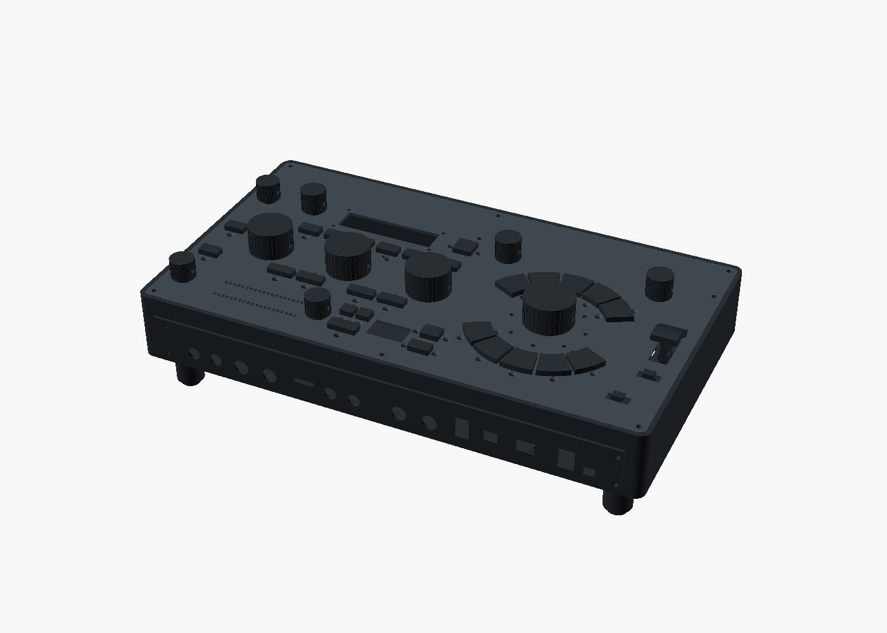

# Larger enclosure candidate

The owner authorized reasonable enlargement with a 20% space/headroom target.
This separate candidate starts at **334 × 188.4 × 45.6 mm shell dimensions**:
the original width, 20% more depth and 20% more height. Its rectangular floor
area grows 20%, bounding volume 44%, and box surface area 22.014%. Those are
geometric ratios, not usable-volume reserves, temperature margins or cooling
gains. Actual space allocations still need to establish the desired headroom.



This is a native CAD render with illustrative colors. It shows reference outer
controls and inherited feet; internal integration and production construction
remain unfinished. `previews/provenance.json` binds the actual rendered solids.

`generate.py` produces actual native shell/lid solids and a reference outer
assembly. It retains the original control XY and rear I/O at Y0. The additional
31.4 mm is the **front strip at Y157–188.4**, initially unallocated. Existing PCB
mounts are reference geometry. The original six lid fasteners remain, preserving
the existing power-board reliefs; three new front positions at Y180.4 support
the larger lid. Their larger-base attachment and assembly details remain open.

Reproduce with:

```sh
.venv/bin/python -m hardware.cad.a12.enclosure_growth.generate \
  --openscad /path/to/OpenSCAD
```

Every native command records explicit depth/height/fastener overrides. Use the
exported `generated/shell.stl` and `generated/lid.stl` to review the actual larger
parts; opening the staged SCAD without its recorded overrides uses inherited
dimensions. `generated/plan.json` and `generated/verification.json` bind the
sources, actual commands, logs and solids.

The first run passes all **eight native blank/envelope cases**. The shell is one
connected surface with zero bad shared-edge incidence and no collapsed binary
triangles. Its actual bounds are 334 × 188.4 × 45.6 mm. The larger lid clears
the shell after a fixed 0.00002 mm numerical separation of its intended seat;
this is not a physical seating-gap or tolerance approval. Nonempty controls
prove the added front floor, taller wall and new front boss exist; an empty
control proves the new pilot bore is open. The outer reference measures
**95.2 mm overall height** with the inherited control/foot envelopes, compared
with the original 87.6 mm. Raw logs/STLs and all source/evidence hashes were
independently checked. These results concern the enclosure blanks and reference
outer envelope only.

The shell has a 2.8 mm wall/floor and a 2 mm lid, as in the reference kit.
The panel moves from Z36 to Z43.6. Control-board height, shaft reach, button
electronics, light guides, supports and the complete wiring must follow a
coherent new interface plan. No unchanged PCB datum or shaft is assumed to
reach the higher panel. The outer reference uses the old feet at their old
positions only to check the dimensional envelope; it does not approve the new
foot spacing, structural stability or thermal base. Conditional thermal work
in `../housing20percent/` is a separate candidate requiring real new metal and
contact geometry.

The panel mount audit in `../panel_mount_audit/` finds that the low E19/E18/E20
stack can retain its current datums: ten pots, switches and panel emitters are
off-board interfaces. Panel-related parts and harnesses still require renewed
fit and engagement checks. The separate `lever_fit.py` moves the fixed-Z lever,
sensor reserves and four posts together by 7.6 mm. All ten native local cases
clear, including full swept travel through the raised lid. The old fixed lever
intersects that lid by 118.603 mm³ and remains a required nonempty control.

The separate [pot/knob stack candidate](../pot_stack/README.md) replaces the
generic pot-height assumption with a source-derived receiving proposal. It
raises the knobs by 0.8 mm, lowers their screw axes and enlarges the ten panel
bores from Ø9.3 to Ø9.5 mm. All 32 conditional local checks clear, including
other controls, expanded bodies, sockets and panel registration. Actual revised
panel/four-knob meshes and a native CAD preview are provided. Exact parts,
undimensioned tolerances, body support, tapping/retention and thermal/physical
validation remain open. This later control candidate is not silently included
in the frozen 45-case EI02 scene; combining it with the enlarged base needs
another source-bound run.

The separate [enlarged metal base](../thermal/enlarged_base/README.md)
now has 42 passing native records and 12 portable tests, actual STEP parts,
four TIM pads, ten nominal 0.2 mm shims and a component assembly 3MF.
Its fused whole-assembly mesh exports remain explicitly rejected; the review
assembly is not a single manufacturable part. Independent review identified
an overbroad available-thread abstraction and a recapture-versus-replay
documentation defect. The frozen [combined base/PS01 revision](../thermal/enlarged_base_pot/README.md)
addresses both and passes all 122 native cases and 13 portable tests.
Root independently checked its 598 files, all raw records and strict part/control
meshes. Its eleven-object review assembly preserves the source geometry;
no fused whole-assembly mesh is promoted as a manufactured part.
The sealed EB01 packet remains unchanged. Nominal stack fit does not qualify
incoming thickness, compression pressure, structural loads or cooling.

The later [R1 placement check](r1_local/RESULTS.md) passes fifteen fresh
Linux Manifold cases against that combined enclosure, with the actual corrected
resistor PCB/part source, 0.25 mm external clearance and ±0.2 mm board-height
sweep. Whole-unit adoption of that later PCB remains separate.

The [digital-link and wire proposal](../positive_links/proposals/dig-leg-y121p3/README.md)
clears the complete J8 attachment receiving gauge after moving one mid-leg
1 mm. A retained failure exposes the old positive wire against the maximum
covered-link envelope. Raising its curves 1 mm, extending the vertical ends
and retaining its ports/radii clears all nine follow-up cases. Full J8 return
wiring, electrical/thermal qualification and integration with the other later
PCB/base candidates remain open.

A [dual-fan under-base prototype](../thermal/forced_air_prototype/README.md)
provides actual tray, guards and spacers and passes 23 local native cases.
It proposes removing 77 whole cooling pins and lowering the feet 8 mm;
nominal overall height with PS01 knobs becomes 104 mm.
The later [FI01 combined assembly](../thermal/enlarged_base_forced_air/README.md)
establishes 162 modeled geometry conditions using 161 direct native passes and
60 distributed empty intersections plus ten controls for one combined check.
Both failed combined executions remain recorded. Actual 960-pin base and tray
STEP parts and a component 3MF are provided. Fan power/protection/wiring and
installed thermal performance remain open. Neither published free-air fan flow nor the local fit checks establish
cooling at the retained heat load plus 20% stress.

The separate [5 V fan supply proposal](../thermal/forced_air_5v_supply/README.md)
uses the same external CAD and dimensional class. Its two motor ratings,
including ±10% and a further 20% provision, use 132 mA of the unassigned
416 mA digital reserve. P03 J3 is a possible raw 5 V/ground source.
The protected circuit, control-logic allocation, complete harness, actual
startup/port voltage and internal-air cooling remain unimplemented.

The [AP01 internal-air budget](../thermal/air_path_budget/README.md) now derives
bulk-flow and port requirements without adding fan power twice or crediting
motor heat export. Its tested Noctua/old-guard pressure scenario is insufficient.
The separate [SF01 Sunon comparison](../thermal/forced_air_sunon/README.md)
prefers two higher-pressure V1 fans for a prototype, with new guards and at least
2200 mm² net interior inlet/exhaust each. The exact thinner fan needs a new
clamp stack and 376.8 mA planning provision, leaving 39.2 mA digital reserve for
control/tach and other loads. All pressure curves remain sensitivities;
no new fan, ports or cooling performance is adopted or qualified.

The [higher-temperature control study](../pot_stack_high_temp/README.md) now
passes 106 native cases while preserving knob exteriors and XY. The mounting
lug requires a local blind pocket; deeper bores and revised grub-screw axes
resolve the tested shaft/flat requirements. Thin panel webs, roof thickness,
washer/thread and actual temperatures remain unqualified. A new air-path
geometry candidate is in development.

The separate [FP01 fan-protection section](../../../qualification/boards/fan_protection/README.md)
now provides an 18-part native schematic with zero ERC/parity findings and
13 targeted checks. P03.J3 is explicitly test only, superseding FV01's proposed
source. A new operating-force feed, health/temperature interlock, actual PCB
and complete harness still need implementation and validation.

The newer `receiver_access.py` candidate uses actual E19 source `2145521e`, a
wider ear and H9 at (182,92.2). All 19 local native cases clear: real PCB material,
post/head/joints, both original and +7.6 mm component reserves, power hardware,
minimum H9 bore and an open-lid Ø6.5 mm tool envelope. The old axis still hits
the unchanged digital link by 11.35085 mm³, while the new axis clears it. This
is a geometric access candidate, not an approved driver, lid-removal sequence,
insert, fastener or structural process. The actual power/ground path between
mounting exclusions widens from 0.7797 to about 4.8012 mm; resistance/ampacity
must be extracted afresh. A separate later candidate adds physical fanout ports;
its additional material and terminations require new checks.

The Trill C3 candidate in `../trill_mount_candidate/` corrects the old 52 × 21 mm
reserve to the actual nominal 53.848 × 21.844 mm native outline. Its thirteen
local checks clear, but the combined `integration/` trial exposes a real
175.306 mm³ interference between that saddle and E28 C8. That failed trial
is preserved. The fixed-low/raised-panel map's
two absolute touch-backer Z fields are corrected separately by that candidate's
`PM01-erratum.json`: actual backer base is Z34.6/42.2, with the same 7.6 mm lift.
The immutable original map and its valid translations remain preserved.

The newer `../trill_front_bay/` candidate puts the actual C3 board at
[82,158,20] mm on two insulating floor posts, using the added front space.
All fifteen declared primary local interference/fit checks clear. Its
25 evidence records retain a failed 0.3 mm centering sensitivity and a blocked
tool-access witness with the guide/control assembly installed. The controller's
I²C/electrode wiring, removal sequence, material and fasteners remain to be
designed or qualified. Root independently checked all sealed inputs, raw logs
and actual mesh volumes; this does not establish complete assembly acceptance.

The same combined trial identified a rear TS body/cassette clash and a J29
header/return-retainer clash. `rear_ports.py` raises all eight audio-jack axes
by 0.8 mm to Z14 while keeping their existing body/aperture classes and the
cassette opening unchanged. All seven local native evidence cases validate,
including the retained old TS interference of 63.840 mm³. Its behind-panel
body requirements include ±0.2 mm Z allocation and 0.25 mm external clearance;
exact jack threads, nuts, mating plugs and wiring still need selected geometry.
`rear-ports/handoff.json` binds the independently audited sources and evidence.

The separate `integration_repaired/` run now passes **all 45 required native
cases** with actual J29 PCB revision `3b2a8197`. The header is at world pin 1
[105,76] mm, angle zero; its actual saved service box is
[102.73,73.73]..[107.27,83.35] mm. This clears the complete power hardware,
including the bonded pedestal missed by the preceding local placement.
The actual PCB has zero raw ERC/DRC/parity/open findings; all other 87 complete
footprints, foreign signal routes, vias, outline and stackup are unchanged.
The two J29-related nets have their declared route replacements.

The combined scene retains the low E19/E18/E20 stack, lifted control/lever
geometry, TC02 front-bay controller, raised rear jack row, all 142 actual
receiving PCB bores, port terminations, H9 tool access and the complete modeled
J4-to-J13 pair. Original P03/E28 external 0.25 mm clearance cases are retained,
including the declared component-height/thickness and ±0.2 mm Z allocations.
Both box and cylinder witnesses outside the nominal bodies but inside that
margin are nonempty; their nominal counterparts are empty. Root independently
verified all 191 source/evidence hashes, 29 raw empty intersections and 16
positive STL volumes/bounds, including nine 0.008 mm³ controls.

The failed `302ec64b` trial remains reconstructible under
`integration_repaired/history/first-J29-other-hardware-clash/`: its actual
25.538 mm³ bonded-pedestal interference and obsolete saddle-witness reference
remain rejected. The final witness targets actual front-bay post material.

The larger-metal-base thermal scenario reduces the source-loaded peak from
95.36–99.51 °C to 86.19–89.93 °C at the retained 35.4315 W/40 °C ambient and
assumed boundaries; the base alone still fails the 60/65 °C screens. Separate
prescribed-isothermal-base plus metal-lid/sidewall scenarios can exceed that
heat load at 65 °C, but sensitivity and unknown installed conditions preclude
a qualified 20% thermal margin. The later
[`coupled_housing20`](../thermal/coupled_housing20/README.md) model actually
loads the base, cut walls, finite joints and apertured lid. All seventeen
loaded cases exceed the 65 °C base screen; the nominal hot-cluster/full-fin
case reaches 71.32 °C. The separate
[`installed_cooling_h20`](../thermal/installed_cooling_h20/README.md) study
requires about h9.34 W/m²K at the underside to meet 65 °C under its 20% heat
stress/half-fin/doubled-joint scenario. This is a model requirement, not an
installed coefficient or selected fan. Plastic-shell geometry does not receive
metal-shell cooling credit; actual metal construction and physical tests remain
open.

The existing potentiometer reserves name the PTV09A-6 family. The current
[Bourns drawing](https://www.bourns.com/docs/Product-Datasheets/ptv09.pdf)
specifies an operating range of −10 to +50 °C. The 60/65 °C base screens
therefore cannot approve the controls' local temperatures. Exact suffix,
shaft reach, nut/washer stack, knob engagement and local body/air temperatures
still require acceptance despite the newer local receiving checks;
`control-temperature-source.json` binds the retrieved drawing.

The 38 mm-shell J4-to-J13 wire pair has a preserved 21-case native geometry
pass. The enlarged-unit 45-case run retains those endpoints and clears the
modeled conflicts. It still uses the explicitly bound E28 `fed47258` with
45 electrical opens and the old-size thermal base; it does not qualify later
U14/P9/J8 electrical or harness proposals, a new metal case or all loose wiring.
Structural loads, material/process bounds, EMI, cooling, physical
assembly and fabrication release remain unverified. The frozen baseline and
sealed qualification evidence are unchanged.
