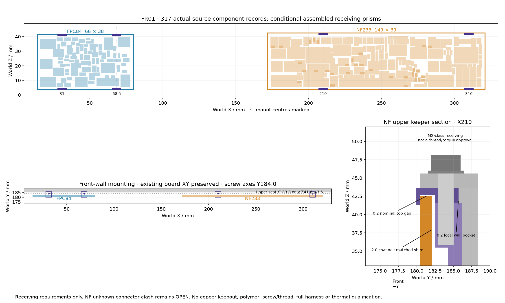

# FR01 front-bay receiving candidate

The two vertical cards and a concrete four-keeper wall mount fit the declared captured unit. **The NF generic connector receiving arrangement still fails**: J5/C31/C32, J2/Q1 and J4/Q2 intersect by a combined **1.416178 mm³**. This packet is a reviewable geometry candidate, with fabrication, physical, electrical, full-harness, installed-airflow and thermal qualification all false.



The complete modeled assembly is [82 separate 3MF objects](generated/FR01-component-review-final.3mf), 1,132,332 triangles, with exact coordinate roundtrip verification. Existing UA01 groups remain review groups and retain their original limitations. No faces were deleted, repaired, moved or decimated. The new integral columns are part of the carrier and are not duplicated as extra assembly material. Connector boxes and wire references are receiving geometry, not certified component CAD or a complete wiring harness. Editable analytic keeper STEP files are in [keeper-BREP](generated/keeper-BREP/verification.json); each is a valid single solid after STEP roundtrip. The whole unit is not one manufacturable part.

## Captured sources and frame

UA01 remains immutable: enlarged 334 × 188.4 × 45.6 shell, HT01 pots, AP03 meter/base, R04 return, PB27 power links, P03 `aux-u10-combined/db83`, E28 sealed32 `dd6a6f5a` with 32 opens, and E19 R1 `dc559bd9`. No later E28 U35/routing or new J8 wire is adopted here.

NF233 uses the explicitly captured pre-UUID-rebuild `9fe0966b` PCB. The 231 parent geometries are unchanged; U49/C88 are added. It has 499 native open connections and no accepted electrical routing. FPC native fit used the captured `9a4c6046` 84-part placement. The final electrically closed FPC `86e07ac4` is copied and linked by [the C7 delta proof](generated/FPCClosed-C7-delta.json): all 84 native net-name pin maps are equal, 83 complete footprint geometries are identical after removing only UUID/net fields, and C7's exact new 0603 courtyard and 0.97 mm assembled receiving projection are strict subsets of its old 1206/1.9 mm receiver. Raw UUID identity is not claimed. The final source is linked conservatively; old native fit inputs were not silently replaced.

The proper rotation is **[u,v,w] → [X₀+u, 180.5−w, 3.5+v]**, with w=0 defined at front copper. This is calibrated against actual native pad coordinates, not an assumed KiCad STEP origin. NF is 149 × 39 at X172; FPC is 66 × 38 at X14. Their front components face −Y. The new robust receivers use FR4 ≤1.76, rear SMD assembly ≤1.2 and trimmed THT lead/fillet ≤1.5 mm. These are acceptance requirements, not vendor guarantees. All actual rear receiver tops are below the upper seat start Z41.6: SMD max39.355, tail max38.86. The side-specific wall/seat is used; no blanket 1 mm rear requirement is imposed.

All 317 source component records, 102 actual drilled-pad tail receivers and 12 mates are retained. The authoritative arrays are [coherent-receiving-model.json](generated/coherent-receiving-model.json). It records a metadata-only defect in the earlier robust model JSON: its mates field retained generic boxes while the SCAD already used the correct XH variant. The earlier file and native report are preserved.

## Actual native scope

| Evidence | Result and limits |
|---|---|
| Robust-rear 34 cases | 32 valid or independently validated; NF generic-mate clash and old opaque-bundle clash retained |
| Exact JST XH reference variant | 4 fresh cases pass; source nominal geometry plus explicit 0.30 mm per-face receiver allowance |
| Final mount variant5 | 30/30 pass, including actual carrier/lid/keepers, bodies/tails/mates, existing unit, thread/seat receivers and finite controls |
| Fourteen local FPC wire exits | 9/9 fresh cases pass; all 91 intrinsic wire pairs certified by continuous interval subdivision and independently replayed |
| Portable artifact/mutation checks | 21 tests pass; no solver or downloads required |

The raw robust report is still 31/34: its projection PolySet validator used an outdated expected area. [The separate validation-only receipt](generated/robust-projection-validation.json) independently verifies exact profile volume, bounds and strict closed/nonzero topology; this is **not a native rerun** and does not erase either receiving rejection. The actual remaining collision STLs are preserved, including the original opaque 10 mm bundle/electronics clash of 217.654749 mm³. That opaque allocation is replaced only by a separately scoped 14-wire local reference exit study, not by a completed harness.

Early missing-Docker-socket runs contain no CAD execution and remain failed execution evidence. The inherited three-character component matcher produced empty required solids; that defect was caught by the required-solid gate and repaired before the successful source-bound run. Earlier mounting clashes and invalid join meshes also remain in their original output folders.

The raw mount4 trial produced only 726 coplanar nominal-seat triangles. [All facets were classified](generated/mount4-seat-facet-audit.json): exact PCB bearing planes, keeper support planes and screw/washer bearing planes, with zero nonboundary triangles. Final mount5 applies a named **test-only 20 nm interior guard** only at those correlated seats. All 11 actual exported part/receiving STL byte sequences are [identical before and after](generated/guarded-parts-identity.json). Four deliberate 0.05 mm intrusion controls remain finite. This resolves numerical contact classification only; it does not approve print, factory or Z tolerances.

## Mounting contract

[interface-final.json](generated/interface-final.json) is the machine-readable contract. NF contact centres are local u38/138 → world X210/310; FPC u17/54.5 → X31/68.5. Physical edge contacts are 6 mm wide ×1.2 mm deep at each lower/upper edge. The front plane stays Y180.5. Each screw axis is Y184.0. The integral wall stems overlap retained wall by 0.6 mm; the removable keeper pockets remove a local 0.2 mm depth, leaving 2.6 mm wall. Strength is unapproved.

The 2.0 mm rear channel needs a matched shim based on actual PCB thickness (0.4 nominal at 1.6 mm PCB; 0.24 remaining at the 1.76 maximum). The upper edge has a nominal 0.2 gap. The planning M2×10-class shank/head/washer receivers and actual engaged-thread receiving region are explicit. Candidate hardware is Accu SPP-M2-10-A4 and HPW-M2-V1-A2; exact length tolerance, thread/tap, material, torque, preload and creep approval remain open. No soldermask electrical insulation is credited.

Root's planned all-copper-layer keepout successor is **not adopted** in these sealed PCBs: 7.2 mm width, local edge v0..1.65 and vH−1.65..H, centred at the four contact u values. The keeper/post polymer is unselected. Physical assembly and removal require temporary card support, harness slack and a real material/fastener process; these have not been demonstrated.

## Component, harness and airflow holds

Primary package facts and project allowances are distinguished in [the primary review](sources/primary-review.json). In particular, Toshiba standoff minima are not maxima. WIMA case tolerance and 195 generic part-class projection ceilings remain unaccepted. Exact JST XH housing/header dimensions come from the [captured manufacturer drawing](sources/jst-eXH-official-US.pdf); their nominal assembly height is not silently promoted to a guaranteed maximum. The unselected NF generic headers need real keyed connector/contact selection before the remaining mate clash can close.

The fourteen wire exits are R10 circular references from actual selected-header native pin coordinates. Maximum receiving OD1.9, local relative-pose stress0.24, geometry reserve0.005 and chord cover0.000753 mm are explicit. Continuous derivative geometry and interval AABB separation—not a sampled minimum—cover all91 pairs. Several upper exits end at45° and require future C1 continuation. Wire MPN, minimum bend radius, crimp engagement, extraction, strain relief, cut lengths, electrical current/voltage, complete destinations and full-unit wiring remain unqualified.

The new vertical uncovered inlet projection is **1273.818840 mm²**, a sensitivity only. It is not a governing throat or pressure area: elevated bodies permit lateral turning. The older 1258.683840 result is retained with its older generic mates. No installed-flow or cooling conclusion follows from either projection; no bottom-gap airflow credit is taken.

## Validation and replay

Read-only validation of existing captured artifacts:

```sh
python3 -S -m unittest hardware.cad.a12.enclosure_growth.front_bay_receiving.test_audit
python3 -S -m hardware.cad.a12.enclosure_growth.front_bay_receiving.audit --continuous --assembly
```

The saved final audit replays all91 certificates, all82 assembly objects, every current required raw log/STL/statistic/hash, all retained actual collision evidence and all11 byte-identical guarded parts. Missing solids, forged empty rows, bad controls, failed execution, improper frames, shrunken rear receivers, wrong C7 height and unsupported insulation/release flags are rejected. A consistency-audit success does not mean all receiving interfaces pass.

Fresh native replay uses captured commands only and a **new repository output directory outside this packet**:

```sh
python3 -m hardware.cad.a12.enclosure_growth.front_bay_receiving.replay --kind mounting --outdir /absolute/repo/path/new-fr01-mount-replay
```

Other kinds are `wire` and `robust`. Robust replay is expected to reproduce the two explicit receiving failures, with a separate expected-outcome flag; it cannot report all collisions clear. Docker socket access may require the environment's bounded escalation. No native replay is claimed by the portable artifact audit. Capture/build scripts are one-shot development tools; **do not rerun them in a sealed packet**. Earlier preview metadata became stale after producer formatting; new `*-final` review outputs were regenerated from the unchanged actual native artifacts before final validation, while earlier previews remain historical.
