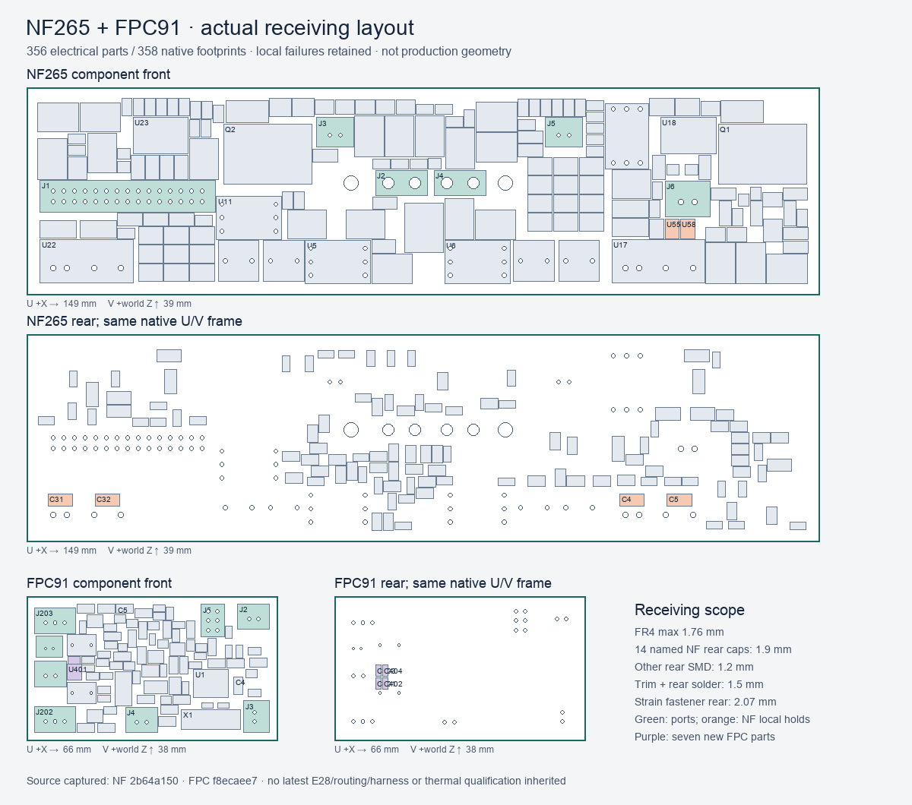

# NR01 — actual NF265 / FPC91 receiving study

This **rejected receiving milestone** captures the actual 265-part NF board plus its two mechanical footprints, and the sealed 91-part fan board. It preserves all five rejected local cases. It is not an accepted whole-unit design.



The immutable inputs are NF PCB `2b64a1502e4fac8623aaf4caed92b27c8b7313b6b93e0a8e927f3630dbced9d5`, FPC PCB `f8ecaee75e789ef53c28b2b347babefab16fff9297b2a6849666a90fed360e74`, NC265 ports-v2, and the captured FR01/UA01 environment. The latter explicitly contains P03 `aux-u10-combined/db83`, E19 `central-r1/dc559bd9`, and partial E28 `sealed32/dd6a6f5a` with 32 electrical opens. Newer E28 development and routing scratch boards are not adopted. The NF source has **750 uncapped native opens**; 499 is the capped JSON report count. See [ERRATA.md](ERRATA.md).

There are **356 electrical parts / 358 native footprints**, not the prior FR01's 317 parts. Six NC265 ports are already among those electrical parts. Fourteen explicitly named rear NF capacitors receive 1.9 mm; other rear SMD parts receive 1.2 mm. THT trim plus solder receives 1.5 mm. Strain screws/washers separately extend 2.07 mm behind the FR4. The 1.76 mm maximum FR4 requirement still conflicts with PH's 0.8–1.6 mm catalogue applicability. That supplier acceptance remains **FAILED**.

`generated/model.json` records every actual side, native pose, courtyard, selected or provisional height basis, and transformed receiver. The proper Rx+90 frame is `X=X0+u, Y=180.5−w, Z=3.5+v`, with `w=0` at front copper and FR4 behind it. No KiCad STEP origin is presumed. The model contains 350 non-port component prisms, 14 mated/port receivers, and 106 actual drilled-pin tail receivers. Unknown PROJECT package, seating, mating and process bounds remain unaccepted; catalogue nominal dimensions are not promoted to guaranteed maxima.

## Actual native results

Verified OpenSCAD 2026.10.27, headless Manifold with hard warnings, produced raw logs and binary STLs. Required solids and controls must have NoError, a closed oriented nondegenerate boundary, positive volume, and agreement with their saved metadata. Empty cases require the exact native empty result and **no STL**.

| Matrix | Clear | Rejected |
|---|---:|---:|
| Initial 47 unique cases, split into 12 + 35 | 42 | 5 |
| Separate exact-native rectangular tail receiving replay | 42 | 5 |
| Actual source pin/drill + selected new-cap body supplements | 6 | 0 |

The rejected exact-tail matrix retains:

* NF connector/force receivers against nearby parts: **8.511148 mm³**. J6's declared XH receiver overlaps U55/U58 courtyards; force-solder comparison also reaches nearby component receivers at the 0.25 mm same-board margin.
* NF TMR tails against C4/C5/C31/C32 rear receivers: **6.698993 mm³**. Their native 1.5 × 3.0 mm pads are long along V; the corrected rectangular envelope does not clear them. A new four-cap source repair must be assessed separately.
* Unselected FPC J5 ISP mating receiver against R6/C24: **3.473573 mm³**. Actual service-plug selection, body/standoff and access remain unresolved. No receiver was shrunk to pass.
* FPC C203.2 tail against C401/C402 courtyards: **0.429845 mm³**. A separate primary-body check establishes clearance for the actual selected C401/C402 maximum bodies with the stronger 0.45 mm comparison. It does not rewrite the failed courtyard trial or qualify manufacture.
* Mount keeper versus expanded unselected ISP receiver: a **zero-volume, nonempty boundary STL**, rejected. No contact guard or tolerance waiver was introduced.

The actual bodies, PCB envelopes, mates and strain receivers clear the captured case/base/floor, P03/E28 and other electronics, controls, existing power hardware and accepted wires in the declared 0.45 mm external comparison. The boards are mutually clear; mount columns clear parts and tails; named own-PCB seats and actual minimum bores are separately checked. This is receiving geometry only. Selected electrical nets, source routing, connector maximum applicability, joint/retention strength, service sequence and new remote wiring remain open.

`tail_shape/audit.json` proves all 106 rectangular tail receivers are contained in the original square envelopes. The unchanged 0.2 mm allowance on each lateral side, pad rotation and 1.5 mm rear requirement are explicit. `supplement/contract.json` checks all 40 native port pads and both actual mechanical holes, including J1.4 physical NC, J1.7 monitor output, and J6's isolated module-primary return. The new bore test uses **all actual NF drilled pads** and minimum receiving bores, rather than an empty generic board. A deliberately undersized old force bore produces a 16.8092 mm³ witness.

## Projection and remaining scope

`generated/floor-port-projection.json` independently projects the new receiving geometry, NC265 strain receivers and retained Trill PCB onto the exact faceted AP03 ports. Net authored area is 2563.128160 mm²; the union projection is 1404.355669 mm², leaving **1158.772491 mm² of vertical-uncovered sensitivity**. This excludes old mount/other retained-unit shadows and complete local/remote harnesses. It is neither the governing throat nor a flow lower bound: elevated bodies permit lateral turns. No installed airflow, pressure or thermal performance follows.

All physical, electrical whole-unit, thermal, full-harness, fabrication and production-adoption flags remain false. The full assembly SCAD and component group STLs are review/receiving representations, not a fused manufacturable part.

## Captured verification and replay

Run the portable saved-evidence audit and tests without native tools:

```sh
python3 -m hardware.cad.a12.enclosure_growth.nf265_fpc91.audit
python3 -m hardware.cad.a12.enclosure_growth.nf265_fpc91.test_receiving
```

Thirteen tests pass on Python 3.9.6 and 3.12.13, including actual input/artifact validation, missing-solid and forged-empty mutations, actual pin/drill identities, rear exceptions, exact tail axes, positive controls, private replay closure, and refusal to overwrite.

**Do not run capture.py or model.py in this sealed packet.** They refuse existing output. They are historical construction inputs, not replay commands. A captured-only source replay can be staged in a fresh directory:

```sh
python3 -m hardware.cad.a12.enclosure_growth.nf265_fpc91.replay --outdir /private/tmp/NR01-replay-NEW
```

Add `--run-native` to execute the captured derived scene with the bound verified native engine; `--cases NAME...` limits a replay. A complete replay intentionally returns nonzero while the retained rejected cases remain. It never recaptures current parent boards. Every stage/native output must be new; no sealed artifact is overwritten.
