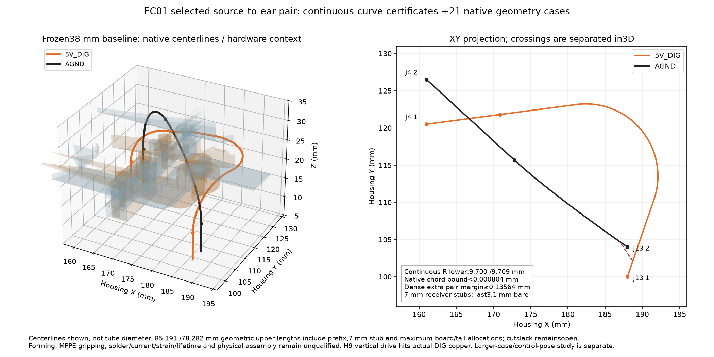

# EC01 — selected J4-to-J13 wire curves, frozen38 mm baseline

**The selected wire pair has continuous bend-radius certificates and passes21 full native geometry cases.** This closes a geometric routing gap in the existing38 mm shell. Forming, soldering, strain relief, cut slack, electrical/current behavior and physical assembly remain unqualified. The source E28 PCB still has45 electrical opens; no build or fabrication approval follows.



The frozen [selected paths](generated/selected-paths.json) contain the exact circle/S-lift primitives, cubic controls, native points, boundary indices and interval proofs. [Dense points](generated/dense-points.json), [independent review](review.py), [tests](test_curve_contract.py) and the copied [ROOT21 native receipt](native_evidence/verification.json) make the result reproducible. The original selected-path SHA256 is `97d6872273757e8171ebb903f18819c90d3981b4c9369484a4ff3eba63a65b3c`; it and its bound sources remain unchanged.

The search extended the case window to housing[154,90,3]..[198,139,37], captured actual P03db83/E28fed bodies, both-face parts/tails/mounts, inherited controls and full return/positive-link solids. The native switch-lead witness has0.008 mm³ expected volume. Receiver geometry includes the supported E19 ear/J13 and actual H9 postOD7.2/Z2.7..6.5 plus headOD5.6/Z8.1..10.41. H9's vertical tool path hits actual DIG copper; removing a cover alone is not an established access solution.

## Selected construction

The source faces remain[161,120.5,6.62] for5V_DIG and[161,126.5,6.62] forAGND. Their checked refined quarter-exit profiles remainPOSR10/7.5°/Z25.25 andGNDR16/−42.5°/Z31.75. The receiver faces remain[188,100,8.1] and[188,104,8.1]. Both paths end with a **7 mm vertical stub**, startingZ15.1 and ending downward at the receiving face. Their last3.1 mm are bare, with nominal insulation cutZ11.2; source cutZ9.72 also remains unchanged.

The first positive planar family hit the positive-link assembly. A0.8 mm upward S-lift with9.7 mm circular radii clears it, followed by a tangent straight, horizontal circular turn to−109°, short tangent and downward vertical quarter. The ground connector uses a C1 cubic with7.5/9 mm endpoint handles. All pieces have matching unit tangents under arc-length reparameterization; **C2 curvature continuity is not claimed**.

For the cubic, velocity is a quadratic Bernstein polynomial and acceleration is linear. Their cross product is cubic Bernstein. On each subdivided interval, a cross-product norm upper bound and velocity-AABB norm lower bound enclose curvature. The saved70-digit Decimal certificate covers the complete parameter interval with positive speed. A dense sampled curvature check is only an independent diagnostic, not the continuous proof.

| Bound or retained requirement | POS | AGND |
|---|---:|---:|
|Continuous centerline radius lower bound|9.699999999 mm|9.709433836 mm|
|Hard minimum true centerline radius|9.6393 mm|9.6393 mm|
|Wire length upper, including prefix/stub/max boards/tails|85.1908 mm|78.2821 mm|
|Native point count|320|335|
|Source initial-straight end index|35|37|
|Source prefix end index|98|138|
|Receiver stub start index|291|306|
|Receiver face index|319|334|

The pair's combined geometric upper length is163.47285 mm, below200 mm **before unallocated cut slack/fanout/strain provisions**. This is not a production cut-length instruction. The global native centerline chord-deviation bound is0.000803221 mm. Maximum insulationOD1.7526 mm, independent0.65 mm position per wire,0.25 mm clearance and separate0.005 mm geometry reserve are retained; they are not traded against the bend limit.

A conservative dense sample-cover calculation gives0.135641 mm additional pair separation after the prescribed inflation/clearance terms. Return STL contact edges remain a signed-distance diagnostic caveat; the full native Boolean pair/hardware cases, rather than that diagnostic alone, establish the saved geometric clearance result.

## What the full native run actually proves

ROOT checked bare/insulated sections and flat cuts, joints, case, hardware, actual component bodies, wire pair, both PCB minimum bores and seven positive controls: **21 cases clear**. The endpoint bores use2.1 mm minimum and0.3 mm relative centering in their common PCB frames. Midpath height is separately bounded: centerZ≥15.1, receiverPCBtop≤8.46 and external tube radius including chord≤1.786403, giving4.853597 mm margin. This height argument does not permit skipping endpoint-bore/cut checks.

The frozen selected file retains its generation-time pending-native flags; the later accepted run is preserved separately. `native_evidence/context/` contains606 exact source/evidence bindings (~159 MB), plus the raw native logs/STLs. The replay SCAD changes only the absolute repository-root prefix to this copied context. No global source needs to be rewritten to preserve the baseline. The independent artifact audit parses actual required meshes and controls, rejects a forged empty row if a collision STL exists, and rejects missing geometry, stale hashes or unsupported physical flags.

The user-authorized larger-case/control-mount study is separate. This38 mm baseline does not establish new panel, shaft, header, light-guide, harness or service interfaces after growth. No PCB pose or production case was adopted by this search.

## Remaining physical work

The wire forming jig, incoming stock/OD, true bend radii, MPPE creep/grip/compression, soldered/tinned1.4 mm core, stripping/cut tolerances, relative centering, tail trim, tension/strain relief,2.4 A temperature rise, contact resistance, flex/service life and installed clearances need actual controlled evidence. H9 post/insert/fastener material, torque, engagement and assembled tool access remain open. The7 mm stub leaves3.9 mm nominal straight insulated length; it does not prove a clip's grip or load capacity.

```sh
python3 -S -m unittest hardware.cad.a12.harness.ear_connector_search.test_curve_contract
python3 -m hardware.cad.a12.harness.ear_connector_search.review
AFX_EAR_CURVE_REPLAY=1 python -m unittest hardware.cad.a12.harness.ear_connector_search.test_curve_contract
```

Eleven independent checks passed with the optional NumPy/VTK dense replay; ten are portable without those packages. Every physical, forming, strain, solder, current/lifetime and fabrication-release claim remains false.
