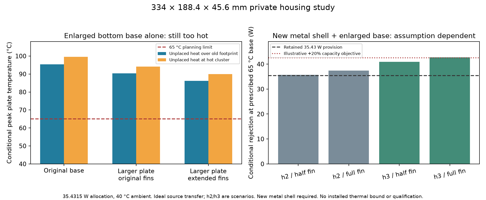

This is the private **334 × 188.4 × 45.6 mm** dimensional/thermal candidate. It preserves all original seals and canonical designs. Root owns the actual new shell/lid under `../enclosure_growth/`; this folder captures that native evidence and separately re-solves the enlarged thermal geometry. No cooling hardware, new control-board pose, production dimension or thermal margin is qualified.

The width stays334 mm. Depth grows31.4 mm and shell height7.6 mm. With the original rear I/O cassette atY0, the added strip is **+Y at the front**, not a rear bay. Original boards/controlXY positions are references until integration is redone. The panel bottom rises36→43.6 mm, so potentiometer shafts, switch/key engagement, release linkage and actual control-PCB supports need matching physical contracts. The old54 mm shell study was only an outer-envelope audit. Root's new eight native blank/seat/witness checks pass; its inherited feet/control outer reference is95.2000 mm overall, compared with87.6 mm originally. That proves neither new shaft alignment nor complete fit.

| Rectangular shell envelope | Original | Candidate | Ratio |
|---|---:|---:|---:|
|Bounding floor area|52,438 mm²|62,925.6 mm²|1.20|
|Bounding volume|1,992,644 mm³|2,869,407.36 mm³|1.44|
|Six-face box area|142,192 mm²|173,494.08 mm²|1.22013953|

These are exact dimensional calculations, **not usable free volume, exposed cooling area or heat-rejection ratios**. `generated/plan.json` additionally records idealR7 rounded-prism geometry and the earlier177/187 mm depth,50/54 mm height comparisons. Apertures, mounts, material, controls, fins, feet and internal obstructions require their actual geometries.

The retained whole-unit heat provision remains **35.4315459 W**, all consumed power conservatively assigned inside as in captured WU01. The10.5578 W supply-only map is not substituted for it. We do not reduce load targets or assume unused reserve disappears. Retained unplaced-source alternatives stay over the original footprint or the original hot cluster; the new strip does not receive an invented moved heat source.

The enlarged bottom-base model uses an explicit334×188.4 mm,6.2 mm metal plate with captured source/contact projections. It compares the original pin field with an explicit1037-pin extension of the original3 mm/7 mm pitch/12 mm height proposal. The new nine-bolt map retains the old six and adds the front row atY180.4; proposed feet retain20 mm edge offsets. Those new base attachments, feet, structural loads, material/finish, table clearance and installation are unaccepted contracts. Rectangular plate edges remain adiabatic; original rounded corners, ports, new support holes and all actual source-to-metal temperature drops are not completely resolved.

At40 °C ambient, assumedh3 W/m²K andε0.8, the original WU01 peaks95.363/99.507 °C for the two unplaced-source alternatives. A larger plate with the original pins gives90.315/94.165 °C. Extending the pins gives refined **86.186/89.932 °C**. Thus the enlarged bottom base **still fails the60/65 °C planning limits** under these scenarios. Refining67×38 to134×76 changes peaks−0.0073/−0.0759 °C. Lowerh and low-emissivity cases are also retained. Plastic shell growth alone receives no added cooling credit.

A **separate metal-shell proposal** parameterizes the captured FF02 conduction/radiation equations to43.6 mm conductive-wall height and the new floor dimensions. It retains2.8 mm sidewalls,2 mm lid, actual captured apertures/capXY masks and actual old FF02 native fin-surface projections. Existing eighteen-millimetre fins would have to move7.6 mm up with the lid; no new front-fin area or new fin-to-control native fit is credited. Actual shell ports, base seams, lateral temperature gradients, insulation and fastener joints still need new construction.

At a **prescribed uniform65 °C base**, illustrative combined metal-side/lid plus enlarged-bottom capacities are:

| Conditional boundary at134×76 lid grid | Rejection | Margin above35.4315 W |
|---|---:|---:|
|Bottomh3, full exposed fin face|42.6937 W|20.50%|
|Bottomh3, half effective fin face|40.9464 W|15.56%|
|Bottomh2, full exposed fin face|37.4209 W|5.61%|
|Bottomh2, half effective fin face|35.6735 W|0.68%|

These shareε0.8,70% exposed sidewall, assumed aluminumk140 W/mK and0.2 K/W whole-wall seam resistance. The lid/side correlation is evaluated at its evolving surface temperatures; h2/h3 denotes the separate bottom scenario. Refining the full-fin lid from134×76 to267×150 increases combined capacity42.6937→**42.7661 W**, or20.70% nominal scenario margin. Only0.2482 W remains above an illustrative1.2×35.4315=42.5179 W objective. No actual installedh, material/contact bound, ambient upper or expanded uncertainty establishes that margin. At60 °C prescribed base, the134×76 h3/full-fin capacity is only33.6076 W and fails even the retained load.

**These prescribed-base capacities are not the source-loaded combined assembly's temperature solution.** They may be summed only as separate rejection paths at the same prescribed isothermal base. They cannot be added to the previously calculated nonuniform bottom-plate temperature or used to inherit a junction pass. A coupled installed base/sides/lid solution, actual heat paths and measurements remain required.

Larger space enables useful redesign, but three existing issues survive shell-only growth unchanged: the H9 vertical tool collides with actual DIG copper, the supported receiver has a0.779689 mm supply/ground gate, and the other0.636 A digital allocation lacks native force/return fanout. Reserve an actual distribution/service corridor, implement the missing terminals/returns, and redesign bus/support access before claiming those are fixed. Moving boards into the front strip also lengthens input/output/control harnesses; the rear cassette remainsY0 unless deliberately moved. Every new lead length/bend, joint, voltage-drop budget, control height and quiet return must be rechecked.

`dimensions.json` is the input API for root's separate MCAD work. `plate_scenario(design, heat_assignment, h, emissivity, grid=...)` reads `design['housing']` for the actual modeled extent. `lid_shell(..., width_mm, depth_mm, wall_height_mm)` performs the separate finite-volume lid solve; `fin_surface.extract` conserves actual captured triangle-surface projection. `generated/thermal.json` holds all scenarios, actual pin coordinates, numerical controls and input SHA maps. `capture.json` binds original source bytes copied under `sources/`. Baseline controls reproduce both saved WU01 peaks and the FF02 lid capacity with zero delta. Three tests, including six rejected acceptance/numerical mutations, verify source integrity, conservation and refinement. No original sources are regenerated.

The current recommendation is to use the new front/height allowance for a coherent layout and stronger **demonstrable** heat rejection, rather than accept size growth itself as the20% margin. Every thermal, whole-integration, fabrication and physical-release flag stays false.
