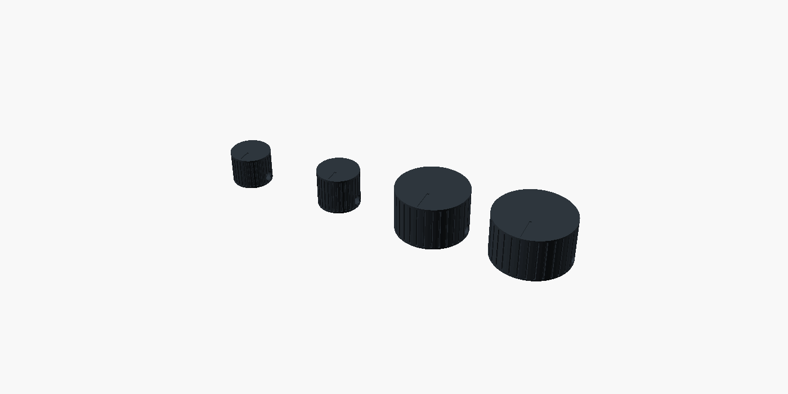

# Pot and knob stack candidate

This private candidate checks a PTV09A-6 family pot with a proposed 20 mm shaft
against the enlarged housing. All **32 conditional native checks pass**.
It retains the four knob sizes and all control XY positions, raises the knob
base 0.8 mm, lowers the radial screw axis and enlarges the ten panel bores.
EI02 and the original enclosure/control kit remain unchanged.



The render uses the actual exported meshes, with illustrative color. The
[16 × 13](generated/knob_0.stl), [17 × 15](generated/knob_1.stl),
[29 × 18](generated/knob_2.stl) and [32 × 18 mm](generated/knob_3.stl) parts
have their review/print face at Z0. Each independently has one connected closed
boundary, correct shared-edge incidence and no collapsed binary triangles.
These are prototype models; material, compensation, tapping and strength are
unapproved. [The panel](generated/panel_geometry.stl) remains in assembly
coordinates at Z43.6–45.6.

| Interface | Previous modeled value | New candidate |
| --- | --- | --- |
| Knob base | Z48.4 | Z49.2; proposed acceptance interval 49.1–49.3 |
| Grub-screw axis above knob bottom | 6 mm | 3 mm; proposed ±0.05 mm |
| Panel pot holes | Ø9.3 mm | Ø9.5 mm |
| Body/terminal XY reserve | 16 × 16 mm | Preserved |
| Body/terminal axial class | Z29.1–41.6 | Z27.7–43.6, with separate lower Z sweep |

The [Bourns drawing](https://www.bourns.com/docs/Product-Datasheets/ptv09.pdf)
identifies the metal-threaded M9 × 0.75 family, a 5 mm thread length and
shaft lengths with ±0.5 mm tolerance. The proposed stack reads the rear shaft
datum to shoulder as 8.4 mm. Its inch annotation is inconsistent; declared
millimetres are used here with an explicit, unaccepted 0.2 mm allocation.
This does not convert that allocation into a supplier guarantee. The retrieved
PDF hash and location are recorded through the bound source record.

With the shoulder proposed at the panel underside, the nominal bushing reaches
Z48.6. The previous knob base at Z48.4 therefore has **5.53435 mm³** modeled
interference. The old screw-axis gauge also extends outside the allowed exposed
shaft band. Both nonempty witnesses remain retained. A separate Ø9.3-hole
witness fails the declared registration allocation by **2.28954 mm³**.

The new receiving requirements allocate a maximum bushing top Z48.9 and shaft
tip interval Z54.4–56.0. The minimum knob base clears that bushing by 0.2 mm.
An axial gauge spanning nominal Ø3 mm screw diameter, axis placement and
0.25 mm end reserve fits below the minimum shaft tip with a further 0.3 mm.
This is an **axial-span check**, not a screw/contact/thread-strength model.
The unchanged Ø2.5 radial pilot still requires an approved M3 tapping and
retention process. Nominal M3 × 4 hardware is inherited, not newly qualified.

The Ø9.5 holes clear a proposed maximum Ø9.1 bushing, 0.005 mm radial geometry
provision and ±0.1 mm independent X/Y registration. A separate +20% registration
sensitivity (±0.12 mm each axis) also clears. Finished-hole limits and those
registration/bushing requirements remain unaccepted; these checks do not prove
a 20% manufacturing or system margin. The supplied washer drawing's minimum
bore is not accepted: a separate receiving requirement of at least Ø9.2 mm
still needs a selected or inspected washer and a coherent threaded stack.

The checks cover expanded body envelopes against the bound EI02 electronics,
guide/control mechanisms, case, power hardware and modeled wire pair; revised
knobs against other controls and one another; hardware/shaft receiving
envelopes against all four sockets; panel registration; required solids and
three 0.008 mm³ controls. The intended pot shoulder/panel seating face is
correlated and receives only a 0.00002 mm Boolean guard, rather than clearance
through its own seat. Hardware envelopes are unions of receiving extremes,
not a simultaneous manufactured nut/washer/bushing assembly.

Raw logs, 13 nonempty meshes and 19 empty intersections were independently
checked, along with all 181 source/artifact hashes. The initial 25-case run is
preserved under `history/`, including its reconstruction map; it predates the
other-mechanism and panel-registration checks and is not the current result.

Exact pot suffix/resistance/taper, supplied hardware, body support and
anti-rotation, shaft-flat orientation, all loose wiring, material, thread
engagement/torque/creep, feel/lifetime and physical measurements remain open.
The pot family's +50 °C operating limit still requires local thermal validation.
This packet does not renew EI02's complete combined scene for the new controls,
later E28 routing/J8 wiring or the enlarged metal base. All physical, thermal
and fabrication-release qualifications remain false.

```sh
.venv/bin/python -m hardware.cad.a12.pot_stack.build --openscad /path/to/OpenSCAD
```
