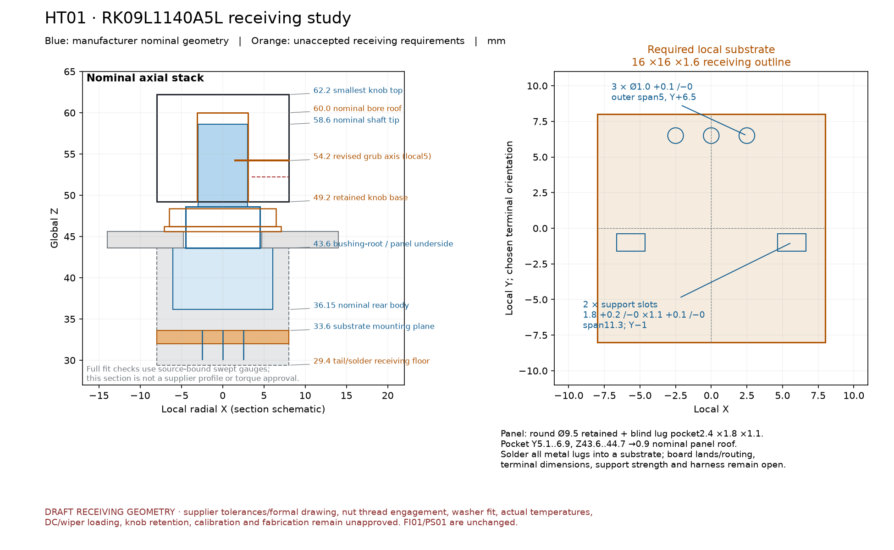

# HT01 · higher-temperature pot receiving study

This separate candidate fits the **Alps RK09L1140A5L** within the frozen FI01 assembly while retaining all ten control centres, the round9.5mm panel bores, knob outer surfaces and knob baseZ49.2. It adds a named blind anti-rotation pocket, increases the blind knob bore10→10.8mm and moves the internal grub-screw axis local3→5mm. **The part, material/process and assembled control interface are not approved or adopted.** FI01, CP01 and PS01 remain unchanged.



## Manufacturer facts and limitations

The [exact Alps product page](https://tech.alpsalpine.com/e/products/detail/RK09L1140A5L/) specifies−10..+70°C,10kΩ±20%,1B taper, no detent,15mm flat shaft and300°±5° travel. It lists0.05W rating and10VDC maximum. The page also requires formal delivery specifications, manufacturer consultation for DC use, and all metal lugs soldered into a substrate. The70°C operating limit is not an installed temperature prediction or a guarantee of allowable self-heating at70°C; power derating and actual control conditions remain open.

Four independently inspected primary drawings are URL/hash bound in `capture.json`, retained externally:

- [15mm dimensions](https://tech.alpsalpine.com/cms.media/product_detail_fig_rk09l_d_222_en_34014d0696.gif): L1=15 from body-front/bushing-root, LB=5, flat length7, shaftØ6−.1/−0, across-flat4.5−.1/−0, C0.8; mounting plane→body-front10, rear-body→body-front7.45, rear-lead projection3.5. The front drawing shows width12.1 and axial-view extents4.85/6.5 about the shaft.
- [Mounting pattern](https://tech.alpsalpine.com/cms.media/product_detail_fig_rk09l_d_231_en_08e696475d.gif):3×Ø1(+.1/−0), signal outer span5, support span11.3, support slots1.8(+.2/−0)×1.1(+.1/−0), row spacing7.5 and common±.1 dimensions. Chosen orientation maps signals toY+6.5 and supports toY−1 relative to the shaft.
- [Bushing/lug](https://tech.alpsalpine.com/cms.media/product_detail_fig_rk09l_c_1_en_60d88f1440.gif): M9×.75, axial lug projection.8(+0/−.2), width2±.1, radial centre6±.2 and radial thickness.8±.2.
- [Supplied hardware](https://tech.alpsalpine.com/cms.media/product_detail_fig_rk09l_c_101_en_acab65d7d7.gif): nut11AF×2 and washerØ14/Ø9.1×.5 are nominal dimensions. **They do not establish maximum nut/bushing envelopes, minimum washer clearance, usable thread or torque.**

Unlabeled mechanical tolerances below are explicit **unaccepted receiving requirements**, not supplier limits. Primary images are not redistributed, and this is not vendor CAD.

## Datum and changes

The nominal panel underside/bushing-root is43.6; substrate mounting plane is33.6, rear body36.15, rear lead end30.1, shaft tip58.6 and flat start51.6. L1 is not measured from the panel top or the end of the bushing. The new16×16×1.6 substrate occupiesZ32..33.6; it contains the actual three signal holes and two source support slots. Its board material, lands, routes, lug soldering/capture and harness remain unselected. No loose-wire-only terminal mounting or positive substrate strength is claimed.

The full fit reserve is deliberately larger than the nominal vendor body:16×16 at each centre, Z29.4..43.59998, including substrate, full rear-tail/solder and body allowances. Body/power/control/wire comparisons use its0.25mm external expansion below the own correlated shoulder seat. The20nm upper seating-plane guard excludes only that intended nominal plane. Unlabeled supplier body/tail dimensions and assembly registration still require approval; the reserve is not a manufacturer maximum.

Declared shaft-length14.8..15.2, flat-length6.8..7.2, shoulderZ43.5..43.7 and knob-base49.1..49.3 produce tip58.3..58.9 and latest flat start52.1. After the nominal C0.8 chamfer and.25mm axial flat reserve, the permitted screw-gauge band is52.35..57.25. The revised local5 axis with±.05 axis allowance and a3.1mm full axial gauge occupies52.5..55.9: **.15mm remaining lower margin after that reserve**,1.35mm upper. Chamfer and unlabeled drawing tolerances are not factory-approved bounds. Actual flat alignment, screw form, torque, thread engagement and anti-loosening remain open.

The smallest knob is13mm tall. A10.8mm blind bore leaves2.2mm nominal roof and, at minimum base49.1,1.0mm axial clearance beyond allocated maximum tip58.9. The old10mm bore had0.2mm of that allocated clearance; it did not physically penetrate the nominal shaft. Its retained failure witness tests the requested1mm clearance gauge, not fictitious shaft material. Four strict closed native knob meshes retain the original exterior/grooves/pointer.

The round9.5 bore cannot receive the real anti-rotation lug. New blind pocket localX±1.2/Y5.1..6.9/Z43.6..44.7 receives the declared lug at±.1XY and20%-larger±.12XY, plus.005 geometry reserve. It leaves **.9mm nominal panel roof and only.35mm nominal web to the adjacent round bore**. Those are unaccepted structural/process facts, not printable or torque-bearing minima. The nominal planar web screen finds≥8.13449mm to other apertures/fastener-head reserves; exact source24-division sector polygons are used so their empty central regions are not mistaken for holes. Actual full panel topology is closed and oriented. Panel bending, lug torque, pocket print/machining tolerance, roof strength and life need engineering/measurement before adoption.

The conservative nut/washer/bushing exterior gauge clears the modeled environment and the revised knob. Its small receiving holes remain conservative material gauges; **own hardware fit is not established by those exterior checks**. The proposed washer ID≥9.2 versus bushing OD≤9.1 requires an actual relative-centering budget. Source washer nominal9.1 has no demonstrated minimum. Minimum proposed thread above the panel+washer is2.1mm versus proposed maximum nut thickness2.2mm, before unknown leads/chamfers; full nut engagement/torque is explicitly unresolved. Own shoulder/panel and hardware bearing interfaces remain correlated seats, not independent full-position tolerances or assembly qualification.

## Actual evidence

`generated/full/verification.json` contains **106 completed pinned-Linux Manifold cases, all clear, no changed inputs**:

- 81 actual empty collision/void conditions, including all60 hardware pairs (ten source centres×six exact obstacle families), revised panel/shaft/knob/body controls and all ten registered lug pockets;
- 6 strict closed parts: panel, substrate and four knob classes;
- 13 actual.008mm³ controls, including every hardware index;
- 3 retained failure witnesses: original round-panel/lug3.347194878mm³, old grub-axis outside flat.073999958mm³ and old bore clearance.032000123mm³;
- 3 explicitly review-only reserve/stack meshes, never promoted as a single manufacturable part.

The independent16-case preflight is also preserved. Every required empty has native rc1/empty diagnostic/no STL; every actual solid has rc0/NoError and positive recomputed volume. Strict part/control/witness meshes require closed oriented nonzero boundaries. Source hashes, raw logs, actual STLs, exact selectors and per-index positive controls are rechecked by `audit.py`; regression tests reject missing hardware pairs, false empty rows with real collision meshes, missing required parts, wrong source datums, old bore/axis and insufficient lug pockets.

This uses FI01's captured **P03db83/E28fed45-open/E19central3b2a** source, low board stack, accepted old full wire routes and old12V fan receiving geometry. Later E28dual-plane32-open, R1, J8/PB, FV01, Sunon, vents or air-path changes are not adopted or proved here. The new pot module does not change the old wire endpoints or board poses. This is a pot receiving study against that scene, not a renewed complete unit electrical/thermal/harness approval.

The GUI/nightly security problem is not bypassed. All new native checks used the reviewed pinned Linux wrapper and image recorded in the receipt. All physical, thermal, electrical and fabrication-release flags remain false. A300°/1B control requires actual endpoint/flat/orientation/calibration validation; same nominal10k does not establish firmware or noise compatibility.

## Read-only verification and captured replay

```sh
python3 -S -m hardware.cad.a12.pot_stack_high_temp.audit
python3 -S -m unittest hardware.cad.a12.pot_stack_high_temp.test_review
```

`stage.py` is capture, not replay, and refuses existing/sealed capture. `verify.py` uses only the captured private model and refuses existing outputs. For a small replay, supply a new nonexistent repo directory outside this sealed packet:

```sh
python3 -S -m hardware.cad.a12.pot_stack_high_temp.verify \
  --openscad hardware/cad/a12/enclosure_growth/r1_local/linux_runner/openscad.py \
  --outdir hardware/cad/a12/ht01-new-proof \
  --cases new_panel_lug_collision new_axis_flat_collision substrate_positive_control
```

Integration API is `generated/checks.scad`, with inherited selectors disabled and config from `generated/config.json`; `ht_case="none"`. It contains the private FI01 scene with revised `ui_lid()`, `ps_body()`, `ps_knob()`, `ps_hardware_max()`, `ps_shaft_max()` and `cp_other_pot_bodies()`. New helpers include `ht_lug_pockets()`, `ht_substrate()`, `ht_hardware()` and `ht_shaft()`. They remain a draft receiving contract requiring all holds above to be resolved.
