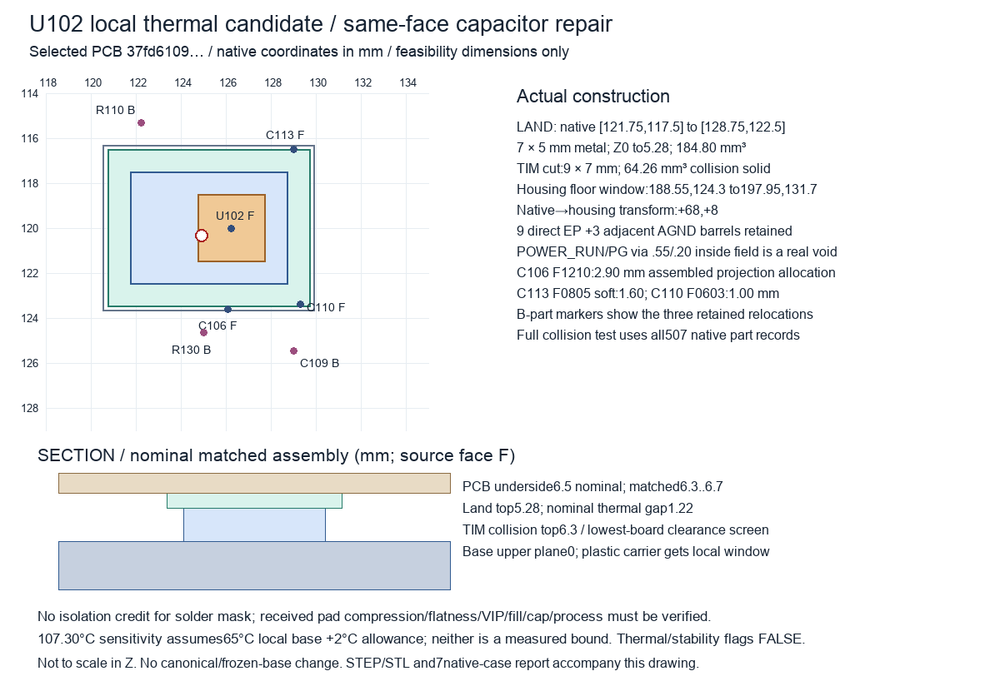

# U102 stronger path and local capacitor repair — separate candidate

The selected source is the electrical owner's **aux-front-cell PCB37fd610961d78a1336227015df1c58f8b609aac7fb424adbef3729718547243c**, copied immutably under `repaired/`. Raw native ERC/DRC/parity/opens are all zero. The necessary same-face input/output capacitor repair is implemented and the real thermal land/TIM geometry clears the captured mechanical envelopes. **Stability, thermal path, physical fit, fabrication and release remain unqualified.** Neither canonical P03 nor the frozen thermal kit was modified.



The [source-bound thermal replay](generated/front-cell-thermal.json), [seven native geometry cases](generated/verification.json), [actual native electrical capture](repaired/evidence-capture.json) and [independent packet seal](handoff.json) name the exact input and actual artifact bytes. Native collision checks use all507 actual P03/E28 component records on both faces, mounting hardware requirements, tails, captured other-board/port reserves, controls including switch leads, the retained shell/metal base, return hardware and the captured positive-link prototype. They exclude the complete loose harness, unconstrained assembly tolerances and future sources. The parent also independently checked nine actual-body cases for this same source. No old candidate result is inherited.

## Actual source and capacitor repair

U102 is TPS7A1601DGNR, F.Cu native126.25,120, housing194.25,128 (native→housing transform+68,+8). Its source allocation is0.961307 W, an unverified90 mA budget. Nine direct EP barrels and three adjacent AGND barrels are retained. The actual new POWER_RUN via at124.925,120.325, land0.55/bore0.20 mm, is **U102 PG/pin3**, not EN/pin5. Its foreign copper/clearance and bore receive no AGND thermal credit.

The [TI TPS7A16 RevF datasheet](https://www.ti.com/lit/ds/symlink/tps7a16.pdf), §8.2.1.2.1.3 printedp15 and §10.1 printedp19, requires at least0.1 µF input and2.2 µF output and calls for close same-face capacitors and direct output-capacitor ground routing. This source has:

| Part | Actual native pose / face | Selected component | Maximum assembled projection allocation |
|---|---|---|---:|
| C106 |126.1,123.6 / F|TDK C3225X7R1E106K250AC,10 µF25 V X7R1210|2.90 mm|
| C113 |129,116.5,180° / F|TDK C2012X7S2A105K125AE,1 µF100 V X7S soft0805|1.60 mm|
| C110 |129.3,123.4,270° / F|KEMET C0603C103J3GACTU,10 nF25 V C0G0603|1.00 mm|

The [dimension facts](sources/dimensions/verified-facts.json) distinguish manufacturer maximum body dimensions from the added PROJECT0.10 mm seating allowance. Exact MPN/footprint assertions are implemented in the shared height resolver; generic case heights undershoot C106/C113. Primary sources are the [TDK C106 sheet](https://product.tdk.com/en/system/files/dam/doc/product/capacitor/ceramic/mlcc/charasheet/c3225x7r1e106k250ac.pdf), [TDK soft-termination catalog](https://product.tdk.com/system/files/dam/doc/product/capacitor/ceramic/mlcc/catalog/mlcc_commercial_soft_en.pdf) and [KEMET C0G tables](https://content.kemet.com/datasheets/KEM_C1003_C0G_SMD.pdf). Failed direct PDF downloads are recorded; no unavailable PDF bytes or hash was invented.

Six authored direct front paths connect input, output and delay capacitors to the intended U102 pins and ground: [source-bound local loop receipt](repaired/generated/aux-local-loop-verification.json). Their lengths are4.45–9.40 mm. Native connection and same-face nominal capacitance do **not** establish shortest possible layout, effective capacitance under DC bias/temperature/tolerance/age, ESR/ESL, input impedance, startup, PSRR or load-step stability. C106 needs actual retained capacitance≥2.2 µF and C113≥0.1 µF; full effective lower bounds remain null. Remote C102/C108 bulk and C107100 nF do not substitute for this local cell.

## Real geometry and thermal calculation

The proposed insulated metal land is native[121.75,117.5]..[128.75,122.5],7×5 mm, housing[189.75,125.5]..[196.75,130.5], Z0..5.28. The TIM cut is9×7 mm, housing[188.75,124.5]..[197.75,131.5]. Its collision model extends fromZ5.28 to6.3; nominal board underside6.5 implies1.22 mm thermal gap. The proposed retained-floor window is housing[188.55,124.3]..[197.95,131.7]. [LAND STEP](generated/LAND.step), [TIM STEP](generated/TIM.step), STLs and the drawing describe a separate addition; the frozen base is untouched. Their actual combined volume249.060006 mm³ agrees with the249.06 mm³ construction calculation.

The received1.524 mm TGP6000ULM pad candidate, compression, pressure/contact resistance, cut tolerances, board flatness, filled/capped-via topography, dielectric isolation and aging require qualification. Metal remains electrically separate CHASSIS; no solder-mask/anodize insulation credit is used. Native clearance is approximately0.35 mm to J106's declared tail reserve and0.20–0.25 mm to the nearest relocated B courtyards. These are nominal envelope gaps, not an approved tolerance stack.

The model uses actual saved six-layer AGND fills, absolute pad angles, straight tracks and matching plated barrels. Foreign-node voids and real holes are excluded. It gives no copper-core credit to resin fill and no invented FR4/air conductance. Required50 µm wall,85 µm outer/70 µm inner copper, VIP fill/cap/web/annulus/plating/registration and the nine0.70 mm lands against the native1.68 mm EP require custom fabricator approval.

| Actual grid320 diagnostic | Repaired37fd |
|---|---:|
| Matching B.Cu under35 mm² land |29.7211 mm²|
| Nominal total reference path |33.0948 K/W|
| Nominal junction at hypothetical60 °C local base |91.8142 °C|
| Declared sensitivity reference path |41.9247 K/W|
| Sensitivity junction at hypothetical60 °C local base |100.3025 °C|
| Sensitivity at65 °C local base plus2 °C allocated allowance |107.3025 °C|

Nominal inputs are Cu385 W/mK, TIM **typical**6 W/mK, gap1.22 mm, additional contact0.8 K/W, package reference14.9 K/W, PCB1.6 mm. Sensitivity inputs are Cu350, TIM4, gap1.5, contact2, the same reference package metric and **1.76 mm total PCB** with dielectric rescaling. Lower conductivities/contact allowances are declared assumptions, not manufacturer guaranteed bounds. Grid160 and320 differ by about0.087 K/W nominal and0.182 K/W sensitivity; mesh agreement does not establish physical accuracy.

The derived necessary total-path upper at65 °C base/2 °C allowance is44.7308 K/W. The apparent2.70 °C reference margin is conditional: package/path/material/contact/power/base upper bounds and actual positive expanded uncertainty are missing. The local single-source network also omits neighbouring-device PCB cross-heating. All actual upper fields remain null; no guardbanded thermal pass is granted.

## Whole-base boundary failure remains open

The [captured T01 replay and audit](generated/base-model-audit.json) reproduces all five prior scenarios exactly. At40 °C assumed ambient and10.557757 W **supply losses only**, the global peak is74.84 °C at assumedh1 W/m²K,64.60 °C at h2 and59.30 °C at h3, with emissivity0.8/view factor0.5. At h3/emissivity0.05 it is63.59 °C. No measured installed airflow, radiative surroundings or received finish establishes those assumptions;60/65 °C are not base-temperature upper bounds.

The supply also delivers about12 W digital and1.255 W analog plus bipolar/auxiliary power. Delivered power is not measured internal heat; dissipation, exported/optical power and the fraction entering this base are unbounded. Assigning all supply loss to the plate is conservative only for that incomplete source set. Ideal3×3 plate injection for unlanded devices does not establish their real junction/interface path. Whole-unit source loss/heat partition, installed orientation/feet/table airflow, finish/material properties, neighbouring heat and measured expanded uncertainty must be bounded before accepting an absolute junction temperature.

## Preserved failures and separate U10 diagnostic

`closed/` preserves fully native-closed c95 and its concrete manufacturer same-face capacitor-layout failure; [failure audit](generated/regulator-layout-failure.json) remains valid for that source. `variant/` retains the strict B-only three-open comparison. `vip_variant/` retains13 real shorts/clearances from the attempted new output via. Aggressive/partial-hole-removal trials are explicitly rejected. No physical oscillation is inferred from a layout rule or simulation result.

The separate [closed-U10 replay](generated/closed-U10-replay.json) preserves actual f94c8 geometry and fails the65 °C-base-plus2 °C scenario at114.294 °C. Its [strict40-B-transit removal probe](generated/U10-B-transit-probe.json) preserves all original barrels, but has four opens and only a conditional108.830 °C result. The electrical owner's later restoration changes copper/barrels and must be re-extracted; neither this number nor the older draft temperature may be inherited. No U10 source was adopted or modified here.

## Verification and remaining work

Portable checks exercise absent required metal, forged-empty collision rows with real solids, real nonzero collision volumes, incorrect witnesses, nonzero CLI rejection, sealed-byte changes, old cap-layout mutations and whole-base scope. Run:

```sh
python3 -S -m unittest hardware.cad.a12.thermal.candidates.u102_stronger.test_audits hardware.cad.a12.thermal.candidates.u102_stronger.test_handoff tests.tooling.test_aux_selected_parts tests.tooling.test_repaired_integration
python3 -m hardware.cad.a12.thermal.candidates.u102_stronger.handoff
```

Actual solvers/native tools remain optional for portable CI. Replaying a new PCB requires a fresh coherent body packet, actual saved fills, loop/native receipts, source binding and native geometry checks. Before adoption: close effective-capacitance/loop-stability evidence, custom C50/VIP process approval, received TIM/contact/isolation/tolerance tests, full-unit heat/base bounds and actual instrumented junction/load/ambient measurements. Every physical, thermal, stability, fabrication and release flag stays false.
