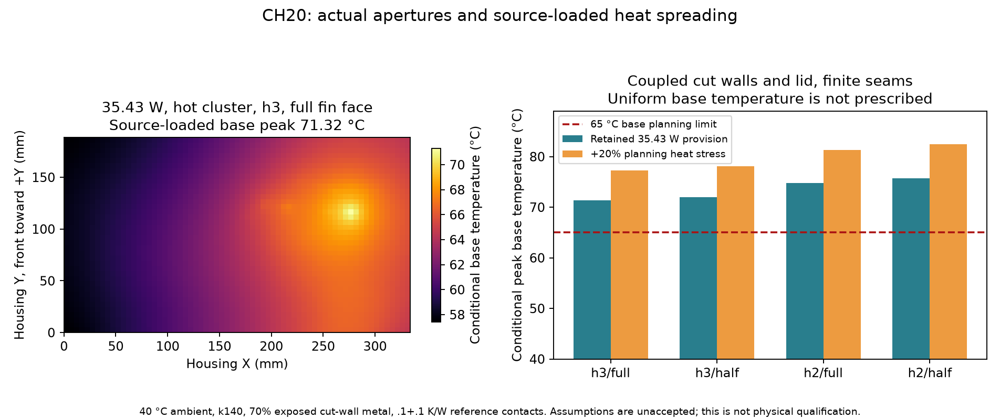

**The enlarged conductive-housing proposal fails the60/65 °C base planning screens in every source-loaded coarse reference case.** Unlike H20's prescribed65 °C capacity sum, this model solves the nonuniform base, cut walls and apertured lid together through finite contacts. No metal part or cooling installation is adopted.



At40 °C ambient, assumedk140 W/mK,70% exposed remaining wall metal and0.1+0.1 K/W reference contacts:

| Bottomh / effective fin face |35.4315 W uniform-unplaced / hot-cluster base peak|+20% heat-stress hot-cluster base peak|
|---|---:|---:|
|h3 / full|67.245 /71.317 °C|77.259 °C|
|h3 / half|67.951 /72.033 °C|78.105 °C|
|h2 / full|70.730 /74.815 °C|81.338 °C|
|h2 / half|71.656 /75.751 °C|82.437 °C|

The20% stress is **42.5178551 W planning heat**, not a newly invented measured load upper bound. The single requested0.2+0.2 K/W joint sensitivity at hot-cluster/h3/full-fin/stress reaches78.995 °C, compared with77.259 °C at0.1+0.1. Neither scenario establishes installedh, source power, material/contact bounds or a qualified20% margin.

The35.4315 W hot-cluster/h3/full case rejects19.1298 W from the base,5.8419 W from the walls and10.4599 W from lid/fins. Its base peak is71.3169 °C while the lid peak is59.2775 °C. This difference is precisely why a uniform-base capacity sum cannot establish loaded base temperature. Energy residual is2.0×10⁻¹⁰ W. All bounded cases conserve heat; those numerical checks do not establish real boundary conditions.

`geometry-contract.json` defines the proposal. The334×188.4×6.2 mm base retains captured WU source projections and the H20 proposed1037-pin pattern. Unplaced heat stays over the old footprint or old hot cluster; it is not silently relocated into the new strip. Replacement2.8 mm conducting walls reach the43.6 mm seat plane. The2 mm lid's **actual captured native STL** supplies the apertured metal region; the structural blank remains material-unqualified.

The four-wall mesh explicitly removes the282×27.2 mm rear cassette opening and nine3×8 mm front slots. Remaining wall metal area is37,666.88 mm² after7,886.4 mm² removal. The70% exposure factor then applies to that remaining metal. No conducting cassette, boss, screw, internal-air or perfect-port bridge is credited. Corner conduction is a declared thin-wall approximation; actual rounded corners and a manufactured conducting replacement remain open.

Actual lid triangles yield51,327.241 mm² metal. At67×38, the lid has2,493 finite-volume nodes, including34 cells with multiple separate metal pieces. Separate pieces remain separate nodes; only real shared metal faces conduct. Their sheet graph remains connected without artificial links. Old actual FF02 fins retain their XY,18 mm height and0.03222323 m² vertical surface; no new front fins or extra fin radiation are added. Their root relocation to the new lid and controls still requires actual native metal/assembly review.

The finite base-wall joint is distributed by the declared1,044.8 mm thin-wall contact length. Actual native seat/lid overlap after excluding boss disks is1,477.215 mm²; the wall-lid joint is distributed by that area. Each pure-contact conductance sum is exactly10 W/K for0.1 K/W, or5 W/K for0.2 K/W, independent of subdivision. Base half-cell, wall half-cell, proposed2 mm conductive seat bridge, lid half-thickness/lateral spreading and fin-root lid-thickness resistances are finite. The contact-reference sum0.2 K/W is not a measured whole-assembly resistance or permission to assume equal heat through both joints.

A new conducting wall/foot/ledge must actually replace or bridge the present insulating structure to reach the metal base. Current plastic CAD geometry supplies only the shape reference; it supplies no heat conduction. The1.5 mm lid-seat overlap, pressure, attachment, electrical isolation, control/body contact, finish, tableside clearance, convection, neighboring plumes and uncertainty all require matching parts and physical evidence. All source heat is idealized into base projections: package/PCB/TIM and real internal air paths are not solved, so base temperatures are not junction predictions.

The current [Bourns PTV09 data sheet](https://www.bourns.com/docs/Product-Datasheets/ptv09.pdf), page1, gives a−10..+50 °C series operating range. An exact suffix remains unselected. **A60/65 °C base screen is not potentiometer temperature approval**, and a lid node is not a measured pot body/air temperature. A real local control/bushing/air/isolation assessment or a newly selected part is required; this model does not invent that heat path. See `control-temperature-hold.json`.

Four decoupled-wall controls reproduce the H20 base-only equations: k167 gives86.1931/90.0075 °C and k140 gives86.9181/91.4254 °C. Differences from the separately retained reference solver are≤1.5×10⁻¹⁴ °C. There are16 loaded cases, one doubled-joint sensitivity and these four controls—**no optimization or spatial refinement sweep**.

Use the frozen API for a separate requirement packet:

```python
from hardware.cad.a12.thermal.coupled_housing20.api import load_inputs
from hardware.cad.a12.thermal.coupled_housing20.coupled import solve
contract, design, placements, geometry = load_inputs()
result, fields = solve(contract, design, placements['unplaced_hotcluster'],
                       geometry, bottom_h=3, fin_face=.5,
                       heat_scale=1.2, contact_r=(.2, .2))
```

Runtime: `/private/tmp/afx-thermal-cad-env/bin/python`, with `PYTHONPATH=/private/tmp/afx-coupled-geometry:.`. Shapely2.1.2 is isolated in that temporary dependency folder; existing scientific environments were not modified. `generated/environment.json` records versions. Root's next packet may derive a requiredh from this same source-loaded model; that requirement is not a fan CFM specification or installed cooling guarantee.

`generated/analysis.json` binds code/inputs, geometry integrity, contacts, source-loaded flows, residuals and all cases. Tests preserve contact normalization under subdivision and reject false physical/uniform-base/cassette-bridge/cell-short/contact-double/stress-upper claims. `errata/J29-service-bounds.json` separately records the5 µm cached-versus-serialized service-bound difference without changing its old board or seal. All thermal, physical, matched-metal and fabrication-release flags remain false.
