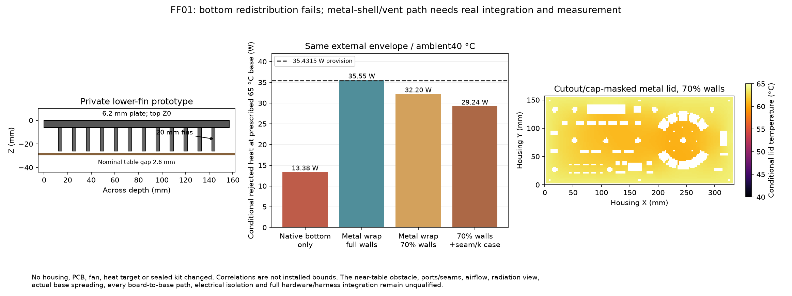
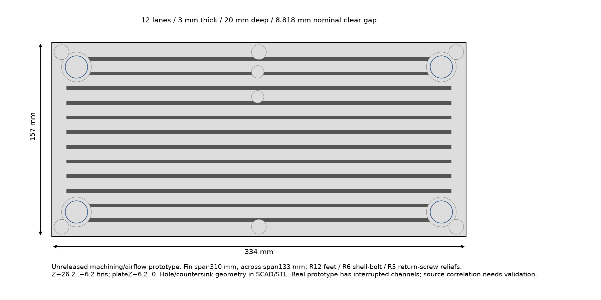

# FF01 — passive cooling within the current envelope, private feasibility only

**Redistributing the underside fins does not close the retained35.4315 W /40 °C ambient heat provision.** A separate conductive-sidewall/lid concept is physically worth investigating, but its optimistic65 °C result has essentially no margin and the declared seam/area cases fail. This packet does not establish an installed heat-rejection guarantee, adopt a housing change or reduce any load reserve.



[Analysis](generated/analysis.json), [native geometry](generated/native-geometry.json), [dimensioned prototype](generated/dimensioned-prototype.svg), [SCAD](generated/prototype.scad), [bottom STL](generated/bottom.stl) and [apertured lid STL](generated/lid.stl) are separate review artifacts. All previous seals and canonical electronics remain unchanged.

## What volume is actually available?

The captured height receipt gives87.6 mm nominal overall height including controls: control topZ58.8, tableZ−28.8. The metal plate underside isZ−6.2, leaving22.6 mm down to the table. The original858 square3×3×12 mm pins have4 mm gaps and10.6 mm nominal table clearance. Their effective outside convection area in WU01 is about0.175 m²; WU01's uniformh1/2/3 values are assumptions applied over that area, **not measured installed coefficients or a vertical-channel correlation**.

The private machined-fin prototype uses12 interrupted310 mm lanes,3 mm thickness,20 mm height and8.818 mm clear spacing across133 mm. It retainsR12 foot, R6 shell-bolt and R5 return-fastener exclusions and the through-hole/countersink locations. Native OpenSCAD exports are nonempty with no zero-area faces. The bottom reports Manifold NoError; the extruded lid is reported as PolySet. Both saved STLs independently have one connected closed, consistently oriented boundary. Dimensions and triangle-derived area are checked. The actual lower wetted area, after conservative subtraction of four foot disks, is about0.1954 m². The gap to the table becomes only2.6 mm. Loaded bumper compression, production tolerances and installed airflow are unbounded; this is not an approved mechanical assembly.



## Horizontal fins, buoyancy and radiation

The [Tari/Mehrtash original authors’ paper](https://users.metu.edu.tr/home102/itari/wwwhome/TariMehrtashATE2013.pdf) supplies a specifically **downward horizontal** plate-fin relation, `NuS=0.0149 sqrt(RaS)`. Its source geometry includes3 mm fins,8.8–14.7 mm gaps,5–25 mm heights and250/340 mm lengths. Our157 mm width differs from180 mm, and the nearby table, feet and interrupted channels require validation. Reported research scatter is not a guaranteed assembly uncertainty. The relation is not transferred to the original square pins.

At65/40 °C, the screened8.85–12.4 mm gaps give roughly1.6–1.9 W/m²K. Full-footprint20 mm arrays reject about9.5 W by convection; actual interrupted geometry gives about7.7 W under the same conditional relation. More tightly packed area cannot be credited with unchangedh. Fin efficiency is calculated explicitly; the short aluminum fins are nearly isothermal, so additional area and access to buoyant flow—not axial fin conductivity—dominate this screen.

Internal fin faces do not each see the room independently. A deliberately generous control gives the entire enclosing lower projected-plus-side aperture blackbody radiation. Even that control with a20% upward convection perturbation and zero-clearance22.6 mm fins stays below27.3 W at65 °C, versus35.43 W required. It is an optimistic comparison within the stated model, **not a rigorous physical upper bound on every possible geometry**. A table can alter convection/radiation and become warmer than ambient. No beneficial table conduction is assumed.

An illustrative full-span14-fin extrapolation would need about40.8 mm fin depth even with the black-aperture control to reach35.43 W at65 °C. Keeping2.6 mm table clearance would raise overall height to108.4 mm. The emissivity0.8/view0.5 case needs about65.3 mm fins/132.9 mm overall. These depths exceed the paper's25 mm height range; they are **out-of-envelope sizing proposals, not validated sink selections**. At60 °C the corresponding dimensions are larger.

## Same-envelope conductive-shell proposal

A separate2 mm metal lid retains the captured actual A11 control apertures. The thermal raster removes those apertures and masks knob/key/display footprints from external heat exchange. A six-node2.8 mm metal-sidewall ladder feeds a finite-volume lid, using actual remaining lid conduction paths. Top and side coefficients update at their evolving group-mean temperatures. [Churchill/Chu's original vertical-plate relation](https://doi.org/10.1016/0017-9310(75)90243-4) is used only for the vertical walls; [Lloyd/Moran's A/perimeter planform relation](https://doi.org/10.1115/1.3450224) is used for the upward lid. Planform mass/heat analogy, obstruction by raised controls and interactions between neighboring surface plumes remain limitations. Air properties use [NIST's conductivity table](https://tsapps.nist.gov/publication/get_pdf.cfm?pub_id=907540) and [NASA's viscosity expression](https://ntrs.nasa.gov/api/citations/20060053240/downloads/20060053240.pdf), with declared dry-air density/cp approximations.

The base is prescribed isothermal at its target—already optimistic. Bottom convection uses the **native notched area**, with emissivity0.8/view0.5 radiation; metal walls/lid use emissivity0.8 and unobstructed-room radiation. The wall-area fractions and seam resistance are sensitivity assumptions, not measured port/seam bounds.

| Conditional same-envelope proposal | Rejected heat at60 °C base | At65 °C base |
|---|---:|---:|
|Full metal walls, typicalk167, zero seam resistance|27.14 W|35.55 W|
|70% exposed wall area, otherwise same|24.56 W|32.20 W|
|70% walls,k140,0.2 K/W common seam|22.35 W|29.24 W|
|Same, emissivity0.5|18.80 W|24.75 W|

The35.55 W result leaves only0.12 W before any uncertainty, actual base spreading or junction interfaces. **It is not a useful acceptance margin.** The70%/seam cases remain short by3.23/6.19 W at65 °C. Fine-grid lid refinement changes its heat transfer by about0.008 W; that numerical agreement does not bound physical model error. Coarse raster islands are explicitly excluded and reported; the finest grid has none. Conduction and surface heat agree to better than1 µW in all saved cases.

This proposal replaces insulating sides/lid with a different conductive structure; its metal seams, ports, lid seat, protective electrical separation, chassis policy, control mounts, touch-surface requirements and complete harness/PCB geometry need their own design. The saved lid is an aperture prototype, **not a completed replacement shell**. It cannot inherit the current plastic-case clearance or electrical-isolation evidence.

## Vent paths cannot be added as an arbitrary cooling coefficient

A horizontal underside channel whose inlet and outlet are at equal elevations has no full-height chimney head. A real through-case design needs distinct low inlets/high outlets and an unobstructed path past boards, guide plates and wiring. The available shell stack is only about36 mm.

A deliberately optimistic buoyancy/Bernoulli/energy calculation, with two equal openings, uniform outlet-temperature density across the entire stack and zero internal drag, requires **129 cm² free area at each opening** for35.43 W at a25 K outlet-air rise whenCd=0.6. At a15 K rise it requires273 cm² each. Cd0.6 is a scenario, not a selected vent guarantee. Such numbers do not support a small cosmetic vent solving the whole heat load.

For a **5 W supplemental branch**, the same15 K-rise calculation needs38.5 cm² per opening before accounting for the cooler mean column and internal obstruction. A deliberately less optimistic half-temperature mean column would increase that to about54.5 cm². Thus a private metal-wrap prototype with roughly60 cm² net low/high openings and a deliberate internal passage is a concrete next study; it is not an accepted design. The real guide/carrier/port changes, heat split into air versus metal, radiator area lost to openings, recirculation and all pressure losses must be solved together. Adding an independent vent-watt credit to the existing all-to-base model would double-count heat transfer unless that split is rebuilt.

## Next concrete action and acceptance evidence

The current footprint/height has no demonstrated robust passive solution under this retained provision. The next useful fanless trial is a **source-matched thermal maquette** of the actual metal-wrap/low-high passage concept, followed by the complete physical unit. Before any adoption, it needs the real port/cap/wiring obstruction geometry, a measured seam conductance, measured finish/emissivity or conservative characterization, actual board-to-shell heat paths and sufficient free area at both apertures. At35.4315 W/40 °C, the installed complete assembly must demonstrate the necessary base-to-ambient resistance of0.5645 K/W for60 °C or0.7056 K/W for65 °C, with positive uncertainty and local hotspot/interface allowances. These are derived project requirements, not supplied hardware ratings.

Actual supply/endpoint workload power, incoming air/table temperature, feet compression, orientations/tilt, hand/object obstruction, dust, altitude and steady/transient stabilization must be characterized. Each IC's package/Cu/TIM path remains separate. No inlet, fan, larger sink, PCB or housing is selected here; purchases and fabrication release remain false.

```sh
python3 -S -m unittest hardware.cad.a12.thermal.fanless_feasibility.test_feasibility
python3 -m hardware.cad.a12.thermal.fanless_feasibility.validate
AFX_FANLESS_SOLVER_TEST=1 python -m unittest hardware.cad.a12.thermal.fanless_feasibility.test_feasibility
```

All installed bounds remain null. Physical tests remain zero. This is private feasibility evidence, not a thermal qualification.
