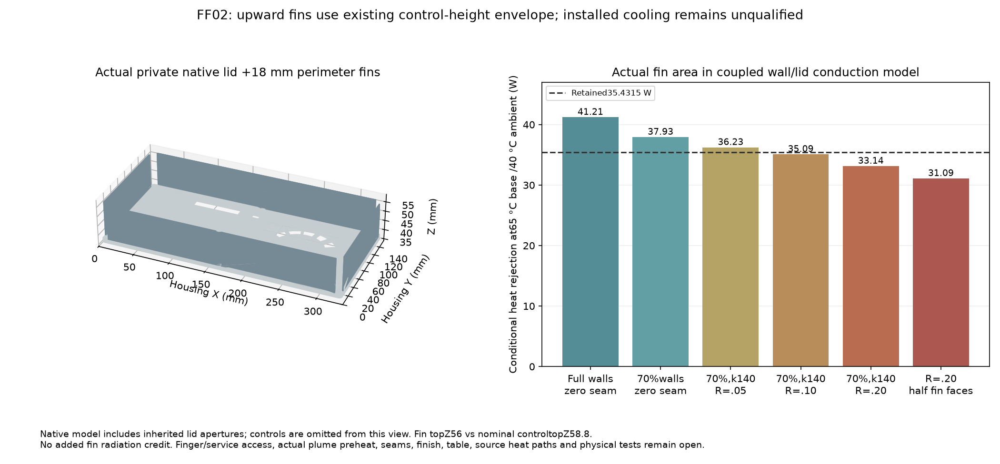

# FF02 — upward perimeter fins within the existing height, private addendum

**A metal-shell/perimeter-fin prototype is plausible at the65 °C base target under favorable assumptions, but no installed passive solution is qualified.** The real seam/airflow sensitivity cases still fail, and every60 °C case fails the unchanged35.4315 W/40 °C ambient provision. No existing geometry or completed seal is changed.



This is a separate addition to immutable [FF01](../fanless_feasibility/README.md), using the unused height above the lid rather than assigning a larger convection coefficient. The [native SCAD](generated/prototype.scad), [finned-lid STL](generated/lid-with-fins.stl), [isolated fins STL](generated/fins.stl) and [source-bound model](generated/analysis.json) are reviewable private artifacts. The lower fin prototype and all limitations of FF01 remain part of these conditional comparisons.

The captured nominal lid top isZ38; the highest controls reachZ58.8. Four2 mm perimeter strips rise18 mm toZ56. They lie atY3.5..5.5 and151.5..153.5 acrossX12..322, andX3.5..5.5/328.5..330.5 acrossY12..145. The root is clipped to the inherited actual lid apertures, captured cap footprints plus a **2 mm project XY margin**, andR4.2 lid-fastener reserves. These margins are proposals, not demonstrated finger, tool, hot-touch or lifetime clearances. The nominal overall height stays87.6 mm; production tolerances and actual installed control height remain unqualified.

Both native models are independently checked for closed, consistently oriented boundaries without degenerate faces. The combined lid is one connected component, with actual topZ56. Existing controls are omitted from the rendered view; the source geometry includes their projected cap exclusions. This is not a complete source-native MCAD clearance proof for all controls, fasteners, guide plates and harnesses.

## Actual area and conduction

The native fin triangles supply **0.03222323 m² vertical area** and0.00175597 m² root area. Their projected line segments/triangles are clipped into the lid thermal grid; vertical/root area conservation residuals are below2×10⁻¹⁷ m². The fin roots remove corresponding flat-lid convection/radiation area. The finite-volume model retains the actual cutout/cap-masked lid and conducting sidewall ladder. Fin convection acts at its actual roots, not an ideal lumped isothermal area.

The copied model applies the same primary vertical-plate correlation cited in FF01 to the18 mm fin height, updating at area-weighted root temperature and calculating axial fin efficiency. It grants **no additional fin radiation credit**. However, further shadowing of adjacent lid radiation is unresolved, so this is not a proven conservative total-radiation bound. The fin surfaces can receive warmer sidewall/lid plumes; fresh ambient at every face is an optimistic assumption. A half-face convection case is a sensitivity, not a measured lower bound.

| Conditional case at65 °C prescribed base | Total heat rejection | Margin to35.4315 W |
|---|---:|---:|
|Full sidewall exposure,k167, zero common seam resistance|41.21 W|+5.78 W|
|70% sidewall exposure,k167, zero common seam|37.93 W|+2.50 W|
|70% sides,k140,0.05 K/W common seam|36.23 W|+0.80 W|
|70% sides,k140,0.10 K/W common seam|35.09 W|−0.34 W|
|70% sides,k140,0.20 K/W common seam|33.14 W|−2.29 W|
|Same0.20 K/W case, half fin-face convection|31.09 W|−4.34 W|

The common seam is inserted at the **base-to-sidewall entry** in this model. It is not a universal limit for a differently located lid seam or a manufacturer's joint specification. Actual lid-seat conductance and port-induced wall spreading remain unresolved. These numbers cannot become assembly acceptance limits without mapping every actual interface and adding positive uncertainty/hotspot allowance. Axial aluminum conductivity is not the sole issue; seam conduction, plume temperature and unobstructed area materially change the outcome.

At60 °C, even full wall exposure/zero seam gives only31.49 W (about4 W short); other declared cases are worse. The65 °C nominal successes cannot certify85/110 °C junction allocations: actual source-to-base spreading, package/Cu/TIM/contact paths and whole-board heat transfer are separate.

## What this makes concrete

A **same-envelope metal chassis/lid with upward perimeter fins** is a more useful fanless physical prototype than adding tightly packed underside area. The retained2.8 mm wall region would need a real conductive structure and verified source isolation/chassis treatment. The existing insulating shell, lid/carrier attachments and control bushings cannot simply inherit that substitution. It needs full actual control/key-travel, finger/tool access, ports/mated cables, harness, thermal expansion and assembly review. The narrow perimeter ridges may be unacceptable ergonomically even when nominal cap solids clear them.

The next thermal trial should impose the retained distributed power on a source-matched metal/fin assembly at40 °C ambient, characterize the actual base-to-wall and lid seams, installed fin-face inlet temperature, radiation/finish, feet/table clearance and local temperatures, then include full real electronics and workload power. The favorable65 °C cases leave only limited margin; the current sensitivity results do not justify fabrication or release. Vents, efficiency changes and heat-split changes would require a renewed combined model, not independent watt credits added to this result.

All primary-source applicability, orientation, dry-air-property, obstruction, radiation and missing-source-power qualifications from FF01 remain. Source and artifact hashes bind its complete immutable seal and the exact additional geometry/model. No fan, larger housing, purchase, current/load reduction or production cooling choice is adopted.

```sh
python3 -S -m unittest hardware.cad.a12.thermal.fanless_top_fins.test_fins
python3 -m hardware.cad.a12.thermal.fanless_top_fins.validate
AFX_TOP_FIN_SOLVER_TEST=1 python -m unittest hardware.cad.a12.thermal.fanless_top_fins.test_fins
```

Actual installedh/capacity/uncertainty bounds remain null; physical tests remain zero. Every thermal, material, electrical-isolation, fabrication and release claim remains false.
