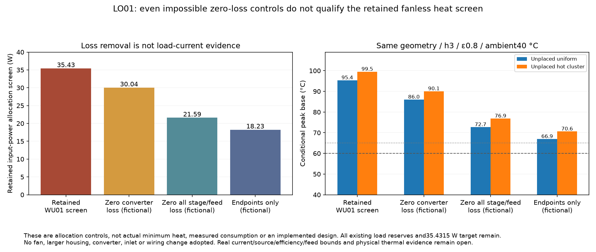

# LO01 conversion and feed-loss options — no adoption

Loss improvements are useful, but **they do not close the retained60/65 °C base screen by themselves**. With the same WU01 load allocations, h3/emissivity0.8 and40 °C ambient, even an endpoint-only counterfactual with every other watt removed reaches66.94–70.60 °C. This is an allocation comparison, not a proven physical minimum heat. Actual loads/efficiencies may differ and remain unqualified. The35.4315 W target and every existing load reserve remain unchanged.



[Source-bound calculations](generated/analysis.json) retain both unplaced-load alternatives from the sealed WU01 model. No fan, larger housing, connector, converter, PCB or control circuit is adopted. Primary documents and exact provenance/availability distinctions are in [primary facts](sources/primary-facts.json).

## How much loss could be removed?

| Counterfactual, retaining allocated endpoint power | Heat | h3 peak base, unplaced uniform / hot cluster |
|---|---:|---:|
|Existing WU01 screen|35.4315 W|95.36 /99.51 °C|
|All converter losses set to zero|30.0394 W|86.04 /90.05 °C|
|All converter, linear-drop and input-feed losses set to zero|21.5939 W|72.70 /76.86 °C|
|Only allocated delivered endpoints remain|18.2339 W|66.94 /70.60 °C|

The last cases are deliberately impossible controls, not proposed circuits. They preserve the endpoint reserves while deleting other heat only in that mathematical experiment. No physical minimum, loss guarantee or lower target follows. The same model has no demonstrated installedh lower bound; these comparisons do not prove that a physical fanless design could never attain a largerh or lower actual consumption.

Making all three conversion blocks95% efficient would save4.1977 W on paper. No selected architecture or manufacturer minimum supports that blanket efficiency. Even deleting all5.3921 W of allocated converter loss is insufficient under these retained load assumptions. Measured or guaranteed loss reduction must remain distinct from replacing a conservative efficiency assumption with a typical graph.

## Input-feed opportunities and limits

The complete0.36 Ω loop already includes Q101/U101. Its4 A planning partition is:

| Term | Resistance | Heat at4 A | Evidence class |
|---|---:|---:|---|
|Rear jack pair|60 mΩ|0.9600 W|Catalog initial-contact interpretation|
|Four internal VH interfaces|80 mΩ|1.2800 W|Catalog environmental-contact entries|
|Wire pair|5 mΩ|0.0800 W|Unmeasured hot acceptance allocation|
|Inlet PCB copper|9.05 mΩ|0.1448 W|Conditional native calculation|
|Q101|40 mΩ|0.6400 W|Hot engineering allowance|
|TPS2663|53 mΩ|0.8480 W|Specified-temperature Ron parameter used in an unverified assembly/current case|
|Remaining fuse/P03 copper capacity|112.95 mΩ|1.8072 W|Unproved remainder, not an identified dissipating component|
|**Complete loop**|**360 mΩ**|**5.7600 W**|**No complete hot/lifetime measurement**|

The1.8072 W remainder is uncertainty capacity. Measuring a lower real resistance could close a conservative envelope; it is not a hardware efficiency change. Likewise, WU01's source-consistent steady feed calculation gives2.8445/2.2845 W at its two static input endpoints. That does not mean a component was improved:4 A is an enclosing planning corner, not the computed current of every mode. Actual internal/external contact heat location remains unproved.

Two actual hardware options deserve bounded review:

- **Replace internal VH disconnects with retained16 AWG wire and four soldered terminations.** The four catalog contact entries would disappear, but new joint resistance, strain relief, retention and inspection must be established. Ideal zero-resistance joints cap the paper benefit at1.28 W at4 A. An illustrative4 mΩ aggregate joint case gives1.216 W; this is not a new acceptance limit or a guaranteed process. Serviceability/rework changes are real. No wire, port or joint was changed here.
- **A lower-contact-resistance inlet is possible, with a larger interface change.** The reviewed [Neutrik NC4MD-L-1](https://www.neutrik.com/en/product/nc4md-l-1.pdf) and [NC4FXX](https://www.neutrik.com/en/product/nc4fxx.pdf) use a male equipment inlet/female source cable and list≤5/≤3 mΩ contact resistance and10 A per contact. Interpreting the worse5 mΩ as one complete mated contact gives10 mΩ for a two-pole loop:0.80 W less than the old60 mΩ pair at4 A. Hot/aged measurement definitions are not established by those catalog numbers. This requires a different24 mm panel cutout, mate/cable/polarity/retention and a renewed adapter boundary/fit review. Retaining the original barrel connection in an external adapter would retain its resistance and invalidate simply subtracting it. No new inlet is selected.

The [selected Nexperia PSMN012-100YL datasheet](https://assets.nexperia.com/documents/data-sheet/PSMN012-100YL.pdf) distinguishes12 mΩ maximum at25 °C from33.1 mΩ at175 °C, both at the stated5 V gate/25 A test condition. The actual gate drive, current and complete temperature-profile applicability are not enclosed here. The room-temperature12 mΩ value must not replace the existing40 mΩ hot requirement. A direct local download returned HTTP403; official web text was reviewed and no unavailable PDF/hash is invented.

## Concrete AUX preregulator concept

The always-on AUX LDO currently dissipates most of its12 V input energy. A dedicated5 V buck upstream of U102 could reduce that loss while retaining its precision2.5–2.7 V interface. A reviewable part candidate is **LMR36506R5RPER**, identified as fixed5 V in the [TI RevC device table](https://www.ti.com/lit/ds/symlink/lmr36506.pdf). Its65 V input class is appropriate to investigate for this upstream role; the earlier28 V TPS62175 idea does not preserve the original60 V AUX input class without added overvoltage isolation. Component input class is not an assembled surge qualification.

The new buck must draw from `VIN_IC`, after Q101 and **before U101**. Feeding it from the existing protected5 V creates a circular startup dependency: AUX is needed to permit that protected supply. Its enable/startup, existing PG/POWER_RUN behavior, off states, reverse injection and60 V input/environmental protection must be rebuilt and checked. Added input/output capacitors, inductor, switching-current loops, grounding, noise/EMI, losses, PCB/MCAD and default-off supervision remain unimplemented.

At5 V and the retained90 mA output plus100 µA LDO-ground allocation:

| Assumed new buck efficiency | Complete AUX input | Conditional reduction from1.18932 W |
|---|---:|---:|
|85%|0.5300 W|0.6593 W|
|90%|0.5006 W|0.6888 W|
|95%|0.4742 W|0.7151 W|

These are whole-AUX input comparisons, including the remaining U102 drop and new buck loss; no output/drop current is counted twice. Efficiency curves are typical; none of these efficiencies is a guaranteed hot90 mA minimum. The part's fixed5 V full-corner/headroom behavior, output/capacitance/derating conditions and actual90 mA load upper still need an independent design. There is no native schematic/PCB or safe-energization proof for this concept. It cannot inherit the existing AUX thermal, loop or startup evidence.

## Smaller analog preregulator change

Changing the existing analog preregulator top resistor from110 kΩ to104 kΩ, keeping10 kΩ below, gives a nominal5.7 V concept. With the existing reference/error/bias allocations, the pre-ripple interval is5.6508–5.7494 V. Retaining50 mV ripple and450 mV dropout allocations leaves135.9 mV static headroom to the existing5.01487 V analog source upper. The same85% efficiency assumption gives only0.0892 W input-power reduction.

That small benefit costs roughly0.3 V of input headroom. Dropout, reference input conditions, PSRR/noise, SET-loop compensation, load steps and startup have not been requalified. The bias/ripple assumptions are not manufacturer guarantees. The precision/noise/output targets are unchanged; no resistor or circuit was altered.

## What can be acted on now?

First reconcile actual delivered loads and measure complete input/source loss under the maximum real workloads and hot conditions. Then independently bound the actual feed loop and its loss location; this targets the largest uncertainty without redesigning around a fictional current. If a private hardware trial is authorized, the upstream AUX buck is a specific modest loss-reduction candidate; internal connector removal has a larger serviceability/process tradeoff. Neither fixes the retained whole-unit thermal screen alone.

These option gains must not simply be added: changed source input current, feed loss, control consumption, startup and heat placement need a renewed coupled analysis. No load reserve, power/noise target, existing interface or sealed packet is revised by this study. No fan, larger enclosure or production cooling choice is made.

Portable mutations reject double-counted feed terms, promoted efficiency/catalog limits, fabricated minimum heat or implementation claims, circular AUX supply acceptance and changed targets. Optional SciPy replay checks the endpoint-only control:

```sh
python3 -S -m unittest hardware.cad.a12.thermal.loss_options.test_options
python3 -m hardware.cad.a12.thermal.loss_options.validate
AFX_LOSS_OPTIONS_SOLVER_TEST=1 python -m unittest hardware.cad.a12.thermal.loss_options.test_options
```

Actual heat/loss-saving upper bounds remain null. Physical tests remain zero. Every implementation, thermal, fabrication and release claim remains false.
