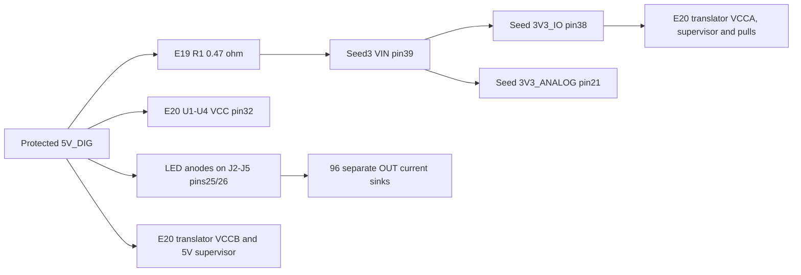

# PA01 LED and Seed current-budget provenance

**No actual LED supply/sink double count was found.** The captured circuit has distinct driver-VCC and LED-anode current paths. The380 mA `led_logic` label is360 mA for four driver supplies plus20 mA miscellaneous reserve; the additional384 mA is96 sink channels at4 mA each. The764 mA LED and1 A Seed allocations remain intact. The sealed WU01 heat screen is unchanged; this audit does not select cooling hardware or reduce its35.4315 W target.

The unresolved issue is the strength of those bounds. The actual16.5 kΩ LED setting does not match the manufacturer's90 mA supply-current test setting, and the reviewed Seed3 documents do not establish the1 A input-current provision or a maximum external3.3 V load. These are project allocations requiring further evidence, not measured draw or assembled guarantees.

## Actual native power paths

Fresh KiCad10.0.7 exports of immutable copies were compared against all49 E20 and76 E19 BOM parts/pins and the saved native PCB power pads. [Export commands/logs/hashes](generated/native-export.json) and the [audit result](generated/analysis.json) preserve the actual evidence. This is a native pin-role check, not a new ERC/DRC or physical qualification.



E19J11.2 carries `5V_DIG` directly upstream ofR1. The E20 driver/LED5 V branch is therefore separate from the Seed input branch; it does not pass through the Seed or its0.47 Ω input filter. E20U5 VCCA uses the Seed-derived3.3 V rail while its two VCCB pins use5 V. J11.3 carries that3.3 V rail. Counting3.3 V child output power again on top of the full Seed input-power provision would double count parent/child power; it is not done here.

## What the manufacturer actually specifies

Relevant pages of four downloaded primary PDFs were rendered and visually reviewed; [facts and byte hashes](sources/primary-facts.json) preserve revisions and test conditions.

| Primary source | Fact used | Limit of application |
|---|---|---|
|[TI TLC5947 RevB](https://www.ti.com/lit/ds/symlink/tlc5947.pdf), printedp6|ICC4 maximum90 mA atRIREF1.6 kΩ,1 V outputs, full grayscale, BLANK/serial controls low|ActualRIREF is16.5 kΩ; clocked operation also differs|
|Same, printedp21|Device dissipation separately includes VCC supply power and output-sink dissipation|Confirms distinct paths; gives no optical/export credit|
|[Seed3v2.1.0](https://daisy.nyc3.cdn.digitaloceanspaces.com/products/seed3/Daisy_Seed3_datasheet.pdf), printedp7/10|VIN4–17 V, two output-only3.3 V pins, USB default500 mA configuration|No reviewed table/section input-current maximum or3.3 V output-current capacity; USB configuration is not measured consumption|
|[TI SN74LVC8T245 RevD](https://www.ti.com/lit/ds/symlink/sn74lvc8t245.pdf), printedp9/11|Combined static no-load supply maximum12 µA under specified input states; Cpd values are typical|Actual loaded, switching translator and mixed rails require additional evidence|
|[TI TPS3808 RevN](https://www.ti.com/lit/ds/symlink/tps3808.pdf), printedp6|IDD maxima5/6 µA at the listed3.3/6.5 V test points|Output pullup sinking, sensing and other operating states are not included in those IDD rows|

TI's nominal current equation gives2.9818 mA at16.5 kΩ, or286.255 mA for96 outputs. Initial1% resistor variation alone gives2.9523–3.0119 mA. This is not a guaranteed low-current accuracy or hot4 mA ceiling. No monotonic extrapolation from a different ICC row, typical graph or30 mA accuracy row is adopted. Ninety mA per driver stays an engineering provision at this actual setting.

The20 mA miscellaneous term is also unpartitioned. E20's independent full-voltage resistor requirements are approximately1.2364 mA on the5.1 V domain and0.8709 mA at assumed3.3 V, using initial1% resistance only. These overbound mutually exclusive steady states; they exclude active/dynamic/leakage/inrush effects. The IREF resistors are not added again outside the driver supply term. The much smaller resistor subtotals do not establish that20 mA covers the complete board, nor do they justify removing reserve. Mixed3.3/5 V miscellaneous consumption needs an explicit source partition.

Firmware requests SPI1 prescalerPS_64. An actual source-clock/edge/loading/transfer-duty upper bound was not established by that enum. The audit does not treat static-table ICC, typical Cpd or nominal brightness as a complete all-state current limit.

## Seed provision and omitted child names

AST extraction records where the actual source numbers originate:

| Source/check | Seed current figure | Classification |
|---|---:|---|
|E19 `verify.py::passive_screen`|0.5 A|Assumed current used in its component/filter screen|
|Older E14 digital budget|0.6 A|Seed-and-its3.3 V-load allocation|
|P02 `distribution.LOADS.seed_local`|1.0 A|Current retained by P03 distribution and whole-unit screen|

The0.5 A screen does not verify1 A operation. At1 A, R1's initial1% resistance gives0.4747 V drop and0.4747 W. The1 W label is not an approved hot, assembled derating result. This heat is already part of source-side Seed branch power, not an additional wattage to add again. Actual module VIN, ripple/startup/load steps, R1 temperature/TCR/derating and source/cable losses need qualification.

P02's separately named3.3 V diagnostics list converter35 mA, control inputs20 mA and monitor20 mA. That75 mA list is not a complete inventory of all exported3.3 V loads. Actual attached components/pins are enumerated in the machine-readable audit, and further child demands include:

- E20 translator VCCA, its3.3 V supervisor and external pulls;
- E19 local GPIO/pulls and ten analog pot excitation branches;
- Trill Craft, AS5600 sensor and the unfinished SD-card interface;
- the state-dependent active, pullup, capacitive and leakage loads of converter/control/monitor interfaces.

Ten8 kΩ-minimum pots at assumed3.3 V alone draw4.125 mA before additional wiper/ADC loading; this is a conditional resistor calculation, not a proven analog-output current bound. These missing diagnostic names do not prove the enclosing1 A input provision is exceeded. They show why the child-current inventory, ground-return model and separate3.3 V source capacity remain open. The aggregate module input, its own CPU/memory/codec demand and its exports must be reconciled at the actual firmware states and regulator efficiency. No unrelated user reserve is silently reassigned or reduced.

## Evidence still needed

Obtain a manufacturer-supported ICC envelope at the actual LED current, output voltage, temperature and serial activity, or measure the installed circuit with an appropriate validated uncertainty allowance. Separately measure driver VCC, LED-anode/sink,5 V miscellaneous and3.3 V branch currents. Steady acceptance must retain the existing allocations; startup/blank/fault/brownout current waveforms need their own source and capacitance coordination.

For Seed3, obtain actual module/regulator-revision capacity and thermal constraints, then characterize input current and each exported rail across the real maximum DSP/audio/memory, SD-write, control/sensor and LED-update workloads. Reconcile every native and external child load before claiming a maximum. The public USB configuration and unrelated example firmware readings cannot substitute for that evidence. No external vendor message was sent and no physical measurement was performed.

Portable tests mutate the VCC/anode/Seed power paths, incorrect RIREF/test-state transfers, invented USB/module limits, reserve reductions and stale source bytes:

```sh
python3 -S -m unittest hardware.cad.a12.thermal.power_budget_audit.test_audit
python3 -m hardware.cad.a12.thermal.power_budget_audit.validate
```

Every actual current, physical and thermal qualification flag remains false. WU01, the285-file U102 packet, canonical schematics/PCBs, the enclosure and frozen thermal kit remain unchanged.
