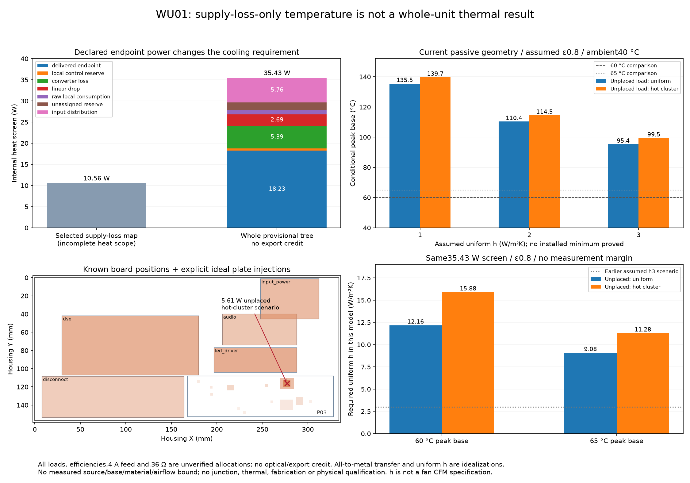

# WU01 whole-unit heat and existing-base replay

The retained simultaneous power provisions imply **35.4315 W internal heat** when all consumed power and uncertain feed losses are conservatively assigned inside the enclosure. The earlier10.5578 W map covers selected supply losses. It is not the whole-unit heat budget. This is a source-bound **allocation screen**, not a measured power upper bound or a qualified assembly result.

The existing base reaches95.36–99.51 °C in the h3/emissivity0.8 scenarios at40 °C assumed ambient. A60 °C peak base requires about12.2–16.7 W/m²K uniformh across the tested placement/finish scenarios;65 °C requires9.1–12.1. No installed heat-transfer minimum establishes those conditions. **The next design action is substantially stronger installed heat rejection or a proven lower whole-unit power envelope. Local TIM improvements alone do not supply the missing cooling.** No enclosure, canonical board, frozen thermal kit or sealed U102 packet was changed.



## Source-power tree

[The full leaf ledger](generated/ledger.json) records IDs, input current/voltage origin, consumer, category, source position/placement assumption and power. Its leaf sum agrees with the independent block input-power sum within7.2×10⁻¹⁵ W.

| Disjoint input block | Provisional power counted as heat |
|---|---:|
| Digital buck input, including protected2.4 A and separate24 mA source-local provision |14.4379 W|
| Analog preregulator input, including protected251 mA,3 mA bleed and5 mA LDO-ground provision |1.8563 W|
| Both bipolar converter inputs, including all regulated endpoints, source-local/ground loads and retained per-rail reserves |11.7920 W|
| Complete AUX input,90 mA output plus100 µA LDO-ground allocation |1.1893 W|
| Retained unpartitioned VIN control reserve,30 mA at13.2 V |0.3960 W|
| Complete input-feed loop,4 A and0.36 Ω provision |5.7600 W|
| **Total** |**35.4315 W**|

The35.4315 W is3.36 times the selected supply-only map. By leaf category it comprises18.2339 W delivered endpoints,5.3921 W converter losses,2.6855 W linear drops,1.0602 W raw-local consumption,0.5169 W local control provisions,1.7830 W unassigned reserve and5.7600 W input distribution. Assigning unused reserved capacity to heat is a deliberately conservative planning case; it does not assert that all those currents are simultaneously drawn.

Traceable source inputs are captured under `sources/`, with [capture hashes](capture.json) and [report lineage](generated/source-lineage.json). Current P03 analytical/bipolar and E28 partial-load report input bytes match their saved hashes. The historical heatmap has a stale native-netlist hash; it is retained only as the labeled10.5578 W comparison. The new heat calculation derives from the current analytical/bipolar provisions and saved actual native component positions, rather than treating that map as complete or fresh proof.

The main counting rules are explicit:

- P02 digital branches sum to2.4 A: Seed/local1.0 A, LED logic380 mA, four96 mA LED groups, bypass80 mA, input/output gain30 mA each, digital monitor80 mA and416 mA reserve. Analog branches sum to251 mA: ADC100 mA, converter140 mA, monitor3 mA and8 mA reserve. Existing416/8 mA reserves are counted once.
- The separately listed35/20/20 mA3.3 V consumers are children of the Seed's5 V input provision. Their0.2475 W nominal output is a diagnostic breakdown, not another power source added to the full5 V input. Seed/SD/3.3 V capacity and actual parent/child consumption remain unverified.
- Independent±12 V endpoint currents total151 mA per sign;±19 V output-stage provision is26 mA per sign. Negative-rail power is positive dissipated power. Signed ground-current basis values do not cancel heat or become additional power sources.
- The P03 native bipolar ledger supplies source bleeds, presence monitors, raw opamp/reference/SET/feedback demand and LT3090 ground-current provisions. The22.5 mA LT3090 ground allowance is included once. No fictitious LT3080 control-ground current is added.
- The new partial E28 native resistor inventory contributes0.54406/0.54420 mA onP19/N19 and0.38859/0.38978 mA onP12/N12. These actual existing-network provisions are counted separately from the **unimplemented**3 mA-per-rail future-controller reserve. Known E28 five-volt resistor demand is assigned within the existing416/8 mA reserves. Four retained Si8751 AUX maxima38 mA are inside the60 mA E28 AUX provision, which is itself inside the90 mA U102 output provision.
- RAW_N22's complete P03 demand57.1648 mA exceeds its old individual50 mA provision. However, the old pooled raw output allowance8.6691 W exceeds the P03-required7.4763 W; this is not evidence of a total pooled deficit. The new screen retains the greater of each old per-rail provision and its complete requirement plus known E28 resistors. Intermediate raw output power is split into delivered regulated power, linear/local dissipation and converter loss; it is never added again as an independent load.
- Output voltage and LDO-drop calculations use the same output corner within each block. U102 output power plus its drop/ground heat equals complete input power;90 mA×13.2 V is not added on top of that sum. The5 mA analog LDO input-ground term is kept separate from delivered output power.
- Source-side endpoint power already includes downstream switch/contact/wire/return heat. Additional downstreamI²R is not added to the same source power. Converter loss includes its inductor/diode/switch losses and is not added twice.

## Input-feed boundary and actual-current diagnostic

The captured H01 contract places the adapter boundary at its plug terminals. External AC conversion and captive cable resistance are not added again. Complete0.36 Ω loop provision includes Q10140 mΩ and U10153 mΩ: their combined4 A heat1.488 W is already within5.76 W. Only the remaining0.267 Ω contributes the additional4.272 W outside those two devices. No guard term is counted twice.

The remaining resistance includes rear jack, fuse, inlet copper, connectors and wire. The physical internal/external loss partition is unproved. Assigning all of it inside, at the actual inlet-board projection, is a conservative scenario rather than a statement that all4.272 W physically heat that board. Omitting all that uncertain upstream heat is only a diagnostic; it still gives88.92 °C at h3/emissivity0.8 with the more distributed placement. No external/export credit is adopted in the primary result.

A separate steady constant-power calculation uses the same retained source blocks and distinguishes the actual AUX branch afterQ101/beforeU101. At captured static plug endpoints11.43/12.57 V, it gives2.8240/2.5322 A total, with whole-input heat32.2784/31.8292 W and exact plug-power balance. These are self-consistent **model operating points**, not measurements, hot-capacity proof or a replacement upper bound. They show why the4 A heat screen is a provisional enclosing corner rather than the predicted current of every operating mode. Source transients, startup/fault/restart/hiccup, actual rail-dependent efficiency and complete concurrent loads remain open.

## Base model and placement

The model retains the captured334×157 mm external aluminum base,6.2 mm plate,858 integral3×3×12 mm pins and foot/bolt/return-support exclusions. It retains typical167 W/mK aluminum conductivity, the same finite-volume lateral conduction, nonlinear projected lower-face radiation, assumed0.5 radiation view factor, uniformh, fin efficiency and blocked foot area. It gives no cooling credit to the plastic shell, feet or internal air.

The new code changes source assignment: every declared watt is injected directly into an ideal plate source. Existing landed P03 devices use their actual T01 contact projections, including the notched U13 land; unlanded P03 devices use actual saved component positions with ideal3×3 mm injection. Known processor, output, LED-driver, E28 and inlet board projections come from the captured enclosure inventory. LED source power is conservatively assigned to the driver-board projection without crediting optical export or inventing the distribution between emitters and sinks.

**5.6128 W of endpoint demand lacks a board placement in that captured inventory**, including ADC/DAC/converter/input-range/monitor/bypass loads. Two alternatives are retained: distribute this subset uniformly over the base, or place it in a declared8×8 mm P03 hot-cluster projection. Neither alternative is an actual missing-board placement or a manufactured heat path. All-to-metal transfer loads the proposed base but does not solve actual PCB/package/TIM/internal-air temperatures, mutual heating or junctions.

| Uniformh (W/m²K),40 °C ambient | ε0.8 / unplaced uniform | ε0.8 / unplaced hot cluster | ε0.05 / unplaced uniform | ε0.05 / unplaced hot cluster |
|---|---:|---:|---:|---:|
|1|135.50 °C|139.71 °C|227.18 °C*|231.51 °C*|
|2|110.36 °C|114.54 °C|142.87 °C|147.15 °C|
|3|95.36 °C|99.51 °C|111.39 °C|115.60 °C|

*Values beyond actual material/component operating windows are fixed-coefficient mathematical failure screens. They are not physically valid high-temperature predictions or permission to energize an assembly there.*

At h3/emissivity0.8, the ideal U13 contact projection itself is95.18/98.81 °C area-weighted across the two placements, before adding a real package/PCB/TIM temperature rise. Thus the prior85 °C LT3471 PROJECT junction allocation has no thermal margin in these scenarios. No old local-path temperature is inherited or combined into a new qualified junction result.

Refining67×32 to134×64 changes the h3/emissivity0.8 peak by−0.0154 °C (uniform) and+0.00049 °C (hot cluster). Source/heat-rejection residuals remain below10⁻⁶ W. The new explicit-source interface also reproduces all five historical supply-only plate peaks exactly, with zero temperature delta. The recorded runtime is Python3.12.13, NumPy2.5.4 and SciPy1.18.1/SuperLU; see [environment](generated/environment.json). These checks establish numerical behavior, not the installed boundary conditions.

## Required cooling and next action

For35.4315 W at40 °C ambient, the necessary peak-base-to-ambient requirement is≤0.5645 K/W for60 °C or≤0.7056 K/W for65 °C, **before** a real uncertainty allowance or hotter ambient/radiative surroundings. In the67×32 model:

| Assumed finish / unplaced load placement | Uniformh needed for60 °C | Uniformh needed for65 °C |
|---|---:|---:|
|ε0.8 / uniform|12.16 W/m²K|9.08 W/m²K|
|ε0.05 / uniform|13.01 W/m²K|9.94 W/m²K|
|ε0.8 / hot cluster|15.88 W/m²K|11.28 W/m²K|
|ε0.05 / hot cluster|16.72 W/m²K|12.14 W/m²K|

The original h1–h3 assumptions do not make this passive geometry a plausible60/65 °C solution at the retained load provisions. This does not prove that a physical passive design can never attain largerh. It establishes the missing installed heat rejection that must be demonstrated.

The next hardware iteration needs either a proven materially lower simultaneous power envelope or stronger installed cooling, such as controlled airflow over the external fins or a separately reviewed larger external passive sink. A uniformh requirement is not a fan CFM specification or permission to scale fin area linearly. First reconcile/measure actual loads and heat exports; then characterize a real cooling assembly with the actual foot/table clearance, orientation, finish, airflow restriction, dust/aging and local base temperatures under distributed whole-unit heat. Preserve margin for measured positive expanded uncertainty. No new cooling component or production geometry is selected by this study.

## Evidence, tests and open limits

[Source-power ledger](generated/ledger.json), [all12 scenarios and8h brackets](generated/analysis.json), [source lineage](generated/source-lineage.json), [plots](generated/whole-unit-heat.svg) and the independent [packet seal](handoff.json) are reviewable without numerical dependencies. Portable tests mutate duplicate/missing power leaves, nested3.3 V/return double counts, sign cancellation, export/upper-bound claims and convergence status. An optional solver check replays the actual h3 case.

```sh
python3 -S -m unittest hardware.cad.a12.thermal.whole_unit.test_whole_unit
python3 -m hardware.cad.a12.thermal.whole_unit.validate
# With NumPy/SciPy available:
AFX_WHOLE_UNIT_SOLVER_TEST=1 python -m unittest hardware.cad.a12.thermal.whole_unit.test_whole_unit
```

No whole-unit heat upper, installedh lower bound, actual ambient/base upper, effective-capacitance/current/efficiency lifetime bound, full source dynamic capacity, assembled thermal path or expanded measurement uncertainty has been established. E28 local inventories remain partial; source-local/global reserves may overlap and require reconciliation. ADC35 mA/sign, Seed/3.3 V/SD, LED current/logic, coils, references, unimplemented startup controllers, bulk leakage and operating-state transients still require source-bound verification. The4 A/.36 Ω/75–85% efficiency inputs are provisions, not actual assembled guarantees. Physical tests remain zero and every thermal/fabrication/release flag remains false.

A separate [U102 count erratum](errata/U102-37fd-adjacent-via-count.json) corrects the sealed packet's narrative/drawing claim of three named adjacent vias: only two exist. The actual saved thermal parser enumerates17 matching domain vias/9 direct EP vias and already modeled those actual bytes. The285-file packet was not modified; its numerical sensitivity is not a fabricated third-via solve.
