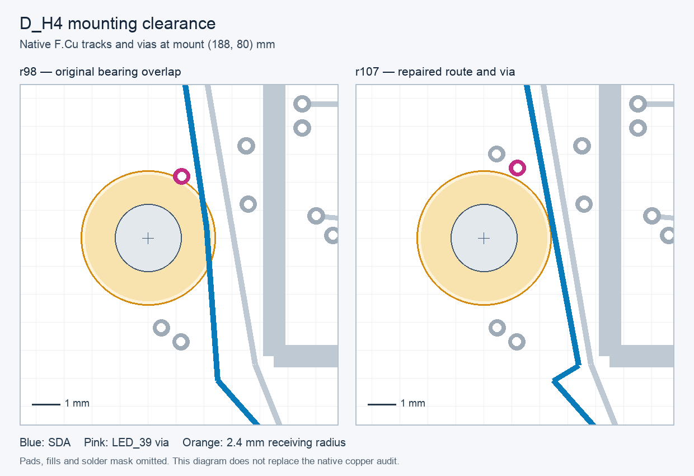

# D_H4 mounting copper repair: selected r107

The selected signal PCB retains167 opens and all477 component poses. Two SDA segments, the LED39 via and its two attached inner-layer tracks are explicitly replaced to clear the main mount's conductive bearing area. All other authored copper and every r98 native connectivity partition are preserved. Four prior reference cases are explicitly retired only for the four replaced tracks; replacement coverage is checked.

Root reproduced130 route reference cases,4873 retained cases,66 returns,236 fill-fidelity cases and98 drill checks, plus three transition-record rejection tests. It independently recomputed all nine signal-mount contact regions with the NPTH drill-only guard. Native keepouts and companion `native-r107/signal_main.kicad_dru` enforce tracks/vias/pours and copper-pad clearance; four native negative tests reject restored track/via copper, an SMD pad and an enlarged NPTH annulus. Ship the companion rule file with the PCB/project.

All104 candidate and selected assembly checks pass for78 roles, preserving S04. This copper repair does not resolve remaining electrical routing, missing ESS, analog/noise performance, physical mounting qualification or fabrication readiness.

The diagram is visually reviewed but omits pads, fills and mask; the numeric/native audits are authoritative.

## Portable verification correction

Root reproduced two packaging failures before acceptance: a mutable shared README was frozen, and a directory scan included unrelated geometry/cache files. Both diagnostics are retained. The final verifier binds791 explicit, recursively validated dependencies, tolerates unrelated shared files/cache entries, and rejects changed contract bytes. Native PCB/rules did not change during this correction. Twelve fastener/NPTH/closure regression tests pass and are included in standalone CI. Frozen evidence was not waived or rewritten to conceal the failures.
