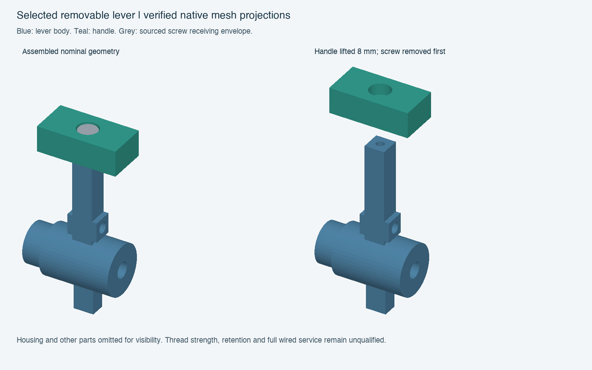

# Selected removable-lever integration

The fixed crossbar is replaced by the sourced socket-cap handle revision. The lever body retains the original pivot and interfaces; its operating envelope retains the original sweep and adds the larger handle throughout 0–35 degrees. The handle footprint and socket stay unchanged, with the top raised 1.2 mm.

All 94 checks passed, including the 57 existing assembly checks and 37 service/operating comparisons. The selection builder explicitly preserved the latest selected PCB rather than rolling back to the older board in the mechanical candidate. Current routing can advance independently after mechanical-freshness verification.

For the checked local service operation, first return the lever to its neutral 0-degree pose, remove the screw, then withdraw the handle vertically 8 mm. The cropped 16 mm lid/guide lift comparison contains the entire fixed lever XY extent and the full original lid/guide Z range; native bounds are retained in `review.json`. It proves that local lever obstruction is removed, not that every wire can flex or the fully wired lid can be removed.

Raw handle and screw seats remain explicit. The solid screw/tap-pilot overlap represents a future tapped-thread region, not an empty clearance pass or strength proof. Printed threads, socket fit, bearing creep, tightening, retention and exact hand/tool handling require qualification.

The preview uses verified native meshes and depth-buffered projection; the screw is a receiving envelope. The housing and other parts are omitted for visibility. Full comparison evidence remains in the check results. No fabrication release is implied.
