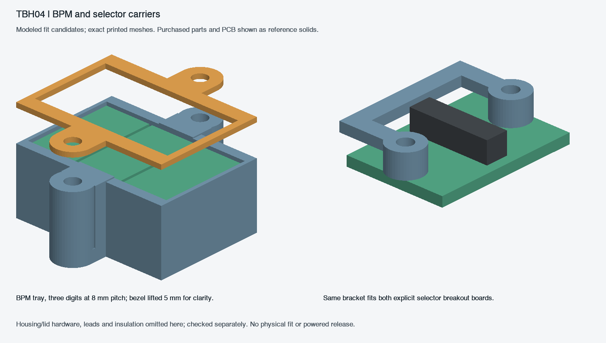

# TBH04 — BPM and selector carrier checkpoint

This adds actual removable mounting for three Kingbright SA36-11YWA digits and both selected C&K selector switches. It preserves the TBH01 r6 shell and main PCB positions. The new lid and guide variants have six added screw holes/reliefs; the original r6 lid does not mount these parts. This is an unpowered mechanical fit candidate, not a whole-unit fabrication or functional release. Panel LED emitters/carriers remain separate unfinished work.

## BPM carrier

`display.scad` supplies a bottom tray and separate top bezel. Three digits are at X152/160/168, Y31: **8.0 mm pitch**, replacing the old nominal touching 7.5 mm pitch. The manufacturer's ±0.25 mm body tolerance gives a maximum combined width of 23.75 mm and at least 0.25 mm between adjacent maximum-width bodies. The 24 mm panel opening and 23.2 mm bezel window are retained/defined respectively; segment visibility still needs a physical optical check. Maximum package height is 8.75 mm. The tray floor is Z33.8 and bezel underside Z42.8, giving a 9 mm pocket.

This is a directly wired insulating holder, not a fictional PCB. Thirty Ø1.3 mm lead bores follow the actual two-column 5.08 mm by five-row 2.54 mm pattern. Seat each display at the tray floor. Select thin insulating shims individually after measuring the body height; target 0.05–0.15 mm vertical freedom without preload. Do not use the screws to crush the displays. The nominal pocket leaves 0.25–0.75 mm total height clearance across the stated package tolerance. Pin tips and insulated joints must remain within the stated envelopes and must not load the housing or PCB below.

Two M2×16 screws with head diameter ≤4.5 mm fasten from the lid exterior into two M2 nuts (AF≤4.0 mm, thickness≤1.6 mm) in the tray's underside pockets. No washers are included in this exact screw stack. Under-head Z45.6 gives screw tips at29.6; nuts occupy31.9–33.5. Hand-tighten only. Mount coordinates are **(160,19), (160,43)**. The tray is 25.4×30×11 mm; bezel25.4×30×0.8 mm. Print the small complete tray/bezel first as the fit sample.

Solder the wires with the displays outside the printed carrier; insulate joints, then feed the leads/wires through the tray. No soldering iron should touch printed plastic. `display-wiring.csv` maps all24 cathodes and six common-anode pins to the current integrated main PCB's D_J3004/D_J3005 headers, checked against the source net assignments. Multiple anodes at one supply pin require a proper splice/distribution connection; the CSV is not permission to cram several wires into one crimp. Full harness conductor/connector/splice selection remains open.

## Selector carriers and real breakout boards

The two **16×23×1.6 mm** breakout PCBs are editable KiCad candidates:

- `settings.kicad_pro`: C&K JS202011CQN, six through-hole switch lands, each routed to its own W1–W6 wire pad.
- `release.kicad_pro`: C&K JS203011SCQN, eight surface-mount switch lands, each routed to its own W1–W8 wire pad.

All poles are preserved; no switch terminals are tied together on these breakouts. `selector-contract.json` records exact terminal-to-wire identities. The breakout designs must be connected to the existing control-input circuit with verified switch continuity/position mapping. A one-to-one breakout does not establish which switch position the firmware should call Default/User or Release mode. Native KiCad DRC records zero violations and zero opens for each board; `pcb-native-r2/review.json` also verifies every net's pad identities. These simple pass-through boards have no standalone schematic/ERC claim. Exact chosen switch variant, current land-pattern/stencil acceptance, copper/process selection and assembly inspection remain release gates.

Both use the same printed bracket, two spacers joined above the switch body. The board is clamped between the bracket and underside washers/nuts. Each uses two M2×10 screws, headOD≤4.5 mm, two 0.5 mm washersOD≤4.5 mm and two M2 nutsAF≤4.0×1.6 mm. Head undersideZ45.6, tipZ35.6, nutZ36.0–37.6, washerZ37.6–38.1, PCBZ38.1–39.7, spacerZ39.7–43.6. Hand-tighten, avoiding board bending.

Mounts: settings **(307,17.5),(307,36.5)**; release **(316,44.5),(316,63.5)**. Board centers remain(307,27)/(316,54). The new top-of-PCB datum is **Z39.7**, correcting the old reserve: atZ37.9 the actuator stopped below the cap socket. Nominal3.5 mm body+2 mm actuator now gives actuator top45.2 and **1.6 mm overlap** with the retained cap socket beginning43.6. Verify actual socket engagement, sliding stroke and cap retention with purchased parts; a loose printed cap needs a qualified removable retention method. Do not glue the moving actuator to the switch body.

The displayed switch models are bounded reference geometry, not supplier STEP models. The body allowance is0.2 mm per side and0.2 mm above nominal height. Through-hole leads have3.6 mm downward allowance; SMT leads are separately bounded. The six collision checks include main-board component/lead envelopes, shell, rear plate, button holders, lid join bars, screw heads, guide and lid. Washer-to-PCB contact uses only the existing-style0.01 mm seating-plane guard.

## Printing and assembly

Use `print/` from the delivery package. Print one tray, one bezel and two selector brackets. Use either the one-piece lid/guide or their corresponding left/right variants; preserve the r6 split joining hardware. Geometry remains millimetres at100% scale. The carrier parts themselves fit a small print bed. The case-size limits from r6 still apply. Printer/material settings are not qualified here. Inspect the0.6 mm display side walls,0.8 mm bezel, nut pockets and lead holes in the slicer; measure bores rather than scaling whole parts.

Assemble and test the small carriers first. Install the selector switches on their breakouts and inspect every joint before installing them in plastic. Check pin numbering from the manufacturer terminal1 mark. Route and secure wires independently so their weight cannot pull the switch or display leads. Attach the carrier assemblies to the new lid and then check the complete unpowered assembly. The earlier main-board supports and shell are unchanged.

## Sources and evidence

- Kingbright primary drawing: https://www.kingbrightusa.com/images/catalog/SPEC/SA36-11YWA.pdf (retained source at `../two_board_print_03/reference/SA36-11YWA.pdf`). Package/pin drawing visually reviewed.
- C&K primary current source: https://www.littelfuse.com/assetdocs/littelfuse-c-k-slide-js-series-datasheet?assetguid=aba42b08-0d2c-423b-813d-a2faa5a3bb14 . Official direct download returned403; the manufacturer-authored22Sep2022 PDF is retained at `reference/ck-js.pdf` from the LCSC mirror. Page4 was visually reviewed for both exact variants; current official2026 extracted dimensions agree. Current manufacturer drawing/process acceptance remains a fabrication gate.
- `verification.json`: display source hashes, seven empty clearance cases, two positive retention cases and printable mesh records.
- `selector-verification.json`: current selector source hashes, six empty clearance cases, positive board retention and print exports.
- `pcb-native-r2/`: both native DRC outputs, rendered SVG copper and exact pad/net identity review.
- `display-wiring-review.json`: current main-PCB and channel-map source bindings.

Earlier failed geometry outputs are retained. Display r1 had an insufficient guide relief; r2/r3 exposed a tangent pillar/wall joint. The final design uses overlapping necks and passed a controlled export before fresh checks. The first shortened-neck trial intersected the maximum-size digit by0.125 mm and was corrected. Early selector hardware was too close to solder pads; increasing board length and mount spacing removed actual courtyard/washer conflicts. No failed export is delivered.

The original sealed r6/TBH03 files were not changed. Full LED carrier design, full harness routing, installed thermal assembly, measured fit, switch feel, optical visibility and powered operation are not established by this checkpoint.
