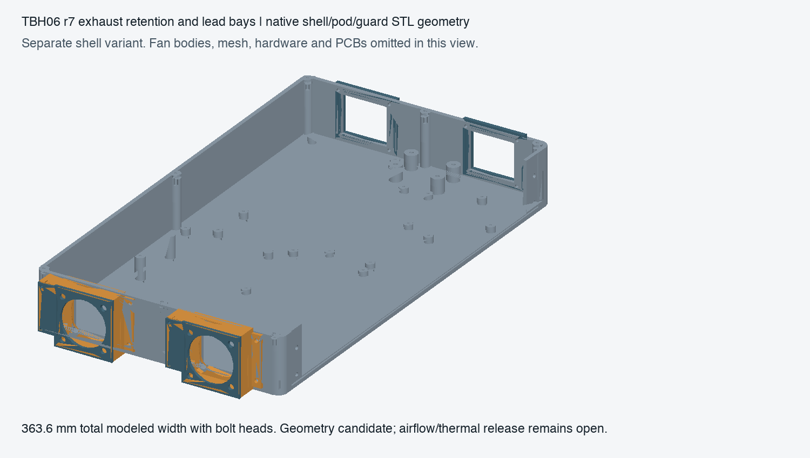

# TBH06 r7 — retained exhaust screens and protected fan lead exits

This revision completes the modeled exhaust-screen attachment and fan lead-exit hardware for the external cooling alternative. The previous checkpoint and sealed r6 housing remain unchanged. It is a separate shell variant for mechanical review, not an approved operating cooling system.

`cooling_candidate.scad` supplies the same uniquely named integration modules: `tbh06_shell_variant()`, `tbh06_installed()` and `tbh06_fans()`. Its native receipt and `verification.json` bind the exact geometry. The overall modeled envelope is **363.6 ×192.4 ×45.6 mm**, including left fan bolts and right exhaust screws, excluding feet and external plugs.

## Exhaust screen assembly

Each right-side36×30 mm exhaust opening now has a48×42×3 mm removable external frame. Cut the selected Howard304SS10-mesh/.010-inch cloth to44×38 mm. Deburr all cut edges. ProvideØ2.4 holes at Y±20/Z6,40 relative to the case-centred frame datum; the editable model shows the exact locations. Trap the mesh in the0.6 mm-deep inner recess between the frame and shell wall. Four M2×8 screws, receiving head envelope≤Ø4×1.6, and M2 nuts≤AF4×1.6 retain each frame. Screw tips reachX333; component, control and exact lever-motion checks are empty.

Mesh escape tests deliberately move the mesh1 mm inward/outward; both intersect their retaining structure. These are positive geometric retention tests, not mesh strength, fatigue or finger-probe certification. The selected cloth's nominal2.286 mm openings are not an operating dust filter. The upstream intake mesh/bolt mounting from the preceding checkpoint is retained.

## Fan lead bay and assembly order

Orient each fan so its factory lead exit faces the pod's +Y edge and the molded fan arrow points into the case. The manufacturer's page6 drawing shows the corner lead exit, black/red/yellow UL1007#26 leads and300±10 mm length. The new exit slot spans the full fan depth; no exact axial lead-emergence dimension was invented. The slot and bay accommodate receiving variation; inspect the actual exit and do not bend or pull at the motor termination.

1. Leave the fan leads uncrimped. Put the captive M4 nuts into the pod and mount the fan/guard/mesh stack using the preceding checkpoint's measured shims. Fan-frame clamping remains a physical receiving check.
2. Place the removable feedthrough bushing in its pocket. ItsØ10 flange is captured between pod and shell, with0.1 mm nominal axial slack. TheØ6.2 bore has chamfered ends. Positive native checks prove that the flange cannot escape either way through the assembled retaining apertures.
3. Lead the wires through the +Y side slot into the side bay and through the bushing into the enclosure. Receive the three-wire bundle at≤Ø5 mm; the bushing is not a clamp. No bare conductor or stripped termination may remain in this path.
4. Fit a received2.5 mm-wide T18R cable tie through the two3.2×1.4 mm bridge slots, around the insulated bundle. The modeled loose strap is2.5×1.1 mm. Confirm actual strap thickness≤1.2 mm and head fits the available bay before assembly. Tighten only enough to prevent wire movement; do not crush insulation. A physical pull/abrasion test must establish retention. Keep a relaxed lead section between the tie and the motor exit.
5. Close the separate bay cover using two M2×12 screws per pod (head≤Ø4×1.6) and captive AF4×1.6 nuts. The cap is removable without disturbing the fan itself. The bridge and cover separate the bundle from the rotating impeller. Inspect the complete wire path and fan rotation before any powered trial.
6. Terminate and connect the two supported fan harnesses as specified below. Route length, receiving/crimp and exact installed fit must be verified before powering.

The candidate tie is [HellermannTyton T18R111-00766](https://www.hellermanntyton.com/products/cable-ties-inside-serrated/t18r/111-00766), nominal100×2.5 mm. Lot-specific thickness/head receiving limits above are project fit conditions, not manufacturer dimensions inferred from width. No mounting hardware is credited as electrical insulation or strain qualification merely because it fits the model.

## Source-supported fan interfaces

The selected power-board values already name XHP-3 housings with SXH-001T-P0.6 contacts. Actual native pad/net records establish the following mapping; it is not guessed from pin order or wire color alone.

| Fan | Board connector | Pin1 | Pin2 | Pin3 |
|---|---|---|---|---|
| Rear/left pod, Y145 | F_J202 | Black → PWR_AGND | Red → FAN_L_5V | Yellow → FAN_L_TACH |
| Front/left pod, Y45 | F_J203 | Black → PWR_AGND | Red → FAN_R_5V | Yellow → FAN_R_TACH |

Use the exact legacy **SXH-001T-P0.6** contact named in the design, subject to JST-approved crimp tooling and wire receiving. Do not silently substitute the newer suffix-N contact: published wire-insulation ranges differ. The [JST XH source](https://www.jst-mfg.com/product/index.php?lang=2&series=277) lists the legacy contact and0.9–1.9 mm insulation range. Measure the actual fan lead insulation;#26 alone does not establish crimp compatibility. Trim/prepare the factory lead ends using the contact's approved crimp instructions, verify pin numbering from the housing drawing and perform continuity/pull checks before plugging in.

The fan source drawing was downloaded again and matched SHA256`580372d445b040b56f5faab666a1e4b8483154a08bd435485547df66bc393a2a`. Its electrical colors and mechanical drawing were visually checked. [SUNON drawing D04114160G-02](https://www.sunon.com/PROSEARCH_FILES/%28D04114160G-02%29-1.pdf) remains the authority; no newer10000-suffix fan is substituted.

## Evidence and remaining work

`verify.py` checks17 strictly empty clearance cases, six positive controls/retention cases and six closed positive-volume solid exports. Every native source hash is checked. `native-first/` retains the first revision, including a zero-volume coincident seating-face result that was not accepted as empty. The final bushing flange has an explicit0.1 mm axial allowance; final clearance is strictly empty. `retention_checks.scad` independently checks axial escape without changing the frozen assembly source.

The native solids still use engineering assembly coordinates; they are not a printer-specific, bed-oriented delivery pack. The preview uses exact exported triangles and deliberately omits fans, mesh, hardware and PCBs for visibility. Root-level integration must add the finalized selector/display/sensor/spring assemblies and their wiring before claiming full installed fit.

The separate `fan_harness.scad` now contains simultaneous fan bundle routes; see `HARNESS.md` for verified scope and outstanding support/fanout work. Full wiring and support placement remain under development. `fan-route-screen.json` is an explicitly failed preliminary cubic route search, not a usable harness. Neither nominal geometry nor passed native checks establish fan current/startup capability, installed airflow/pressure, temperature, noise or physical cable durability. The source-bound whole-unit heat/current and full harness work remain open as described in the parent README.

## Exact fan screw candidate

Select [Accu SSC-M4-20-A2](https://www.accu.co.uk/metric-cap-head-screws/2828-SSC-M4-20-A2), M4×20 full-thread A2 socket-cap screw, as the concrete candidate matching the frozen model. Accu specifies head diameter 7 mm (+0/−0.22) and head height 4 mm (+0/−0.18), so the modeled Ø7×4 envelope bounds the specified head. This keeps the manufacturer-recommended M4 thread. SUNON suggests a pan head; this candidate uses a socket cap bearing on the separate guard. It is an explicit assembly choice and does not inherit SUNON tightening torque for the printed guard/pod stack. Physical clamp/shim/torque verification remains required.
