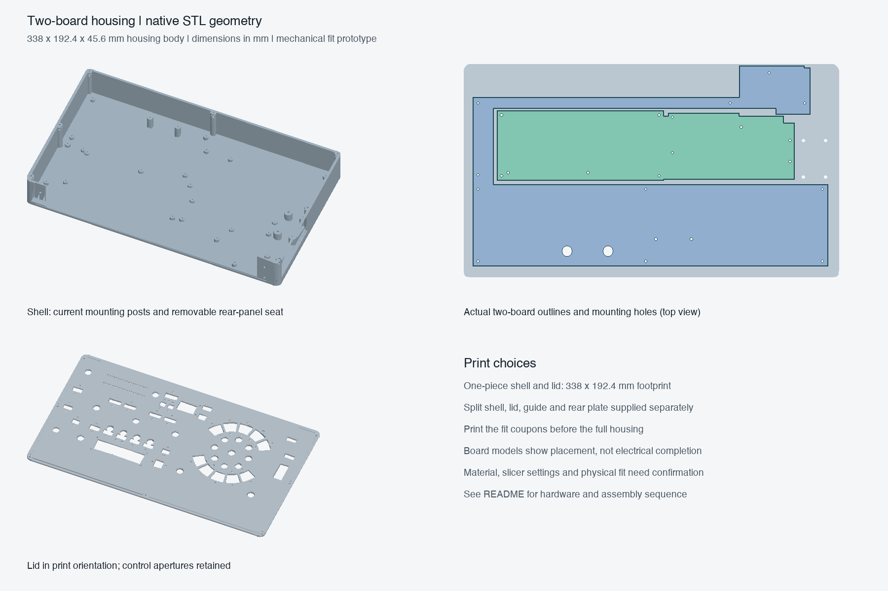

# TBH01 r6 — two-board housing print package

**Use `TBH01-r6-print-package.zip` for an unpowered fit prototype.** It contains separate, oriented housing STLs, a bolted split option, control prints, quantities, editable OpenSCAD sources and verification evidence. This is the current two-main-PCB layout with the Daisy Seed retained. It is not a finished powered instrument or a thermal release.

The source geometry is frozen at **r6**. `generated/r1` through `r5`, their previews and reviews are development evidence, **not files to print**. r6 adds real PCB and lever supports, a removable lid with side-loaded captive nuts, a rear plate at the correct connector face, and mechanically joined split parts. Earlier eight-board housing mounting patterns are not used.



## Print tomorrow

1. Extract the ZIP. Import STLs as **millimetres, 100% scale**. Use `parts.csv` for quantities. Files already have the intended print face at Z=0; let the slicer center XY without scaling.
2. Print the small `fit-coupons` first: M2 nut/holes, captive-lid-nut insertion, rear connector openings and shaft diameters. Confirm your actual nuts, screws, jacks, switch and shafts fit before the large parts. Nut coupon columns, left to right, are AF4.0/4.1/4.2/4.3; matching bores are Ø2.2/2.3/2.4/2.5. The design uses AF4.2 pockets and Ø2.4 M2 bores.
3. Choose **one** housing variant: `single-piece` or `split`. Both use the files in `shared`. The `controls` directory is the retained control prototype inventory; it is optional for an initial board/housing fit print. The housing will not become a functional instrument merely by printing every accessory.
4. Confirm the slicer footprint **including brim, skirt and machine exclusions**. Largest single-piece part: **338 × 192.4 × 43.6 mm**. Largest split part: **175 × 192.4 × 43.6 mm**. A 5 mm brim around that split part needs at least **185 × 202.4 mm** of usable XY area. A nominal 200 mm bed therefore does not accommodate that brim in this orientation.
5. Suggested starting profile, pending the actual printer/material: 0.4 mm nozzle, 0.2 mm layers, four perimeters, five top/bottom layers, 25–30% infill, and a brim as needed. Use the filament manufacturer's printer profile for temperatures. Check bridge previews over nut pockets and the short rear screw bores. Do not fill the functional pockets with support. The lever, switch-holder lips and fine control features may need local supports and a finer layer height.

PETG is a reasonable mechanical prototype candidate; printed fits, stiffness and spring/clip behavior still need measurement. PLA can serve an unpowered dimensional check but is not an operating-temperature decision. Official background: [Prusa PETG](https://help.prusa3d.com/article/petg_2059), [brims](https://help.prusa3d.com/article/skirt-and-brim_133969), [layers and perimeters](https://help.prusa3d.com/article/layers-and-perimeters_1748). These are starting assumptions, not a tested machine recipe. Printer, build volume, material, actual slicing time and print completion by tomorrow remain unconfirmed.

## Geometry and datums

The housing body is **338 × 192.4 × 45.6 mm**, 4 mm wider and 4 mm deeper than the earlier shell; the growth is at the right/front. Control XY positions, rear connector XY registration, and both PCB placements remain unchanged. Floor and walls are 2.8 mm. The lid underside is Z43.6 and its visible top is Z45.6. The registration lip has 0.3 mm nominal side clearance.

The 45.6 mm figure is **body height**, not the assembled instrument. The tallest nominal knobs reach Z66.4; 6 mm feet give a nominal modeled overall height of **72.4 mm**, excluding hardware tolerances. The rear plate extends to Y−1.6; plugs and cables extend farther. Do not use the body box as a packed/cabled-unit envelope.

| Item | Current source / installed datum |
| --- | --- |
| Signal PCB | `two-board-signal-routed-native-03/signal_main.kicad_pcb`; underside Z6.75, nominal thickness 1.6 |
| Power/protection PCB | TBP61 `two-board-power-control-corridors-native-02/power_protection.kicad_pcb`; underside Z7.9, nominal thickness 1.6 |
| PCB supports | All 24 small NPTH positions taken directly from those files: 22 board mounts and two strain-relief holes |
| Trill module | Board underside Z20; posts at (130.0871,168.922) and (93.0871,168.9352); Ø7.2 posts pass through the power PCB's two Ø9 openings |
| Lever bracket | Four M3 supports at X306/326, Y69/102, seat Z14.6; mechanism lifted 7.6 mm from A11, with pivot Z31.6 |
| Rear plate | Thickness 2.4, outer mating face Y−1.6, back Y0.8, shell recess 0.8 |
| DC input | Existing center X288/Z15.5, opening 10.4 × **14.2**; height increased from 13.4 for allocated vertical tolerance |
| Power switch | Existing 7.2 × 5.5 actuator opening at X302/Z11.65; backside body relief begins Y0.30 |

The rear opening is open at the shell top, closed by the removable plate and lid. This avoids a 282 mm unsupported printed bridge. Rear audio holes remain generic Ø8.2 RCA / Ø9.8 TS allocations: the coupon must be checked against the actual jacks, threads, washers and plug bodies.

## Fasteners and assembly

Use low-profile heads and washers within the limits below. All dimensions are nominal. Hand-tighten the prototype; no torque, fatigue, drop or shipping-load rating has been established. The M2 nuts assumed here are AF4.0 × 1.6 mm; M3 nuts AF5.5 × 2.4 mm. Measure your stock. The pockets provide printing allowance, not a guarantee for every nut standard.

| Joint | Quantity | Proposed hardware and fit |
| --- | ---: | --- |
| Main PCB supports | 24 | M2 × 10 pan-head screws, 0.5 mm washers, M2 nuts in underside floor pockets. Head/washer OD ≤4.5; head plus washer height ≤2.5 above PCB |
| Trill supports | 2 | M2 × 25, 0.5 mm washers, M2 nuts; head/washer OD ≤4.5, combined height ≤2.5 |
| Lid | 7 | M2 × 8, 0.4 mm washers, side-loaded M2 nuts. Insert front-corner nuts diagonally inward; the other five slide straight inward. The retaining roof is 1.2 mm |
| Rear cassette | 4 | M3 × 12 pan-head, 0.5 mm washers, M3 nuts in rear-facing pockets; insert nuts from inside before closing |
| Lever bracket | 4 | M3 × 20, 0.5 mm washers, underside M3 nuts; bracket thickness 3 mm, seat Z14.6. Verify chosen head/washer clearance physically |
| Split floor only | 6 | M3 × 8 countersunk; head sits flush with floor Z2.8; six M3 nuts in three 4 mm underside joining plates |
| Split lid only | 4 | M2 × 6 pan-head, 0.4 mm washers, M2 nuts in the two joining bars |
| Split rear only | 2 | M2 × 6 pan-head, 0.4 mm washers, M2 nuts in rear joining bar |
| Button holders | 58 | M2 × 8 countersunk, tapped/check-fitted Ø1.6 printed pilots; two screws per holder. Retained plastic-thread interface requires coupon testing |
| Touch backer | 4 | M2 × 4 countersunk, tapped/check-fitted Ø1.6 pilots; thin backer engagement requires physical checking |
| Knob retention | 10 | M3 × 4 grub screws after tapping radial Ø2.5 pilots; test shaft engagement first |
| Feet | At least 4 | Adhesive elastomer feet, **at least 6 mm high**, positioned clear of nut access and split joining plates; feet are purchased, not modeled print parts |

PCB screw tips with the specified washers reach Z−1.15 (signal) and Z0 (power). Trill screw tips reach Z−2.9. Flush-head split-floor screws reach Z−5.2; 6 mm feet leave 0.8 mm nominal table clearance. Do not substitute longer screws without checking underside clearance. These stacks intentionally use M2 × 10 for PCB mounts: M2 × 8 would barely engage the power-board nuts.

For the split version, join the shell first. The left floor has three alignment laps with 0.2 mm clearance into the right half; do not force the mating faces. Install three underside plates centered at X169, Y20/90/186, using bolt columns X159/179. Tighten only after the seam and both floors sit flat. Insert the center-front lid nut only after the halves are joined. The central seam is 0.2 mm nominal.

Join the lid halves with bars centered X169, Y8/156. Nuts face downward; each bar contacts the lid underside. The guide has clearance around these bars; fit its halves at the matching panel holes. Join the rear halves using the bar at X169/Z35, behind the plate (Y0.8–3.8). Its two hole centers are X162/174. Fit the assembled cassette into the recessed shell face.

Install floor nuts before the boards. Seat the power board first over its supports and the Trill passages, then the signal board, then Trill. Mount the lever bracket on the four tall posts. Install panel hardware while the lid is off. Slide the seven lid nuts into their side slots before fitting the lid; a small removable tape tab can hold an unloaded nut during handling. The native insertion sweep checks the entire entry path; the coupon tests printer-specific fit.

## Retained controls and remaining carriers

`accessory-inventory.json` / `parts.csv` give exact quantities and the 46 distinct retained accessory prints: 29 labelled keys; holder variants totaling 29; 29 clips; knob variants totaling ten; two selector caps; touch/ring/meter/bank/display lenses; and a shaft coupon. The lever bracket/arm, guide and touch backer are included with the housing set. These are source-derived A11 mechanical prototypes, renewed against the current component layout where checks are stated below.

Buttons use 29 purchased Omron B3F-1000 switches, return springs and soft silicone contacts. The insulating holders are not PCBs: wire the switch leads separately. The retained contact is nominal Ø3 × 2 in a Ø2.8 pocket; spring targets are OD6, ID5.4, free length4.5, solid height≤1.2, nominal rate0.2 N/mm. Actual spring force, silicone hardness, contact closure before the 1.2 mm stop, friction and return remain physical tests. Do not replace the compliant contact with a rigid plunger.

Pots are retained by their metal threaded bushing, washer and nut, not by the printed knob. The reference is the Bourns PTV09A-6 family, M9×0.75; the chosen shaft style/length remains to be confirmed against the Ø6.2 blind knob socket and 2.8 mm knob-to-panel stand-off. See [Bourns PTV09 drawing](https://www.bourns.com/docs/product-datasheets/PTV09.pdf). The shaft coupon has Ø6.0/6.2/6.4 samples.

Optic flanges locate against the panel and require a compatible removable adhesive/retention process. The touch lens is 0.8 mm nonconductive material; foil electrodes and wiring are separate. Printed translucent lens fit does not establish optical transmission, isolation or sensing performance.

The following are **still missing for a complete functional assembly**, and are not hidden behind the print-ready claim:

- The settings and release-selector electrical/mechanical carriers. C&K JS202011CQN and JS203011SCQN are PCB-mount parts; the printed caps do not retain their switch bodies. See the [C&K JS drawing](https://www.ckswitches.com/media/1422/js.pdf).
- BPM display and panel LED-emitter carrier mounting/retention. Their source-derived body/connector reserves are checked, but their final carrier PCB and fixing geometry are not supplied.
- The angle-sensor board's removable carrier and measured magnet alignment. The board reserve is maintained beside the lever; it is not an attachment.
- Selected lever pivot length, axial retainers, return spring and magnet retention. The printed mechanism has a nominal Ø3 pivot and Ø6×2 diametric-magnet interface; select and test the actual hardware.
- Completed cable routing, connector mating/service envelopes, strain relief qualification, electrical isolation and cooling. The two strain-support posts do not qualify a finished harness.

These carrier gaps already exist in the source design; inventing mounting holes in unspecified PCBs would not finish them. The package is useful for assembling and measuring the case, boards and available controls now, while those items are resolved.

## Verification and scope

`verification.json`, `independent-review-r6.json` and `cross-board-envelope-review-02.json` bind the final CAD to current source hashes. The package manifest records every delivered file. Native Linux exports use the authorized pinned container; quarantined Mac CAD runtimes are not used. Five retained switch-holder meshes use CGAL triangulation of the unchanged source after the Manifold STL exports failed exact edge checks; those failed exports are excluded from the print package.

The checks cover actual board profiles/mounts, 1,552 component and 517 lead envelopes, the declared thickness/Z allocations, shell/lid/guide/holder/fastener clearance, rear plate fit, split joints, full 0–35° lever motion, captive-nut insertion and positive retention. Intentional PCB seating planes are excluded by only a 0.01 mm Z guard; intended rear/lid mating surfaces use the same 0.01 mm guard. This does not excuse other collisions.

At the rear plate only, the jack body and switch body/actuator envelopes replace their larger soldering courtyard boxes; XY allowance is ±0.2 and Z allowance ±0.36 mm. General board/housing checks retain the conservative courtyard/body envelopes. Fourteen new power footprints have explicit conservative height assumptions; the rest retain the source height allocations. Supplier-exact solids and measured heights are not available for the entire unit.

Delivery meshes are checked for closed, consistently oriented boundaries, positive volume and valid print placement. Any native zero-area facets are removed only from the delivery copy, with original/delivered hashes and removed-facet counts recorded; original exports remain in `generated/r6`. No smoothing, scaling or dimensional repair is applied.

**Do not power the assembled unit on the strength of this CAD package.** The old metal thermal-base solution is not carried forward as a qualified two-board cooling assembly. Printed plastic is not a replacement heat spreader. Cooling hardware, airflow, installed thermal interfaces, fault operation and electrical fabrication release remain separate work. The printable floor is for the unpowered fit prototype.

## Editing / reproducing

Editable parametric sources are in the ZIP under `source/hardware/cad/`, preserving relative includes. `housing.scad` selects a part with `-D 'part="shell"'`; `accessories.scad` selects accessory names from the inventory. `capture.py` in the repository re-extracts actual PCB geometry; `run.py` creates a fresh, source-bound native result directory and refuses overwrite. Do not run the quarantined host CAD apps.

From the repository, a new isolated export uses:

```sh
.venv/bin/python -m hardware.cad.two_board_print_01.run shell --revision new-review
```

Use a new revision name for any changed geometry and renew the checks. Scaling to fit the bed changes every PCB/fastener/control interface and is not a supported variant.
