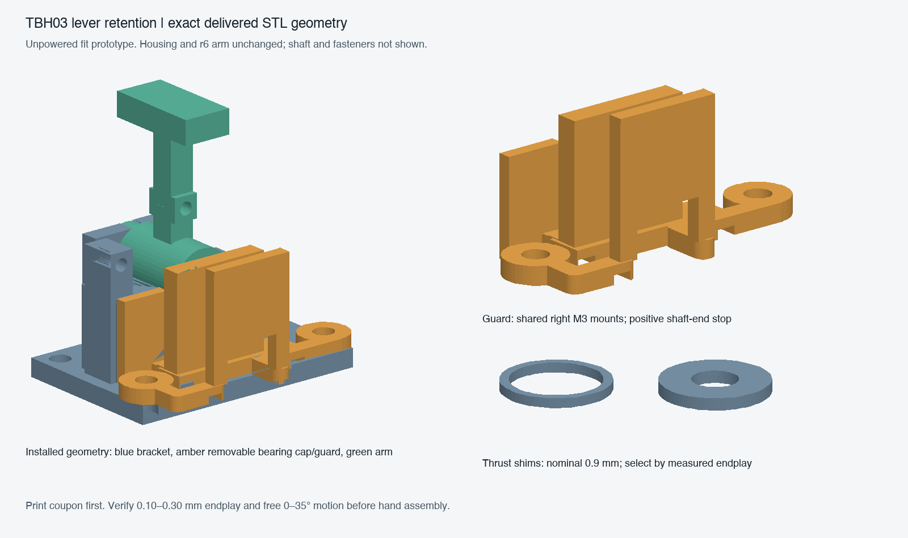

# TBH03 — removable lever pivot retention

This add-on completes axial capture of the modeled release lever for the **TBH01/r6 unpowered housing fit prototype**. It replaces the r6 lever bracket and adds a removable right-bearing/shaft-end guard and two thrust shims. The housing and lever arm remain unchanged. It is a mechanical fit candidate, not a functional, strength, electrical or thermal release.

Print tomorrow in this order:

1. `pivot_coupon.stl` (49 × 17 × 4 mm): check the actual steel rod in the Ø3.1/3.2/3.3 holes, left to right; check the Ø8.3 hole against the arm's Ø8 neck. The actual bracket uses Ø3.2/8.3. Deburr the rod, remove hole burrs, and require free sliding without forcing. The coupon is printed in a different bore orientation from the installed bracket, so the bracket itself still needs checking.
2. One `retained_bracket.stl` and one `pivot_guard.stl`.
3. One `left_shim_9.stl` and one `right_shim_9.stl` (nominal 0.9 mm each). The other shim thicknesses, 0.7–1.1 mm, are alternatives to select after measuring; do not stack all of them.
4. Reuse the r6 lever arm. An identical copy is included as `lever_arm_r6.stl` if it has not yet been printed.

All STLs are in millimetres, already oriented at Z=0. The largest add-on part is the 49 × 17 mm coupon; allow extra bed margin for a brim. The replacement bracket is 26 × 39 × 23 mm. The guard is about 15.3 × 41 × 20.1 mm. This does **not** reduce the bed needed for the housing: its one-piece body footprint is 338 × 192.4 mm; the largest split footprint is 175 × 192.4 mm, before brim. The housing body is 45.6 mm high, excluding feet, controls and plug overhang.

Printer, usable bed, nozzle and material are still unspecified. Use the printer maker's profile for the selected material. PETG is a reasonable provisional choice for a hand-assembled fit prototype; official guidance describes its mechanical uses and layer adhesion ([Prusa PETG](https://help.prusa3d.com/article/petg_2059)). Our starting points are 0.20 mm layers for bracket/guard, four perimeters and 35% infill, subject to slicer inspection. Use 0.10 mm layers for shims and inspect the layer preview: the total, including first-layer height, must be 0.9 mm. A preset with a 0.2 mm first layer will not necessarily produce nine layers. Measure their actual thickness. Disable automatic scaling. Inspect support preview around horizontal bearing bores and the guard's approximately 9.2 mm bridge; use removable local supports if needed, keeping support scars off bearing/thrust faces and the locating rails/channels. The left shim has a 0.8 mm radial wall; confirm continuous toolpaths on this ring with the selected nozzle. The supplied orientation avoids placing the long guard foot rails on edge. Brim is optional and requires extra bed space ([official brim guidance](https://help.prusa3d.com/article/skirt-and-brim_133969)); perimeter choices depend on actual extrusion width ([layers/perimeters](https://help.prusa3d.com/article/layers-and-perimeters_1748)). No print time or universal temperature is claimed.

## Bought hardware and receiving dimensions

| Item | Quantity | Required specification |
|---|---:|---|
| Steel pivot rod | 1 | Smooth, straight, deburred Ø3 mm; measured diameter 2.98–3.00 mm, length 16.0 ±0.1 mm. Cut from rod stock; no threaded screw shaft substitution. |
| Right bracket/guard bolts | 2 | M3 × 25 mm under-head length, head envelope ≤Ø5.5 × 3 mm. Replace the two original right M3 × 20 bolts. |
| Left bracket bolts | 2 | Retain M3 × 20 mm, same head envelope. |
| Flat washers | 4 | M3, 0.5 mm thick, outside diameter ≤7 mm. |
| Floor nuts | 4 | Retained M3 nuts, ≤5.7 mm across flats, ≤2.4 mm thick, in existing underside pockets. |
| Radial grub screw | 1 | M3 × 3 mm flat point with 1.5 mm hex socket, e.g. [Accu SSF-M3-3-A2](https://www.accu.co.uk/flat-point-set-screws/4511-SSF-M3-3-A2), DIN913/ISO4026; tap the existing Ø2.5 pilot after printing. Nominal contact at rod Y83.5 puts its outer end at Y86.5, recessed 0.5 mm from the hub surface. Check actual tapped engagement, clamping and free rotation by hand. |
| Feet | as housing | At least 6 mm height below floor; physically check clearance after tightening. |

No additional PCB holes or purchased shaft collars are needed. The printed guard provides positive axial capture independently of shaft friction or grub-screw clamping. The grub screw remains necessary to couple the rod to the lever during normal motion; its exact chosen length and the spring/magnet interfaces remain physical assembly checks.

## Assembly and measured endplay

Do this on the bench with the lever assembly removed from the housing. The right bearing and right side of the stop block are part of the removable amber cap/guard, leaving the fixed bracket open on the right. Remove that cap. Put the left shim over the Ø8 arm neck. Hold the arm at its zero-degree position and translate the arm and shim horizontally left from the open right into the left bearing. This avoids trying to tilt the arm between two closed bearing walls.

Insert the steel rod from the open right into the arm's blind bore and seat gently. Slide the right shim onto the exposed rod against the hub's right face. Then translate the complete bearing-cap/guard horizontally left from the right: its bearing threads onto the already-inserted rod and its underside channels slide onto the two locating rails. The cap's split stop-block face has 0.1 mm nominal axial clearance from the fixed part. Do not lower the cap vertically over the arm or force it. The nominal bore blind end is X315, seated rod end X331, guard inner face X332.3: nominal free end clearance is 1.3 mm. The guard's final face blocks later shaft withdrawal; the rod must be inserted before the cap.

Install the assembly onto the four housing posts, retaining the aligned rod in the bearings while hand-tightening the mounting screws. The 2.4 mm-wide base rails and 2.6 mm-wide cap channels locate across Y; the original bolt holes and split faces locate along X. Verify bearing alignment and free rotation after tightening.

The right guard pads add 2.4 mm above bracket top Z17.6. With 0.5 mm washers, the right screw under-head plane is Z20.5; M3 × 25 tips reach Z−4.5. Six-millimetre feet leave 1.5 mm nominal ground clearance. Left M3 × 20 tips reach Z−1.9. Confirm nut seating, full nut engagement and actual tip clearance; tighten only by hand for this prototype. The guard rear rail deliberately passes inward of the adjacent lid boss. The end plate outer face is X334.3; its foot rail reaches X334.6, leaving 0.6 mm nominal clearance to the shell inner face X335.2. Native checks expand the exterior guard rails and plate by 0.2 mm in every direction; the bearing/stop portion is checked at its authored dimensions against the expanded rotor sweep. This is not a claim of 0.2 mm reserve around the entire combined cap.

Measure the total available axial gap: inside distance between bracket bearing walls minus the hub length. For the default pair, accept total gap 1.95–2.05 mm and each printed shim 0.88–0.92 mm. This guarantees **0.11–0.29 mm** calculated total endplay within those measured limits, with no shim preload. Independently verify 0.10–0.30 mm actual endplay and free rotation through 0–35°. If dimensions differ, select the supplied alternative shim sizes to obtain that measured range. Do not tighten mounting screws to squeeze an oversized shim stack into place. Printed accuracy is not assumed.

The original nominal hub is X309–323; bracket inner walls X308 and324. Left shim OD10/ID8.4 clears the Ø8 neck; right ID3.4 clears the Ø3 rod. The replacement bracket widens only the stop-tab's axial pocket from 4.6 to 6.4 mm, preserving its angular profile. This avoids relying on the original narrow slot while allowing the measured endplay. Inspect stop action gently; do not use the lever stop for strength testing.

For the modeled receiving limits, the guard inner face is X332.3 ±0.1 and conservative rotor shift is ±0.3 mm. The seated rod/guard gap is 0.8–1.8 mm. Even if the rod slides fully right to the guard, minimum remaining hub engagement is 6.2 mm and the complete 3 mm right bearing remains engaged. These are geometric calculations, not load or wear qualification. Do not sand away the guard's inner capture face without remeasuring.

To remove the shaft, remove the lid and **remove the complete four-screw lever assembly from the housing first**: the case wall leaves insufficient room to withdraw a 16 mm rod in situ. On the bench, remove the two right screws and slide the bearing-cap/guard to the right off the rod and rails. Remove the right shim, loosen the radial grub screw, and withdraw the rod to the right. The guard does not obstruct the modeled Ø1.8 tool envelope for a 1.5 mm AF hex key to the radial grub screw.

## Evidence and limits

`verification.json` binds the exact native CAD sources and records each export/collision result. Final source uses CGAL for printable solids and Manifold for assembly booleans in the pinned isolated Linux OpenSCAD image. `tolerance-review.json` contains the receiving-limit arithmetic. `delivery-review.json` checks the delivered binary STL vertices/edges directly, with no hole filling; any removed exact zero-area native facets are recorded in `delivery-manifest.json`. `independent-review.json`, when present, records the parent's independent check. `generated-r1` through `generated-r4` are superseded evidence; the delivery uses `generated-r5` only.

Checks cover an expanded continuous 0–35° sweep, ±0.5 mm axial movement against surrounding shell/controls/current two-board component envelopes, ±0.3 mm against the replacement bracket, expanded exterior guard clearances, authored bearing/stop geometry, nominal shaft/shims, radial tool approach, rigid rotor/cap insertion paths, and positive blind-end/guard/angular-stop controls. Geometric clearance does not establish print strength, wear life or actual stock fit. The assembly uses the same TBP61 mechanical basis as r6; later TBP66 copper updates preserve its complete footprint records and board edges (parent compatibility addendum in `../two_board_print_02`).

Remaining exact inputs for the other carriers are deliberately outside this add-on:

- Settings/release selector carriers: actual PCB outlines, thicknesses, edge keepouts or mounting patterns, underside leads and connector orientation for the selected C&K JS202011CQN/JS203011SCQN switches.
- Display/LED carriers: actual populated PCB outline, three display centres/pitch, connector clearance and emitter optical heights. The [Kingbright SA36-11YWA drawing](https://www.kingbrightusa.com/images/catalog/SPEC/SA36-11YWA.pdf) gives a 7.5 × 14 × 8.5 mm body with general ±0.25 mm tolerance, but does not specify our carrier board or mounting.
- Angle sensor: actual AS5600 board edge/mount pattern, die centre from board datum, connector and selected magnet gap/alignment. Existing CAD is a reserved envelope only.

The return spring selection/force and magnet retention are also unfinished. Do not power or call the full functional CAD assembly complete on the basis of this print package. The previous r6 and print-first archives remain unchanged.

## Editable source and recovery record

The delivered editable entry point is `source/hardware/cad/two_board_print_03/retention_r5.scad`. Choose `part="retained_bracket"`, `"pivot_guard"`, `"pivot_coupon"` or a shim name (for example `"left_shim_9"`). Its r6 dependencies are included with their relative paths. The Python verification runners require the repository checkout and pinned isolated Docker workflow; the ZIP's SCAD files can be edited/exported separately.

An early cap sweep used a Minkowski operation that triggered a geometry-kernel assertion. Its output was rejected, and its failure marker/log/source were preserved. A separately reviewed construction now sweeps each convex primitive directly, enlarges occupied surfaces by0.001 mm and shrinks holes/channels by0.001 mm. Both the continuous path collision and exact-cap containment checks are strictly empty; no small-volume tolerance was used to declare a pass. Intermediate coplanar base remnants were removed by defining the right bearing and stop portion explicitly. The successful diagnostics and controlled-recovery decision are included as evidence; no Mac CAD application was launched.
