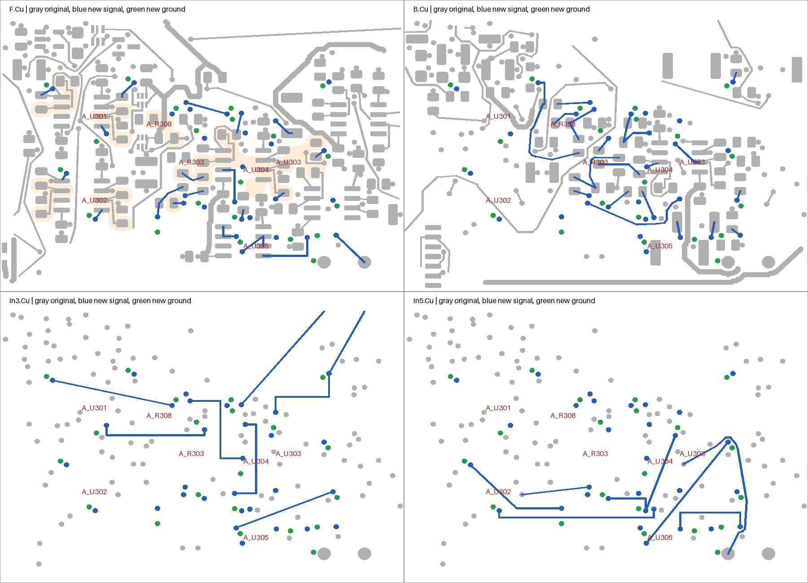

# DAC internal routing checkpoint

The latest verified geometry checkpoint is [r89](CHECKPOINT-R89.md): 177 total opens and zero remaining modeled DAC connections. It adds ten ADC monitor/control joins relative to r83, with no removed accepted copper or footprint changes. All 109 new-route reference cases, 4,877 retained cases, 57 local returns, 214 fill-fidelity cases and 84 drill checks pass. Failed return/reference candidates are retained; the accepted threshold route eliminates a redundant candidate via. Current E12-R2 monitor constraints are explicitly bound. Missing ESS, remaining ADC/board routing and analog-noise/stability qualification remain open. Selected-board identity requires integration. The frozen r26 provenance remains below.

Design is currently held for workflow coordination. The unselected [r95 candidate](HOLD-R95.md) reaches 167 native opens but fails one new-route reference case; r89 remains the accepted 177-open checkpoint. Its rejected result is source-bound and reproducible with `verify_failed_r95 --reference`.

Frozen r26 board: [native-r26/signal_main.kicad_pcb](native-r26/signal_main.kicad_pcb), SHA-256 `e67e18cf534a2ef58945a3ec0e7d7ed1a4dd526cd9ed347010b7b49096390790`.

This adds 32 native connection joins to the accepted signal-input r7 board, reducing total native opens from 230 to 198. All 477 component poses, original tracks/vias, authored zones/keepouts, outline, stackup, thickness, project, and design rules remain unchanged. The additions comprise 63 route pieces, 31 signal vias, and 23 ground stitches. Left/right internal signal routing uses In3/In5 with the connected In4 reference between them. This is a bounded geometry checkpoint, not a completed DAC or fabrication release.

## Observed validation

| Check | Result |
| --- | --- |
| Pinned Linux KiCad 10.0.7 geometry, ERC, schematic parity | Passed; original missing-footprint warning retained |
| Native connectivity and independent captured group gaps | Both 198; exactly 32 approved joins |
| New route reference cases | 63 passed |
| Retained reference cases | 4,877 passed with explicit raw-change accounting |
| Native signal transitions and local returns | 34 passed, each verified corridor ≤2.5 mm |
| Raw/unfractured native polygon fidelity | 183 passed |
| New via drill-to-SMD copper checks | 54 passed; minimum 0.102145 mm against 0.1 mm requirement |
| Missing/wrong-net transition proof rejection | Two regression checks passed |

[final-review.json](final-review.json) binds the selected PCB, native evidence, and complete local source closure. [REFERENCE-POLICY.md](REFERENCE-POLICY.md) defines the source-derived low-capacitance areas, exact transition identity requirements, and native numerical boundary accounting. The three explicit low-capacitance cases are two RX_NEG_R escapes and one CM_SUM_R local join. Raw retained changes remain visible: a physically contacted same-net IV_P_L via transition and an RX_OUT_L fill-boundary change. Neither is reported as exact zero raw loss. Noise, stability, crosstalk, solder process, and fabrication acceptance are not inferred.



## Remaining DAC connections at r26

Eight connections remain: BIAS_P_L, BIAS_P_R, BUF_IN_L, CM_DRV_L, CM_SUM_R, IV_P_L, RX_NEG_L, and RX_POS_R. R303/R308 remain in their original positions and both pads of each remain unrouted; relocation was surveyed but not applied. Continue constrained escape/internal routing and, where justified, explicit placement changes with fresh native/mechanical verification.

The original missing footprint is **A_U201 (ES9292QPRO)**. No footprint or package geometry was invented. The other 190 non-DAC opens and all existing release gates remain open.

## Recheck

From the repository root, run:

```sh
.venv/bin/python -m hardware.cad.two_board_sensor_05.signal_dac.verify_portable_r26 --reference --regressions
```

The portable entry point verifies the frozen relative source closure, maps only the recorded owner-worktree prefix to the current checkout, and runs the unchanged final gate without rewriting evidence. It rejects dependencies outside this checkout. The original native project must remain available alongside the checkpoint. `--reference` recomputes the full frozen reference audit and requires identical results; `--regressions` checks missing and wrong-net transition proofs fail at the intended identity assertions. Both options passed in a separate copied checkout, with all reads rebased locally and no evidence rewritten. Native execution uses the pinned Linux image in `run_linux.py`; host-native CAD must not be used. Keep native outputs immutable and use a fresh output folder for any changed native probe. Intermediate candidate/capture files included in the source closure preserve how the final geometry was authored; they are not additional selected boards.
