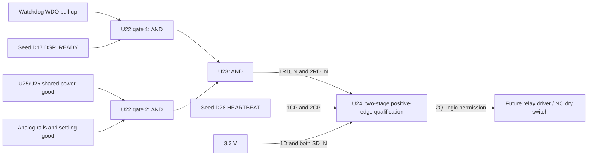

# A0.1 bypass permission circuit

The broader [A0.2 carrier draft](carrier.md) now adds the relay/coil/mute,
line-audio, power, analog-health, control and compute sheets. This page describes
the original permission sheet; references below to required external circuits
remain physical integration/qualification requirements. See the consolidated
[BOM](carrier-bom.csv), [connections](carrier-connections.csv),
[inventory](carrier-inventory.json) and [commissioning procedure](commissioning.md).

This sheet is one part of the full hardware clone: a concrete, pin-connected **draft** of the independent watchdog, digital power supervision and relay permission logic. It is not a complete audio carrier, a PCB or a fabrication release. The user preference is [NZ sourcing](../sourcing-nz.md); exact stock, some footprints and passive part numbers remain open.

- [bypass.json](bypass.json): selected draft parts, vendor pin names/numbers, nets, interface contracts and placement.
- [bypass-permission.kicad_sch](bypass-permission.kicad_sch): generated schematic with embedded pin-block symbols; no external symbol library required. Standard footprint identifiers are candidates, not verified PCB assignments. U21 and SW32 footprints are deliberately empty pending selection/review.
- [bypass-permission.svg](bypass-permission.svg): matching pin-block drawing for inspection without KiCad.
- [bypass-bom.csv](bypass-bom.csv): 29 physical components with a separate MPN column; two virtual external-power flags are excluded.

```sh
python3 tools/generate_bypass.py
python3 tools/generate_bypass.py --check
python3 tests/bypass_tests.py
```

A pre-existing KiCad 10.0.7 bundle was located after the standalone draft was created. **The permission circuit now passes native import/ERC as part of the integrated [carrier project](carrier.kicad_pro).** Its exported physical pin/net connectivity is also checked, with source hashes in [native-check.json](native-check.json). Standalone external power flags are omitted in that project so the real carrier sources are checked. Manufacturer footprint/dimension review and physical qualification remain open. The following commands only check this independent sheet; use `tools/check_carrier.py` for the assembled system:

```sh
kicad-cli sch export netlist hardware/electrical/bypass-permission.kicad_sch -o /tmp/rmx-bypass.net
kicad-cli sch erc hardware/electrical/bypass-permission.kicad_sch -o /tmp/rmx-bypass-erc.rpt
```

## Permission and recovery



U22/U23 compute `CLEAR_N = WD_OK AND DSP_READY AND PG_OK AND EXT_RAILS_OK`. U24 is a 74LVC74APW dual flip-flop. Both stages have inactive set inputs tied high, asynchronous reset tied to CLEAR_N and clock tied to D28. Stage 1 D is high; stage 1 Q feeds stage 2 D; only stage 2 Q drives relay permission. A fault clears both stages. After clear releases, **two fresh rising heartbeat edges**, with an intervening falling edge, are required. This prevents periodic reconnection when the watchdog fault pulse ends while the MCU is stalled. Automatic recovery requires resumed foreground/audio progress and consumes no extra GPIO or front-panel control.

Two stages also address the TPS3435's startup frame: its WDO is high during that frame until a valid **falling** WDI edge starts normal monitoring. A single rising-edge stage could enable permission before that transition, or on a clock close to fault-pulse release when the watchdog did not accept the preceding falling edge. The two-stage chain requires a complete heartbeat pulse after recovery, so the watchdog receives a falling edge before permission returns. Both flip-flops must use the same physical clock net and stage-2 D must connect to stage-1 Q; bypassing stage 1 invalidates this property. Clock skew, stage hold time and asynchronous reset release still require timing review and bench verification.

The current firmware advances D28 only after observing completed audio callbacks. D17 is asserted after at least three completed callbacks and withdrawn after more than 10 ms without progress when the foreground is running. A stopped foreground instead leaves D28 fixed and the external watchdog clears permission. This is a source-level interface contract, not proof of execution on a Seed. The watchdog requires a valid WDI pulse of at least 500 ns; measure minimum high/low pulse widths and maximum falling-edge interval with the real foreground workload. Ideal host logic tests do not establish timing margins.

## Interfaces and defaults

| Connector | Pins | Contract |
| --- | --- | --- |
| J_BP1 | 1: +3V3, 2: +5V, 3: GND | Externally regulated rails with a common logic ground. Power generation, isolation, protection and sequencing are unfinished. Do not drive these rails from two sources. |
| J_BP2 | 1: HEARTBEAT, 2: DSP_READY, 3: GND | Seed GPIO **D28 / D17**, not Seed physical header pin numbers. Each signal has a local 47k pull-down. All logic is 3.3 V. |
| J_BP3 | 1: EXT_RAILS_OK, 2: GND | Active-high 3.3 V permission from future analog rail/settling supervision. A 47k pull-down keeps the unit dry when disconnected. Do not strap this high in the finished carrier. |
| J_BP4 | 1: RELAY_PERMISSION, 2: GND | 3.3 V logic output with a 47k pull-down. **Not a coil output.** The remote relay driver needs its own gate/input pull-down so a disconnected cable de-energizes it. |

SW32 is a maintained SPST switch from MANUAL_N to ground. Closing it asserts both supervisors' MR inputs, clearing permission independently of firmware. Opening it requires the supervisors' delay and two fresh heartbeat rising edges before processed audio can return. An open switch wire does not force manual bypass; this draft does not claim coverage of all wiring or component faults.

U25 uses TPS3808G33's 3.07 V nominal falling threshold; U26 uses TPS3808G50's 4.65 V nominal threshold. Both are powered from +3V3, with U26 sensing +5V separately (within the datasheet's 0–6.5 V SENSE range). Their active-low open-drain outputs share a 10k pull-up. Each CT connects to +3V3 through 100k for a **nominal 300 ms** recovery delay. Threshold/delay tolerances and analog rail limits require review. Each IC has a local 100nF decoupling capacitor; physical proximity is a future PCB-layout requirement.

## Watchdog selection and timing

The draft now selects **TPS3435AFACADDFRQ1**, pinout A in the DDF SOT-23-THIN-8 package, replacing TPS3431. The exact suffix matters: it selects open-drain WDO, a 10-second startup frame, capacitor-programmed timeout/output pulse and the available SET0 scaling. MR is tied high, SET0 low for 1× timing, and WDO has a 10k pull-up. There is no exposed pad or ENOUT on this selected package. U21's footprint remains empty until its DDF land pattern has been verified.

The CWD network is **10nF plus 100pF in parallel**, both C0G 1%. CRST uses a separate 10nF C0G 1%. Named parts are KEMET C0805X103F5GACTU (C21/C29, 0805) and C0603C101F5GACTU (C28, 0603), with manufacturer spec sheets linked in the JSON/BOM. The manufacturer's equations give:

```text
tWD(s) = 4.95 × 10^6 × CWD(F)
CWD = 10.1nF: 49.995 ms nominal
tWDO(s) = 4.95 × 10^6 × CRST(F)
CRST = 10nF: 49.5 ms nominal output-low pulse
```

The adjustable timer's accuracy is **±20%**, not the ±10% advertised for many fixed-time variants. Combining ±20% with the initial ±1% capacitance gives **39.596–60.594 ms**, before capacitor temperature/voltage effects, layout parasitics/leakage, logic/driver delay and relay motion. The nominal timeout is now within 0.005 ms of the original 50 ms nominal target. This **does not guarantee a 50 ms maximum fault-to-dry time**; define that separate worst-case requirement and qualify the complete circuit before release. CRST's initial-tolerance bounds are 39.204–59.994 ms. Both timing networks are inside the 1.5nF minimum range, and `CWD < 200 × CRST` holds even at opposite capacitor tolerance extremes.

The selected device starts a **9–11 second startup frame** after power-up and after each watchdog output pulse. A valid falling WDI edge exits it early. During a frozen heartbeat, output pulses can therefore be separated by a long startup interval; the two cleared qualification stages keep relay permission low throughout. The tests explicitly include these intervals. Startup calibration, supply ramps and edge-at-boundary ordering are physical validation gates. The circuit addresses a **common D28 net stuck high/low or a stopped MCU**, not arbitrary independent failures inside the watchdog, flip-flops, driver or relays.

## Evidence and remaining release gates

`tests/bypass_tests.py` reconstructs connectivity from emitted symbols, wires, labels and NC markers. Eleven tests check selected IC/pin tables, bias/power/decoupling, all **256** combinations of prior two-stage/clock state and current health/heartbeat inputs, individual faults/recovery, and repeated watchdog pulses with a frozen heartbeat. A separate ideal watchdog-frame model covers startup, normal timeout, output pulse and recovery; stalls are swept across both heartbeat levels, the power-good transition and three initial-tolerance timeout values, for 12 seconds each. Broken clear/clock and bypassed-stage mutations expose loss of fault clearance, qualification or monitoring-before-permission. The frame model assumes supplies/calibration have settled and valid pulse widths; it does not simulate analog thresholds, supply collapse, physical oscillator accuracy or propagation delays.

Required next work remains:

- Native KiCad import/ERC; inspect the exported netlist and every symbol/footprint pin mapping. Replace pin-block graphics where useful for schematic review.
- Define maximum fault-to-dry latency separately from nominal watchdog timing; confirm the selected suffix, stock and all remaining passive part numbers through NZ suppliers.
- Design the rated relay driver and suppression, physical NC dry contacts, line-level gain/protection, analog rails and output mute/settling. Integrate their measured readiness into J_BP3.
- Verify power ramps/loss, reset, stopped audio and stopped foreground separately on real hardware. Scope clear/clock recovery margins, complete fault-to-dry latency including contact bounce and suppression, and output pops. Stuck contacts or semiconductor failure require separate fault analysis.
- Complete PCB layout, mechanical integration, assembly and full audio/control validation. The complete-carrier roadmap item remains open.

## Primary design references

- [TI TPS3435-Q1](https://www.ti.com/lit/gpn/tps3435-q1), pinout A, adjustable timing, startup-frame exit and WDO behavior; [selected orderable](https://www.ti.com/product/TPS3435-Q1/part-details/TPS3435AFACADDFRQ1).
- [TI TPS3808](https://www.ti.com/lit/gpn/tps3808), DBV pin table, thresholds, CT options and SENSE operating range.
- [Nexperia 74LVC2G08](https://assets.nexperia.com/documents/data-sheet/74LVC2G08.pdf), DP pin table and AND function.
- [Nexperia 74LVC1G08](https://assets.nexperia.com/documents/data-sheet/74LVC1G08.pdf), GV pin table and AND function.
- [Nexperia 74LVC74A](https://assets.nexperia.com/documents/data-sheet/74LVC74A.pdf), PW pin table, asynchronous reset and positive-edge behavior.
- KEMET [10nF](https://search.kemet.com/download/specsheet/C0805X103F5GACTU) and [100pF](https://search.kemet.com/download/specsheet/C0603C101F5GACTU) part specifications.
- [KiCad schematic format](https://dev-docs.kicad.org/en/file-formats/sexpr-schematic/).
