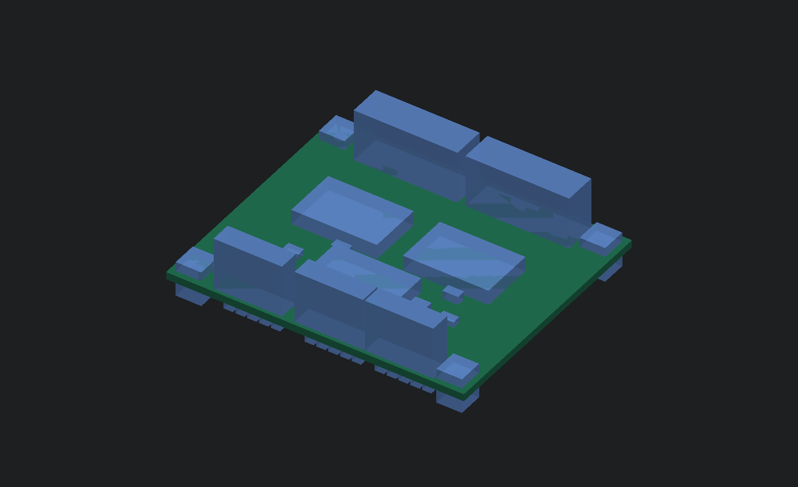

# E18 digital input hub

This 64 × 54 mm, four-layer board connects all32 front button/selector inputs
and four external-profile rear/status inputs to three MCP23017-E/SO expanders.
It uses the corrected [F04 mapping](../../firmware/control-inputs.json), leaving
GPA7/GPB7 unconnected because the manufacturer specifies them as output-only.
It is a prototype subassembly. Pots, LED/display drivers, touch electrodes,
angle sensing, complete carrier routing and physical validation remain open.

The native schematic has15 circuit components. Its independently checked
netlist, all-severity ERC/DRC, schematic parity and open-connection checks pass.
The saved PCB has424 segments,62 through vias and a filled inner AGND plane.
These checks establish the saved connectivity and design-rule result; they
do not establish real scan latency, signal integrity, EMC/ESD or physical fit.



The PCB sits at layout(111,43), seat Z=12.1mm, above the existing processor
carrier on four nominal4mm spacers. Its four Ø2.4mm mounting holes are board-
relative(4,4),(60,4),(4,50),(60,50). The processor-carrier holes and routing
keepouts are still proposals; the carrier itself is unrouted. Spacer OD≤5.5mm,
screw/washer OD≤5.5mm and head height≤2mm are assembly limits with no selected
parts or engagement proof. The placement packet uses actual PCB courtyards,
connector expansion0.5mm, an11mm connector/harness height allocation,≤3mm
trimmed THT protrusion including solder and stated board/seat allowances.
The A04 CAD's241 named reserves and native solid-intersection checks pass
under those limits. Complete wiring paths and final electronic-board fit remain open.

| Header | Connection |
| --- | --- |
| J1,2×8 | Front inputs0–13; pin order follows the routed fanout; pins15/16 ground |
| J2,2×8 | Front inputs14–27; pins15/16 ground |
| J3,1×5 | Ground,Scene9,Default/User,Back Spin,Vinyl Brake |
| J4,1×5 | Ground,Send/Return sense,manual bypass sense,ANALOG_OK,INPUT_READY |
| J5,1×5 | Ground,shared MCU3.3V,SCL,SDA,CONTROL_RESET_N |

Use the [exported connector map](generated/connector-map.csv) for every pin and
logical control ID. J1/J2 alternate A-side reverse order with B-side forward
order; do not wire them as consecutive logical inputs. The connectors are
engineering pin-header footprints. Production connector, mating cable,
retention and polarity/keying selections remain unfinished.

**Connect J4 only with `PROFILE=external`.** Onboard firmware makes its GPA0..3
unused low outputs; leave J4 unplugged for onboard-codec bring-up. External
ANALOG_OK and INPUT_READY receive47kΩ/270kΩ pull-downs on this board and no
internal pull-ups. This implements the receiving loads required by E09/E11.
Both active-low rear switch inputs use the expander's configured pull-ups.

J5 reset is D0/CODEC_RUN externally or D27 onboard. R1 adds a receiving100kΩ
pull-down; this replaces the earlier prospective onboard reset pull-up.
F04 drives reset low then high and verifies direction/pull-up/output-latch
readback before accepting controls. Missing-drive, partial-power, leakage and
reset transients still need hardware qualification. A shared3.3V supply is
required; never power this board's logic from5V or join independent3.3V outputs.

There are no I²C pull-ups on E18. E09 R1/R2 supply the single2kΩ pair for the
external profile. Onboard bench bring-up needs an equivalent external pair.
Include fixed module pull-ups in the total bus load and measure rise time,
capacitance, ringing and actual scan cadence before accepting400kHz operation.
All switch leads remain inside the enclosure; system-level ESD/EMI provisions
and harness qualification are unfinished.

Regenerate and verify with the existing CAD Python environment (numpy2.5.4)
and KiCad10.0.7:

```sh
python3 -m hardware.electronics.control_inputs.generate
build-hardware/cad-tools/bin/python hardware/electronics/control_inputs/board.py --kicad-cli /path/to/kicad-cli
python3 -m hardware.electronics.control_inputs.verify --kicad-cli /path/to/kicad-cli
python3 -m hardware.cad.standalone
build-hardware/cad-tools/bin/python hardware/cad/render.py --openscad /path/to/openscad
```

`board.py` uses explicit GPIO fanouts and a conservative grid-routing aid for
the remaining slow digital nets. Native KiCad DRC/parity checks the resulting
saved copper. `verify.py` independently declares all15 component contracts,
checks F04 logical/physical input mapping and NC-pad isolation, audits SOIC
pad numbering/positions, re-exports E09/E11 interfaces, and produces the
[verification record](generated/verification.json) and
[PCB placement packet](generated/placement.json). It uses shared parser and
transform helpers from E07; it does not import this board's circuit specification.

The MCP source is Microchip
[DS20001952D](https://ww1.microchip.com/downloads/aemDocuments/documents/APID/ProductDocuments/DataSheets/MCP23017-Data-Sheet-DS20001952.pdf).
Standard KiCad footprints are embedded in the board and hashed in the record.
Full manufacturer land-pattern/stencil approval, exact passive/connector MPNs,
fabrication stackup and physical performance are still pending. This board
does not complete the standalone unit or authorize a complete fabrication run.
