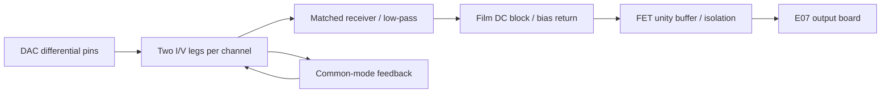

# E08 stereo DAC I/V and receiver

E08 adds a native, unassembled **60-component circuit prototype** between the
prospective ES9292QPRO DAC pins and the routed E07 output board. It does not
contain the codec, its power/clock/configuration circuit, the ADC/input path or
a PCB. These parts have **not been placed in the enclosure**; A03/E07 clearance
results still cover the existing output board and named reserves only.

Open the [KiCad project](dac_receiver.kicad_pro),
[native schematic view](generated/dac_receiver.svg), [BOM](bom.csv),
[pin schedule](components.json), [verification record](generated/verification.json)
or [loaded circuit analysis](generated/circuit-analysis.json).
The [current hardware review](../../releases/README.md#standalone-review-e08)
includes E08 sources and the existing A03/E07 CAD/output PCB.

## Circuit and boundaries

The ESS reference output stage uses two I/V amplifiers and common-mode feedback.
E08 retains that functional topology: OPA1612 I/V pairs, 1.8 kΩ feedback with
510 pF, two 100 kΩ common-mode sense resistors and 1.2 MΩ/51 pF feedback. It uses
one OPA1612 dual package for the two common-mode units instead of two reference
OPA1611 singles. A proportional common-mode loop does not make every output
exactly zero DC.

A further OPA1612 dual implements the stereo differential receiver. Four 499 Ω
resistors per channel require 0.01% ratio accuracy; 1 nF C0G feedback/shunt caps
provide matched low-pass filtering. Polarity restores a positive DAC-current to
RECV transfer. The lower resistor values reduce added noise but load the I/V
outputs more heavily than the amplifier's 2 kΩ table condition. Normal modeled
peak current reaches about 5.1 mA in an I/V unit; distortion and stability at
this load remain measurements.

Receiver DC is blocked by one 2.2 µF/63 V nonpolar film capacitor per channel,
with a 33.2 kΩ bias return. The selected drawing family is WIMA
MKS2C042201K00KSSD: nominal 7.2 × 7.2 × 13 mm body and 5 mm lead pitch.
Maximum dimensions, seating, availability and physical fit remain unqualified.
An OPA1656 dual buffers these nodes; its FET input avoids putting the bipolar
input's bias/current-noise burden on that network. A 2.74 kΩ series resistor is
an input-current-limiting provision, and 33.2 Ω isolates each final output.
The limiter requires a qualified 0.5 W part in the candidate 2010 footprint;
the modeled initial pulse is 0.215 W with up to 0.711 mJ stored in the coupling
capacitor. Exact pulse/temperature derating is open. This does not establish
rail-injection or power-fault protection.

| Boundary | Pins / requirement |
| --- | --- |
| J1 raw DAC | 1:DAC_LP → ESS pin 5; 2:DAC_LN → pin 4; 3:AGND; 4:DAC_RP → pin 8; 5:DAC_RN → pin 7 |
| J2 post-receiver | 1:RECV_L, 2:AGND, 3:RECV_R → E05/E07 J1, same order |
| J3 supplies | 1:+12 V, 2:AGND, 3:−12 V; regulated and qualified externally |
| E05/E07 load | Actual exported R17/R18: 100 kΩ per channel; ideal amplifier inputs add no load in this model |
| Calibrated interface | Target 2 V RMS at 1 kHz, zero-centered; proposed steady DC allocation ±25 mV; low source impedance through 33.2 Ω |

J1 headers document a prototype circuit boundary. Keep the eventual raw-DAC
connections short on the converter board. The header is not a long-harness
recommendation. Precision resistor, C0G and decoupling MPNs are unselected;
10 µF rail bulk uses candidate 1210 footprints and requires at least 4.7 µF
effective capacitance at 12 V.

## Calculated evidence and limits

The verifier runs all-severity native ERC, checks every exported component pin
and value against an independent contract, and exports E05 afresh to verify
connector order and its load. It compares an ideal nodal solve with an
independently expressed transfer function in 24 AC cases, including two
interpretations of the DAC impedance and mismatched legs. It evaluates 16,384
corners of 14 listed passive/source parameters; other spreads are explicitly
excluded. Both exported channels have identical numeric networks.

**Raw DAC scale is unresolved.** The ESS performance figure was measured on its
evaluation board and is not sufficient to derive the current at each bare pin.
The model normalizes a hypothetical differential current to 2 V RMS at J2;
that current is approximately 1.1115 mA RMS. This is an analysis condition, not
a measured or guaranteed chip output. Hardware gain/calibration range must be
resolved without assuming digital attenuation can correct an undersized analog
full scale. The 390 Ω impedance's per-pin/differential convention and raw DC
conditions also need confirmation.

Under that normalization, the 12 ideal E08/E05 cascade cases give approximately
12.276 V RMS in Master and 3.163 V RMS in Send/Return at 1 kHz. Nominal 20 Hz
and 20 kHz levels are respectively 0.118 dB and 0.074 dB below the 1 kHz level.
This is an ideal linear frequency-response result, not an audio-specification
pass.

The DC screen varies assumed raw common mode and both DAC impedances in 32
cases. Coupling blocks steady upstream DC in the linear model. With explicit
100 nA hot buffer-bias and 100 nA film-leakage allocations, a 1.2 mV buffer-offset
allowance and resistor tolerances, the calculated steady output bound is about
8.12 mV. Those current allocations need qualification at the actual temperature;
they are not guaranteed hot limits copied from the 25°C bias table.

For a modeled 24.24 V step and maximum coupling time constant of 80.4 ms, one
second leaves about 0.097 mV transient residue. **Require at least one second
after the analog rails and codec output state become stable before enabling
processed audio.** Rail/CHIP_EN faults and converter reconfiguration that can
change DC must restart qualification. The existing 350 ms firmware rearm delay
alone does not meet this new settling requirement. The
[E09 qualification schematic](../converter/README.md) now provides a conditional
minimum 1.21 s timer; it is not routed or assembled, and the external-codec
adapter remains unimplemented. This step calculation
does not establish absence of audible clicks or safe behavior during faults.

Allowing the full ±25 mV receiver DC budget leaves about 0.53 V in the prior
Master peak-margin screen. The OPA2992 swing assumption at ±19 V is still a
screening assumption. No measured clipping claim follows.

The illustrative added receiver/coupling/buffer noise is about 1.41 µV RMS,
unweighted over 20 Hz–20 kHz. The full modeled analog subassembly gives about
2.28 µV before converter-internal noise. OPA1612 uses flat typical noise
densities; OPA1656 uses a white-plus-1/f approximation normalized to its typical
integrated input-noise figure. Do not add overlapping I/V noise twice to ESS's
EVM result or directly combine these unweighted values with A-weighted DNR.
The complete input/converter/output noise budget remains open.

Five dual amplifiers use approximately 0.88 W typical quiescent power; the
combined maximum-current screen is 1.30 W before signal power. Reference
package thermal resistances do not prove enclosed temperatures. The single-pole
finite-gain/input-capacitance sweeps also do not prove phase margin or stability.
Raw-DAC protection, rail injection, startup/brownout, high-frequency behavior,
noise/THD, thermal behavior and physical fit remain verification work.

## Regeneration and sources

    python3 -m hardware.electronics.dac_receiver.generate
    python3 -m hardware.electronics.dac_receiver.verify --kicad-cli /path/to/kicad-cli

The generators/verifier use the Python standard library, project-owned E05
symbol/analysis helpers and external KiCad libraries. Source/library hashes and
[primary-document hashes](dependencies.json) are recorded. Generation replaces
the schematic; persist circuit edits in generate.py. No PCB has been generated,
ordered or assembled for E08.

Primary sources: [ESS ES9292PRO](https://www.esstech.com/wp-content/uploads/2026/08/ES9292_DS_v0.1.pdf),
[TI OPA1612](https://www.ti.com/lit/ds/symlink/opa1612.pdf),
[TI OPA1656](https://www.ti.com/lit/ds/symlink/opa1656.pdf),
[WIMA MKS2](https://wima.de/wp-content/uploads/media/e_WIMA_MKS_2.pdf).
