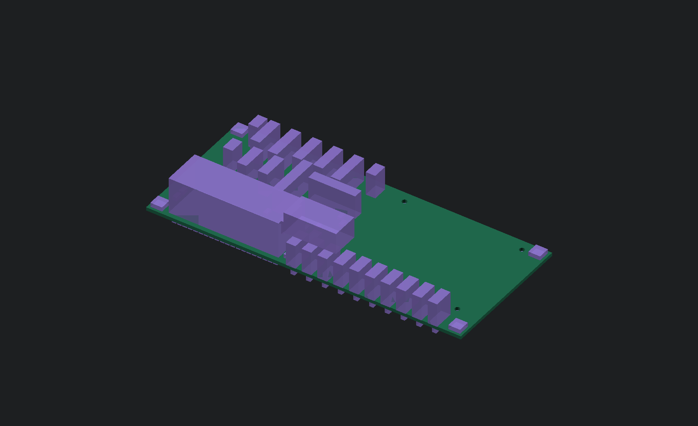

# E19 processor carrier — routed prototype

This circuit connects the Seed3 processor, ten knob inputs, E18 control hub,
E09 converter and E11 bypass controller for the **standalone external-converter
firmware profile**. It also exposes interfaces for the planned LED, touch,
angle-sensor and SD boards. Those interfaces do not complete those boards.

The 76-part native KiCad schematic and 150 × 65 mm four-layer PCB pass electrical,
routing, schematic parity and open-connection checks with zero violations.
An independent verifier checks all 40 module pins, ten knob channels,
connector pin order against fresh exports of the other four board schematics,
and the current F04 firmware assignments. See
[verification.json](generated/verification.json) and
[connector-map.csv](generated/connector-map.csv).

The processor now occupies the front slot on normal-height sockets. E18 shifts
2 mm left to clear the lower spacer fixings. Eight mounting holes and copper
keepouts are implemented, and the PCB-derived module, component, solder-tail,
fastener and USB allocations feed the A05 housing model. Full electronics
placement, wiring, thermal behavior and physical fit remain unverified.
This is not a fabrication package.

The [A05/E19 review package](../../releases/README.md#processor-and-housing-review-a05-e19)
captures the current processor/input/output placement and housing sources.



The ten 10 kΩ linear pots use the module's analog 3.3 V output, a 1 kΩ series
resistor, 100 nF shunt capacitor and 1 MΩ bleed per ADC input. Digital 3.3 V and
analog 3.3 V remain separate; module AGND and DGND join on the carrier.
[Conditional DC/RC screens](generated/passive-screen.json) do not verify ADC
acquisition, leakage, accuracy, noise or the full supply budget. Passive MPNs
and capacitor effective values remain to be selected and qualified.

The 40-pad library pattern preserves Electrosmith's supplied pad centers and
numbering: 2.54 mm pitch, 15.24 mm between rows and 1.7 mm pads. The unmodified
source and MIT license are in `vendor/`. The carrier adapts the original holes
to the chosen pair of
[SSW-120-02-G-S sockets](https://www.samtec.com/products/ssw-120-02-g-s). Samtec's
[single-row layout](https://suddendocs.samtec.com/prints/ssw-s.pdf) calls for
1.04 mm nominal holes, now used in the carrier. Finished-hole/plating tolerances,
socket insertion and the physical stack remain unqualified.
The Seed3 module's own PCB hole dimensions are separate from the carrier socket
holes. Legacy module graphics and STEP models are removed. Actual component
MPNs, a USB pigtail and physical tolerances must meet the documented allocations.

The ten ADC filter networks use short bottom-side connections beside the module
pins. Raw wiper traces escape through exact socket-pitch midpoints before joining
the harness fanout. In1 is a continuous AGND plane, with explicit copper exclusions
around all eight fasteners. Native connectivity removes redundant vias during
generation; the independent verifier then checks the saved PCB again.

J1 matches E17 J4 directly: pin 1 protected `5V_DIG`, pin 2 ground. It must not
receive raw 12 V. J6 requires a split harness: pins 1/2 feed E09 J4 pins 2/3;
pins 1/3/4/5/6 connect E09 J5 pins 1/2/3/4/6. E09 J4 pin 1 (`V5_REG`) comes from
the analog supply, not J6. Never join the module's 3.3 V outputs to a separate
regulator output. J2 reset and J4 bypass use the documented E18 signal aliases.
All E19 wiring is external-profile only; the onboard bring-up profile assigns
several of these processor pins differently.

Run from the repository root with Python 3.11+ and KiCad 10:

```sh
python3 -m hardware.electronics.processor_carrier.generate
python3 -m hardware.electronics.processor_carrier.board --kicad-cli /path/to/kicad-cli
python3 -m hardware.electronics.processor_carrier.verify --kicad-cli /path/to/kicad-cli
```
