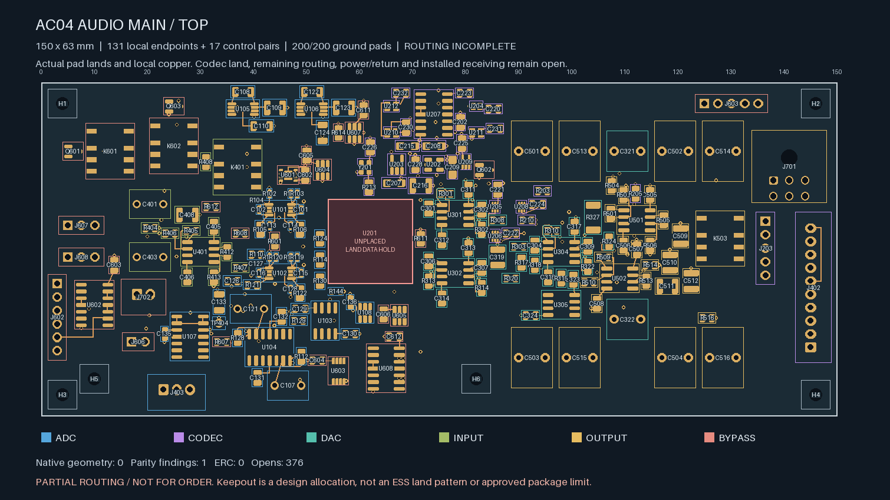
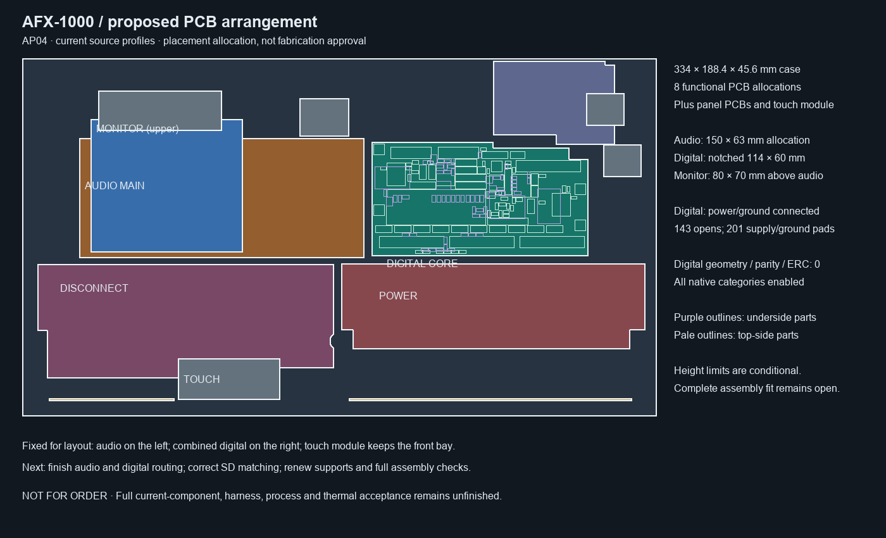

# Standalone fabrication preparation

**The complete unit is not ready for fabrication.** This inventory targets the
first prototype of the full 12 V higher-headroom standalone design. B1 is separate.

These are 15 functional roles, not a decision to manufacture 15 separate PCBs.
The final physical partition and integrated assembly remain unfinished.

The table is generated by `python -m hardware.fabrication.audit_scope` from
[scope.json](scope.json). [current-readiness.json](current-readiness.json)
records source hashes, saved native findings and unresolved requirements.

| Functional role | Selected development source | DRC findings / opens / ERC findings |
| --- | --- | --- |
| power supply | [KiCad source](../electronics/power_distribution/p03/candidates/ax03-run-transmitter/generated/native-closed-transmitter/power_p03.kicad_pro) | 0 / 0 / 0 |
| input protection | [KiCad source](staging/input-protection-native-01/rear_inlet.kicad_pro) | 0 / 0 / 0 |
| rail disconnect | [KiCad source](staging/e28-branch-cleanup-native-12/rail_disconnect.kicad_pro) | 0 / 0 / 0 |
| rail monitor | [KiCad source](staging/rail-monitor-reserved-closed-native-02/rail_monitor.kicad_pro) | 0 / 0 / 0 |
| processor carrier | [KiCad source](staging/processor-carrier-native-01/processor_carrier.kicad_pro) | 0 / 0 / 0 |
| control inputs | [KiCad source](staging/control-inputs-native-01/control_inputs.kicad_pro) | 0 / 0 / 0 |
| led driver | [KiCad source](staging/led-driver-native-01/led_driver.kicad_pro) | 0 / 0 / 0 |
| converter | [KiCad source](../electronics/converter/converter.kicad_sch) | No PCB layout |
| input range | [KiCad source](staging/input-range-native-01/input_range.kicad_pro) | 0 / 0 / 0 |
| adc driver | [KiCad source](staging/adc-driver-native-01/adc_driver.kicad_pro) | 0 / 0 / 0 |
| dac receiver | [KiCad source](staging/dac-receiver-closed-native-01/dac_receiver.kicad_pro) | 0 / 0 / 0 |
| output stage | [KiCad source](staging/output-stage-native-01/output_stage.kicad_pro) | 0 / 0 / 0 |
| sequenced bypass | [KiCad source](staging/bypass-closed-native-03/sequenced_bypass.kicad_pro) | 0 / 0 / 0 |
| negative startup protection | [KiCad source](staging/nf-logic-swap-clean-native-01/negative_startup_physical.kicad_pro) | 0 / 138 / 2 |
| fan health protection | [KiCad source](staging/fan-watchdog-land-native-01/fan_power_health.kicad_pro) | 0 / 0 / 0 |

The [shared audio integration candidate](staging/audio-main-integration-04b/audio_core.kicad_pro) combines input range, ADC driver, codec, DAC receiver, output stage and sequenced bypass
into 329 parts/971 terminals on one proposed PCB.
Its native schematic export has zero ERC findings. The codec land remains
unassigned; the source and interface audit does not adopt separate development-board copper.
The [partial main audio PCB](staging/audio-main-controls-01/audio_core.kicad_pro) places 328 known electrical footprints
and six proposed mounts in the 150 × 63 mm allocation. Native geometry and ERC
are zero with all categories enabled. The missing ESS footprint remains an explicit
parity finding; 376 connections remain unrouted.
Its 99 local feedback/bypass/pump/clock/servo cells meet their declared endpoint
limits. Full analog performance, codec placement, mating/harness fit and manufacturing remain open.

All 131 declared local signal/supply endpoints and all 20 declared local ground-return pairs are native-connected.
The In1 AGND plane connects every one of the 200 placed ground pads to the input ground.
The candidate has 475 tracks and 199 conventional 0.60/0.30 mm vias;
the minimum screened drill-edge-to-SMD gap is 0.170 mm. Twelve sensitive-node plane openings
and six mounting-hardware copper exclusions remain protected. All amplifier placements and
their direct compensation capacitor traces are retained. Four previously unrouted parts
have renewed receiving after local changes. Full power/return, noise/stability, stack/process
and whole-unit thermal/mating/harness qualification remain unfinished.
An additional 17 low-speed control pairs are native-connected,
using surface traces only. No parent analog copper, lands, drills or stored plane fill changes.
Installed timing, coupling, EMI and fault behaviour still require qualification.

The [combined digital/control candidate](staging/digital-four-clean-native-03/digital_core.kicad_pro) places the processor carrier,
control expanders and LED drivers on one proposed notched 114 × 60 mm PCB.
It has 138 electrical parts, zero native geometry/parity/ERC findings,
and 143 unrouted connections. All native categories are enabled.
Five inter-board headers were removed. Placement does not establish routed
power/return performance, production connector acceptance or installed fit.
The DC04 signal-routing checkpoint preserves all 201 connected power/ground pads,
39 local connections and 33 thermal connections. The four-layer stack, component
poses, mounts, outline and all DC03 copper remain unchanged. Both plane fills remain connected.
Its 1,252 tracks and 243 vias include 107 new drills clearing SMD copper by at least 0.169 mm.
The 21 earlier mask-covered heat-spreader vias retain their separate process hold.
SD and audio data nets are connected, but SD carrier trace totals span 47.6–84.3 mm
with unequal via counts. Timing, impedance, return paths and off-board interfaces remain unqualified.
The 116 open nets include 76 LED outputs and 13 control nets. LED/control escapes
and SD routing need rework before power/noise/thermal and manufacturing acceptance.
See the [signal-routing review](staging/digital-four-clean-native-03/README.md).

The [AP04 arrangement](staging/assembly-layout-04/README.md) fixes allocations for the next PCB work:
six audio roles on the left, combined digital on the right, an upper rail-monitor
board, and the existing touch-module front bay. Its eight functional PCB
allocations exclude additional panel/emitter boards and the touch module.
The full current assembly, supports, harness and thermal design remain unfinished.

DRC findings include warnings. A zero count does not approve the circuit,
fabrication process, current capacity, thermal design, mechanical fit or assembly.
All selected native reviews retain explicit rule coverage; no ignored category
is used to obtain a passing result. The NF isolated-domain ground warnings
remain visible; the negative reference nets have not been shorted to AGND.

## Work remaining before prototype release

- Select one coherent set of current board, panel, housing, link, return and harness sources.
- Reconcile mechanical receiving with thin NF/FPC and current E28/P03 rather than inherit older assembly passes.
- Resolve exact parts, fasteners, connector keying and manufacturing tolerances.
- Produce and independently inspect Gerber, drill, stack, BOM, placement and fabrication/assembly drawings for each selected physical board.
- Create the bounded first-article inspection and isolated bring-up package before complete-unit power-up.

Board-specific holds are recorded in scope.json. The missing ESS package
drawing, PCB process questions and prepared supplier request are in
[manufacturer-inputs.md](manufacturer-inputs.md). No supplier request or order
has been sent. The converter footprint remains deliberately unassigned.

A prototype release needs the completed design, inspected fabrication outputs
and a first-article inspection/bring-up plan. Measurements of the subsequently
built hardware are required for production qualification.

## Runtime and storage

Mac KiCad/OpenSCAD remain disabled. Native checks use the pinned, network-disabled
Linux CAD container. Routing development runs bounded host geometry searches.
Original projects and earlier candidates are preserved. Staging files are
engineering evidence, not a manufacturing release. Bulk audio generation stays paused.
