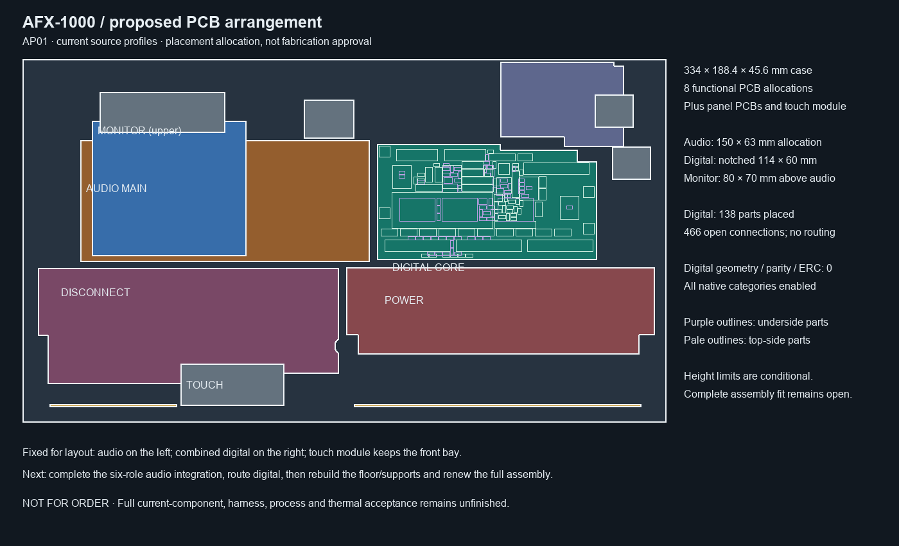

# AP01 — physical allocations for the remaining PCB work



This fixes the layout direction inside the existing enlarged
**334 × 188.4 × 45.6 mm** case. The 15 functional roles are grouped into **eight
functional PCB allocations**. Additional display, selector, sensor and LED
emitter PCBs and the Trill module are separate; eight is not the total PCB count
of the finished device.

| PCB allocation | World datum, mm | Allocation / source |
| --- | --- | --- |
| Audio main | [30,42,6.5] | 150 × 63 mm; input range, ADC, codec, DAC receiver, output and bypass |
| Digital core | [184,44,7] | Notched 114 × 60 mm; processor, controls, LED drivers; actual 138-part placement |
| Rail monitor | [36,32,24] | Current 80 × 70 mm PCB, upper mezzanine |
| Power supply | [168,108,6.5] | Current P03 profile |
| Rail disconnect | [8,108.5,5] | Current E28 profile, including the extended tail |
| Rear input protection | [248,1.4,7.9] | Current inlet profile |
| Negative startup protection | [172,180.5,3.5] | Current 149 × 39 mm PCB, RX+90° |
| Fan health protection | [14,180.5,3.5] | Current 66 × 38 mm PCB, RX+90° |

The Trill module keeps TC02's [82,158,20] mm pose. Its floor posts clear the
**actual current E28 Edge.Cuts**, including the 70 mm-wide extension. This
calculation uses the polygon, not the misleading 156 × 60 mm bounding box.
Post material, screw engagement, tolerance and physical approval remain open.

Digital and rail-monitor component XY bounds come from actual placed native
footprint courtyards. The declared digital receiving limits are Seed assembly
17.2 mm above PCB, mated/wire allocation 13.5 mm above PCB, other installed
components 3.2 mm, THT tails including solder at most 3.2 mm below PCB, PCB
thickness 1.44..1.76 mm and datum Z ±0.2 mm. Monitor limits are headers 13.5 mm,
C50 2.5 mm and other parts 2.0 mm, with the same PCB and Z interval. **These are
unapproved receiving requirements, not proven supplier limits.**

Under those limits, the component-box screen clears the retained pots,
button/solder and holder-column allocations, inlet/rear reserves and release
mechanism XY keepout. It does not constitute a complete assembly collision
review. The native digital PCB has zero geometry/parity/ERC findings with all
categories enabled; it remains unrouted at 466 connections.

The audio allocation contains **342 parts before six-role port consolidation**.
Only the ADC/codec/receiver sub-schematic is currently combined. Tall film caps
and connectors must be placed outside the upper monitor projection. The two
front monitor supports at [40,98] and [112,98] pass through the future audio PCB
and require designed clearance holes and copper keepouts. Components beneath
upper-board header tails need a separate height restriction. No actual audio
placement is asserted by this diagram.

Remove superseded processor, control-hub, LED and output-board bosses when
regenerating the enclosure floor. Create the new digital mounts and monitor
supports, then renew the complete native assembly using current P03/E28/NF/FPC
parts, mounts, shims, all rear ports, emitter assemblies, conductors and service
paths. Earlier whole-unit fit passes are not inherited.

```sh
python -m hardware.fabrication.assembly_layout --check
python -m hardware.fabrication.audit_digital_layout --check
python -m hardware.fabrication.audit_scope
```

`allocation.json` binds the exact source files and retains the conditional
component boxes. The [SVG](arrangement.svg) and PNG are engineering allocation
views, not manufacturing drawings. Full physical partition/receiving, routing,
actual parts/process, power/fault/return/thermal analysis and the inspected
manufacturing/first-article package remain unfinished. **Not for order.**

The later [AC04 six-section schematic](../audio-main-integration-04b/README.md) now completes the schematic-integration step shown as next work in the original diagram. Its 329-part circuit uses this allocation; actual placement and full assembly receiving remain unfinished.
