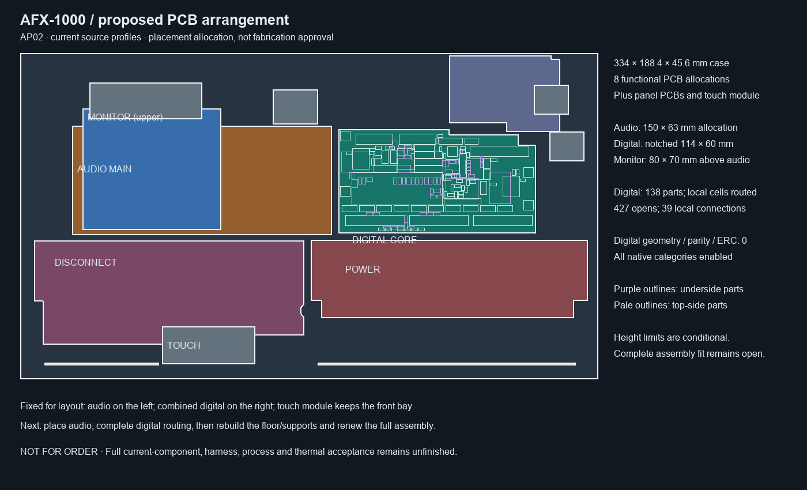

# AP02 — current digital cells in the unit allocation

AP02 retains the eight functional PCB allocations and the 334 × 188.4 × 45.6 mm
case envelope from [AP01](../assembly-layout-01/README.md). Additional panel,
emitter, sensor and touch boards remain separate; eight is not the finished
unit's total PCB count.

The digital allocation now uses the actual DC02 component poses: 138 parts,
39 local routed connections and 427 missing connections. The actual component
courtyards, opposite-side THT solder reserves and declared height boxes are
rechecked against the retained controls, rear/inlet and release context. No
conditional collision is found. The five mount positions and outline are exact.

The receiving limits remain proposals: PCB thickness 1.44–1.76 mm, datum Z ±0.2 mm,
Seed assembly 17.2 mm above the board, mated headers/wires 13.5 mm, other components
3.2 mm, and THT tails including solder at most 3.2 mm below the board. These are
not received-part or assembly guarantees. No new full native enclosure collision,
service-path, thermal or harness qualification is asserted.

The audio allocation now refers to the integrated 329-part six-section schematic;
it still has no placed/routed PCB. The monitor support piercings, tall-part
restrictions and full floor/support rebuild requirements remain as recorded in
AP01. Current NF/P03/E28/fan parts, harnesses and service access need one complete
assembly renewal.

[allocation.json](allocation.json) binds all sources used by this conditional
screen. `python -m hardware.fabrication.audit_scope` checks the selected evidence.
**Not for order or fabrication release.**
