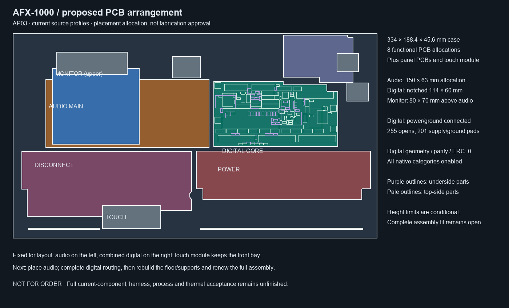

# AP03 current digital distribution allocation

This arrangement rechecks the selected DC03 PCB against the existing conditional
component, control-context, floor and height limits. The component bodies,
mounting holes and outline are unchanged from DC02; new tracks, vias and planes
do not establish a new installed-fit or thermal qualification.

The conditional component-context and floor collision lists are empty. Eight
functional PCB allocations remain, plus panel/emitter boards and the touch
module. The integrated audio layout, supports, complete harness, service paths,
received dimensions and full mechanical/power/thermal checks remain unfinished.

DC03 contains 138 electrical parts, five connected power/ground nets and 255
unrouted connections. Native geometry, parity and ERC findings are zero.

Source-bound data: [allocation.json](allocation.json).
Recompute with `hardware.fabrication.assembly_layout_v3.calculate()` and compare
to the saved allocation. This is not a fabrication or assembly release.
