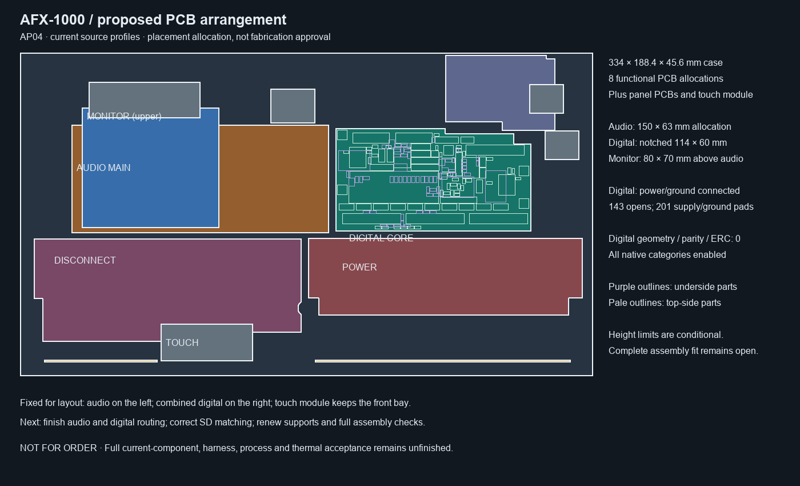

# AP04 current digital signal-routing allocation

AP04 rechecks selected DC04 against the existing conditional component,
control-context, floor and height limits. Its component bodies, mounting holes,
outline and nominal board thickness are unchanged from DC03. Conditional
component-context and floor collision lists are empty.

DC04 retains four copper layers and 138 electrical parts. It has 143 open
connections with zero native geometry, parity and ERC findings. Its SD timing,
remaining routing and electrical/thermal qualification are unfinished.

Eight functional PCB allocations remain, plus panel/emitter boards and the touch
module. The partially routed main audio board, missing codec package, supports,
complete harness, service paths, received dimensions and full installed-fit,
power and thermal verification remain unfinished. This is a conditional
allocation, not assembly or fabrication approval.

Source-bound data: [allocation.json](allocation.json).
Recompute with `hardware.fabrication.assembly_layout_v4.calculate()` and compare
with the saved allocation.
