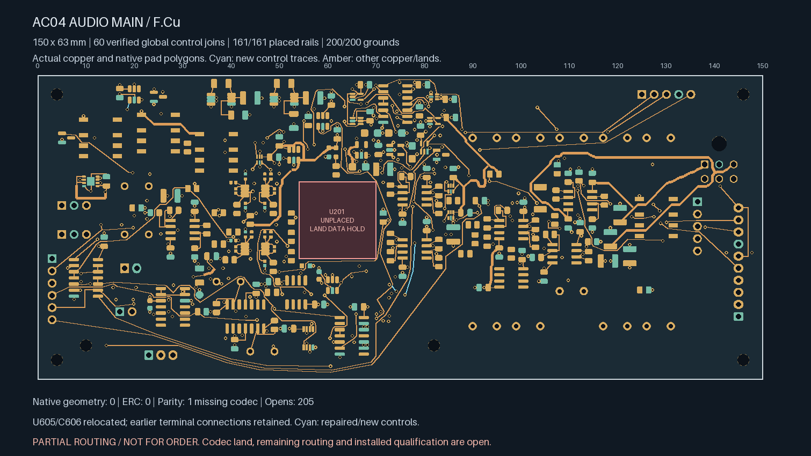
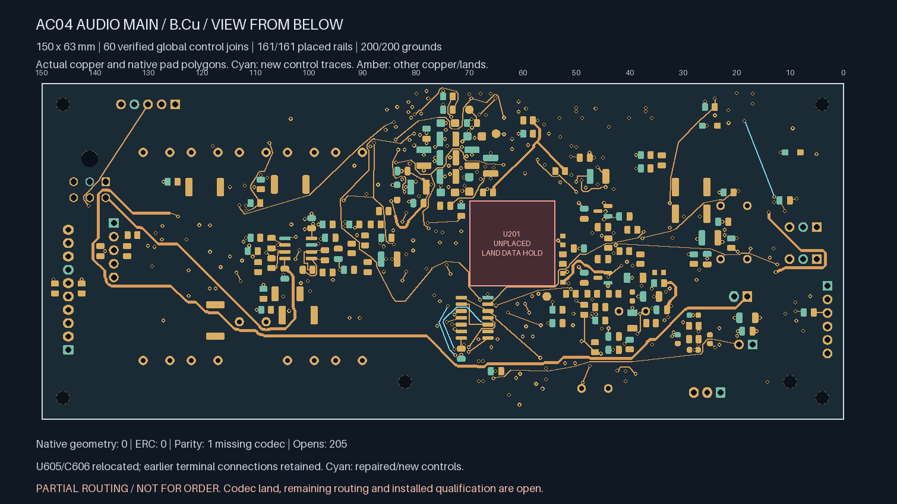
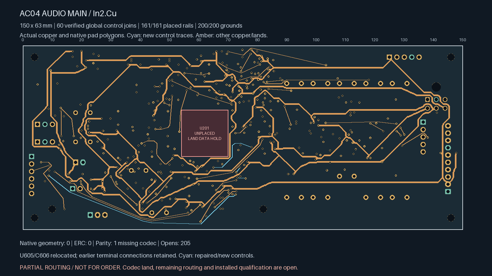
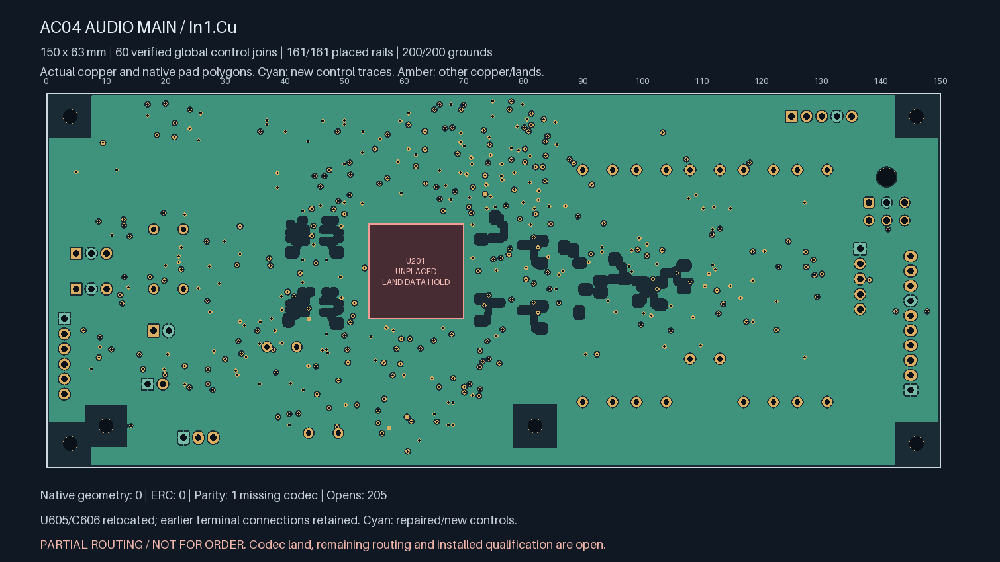

# AC04 — bypass routing comparison

**Partial routing; not ready for fabrication.** This unselected comparison has
**205 open connections**, including **four control opens**. The selected
[208-open checkpoint](../audio-main-controls-06/README.md) remains unchanged.
U201/ES9292QPRO still has no approved land pattern.

| Actual top copper | Actual bottom copper, viewed from below |
| --- | --- |
| [](plots/top.png) | [](plots/bottom.png) |

| Actual In2 copper | Actual refilled In1 reference |
| --- | --- |
| [](plots/supplies.png) | [](plots/ground.png) |

The supervisor U605 moves from (67.5,44) to (20,4) mm; its local bypass C606
moves with it to (17,3.75) mm. Package orientations, local supply coupling
and the private ground copper move together. All other component poses,
manufacturer lands, board edges, six mounts, authored keepouts, project,
schematics and libraries remain exact. The allocation stays 150 × 63 × 1.6 mm.
Actual polygons for all 930 pads are checked against the parent with only
these two declared translations.

The relocation frees space for five connections. INPUT_READY and INPUT_ENABLE
repair earlier joins displaced during the rework; LOCAL_OK, PROCESS_HEALTH
and TIMER_ENABLE are three additional global joins. Full added lengths include
actual pin exits:

| Connection | Length | Fresh vias, including used pin-exit vias |
| --- | ---: | ---: |
| INPUT_READY repair | 16.551 mm | 0 |
| INPUT_ENABLE repair | 34.458 mm | 3 |
| LOCAL_OK | 17.337 mm | 1 |
| PROCESS_HEALTH | 86.864 mm | 4 |
| TIMER_ENABLE | 4.200 mm | 1 |

INPUT_ENABLE explicitly exceeds the earlier **28.485 mm distance-based search
target**. This comparison allows up to **40 mm**, retaining the actual length,
old target and electrical-qualification hold in its records. This is a planning
comparison, not a timing or signal-integrity acceptance limit. U602/U606 are
SN74HCS08 Schmitt-input gates; the native netlist retains the R612 driver branch.
The complete net's loading, timing, edge behaviour, return transitions, noise
and EMC remain unqualified. The [TI datasheet](https://www.ti.com/lit/ds/symlink/sn74hcs08.pdf)
is the device reference, not proof of this installed layout's performance.

Three relocated supply connections retain **0.60 mm trunks** with short
0.20 mm pad entries and conventional 0.60/0.30 mm vias. Native-identified
abandoned source tails are removed, including both old rail-feed chains.
Removal stops at actual solder lands or plated junctions. Unused temporary
pin-exit vias and a bypassed stub are removed. The independent audit replays
those exact deletions; all unretired parent copper stays exact.

| Isolated Linux KiCad 10.0.7 check | Result |
| --- | --- |
| Geometry / ERC findings | **0 / 0**, no ignored categories |
| Schematic parity | **1: missing U201 footprint** |
| Open connections | **205** |
| Tracks / conventional vias | **2,412 / 393** |
| Earlier local / earlier control / earlier global joins retained | **138 / 17 / 57** |
| Earlier private watchdog / settling timing pairs | **Both connected** |
| Placed rail/sense pads connected to designated source | **161 / 161** |
| Placed ground pads connected to J701.2 | **200 / 200** |
| Minimum all-via drill-edge-to-SMD-copper gap | **0.16998 mm** |
| Actual native-refilled In1 ground area | **8,025.88 mm²** |

Remaining control gaps are TIMER_INPUT_OK, CODEC_PGOOD and two CHIP_EN joins.
The [source-bound handoff](routing-handoff.json) replays the preparation,
supply restoration, pin exits, complete control witnesses, native tail cleanup
and final native results. Earlier [two](../audio-main-bypass-repack-03/README.md)
and [three](../audio-main-bypass-repack-02/README.md) dangling-track findings are
retained as rejected intermediate checks, with no findings waived.

Release still requires all remaining routing, revisioned ESS package/interface
inputs, physical ADC stars, whole-unit electrical/thermal/fault review,
parts/mates/harness/support/case receiving, supplier process acceptance,
inspected manufacturing outputs and a bounded first-article plan. No supplier
message, upload or order was made. Native Mac CAD remains disabled.

Replay from the repository root:

```sh
uv run --locked python -m hardware.fabrication.audit_audio_main_bypass_repack --check
uv run --locked python -m unittest tests.tooling.test_audio_main_bypass_repack
```
