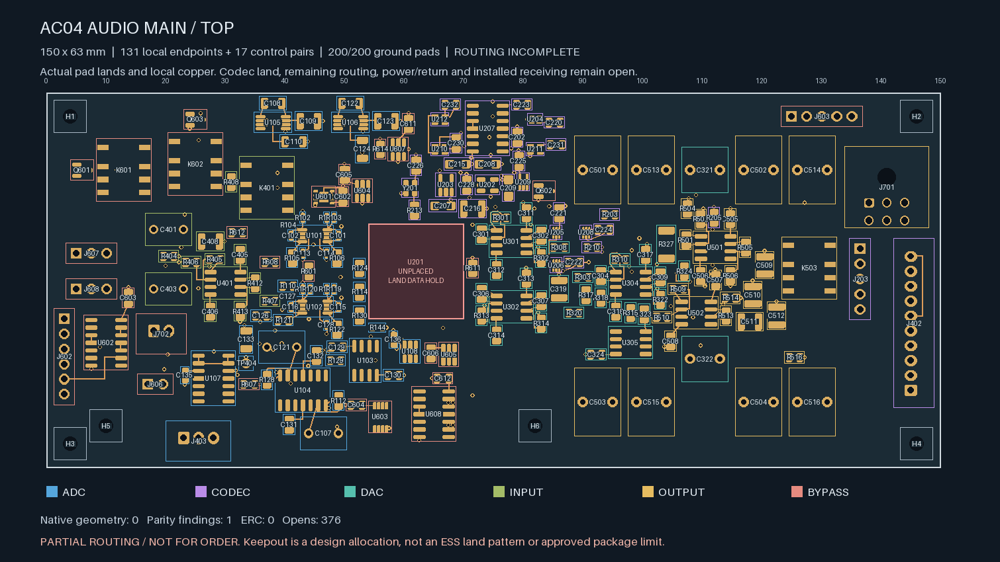
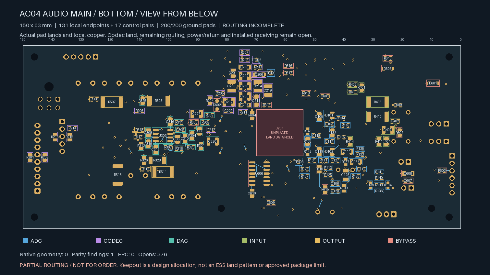
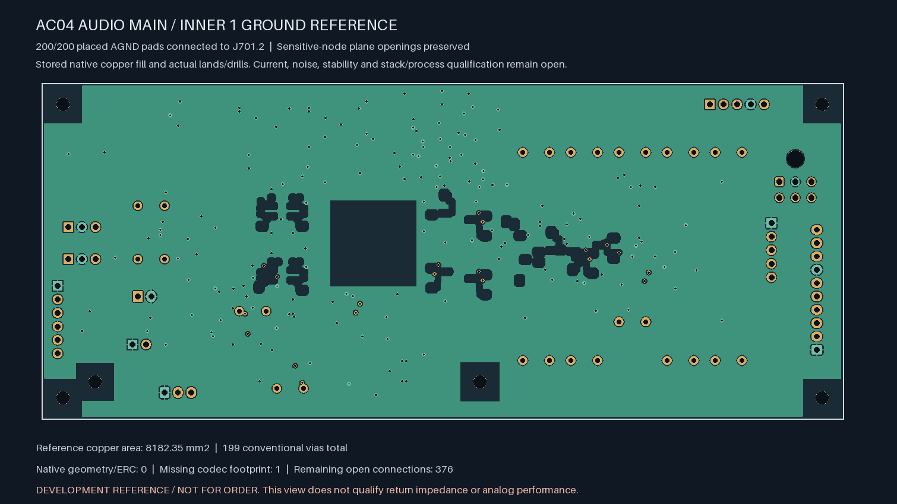

# AC04 — local audio cells, complete placed ground, first control routes

**Not ready for fabrication.** The selected partial audio main board now has
**376 open connections**, down from 393 in the
[ground-reference candidate](../audio-main-ground-02/README.md).
The codec land remains missing and global signal and supply routing is unfinished.

| Top copper | Bottom copper, viewed from below |
| --- | --- |
|  |  |

| Isolated Linux KiCad 10.0.7 check | Result |
| --- | --- |
| Geometry findings / ERC findings | **0 / 0** |
| Schematic parity | **1: missing U201/ES9292QPRO footprint** |
| Native open connections, uncapped | **376** |
| Ignored DRC / ERC categories | **0 / 0** |
| Tracks / conventional vias | **475 / 199** |
| Additional control pairs connected | **17 / 17** |
| Retained explicitly tracked local pairs connected | **138 / 138** |
| Placed ground pads connected to J701.2 | **200 / 200** |

The 27 new surface segments connect seventeen previously separate islands on
an exact list of low-speed bypass, bias-window and codec control nets. They
include joined logic inputs, the bias-window comparator outputs, MCU permit,
settling enable, bypass arming and analog-health headers. The planning limits
are 12 mm between endpoints and 16 mm of trace per new branch, with 0.20 mm
width, 0.20 mm clearance and a further 0.01 mm obstacle-screen margin. These
are routing construction limits, not measured timing or EMI qualification.
The longest actual added branch is 14 mm. No coil-current, timing-capacitor,
audio, reference, clock or supply node is selected by a name fragment.

**Every parent object remains exact**, including all footprints, amplifier
poses, compensation copper, local supply routes, drills, six mount exclusions,
twelve sensitive-node plane openings and stored In1 ground fill. No via is
added. All 131 declared local signal/supply endpoints and twenty local
ground-return pairs remain connected; the 138 explicit parent pair witnesses
are rechecked together with all 200 ground terminals in the new native board.
The retained 8,182.35 mm² reference and 0.170 mm minimum drill-edge-to-SMD gap
retain their earlier limits and supplier/process holds. The native pad geometry
used for the image is inherited from the exact unchanged parent lands; it is
not a newly assigned ESS footprint.

The [source-bound replay](routing-handoff.json) checks new copper against the
native obstacle capture, exact endpoint membership in previously disconnected
islands, actual widths and lengths, full native findings, and complete retained
connection witnesses. Source snapshots retain each executed generation action.
The renderer receipts bind the PCB, native reports, inherited pad capture and
actual image files. Preview images are not inspected manufacturing outputs.

Remaining release work includes the other 376 connections, revisioned ESS
land and interface data, physical ADC stars, final parts/mates/harness/supports,
installed PDN/fault/thermal/noise/stability and control timing/coupling/EMI
qualification, supplier acceptance, inspected Gerber/drill/BOM/placement
outputs and a bounded first-article plan. Existing receiving remains conditional
on its unapproved component and assembly limits. No supplier request, order,
upload or native Mac CAD launch is made by this work.
