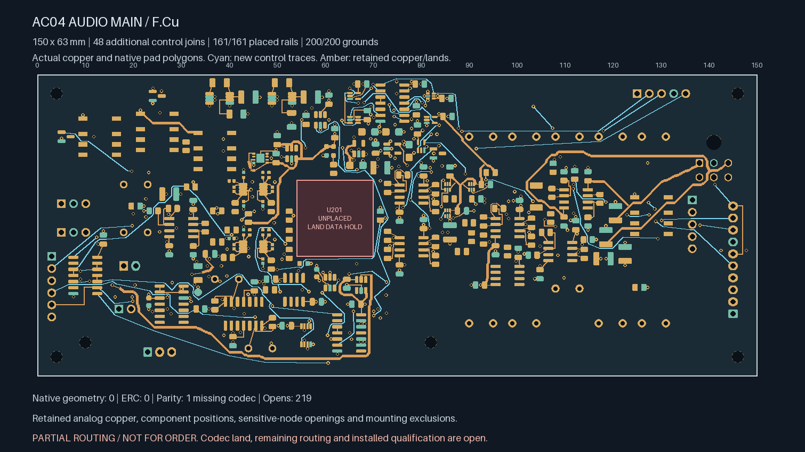
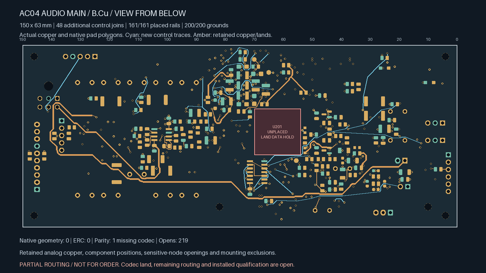
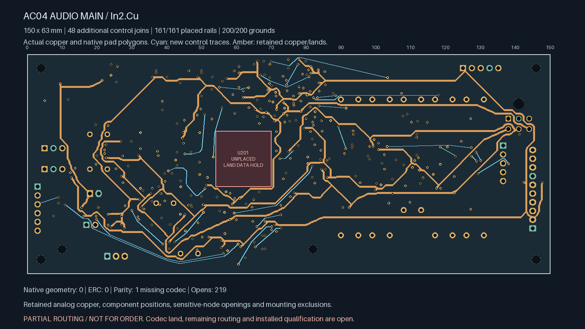
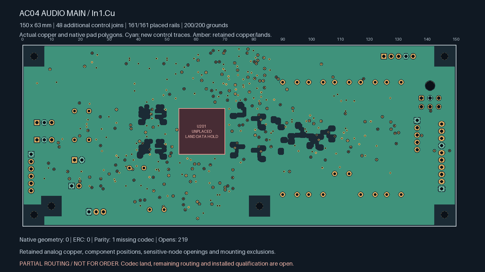

# AC04 — 48 additional control connections verified

**Partial routing; not ready for fabrication.** Native Linux KiCad 10.0.7
confirms **219 open connections**, down from 267 in the
[placed-supply predecessor](../audio-main-supplies-06/README.md). U201/ES9292QPRO
still lacks an approved land pattern. No manufacturing outputs are released.

| Actual top copper | Actual bottom copper, viewed from below |
| --- | --- |
|  |  |

| Actual In2 supply/control copper | Actual refilled In1 reference |
| --- | --- |
|  |  |

| Native check | Result |
| --- | --- |
| Geometry / ERC findings | **0 / 0**, no ignored categories |
| Schematic parity | **1: missing U201 footprint** |
| Open connections | **219** |
| Additional control joins / remaining targeted control opens | **48 / 16** |
| Added tracks / conventional 0.60/0.30 mm vias | **545 / 85** |
| Total tracks / vias | **2,274 / 356** |
| Retained explicit local pairs / earlier control pairs | **138 / 17**, all connected |
| Placed rail/sense pads connected to source | **161 / 161** |
| Placed AGND pads connected to J701.2 | **200 / 200** |

New 0.20 mm control traces use F.Cu, In2.Cu and B.Cu; no new signal tracks
occupy In1.Cu. The previous component poses, local analog copper, supply
distribution, mounting exclusions and authored plane openings remain exact.
Sensitive analog openings also exclude the new control routes on all three
routed layers. The 150 × 63 × 1.6 mm allocation is unchanged.

Each route joins actual native connectivity groups, with complete pad-key
witnesses. Short pad-to-via escapes have a 3.5 mm limit. Search routes are
limited to four new vias and the smaller of 180 mm or 2.5 times the actual
terminal distance plus 10 mm. These construction limits do not establish
signal integrity or timing acceptance. The longest new route is about
108.3 mm; timing, coupling, EMI and installed fault behaviour remain open.

Every new via clears actual SMD solder copper on both faces by at least
**0.16998 mm at the drill edge**, including same-net lands. Native refill
leaves **8,056.27 mm²** of stored In1 ground copper and retains all 200 ground
terminal connections. Plane impedance, mask/tenting, drill tolerances and
two-sided assembly remain unqualified.

The [source-bound replay](routing-handoff.json) binds the actual copper,
native reports, executed producer snapshots, refill and terminal witnesses.
The retained intermediate constructions record the successive additions;
none is a separate fabrication selection. The new regression checks reject
lost analog tracks, changed drill/width rules, false island merges and
incomplete or disconnected native pad witnesses. Obstacle checks also cover
newly appended copper/vias and analog exclusions on every signal layer.

Sixteen targeted control connections remain on thirteen nets, enumerated in
the handoff. Further routing needs review of blocked escapes and placement;
repeating the same search has produced diminishing returns. Other remaining
connections include analog, clock, timing and relay-current paths outside
this control whitelist. The earlier 164.6 mm relay supply branch still needs
review together with its unrouted return and switching transients.

Release still requires codec land/interface data and physical ADC stars,
the remaining routing, full power/return/noise/stability/fault/thermal review,
parts/mates/harness/support/case receiving, supplier stack and assembly
acceptance, inspected Gerber/drill/BOM/placement outputs and a first-article
plan. Connectivity is not installed hardware qualification.
