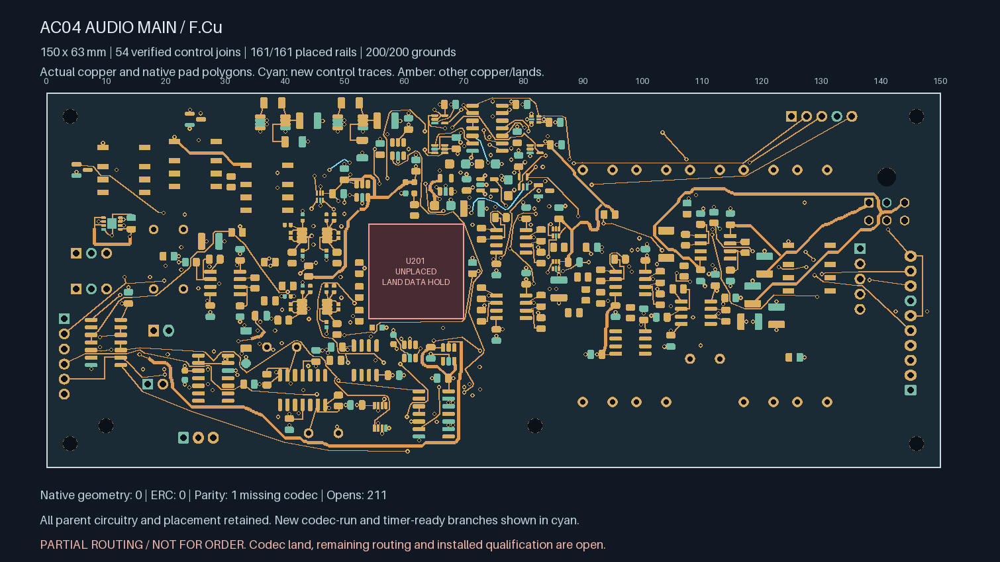
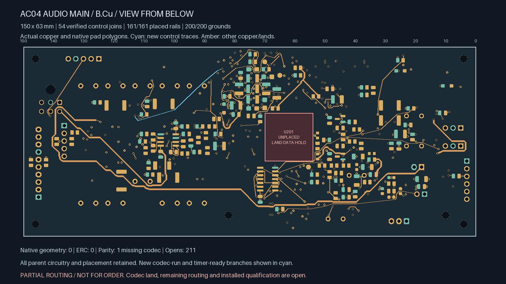
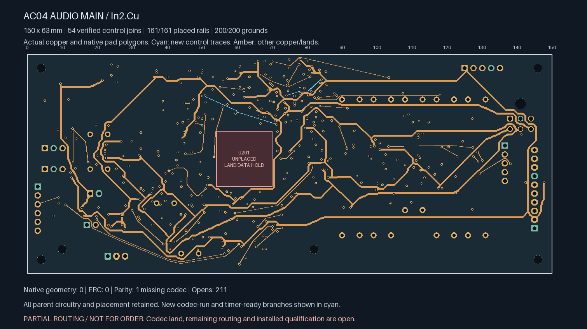
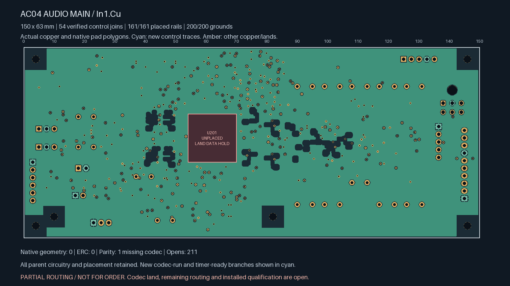

# AC04 — additive codec control completion

**Partial routing; not ready for fabrication.** Two additional branches connect
CODEC_RUN and the remaining TIMER_OK receiver. The board now has **211 open
connections**, including **10 targeted control opens**. U201/ES9292QPRO still
has no approved land pattern.

| Actual top copper | Actual bottom copper, viewed from below |
| --- | --- |
|  |  |

| Actual In2 copper | Actual refilled In1 reference |
| --- | --- |
|  |  |

| Isolated Linux KiCad 10.0.7 check | Result |
| --- | --- |
| Geometry / ERC findings | **0 / 0**, no ignored categories |
| Schematic parity | **1: missing U201 footprint** |
| Open connections | **211** |
| Tracks / conventional 0.60/0.30 mm vias | **2,354 / 377** |
| Earlier explicit local / earlier control / earlier global-control joins retained | **138 / 17 / 52**, all connected |
| Earlier private watchdog / settling timing pairs | **Both connected** |
| New global control joins | **2**, connected |
| Placed rail/sense pads connected to designated source | **161 / 161** |
| Placed AGND pads connected to J701.2 | **200 / 200** |

The [parent settling-supervisor board](../audio-main-settle-repack-01/README.md)
is retained exactly apart from new signal copper and native-refilled ground.
Every component pose, existing track/via, authored zone, board edge, mount,
library, project and schematic remains unchanged. Native polygons for all
930 pads independently match the parent capture. No board or housing growth
is introduced; the proposed audio allocation remains 150 × 63 × 1.6 mm.

CODEC_RUN adds approximately **53.862 mm / three vias**; TIMER_OK adds
**40.544 mm / three vias**. These totals include the actual terminal entries.
All 33 new tracks are 0.20 mm wide; six new vias are 0.60/0.30 mm. Each fresh
via joins at least two routed faces. The independent replay checks physical
terminal contacts, complete native pad witnesses, actual copper clearances,
the four-new-via construction limit and the inherited length budget.
Protected analog regions remain excluded on all routed faces.

These are unqualified low-speed control routes. Their length/via construction
checks do not establish installed loading, timing, return impedance, coupling,
EMI, fault behaviour or manufacturing acceptance. The parent isolated SENSE
branch and its conditional assessment are retained without modification.

The [source-bound handoff](routing-handoff.json) replays the complete parent
history and current native evidence. The new plots show actual saved copper,
native lands and fill; cyan identifies the two added branches. They are
engineering views rather than approved manufacturing outputs.

Release still requires remaining routing, revisioned ESS package/interface
inputs, physical ADC stars, whole-unit electrical/thermal/fault review,
parts/mates/harness/support/case receiving, supplier process acceptance,
inspected manufacturing outputs and a bounded first-article plan. No supplier
message, upload or order was made. Native Mac CAD remains disabled.
