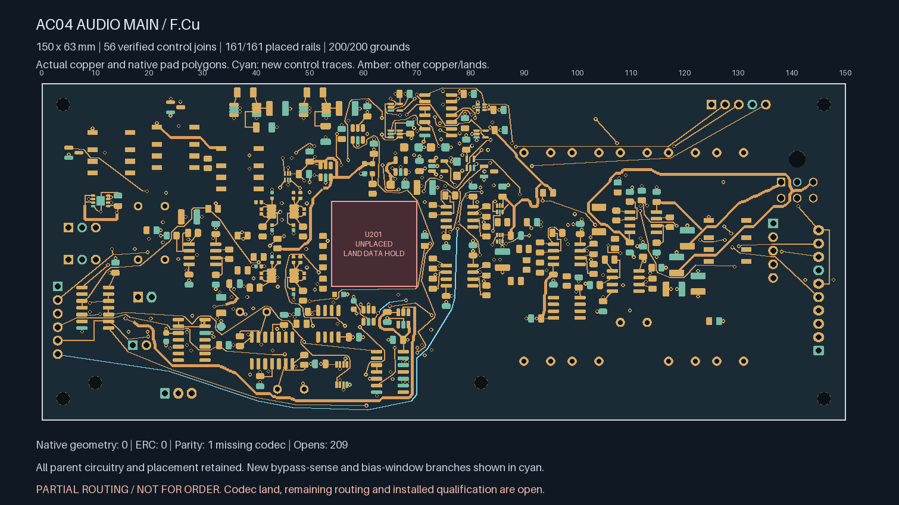
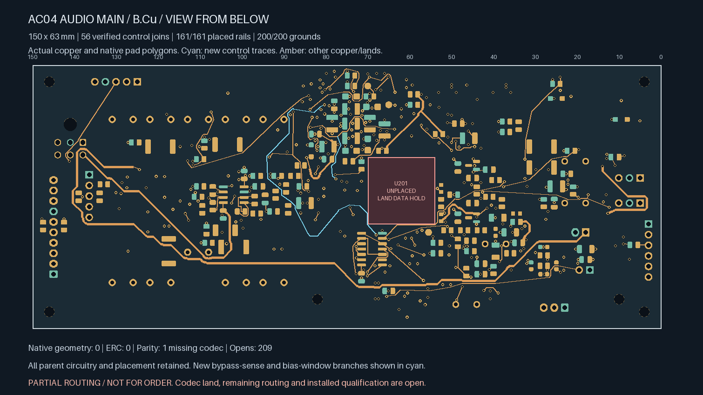
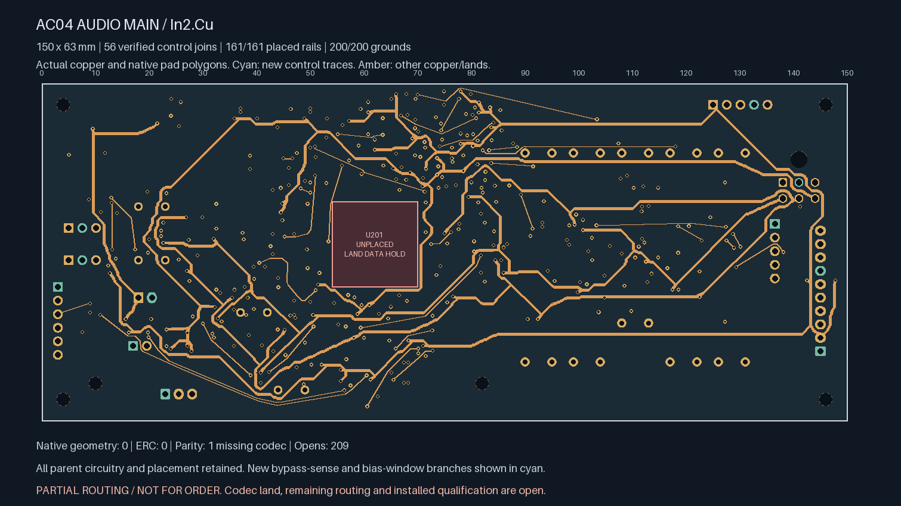
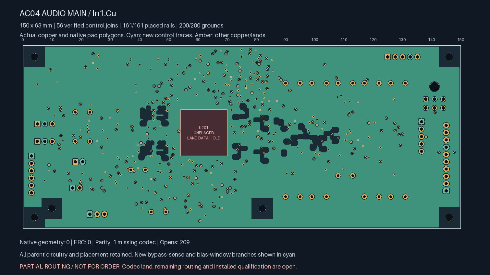

# AC04 — longer controls with fewer plated transitions

**Partial routing; not ready for fabrication.** Two additional branches connect
BYPASS_SENSE and the ADC bias-window receiver. The board now has **209 open
connections**, including **8 targeted control opens**. U201/ES9292QPRO still
has no approved land pattern.

| Actual top copper | Actual bottom copper, viewed from below |
| --- | --- |
|  |  |

| Actual In2 copper | Actual refilled In1 reference |
| --- | --- |
|  |  |

| Isolated Linux KiCad 10.0.7 check | Result |
| --- | --- |
| Geometry / ERC findings | **0 / 0**, no ignored categories |
| Schematic parity | **1: missing U201 footprint** |
| Open connections | **209** |
| Tracks / conventional 0.60/0.30 mm vias | **2,401 / 380** |
| Earlier explicit local / earlier control / earlier global-control joins retained | **138 / 17 / 54**, all connected |
| Earlier private watchdog / settling timing pairs | **Both connected** |
| New global control joins | **2**, connected |
| Placed rail/sense pads connected to designated source | **161 / 161** |
| Placed AGND pads connected to J701.2 | **200 / 200** |

The [parent codec-control board](../audio-main-controls-04/README.md) is retained
exactly apart from 47 new signal tracks, three new vias and native-refilled
ground. Every component pose, existing track/via, authored zone, board edge,
mount, library, project and schematic remains unchanged. Actual native
polygons for all 930 pads match the parent capture. The proposed audio
allocation remains 150 × 63 × 1.6 mm; no housing growth is introduced.

BYPASS_SENSE adds **113.774 mm / one new via**. ADC_BIAS_WINDOW_OK adds
**76.433 mm / two new vias**. Lengths include actual terminal entries.
New tracks are 0.20 mm wide and vias are 0.60/0.30 mm. Every fresh via joins
at least two routed faces. The minimum new drill-edge-to-SMD-copper gap is
**0.170 mm**; the minimum across retained and new vias remains **0.16998 mm**.
Stored native In1 ground area is **8,036.38 mm²**, with all 200 ground pads
connected.

The earlier coarse search found paths needing five or six new vias and
emitted no board. A subsequent search penalised plated transitions more
heavily, finding the two paths above within the unchanged four-new-via and
existing length budgets. Grid resolution affects planning only; every
actual segment and hole receives exact geometry screening, native checks
and independent replay. The remaining ANALOG_OK connection was not solved
within this bounded search. No shortest-path or impossibility claim is made.
Only compact rejected-search diagnostics are retained.

These longer routes remain electrically unqualified. Construction budgets
do not establish installed loading, timing, return impedance, coupling,
noise, EMI, transient/fault behaviour or manufacturing acceptance. Protected
analog regions remain excluded on all routed faces. The parent isolated
SENSE branch and its conditional assessment remain unchanged.

The [source-bound handoff](routing-handoff.json) replays the complete parent
history, selected planning proposal, exact additions and complete native
terminal witnesses. Plots show actual saved copper, native lands and fill;
cyan identifies the two additional branches. They are engineering views.

Release still requires remaining routing, revisioned ESS package/interface
inputs, physical ADC stars, whole-unit electrical/thermal/fault review,
parts/mates/harness/support/case receiving, supplier process acceptance,
inspected manufacturing outputs and a bounded first-article plan. No supplier
message, upload or order was made. Native Mac CAD remains disabled.
