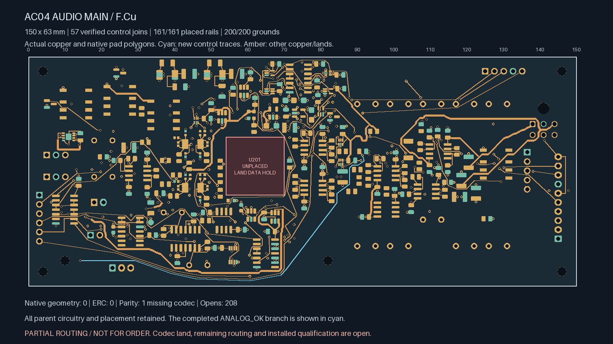
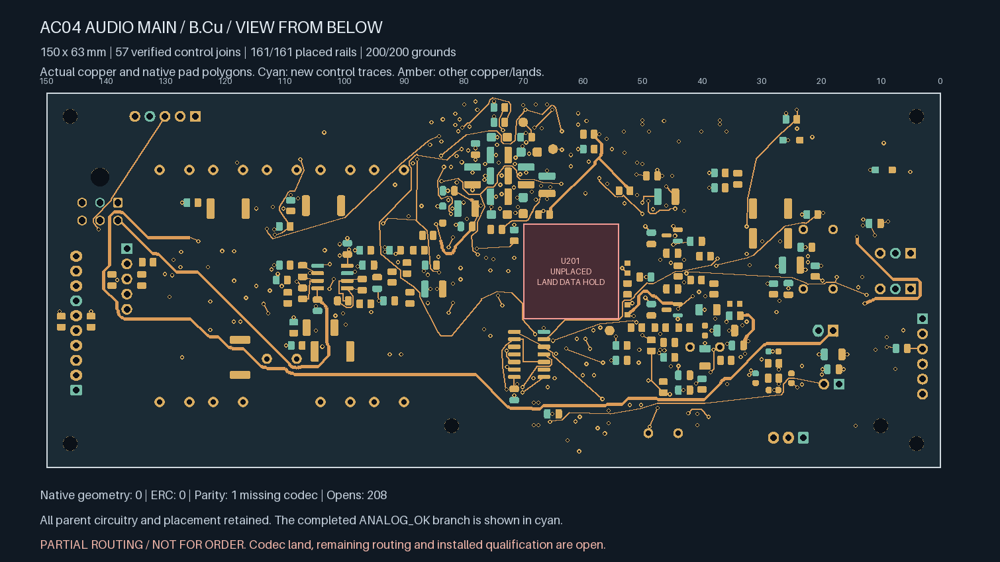
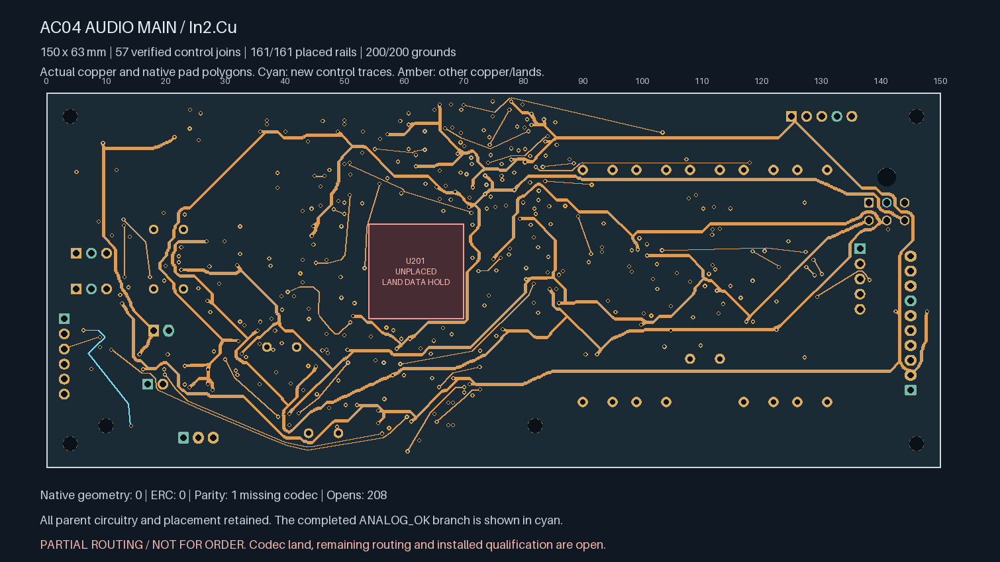
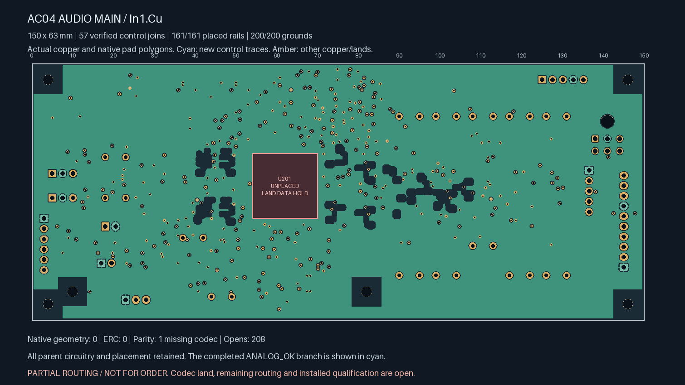

# AC04 — ANALOG_OK connected

**Partial routing; not ready for fabrication.** The remaining ANALOG_OK
receiver is connected. The board now has **208 open connections**, including
**7 targeted control opens**. U201/ES9292QPRO has no approved land pattern.

| Actual top copper | Actual bottom copper, viewed from below |
| --- | --- |
|  |  |

| Actual In2 copper | Actual refilled In1 reference |
| --- | --- |
|  |  |

| Isolated Linux KiCad 10.0.7 check | Result |
| --- | --- |
| Geometry / ERC findings | **0 / 0**, no ignored categories |
| Schematic parity | **1: missing U201 footprint** |
| Open connections | **208** |
| Tracks / conventional 0.60/0.30 mm vias | **2,425 / 382** |
| Earlier explicit local / earlier control / earlier global-control joins retained | **138 / 17 / 56**, all connected |
| Earlier private watchdog / settling timing pairs | **Both connected** |
| New global control joins | **1**, connected |
| Placed rail/sense pads connected to designated source | **161 / 161** |
| Placed AGND pads connected to J701.2 | **200 / 200** |

The [parent control board](../audio-main-controls-05/README.md) is retained
exactly apart from 24 new signal tracks, two new vias and native-refilled
ground. Every component pose, earlier copper object, authored zone, edge,
mount, library, project and schematic remains unchanged. Actual native
polygons for all 930 pads match the parent capture. The proposed audio
allocation remains 150 × 63 × 1.6 mm; no housing growth is introduced.

The ANALOG_OK branch adds **122.441 mm / two new vias**, including actual
terminal entries. New tracks are 0.20 mm wide and vias are 0.60/0.30 mm.
Each fresh via joins at least two routed faces. The new drill-edge-to-SMD
gap is at least **0.28506 mm**; the retained all-via minimum remains
**0.16998 mm**. Stored native In1 ground area is **8,034.71 mm²**, with all
200 ground pads connected.

Reversing search orientation finds this path within the unchanged width,
clearance, four-new-via and length construction limits. Other controls
remain unsolved within the bounded search; compact diagnostics record
those attempts. No shortest-path or impossibility claim is made.

This long branch remains electrically unqualified. Construction checks do
not establish installed loading, timing, return impedance, coupling/noise,
EMI, transient/fault behaviour or process acceptance. Protected analog
regions and the earlier isolated SENSE branch remain unchanged.

The [source-bound handoff](routing-handoff.json) replays the complete parent
history, selected planning proposal, exact additions and complete native
terminal witnesses. The plots show actual saved copper, native lands and
fill; cyan identifies the added branch. They are engineering views.

Release still requires remaining routing, revisioned ESS package/interface
inputs, physical ADC stars, whole-unit electrical/thermal/fault review,
parts/mates/harness/support/case receiving, supplier process acceptance,
inspected manufacturing outputs and a bounded first-article plan. No supplier
message, upload or order was made. Native Mac CAD remains disabled.
