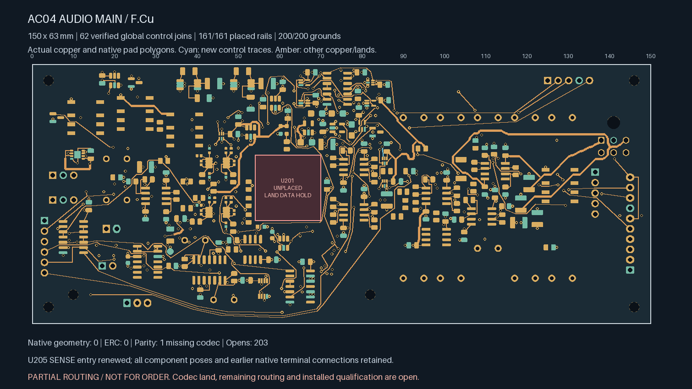
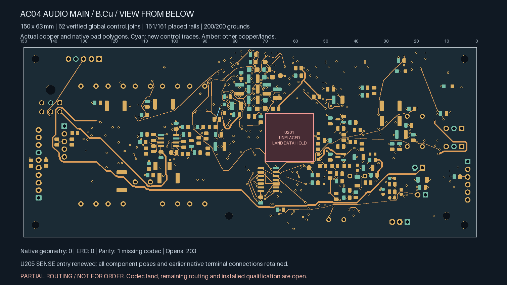
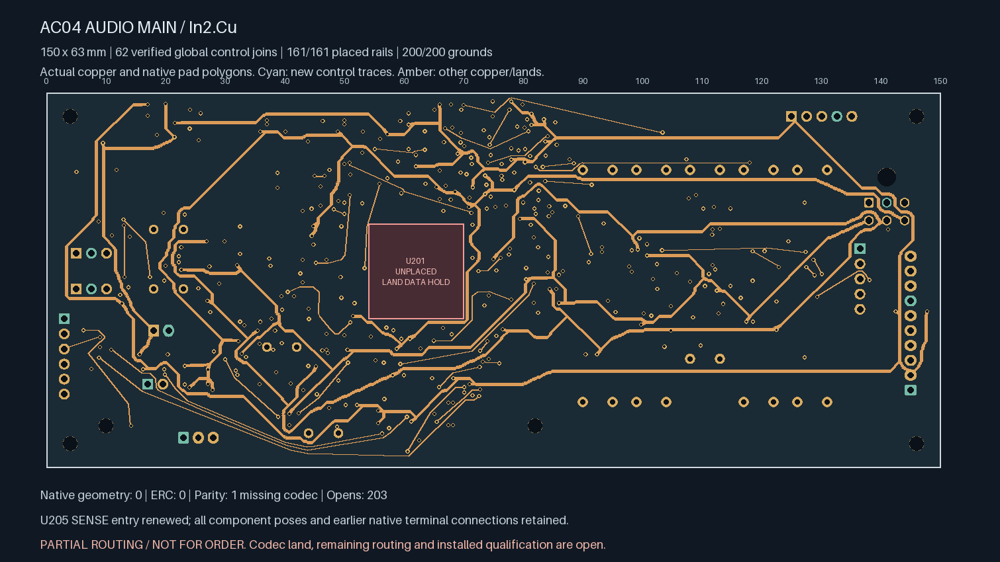
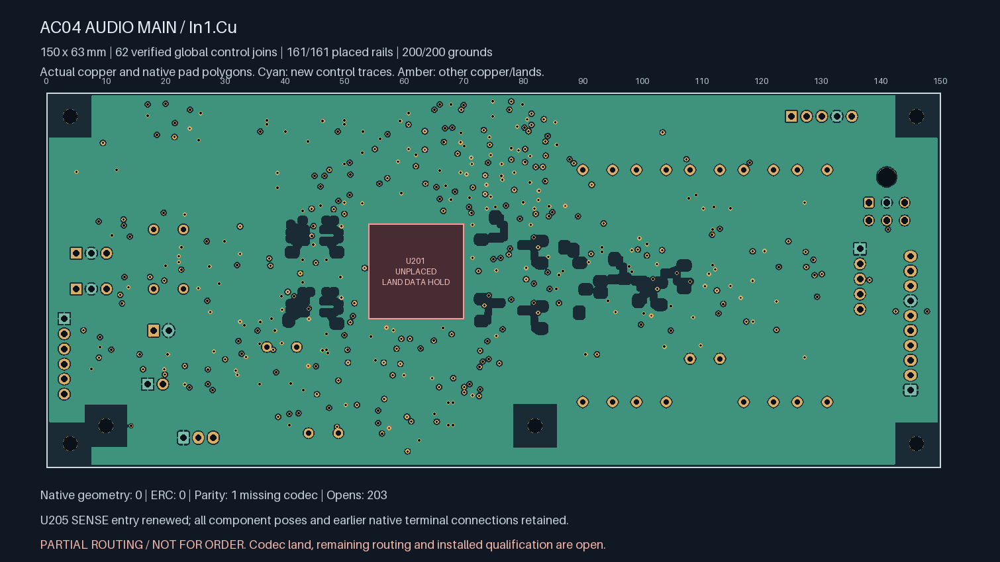

# AC04 — CODEC_PGOOD connected

**Partial routing; not ready for fabrication.** This unselected comparison
has **203 open connections**, including **two control gaps**: TIMER_INPUT_OK
and one CHIP_EN connection. U201/ES9292QPRO still lacks an approved land pattern.
The selected [208-open snapshot](../audio-main-controls-06/README.md) is unchanged.

| Actual top copper | Actual bottom copper, viewed from below |
| --- | --- |
| [](plots/top.png) | [](plots/bottom.png) |

| Actual In2 copper | Actual refilled In1 reference |
| --- | --- |
| [](plots/supplies.png) | [](plots/ground.png) |

The [preceding bridge](../audio-main-controls-07/README.md) adds a **2.617 mm /
one-via CHIP_EN connection**. This stage adds a **6.219 mm / one-via
CODEC_PGOOD branch**, including its actual terminal entry. All fresh control
tracks are 0.20 mm wide; each new 0.60/0.30 mm via joins two routed faces.
Control copper retains the stronger all-layer screen around sensitive analog
regions. No component moves or board growth are introduced.

## Isolated SENSE entry

U205.6 was enclosed by its own SENSE-feed geometry. Moving the SENSE via from
(84.6,22.1) to (84.3,20.8) mm opens a route from that output. Two declared
0.20 mm F.Cu entry segments are replaced by one F.Cu segment and one B.Cu
segment. The old B.Cu entry and F.Cu pad contact remain exact. No 0.60 mm
supply trunk, ordinary VDD/MR feed, component pose, solder land, authored
keepout or unrelated copper changes.

The complete **8.150 mm SENSE leaf**, including retained entry copper, feeds
only U205.1. The native netlist identifies TPS389033DSET; its VDD and MR pins
remain on V3V3_IO. The [TI TPS3890 datasheet, SLVSD65A](https://www.ti.com/lit/ds/symlink/tps3890.pdf)
lists an 8 µA SENSE-current entry at 5 V. The 100 nA row for TPS389001/012 is
not used for this fixed 3.3 V variant.

The independent construction assessment bounds the complete leaf at 12 mm.
With explicitly assumed 0.16 mm minimum finished width, 18 µm copper and
125°C copper temperature, trace-only resistance is at most 0.10148 Ω.
An engineering current allowance of 1 mA gives at most **0.10148 mV** of
trace-only drop. That allowance is not a datasheet guarantee at 3.3 V.
Via/contact loss, actual stack/material/process, rail tolerances, coupling,
transients and installed monitor accuracy remain unqualified. The longer
quiet SENSE leaf follows the existing power-routing policy; no noisy control
track is exempted from its analog-region screen.

The audit replays all three retired objects and three new objects against the
parent, proves every other object remains exact, checks the actual native
netlist pin roles and rejects another load touching the SENSE leaf. The old
source via's position is not reused to bypass the new drill's clearance test.

| Isolated Linux KiCad 10.0.7 check | Result |
| --- | --- |
| Geometry / ERC findings | **0 / 0**, no ignored categories |
| Schematic parity | **1: missing U201 footprint** |
| Open connections / remaining control gaps | **203 / 2** |
| Tracks / conventional vias | **2,416 / 395** |
| Actual global control joins | **62** |
| Earlier local / earlier control pairs retained | **138 / 17** |
| Earlier private watchdog / settling timing pairs | **Both connected** |
| Placed rail/sense pads connected to designated source | **161 / 161** |
| Placed ground pads connected to J701.2 | **200 / 200** |
| Minimum all-via drill-edge-to-SMD-copper gap | **0.16998 mm** |
| Actual native-refilled In1 ground area | **8,024.30 mm²** |

The [source-bound handoff](routing-handoff.json) replays the complete parent
history, exact SENSE rework, actual control additions, complete native
witnesses, real pad polygons and native-filled ground. The allocation remains
150 × 63 × 1.6 mm, with six unchanged mounts.

Release still requires all remaining routing, revisioned ESS package/interface
inputs, physical ADC stars, whole-unit electrical/thermal/fault review,
parts/mates/harness/support/case receiving, supplier process acceptance,
inspected manufacturing outputs and a bounded first-article plan. The earlier
long INPUT_ENABLE comparison remains electrically unqualified. No supplier
message, upload or order was made. Native Mac CAD remains disabled.

Replay from the repository root:

```sh
uv run --locked python -m hardware.fabrication.audit_audio_main_codec_pgood --check
uv run --locked python -m unittest tests.tooling.test_audio_main_chip_enable tests.tooling.test_audio_main_codec_pgood
```
