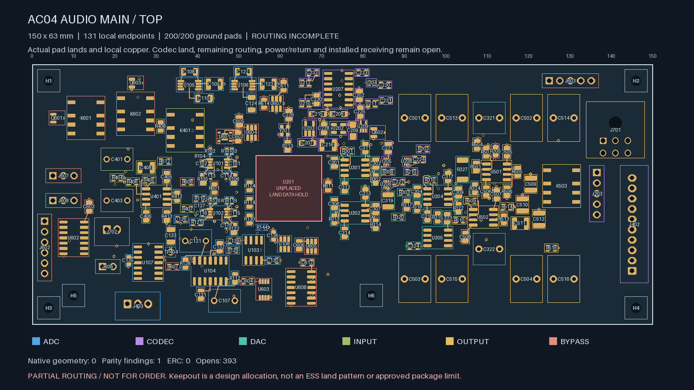
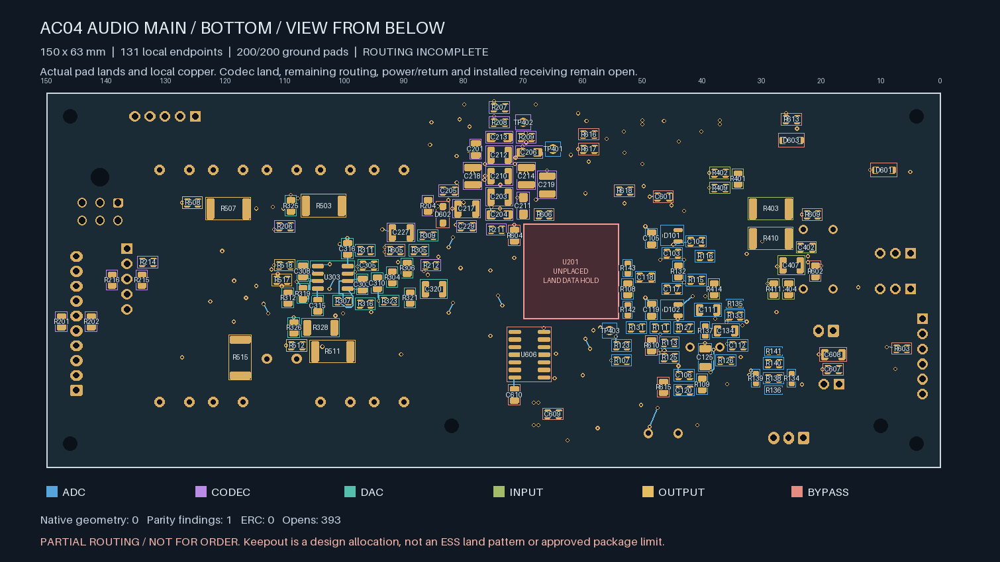
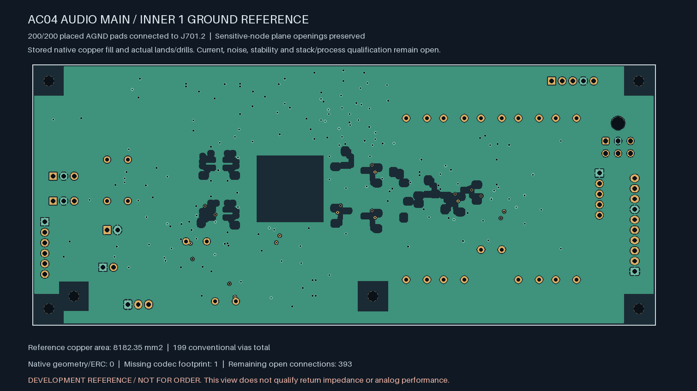

# AC04 — routed local cells and complete placed-ground continuity

| Top copper | Bottom copper, viewed from below |
| --- | --- |
|  |  |

**The board is not ready for fabrication.** It remains a 150 × 63 × 1.6 mm
four-layer candidate with 328 assigned electrical footprints, four bare test
pads included, and six proposed mounts. U201/ES9292QPRO has no approved land
assignment. Its marked reserve is not a substitute footprint.

**All 131 declared local signal/supply endpoints, all twenty declared local
ground-return pairs, and all 200 placed AGND pads are native-connected.**
The ground reference is protected input terminal J701.2. The earlier 724 open
connections are reduced to **393**; global signal and supply routing is still
unfinished. In2 is reserved for later distribution and has no adopted plane.

| Isolated Linux KiCad 10.0.7 check | Result |
| --- | --- |
| Geometry findings | **0** |
| ERC findings | **0** |
| Schematic parity | **1: missing U201 footprint** |
| Native open connections, uncapped | **393** |
| Ignored DRC / ERC categories | **0 / 0** |
| Tracks / conventional vias | **448 / 199** |
| Placed ground terminals connected to J701.2 | **200 / 200** |

The In1 AGND reference has **8,182.35 mm²** of stored native-filled copper.
Twelve plane openings protect the FDA input/output nodes and the OPA1612
summing nodes on both inner layers. Six full-layer copper exclusions retain
the proposed mounting-hardware allocations. The codec's existing all-layer
reserve remains clear. The [THS4551 layout guidance](https://www.ti.com/lit/gpn/ths4551)
calls for continuous references with openings around sensitive input/output
pins; [OPA1612 layout guidance](https://www.ti.com/lit/ds/symlink/opa1612.pdf)
also addresses grounding and local feedback placement. The 0.5 mm pad and
0.6 mm trace-centre opening margins are project allocations, not manufacturer
specified dimensions or a measured parasitic/stability result.

The 179 added ground vias use 0.60 mm copper lands and 0.30 mm drills. Together
with the twenty retained local signal/supply vias, the fresh native land screen
finds a minimum **0.170 mm** drill-edge-to-SMD-copper gap across both faces,
including same-net lands. No via drill intersects an SMD solder land. Mask
registration/tenting, stencil, plating and the actual stack still need supplier
acceptance. The 182 ground branches include reuse of existing vias. All normal
escape traces retain a 3.5 mm budget; supervisor U205.2 uses a 4.75 mm trace
within its original 5.6 mm local-ground construction allowance. Width remains
0.20 mm. Those lengths exclude travel through the via barrel and do not qualify
current capacity, ground noise or high-frequency return performance.

All amplifier poses and direct compensation capacitor tracks remain unchanged.
The [preceding local rework](../audio-main-local-routing-03/README.md) moves three
unrouted parts. This successor additionally rotates C310 180° in the same body
courtyard, placing its ground terminal outside the congested plane opening.
Its signal terminal remains on the original net. Every conditional body,
floor, upper-board, solder-tail, codec-reserve and support receiving constraint
is renewed; actual mating parts, fasteners, case details and tolerances remain
unapproved. Bare test pads still need explicit non-fitted-copper BOM treatment.

The [independent handoff replay](routing-handoff.json) binds actual copper,
native refill output, per-terminal connectivity and fresh pad geometry. It
checks all pre-existing analog copper, every added branch, all actual drills,
the protected plane openings, and complete ground-terminal coverage. Plane
boundaries use a one-nanometre comparison tolerance matching coordinate
serialization; no copper-clearance or local analog length budget is relaxed.
Executed generation/review source snapshots are retained separately so later
tool development does not rewrite historical evidence.

**Connectivity is not complete power/return, noise, stability, thermal or
manufacturing qualification.** The remaining 393 connections, ESS package and
raw-interface data, physical ADC stars, final parts and harness/mates/supports,
installed power/fault/thermal analysis, inspected Gerber/drill/BOM/placement
outputs and bounded first-article plan must be completed before release. No
supplier request, board order or native Mac CAD launch is made by this work.
