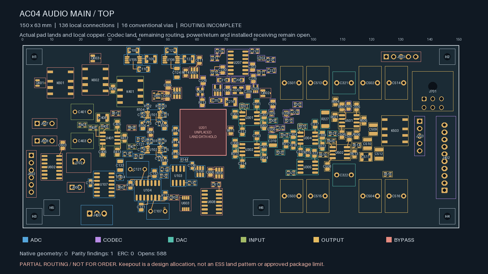
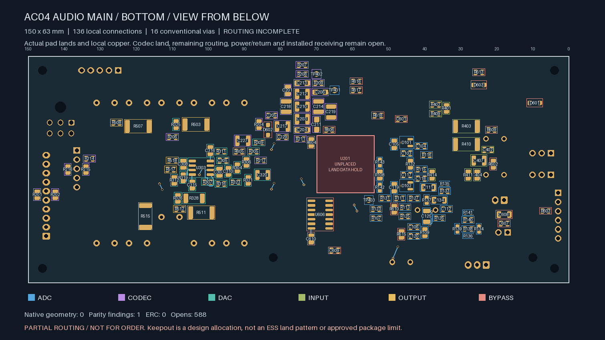

# AC04 — partial main audio local routing

| Top local copper | Bottom, viewed from below |
| --- | --- |
|  |  |

**Not ready for fabrication.** The 150 × 63 × 1.6 mm candidate retains all
328 assigned electrical footprints, four bare test pads included, and six
proposed mounts. U201/ES9292QPRO remains unplaced pending its approved package
and land data. The codec reserve is a provisional allocation, not a footprint.

The partial routing connects **136 local pad pairs**, reducing native open
connections from **724 to 588**. These are **129 of the 131** declared
feedback, pump, clock, servo and supply endpoints, plus **seven actual
power-ground pairs**. The remaining declared endpoints are **R319.1 to U303.6**
(DAC common-mode feedback) and **C127.1 to U102.3** (ADC-driver supply).
Thirteen requested local ground returns also remain open. Global audio,
power/return, codec-star and control routing is unfinished.

| Isolated Linux KiCad 10.0.7 check | Result |
| --- | --- |
| Native geometry findings | **0** |
| ERC findings | **0** |
| Schematic parity | **1: missing U201 footprint** |
| Native open connections, uncapped | **588** |
| Ignored DRC / ERC categories | **0 / 0** |
| Tracks / conventional vias | **257 / 16** |

Every original footprint, component pose, terminal net, outline, mount and
all-layer codec reserve is unchanged. The project and the narrowly scoped
inherited VSSOP pad-clearance rules are byte-identical to the earlier
[placement candidate](../audio-main-placement-02/README.md). The original
conditional body, upper-board, THT-tail and support receiving limits therefore
still apply; they do not become approved component or assembly tolerances.

Tracks are 0.20 mm wide, on the two outer layers. Sixteen conventional vias
use 0.60 mm lands and 0.30 mm drills. The independently recomputed minimum
drill-edge-to-native-SMD-copper gap is **0.170 mm** across both faces, including
same-net lands. No via hole intersects an SMD solder land. This is a geometric
screen; mask registration, tenting, stencil, plating and the four-layer stack
still require manufacturer acceptance. Neither inner layer has routed tracks
or a completed plane.

The eight FDA compensation and sixteen I/V feedback-capacitor terminal routes
retain exactly their original direct same-face tracks. Eight other connections
use two-via escapes. Their actual per-layer copper lengths remain within the
declared project construction budgets; each separately records 3.2 mm of
nominal via-barrel traversal. Those budgets exclude barrel traversal and do
not qualify loop stability, parasitics, supply impedance or noise.

The first local trial is retained in `../audio-main-local-routing-01`. This
successor removes its C612 ground trace to U608.13, a grounded logic input.
C612's requested return is now U608.7, the actual power-ground pin, and remains
unrouted. All requested bypass-ground endpoints must be native schematic
`power_in` terminals. The two OPA1612 input-reference pins are excluded from
the bypass-ground request set. Other prior copper is retained exactly.

The [routing handoff](routing-handoff.json) binds the construction records,
source placement, complete-rule native reports and per-pad connectivity
witnesses. Its replay independently checks actual copper, pad endpoints,
lengths, layers, drill-to-SMD distances, unchanged receiving geometry and
compensation-track preservation. Seven fault-injection tests include grounded
input rejection, missing compensation copper, inner-layer routing, changed
drills/widths and unreviewed component moves.

Remaining release work includes the two listed local connections and thirteen
local returns, all other routing, ESS package/interface inputs and physical
ADC stars, actual parts and complete connector mates/wire paths, supports and
case qualification, PDN/return/noise/stability/thermal review, and independently
inspected manufacturing outputs with a bounded first-article plan. No supplier
request, order or fabrication release is made by this candidate.
