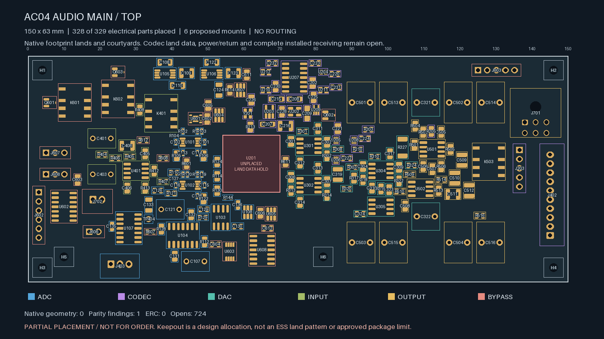
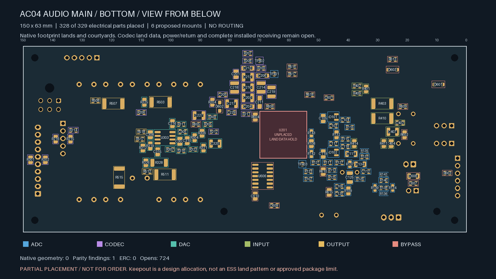

# AC04 — partial main audio PCB placement

| Top | Bottom, viewed from below |
| --- | --- |
| [](plots/top.png) | [](plots/bottom.png) |

The main PCB candidate places **328 known electrical footprints** in the
**150 × 63 × 1.6 mm** AP01 allocation at enclosure datum **[30,42,6.5] mm**.
There are 199 top-side and 129 bottom-side electrical footprints, plus six
proposed mechanical mounts. Four electrical footprints are bare test pads,
not separately fitted components.

**U201 / ES9292QPRO remains unplaced.** Its dimensioned land/package information
is unresolved. The marked **16 × 16 mm all-layer keepout** is a provisional
layout allocation, not a substitute footprint or a proven manufacturer package
limit. No codec pad or exposed-pad pattern is invented. Codec-local passives
remain provisional and need placement renewal around the approved land.

| Isolated Linux KiCad 10.0.7 check | Result |
| --- | --- |
| Geometry findings | **0** |
| ERC findings | **0** |
| Schematic parity findings | **1: missing U201 footprint** |
| Unrouted connections, uncapped | **724** |
| Ignored DRC / ERC categories | **0 / 0** |

The PCB is **placed-only**, with no tracks, vias or copper planes. The nominal
four-layer allocation is not an accepted stackup. Native checking does not
establish signal routing, audio performance, manufacturability or complete fit.

The 99 local feedback, bypass, flying-capacitor, clock-series and servo groups
have **131 checked endpoint displacements**. All use the same face as their
owning IC. Declared limits remain 3.0 mm for FDA compensation parts, 3.5 mm for
local supply bypasses and clock series termination, 4.0 mm for ordinary feedback
and flying caps, 5.0 mm for pump reservoir/output caps, and 6.0 mm for the two
leaded servo-integrator films. These are placement construction metrics, not
trace lengths, closed-loop parasitics, stability or noise qualification.

Each amplifier's local network is solved jointly before remaining parts are
placed. This retains the limits when two parallel feedback parts need separate
sites. The highest local search used 22 candidate placements. Critical FDA and
I/V parts are not moved to a different face to make the distance screen pass.

All eight tall output films sit outside the upper monitor projection. The
conditional receiving screen uses actual E13 THT land locations and the stated
PCB/seat, body-height and solder-tail allocations. It leaves a minimum **0.84 mm**
vertical gap to the upper PCB for overlapping component envelopes and **7.74 mm**
to overlapping upper THT-tail envelopes. **Those limits are unapproved receiving
requirements, not established part tolerances or a full native assembly pass.**
Complete connector mates, wire bends, strain relief and service paths are not
included by the 0.5 mm secondary footprint clearances.

Six nominal 2.4 mm M2 clearance holes include the two proposed shared monitor
fixing points at [40,98] and [112,98] mm in the case. Their shaft/standoff stack,
floor bosses, board loading, tolerances and upper-board datum still require
mechanical design and native renewal. Existing A11/A12 assembly passes are not
inherited.

The earlier `audio-main-placement-01` trial is preserved: it had 22 clearance
errors from applying 0.20 mm to the existing VSSOP lands, 199 field mismatches,
four test-pad BOM-attribute mismatches and the missing codec. This successor
keeps every pad, pose, net, outline and keepout unchanged. It synchronizes the
actual schematic instance fields, removes invented MPN fallback values and
matches the test-pad instance attributes. Final assembly BOM generation must
classify the four bare test pads as non-fitted copper features.

The selected ADC source already uses 0.15 mm minimum clearance. This board keeps
**0.20 mm general copper clearance and routing width**, with an explicit
**0.15 mm intra-footprint pad rule only for U101/U102/U105/U106**. The native
rule file and project are captured before/after the native check. No severity
category is suppressed. The rule structure follows
[KiCad's custom-rule model](https://docs.kicad.org/master/en/pcbnew/pcbnew.html);
the numerical requirement comes from the retained source lands. Factory copper,
mask, registration and assembly-process acceptance remain open.

```sh
python -m hardware.fabrication.audit_audio_main_placement --check
python -m unittest discover -s tests/tooling -p 'test_audio_main_placement.py' -v
python -m hardware.fabrication.audit_scope
```

The [native project](audio_core.kicad_pro), [placement receipt](placement-handoff.json),
[rule-bound native review](rule-bound-native-review.json),
[full planner data](plan.json) and [instance/rule corrections](construction.json)
are available. Images show the actual native lands and courtyards; they are not
CAM-mask/stencil approvals or manufactured hardware. Routing, ESS data/land and
physical ADC stars, final parts, PDN/returns, analog behavior, thermal design,
full assembly/harness receiving and the inspected manufacturing/bring-up package
remain unfinished. **Not for order. No fabrication release.**
