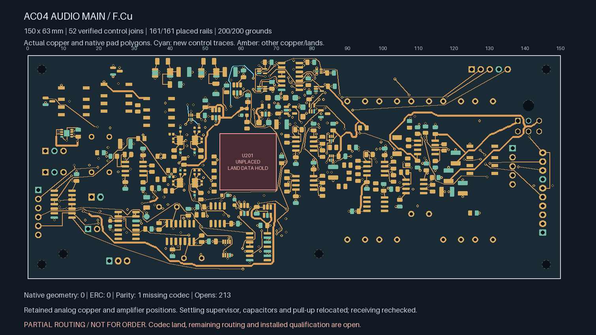
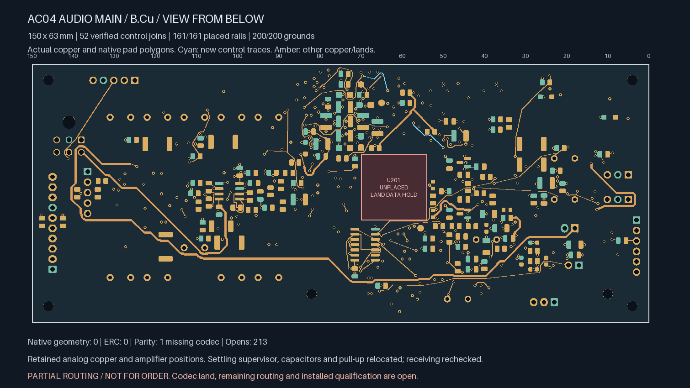
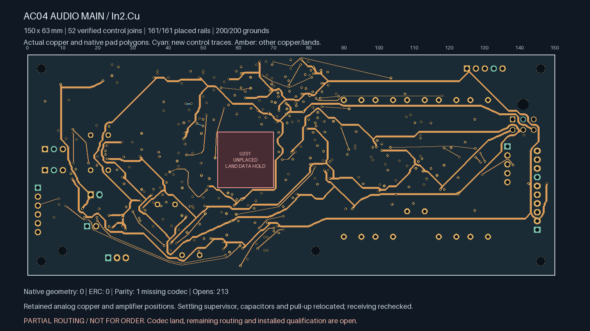
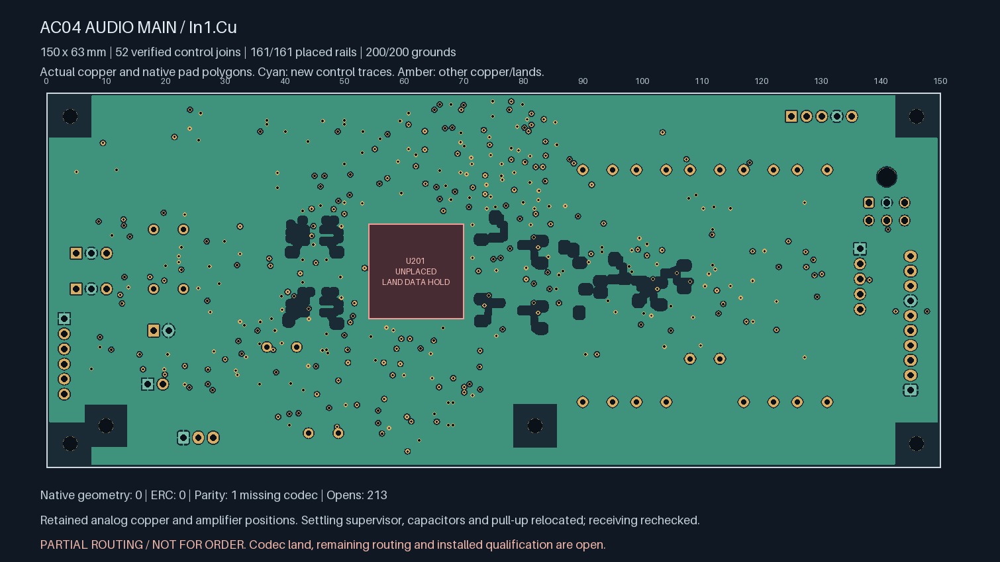

# AC04 — settling supervisor and local pull-up connected

**Partial routing; not ready for fabrication.** U208, C224 and C227 move into
the space freed by the watchdog rework; R204 moves beside this cell. Its two
control connections and private timing-capacitor path are native-connected.
Open connections fall from **216 to 213**; **12 targeted control connections**
remain open. U201/ES9292QPRO still has no approved land pattern.

| Actual top copper | Actual bottom copper, viewed from below |
| --- | --- |
|  |  |

| Actual In2 copper | Actual refilled In1 reference |
| --- | --- |
|  |  |

| Isolated Linux KiCad 10.0.7 check | Result |
| --- | --- |
| Geometry / ERC findings | **0 / 0**, no ignored categories |
| Schematic parity | **1: missing U201 footprint** |
| Open connections | **213** |
| Tracks / conventional 0.60/0.30 mm vias | **2,321 / 371** |
| Earlier explicit local / earlier control / earlier global-control joins retained | **138 / 17 / 50**, all connected |
| New global control joins / private timing pair | **2 / 1**, connected |
| Earlier watchdog timing pair | Connected |
| Placed rail/sense pads connected to designated source | **161 / 161** |
| Placed AGND pads connected to J701.2 | **200 / 200** |

The four changed poses pass receiving again inside the unchanged
150 × 63 × 1.6 mm board allocation. Native pad geometry is checked independently
against the intended translations and R204 rotation. Amplifier positions,
analog/compensation copper, mounts, board edges, sensitive-node openings and
the codec reserve remain exact. A 1.15 mm-long connection retains the
existing V3V3 distribution where the old decoupler trace was also a junction;
its trace width is **0.60 mm**. Six abandoned V3V3 leaf segments are checked
and removed without deleting real terminals.

R204's placement makes the timer connection local, avoiding the earlier
multilayer detour. New control routes retain the four-new-via and declared
length budgets. Their native witnesses cover all real pads in each joined
group. Coupling, timing, loading and installed fault behaviour remain open.

U208 pin 1 is SENSE; pin 4 is VDD. The
[TI TPS3890 Rev. A datasheet](https://www.ti.com/lit/ds/symlink/tps3890.pdf)
specifies **8 µA maximum SENSE current at 5 V** for this TPS389033 variant.
The 100 nA entry applies to TPS389001/TPS389012. VDD retains its short local
decoupler connection and source entry. The pull-up has a separate short
power feed. The **10.073 mm, 0.20 mm SENSE branch**, including both surface
entries, has a separate **12 mm** construction limit; it supplies no other
load and does not replace a bulk supply trunk.

The illustrative trace calculation allows 20 µA, a 0.16 mm minimum finished
width, 18 µm copper and 125 °C copper temperature. Under those unapproved
assumptions, the 12 mm trace-only resistance is about 0.1015 Ω and drop about
**2.03 µV**. This excludes via resistance, leakage outside the stated model,
coupling, transient/fault response and supplier process acceptance. It is not
an installed voltage-accuracy qualification.

The [source-bound replay](routing-handoff.json) accounts for the actual copper,
the four declared moves, complete inherited connections, new native terminal
witnesses and the isolated sense branch. All actual drill edges clear SMD
copper on both faces by at least **0.16998 mm**, including same-net lands.
Stored native In1 area is **8,043.59 mm²**, with all 200 ground pads connected.
Native fill is retained exactly from the checked export. Height, mating,
drill/mask/stencil, stack and two-sided assembly assumptions remain unapproved.

The first native trial found 0.15 mm clearance between C224 and an existing
via. A 0.07 mm cell shift corrects it while retaining body clearance. Only
the corrected zero-geometry-finding candidate above is selected; compact
rejected-source/findings diagnostics replace duplicate board exports.

Release still requires remaining routing, ESS land/interface information and
physical ADC stars, full power/return/noise/stability/fault/thermal review,
parts/mates/harness/support/case receiving, supplier process acceptance,
inspected manufacturing outputs and a first-article plan. The earlier long
relay feed and unrouted return remain open. No supplier message, upload or
board order has been made; native Mac CAD remains disabled.
