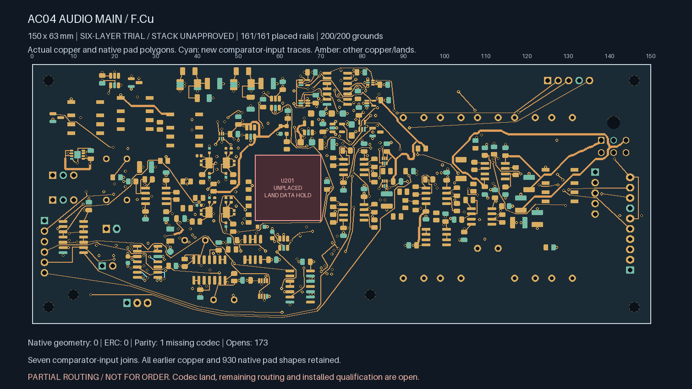
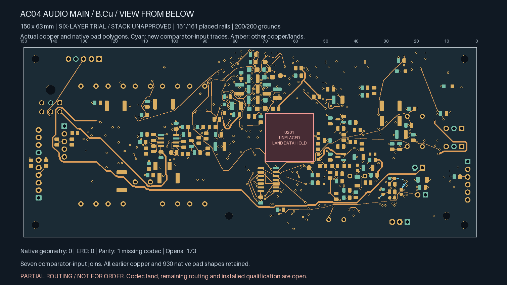
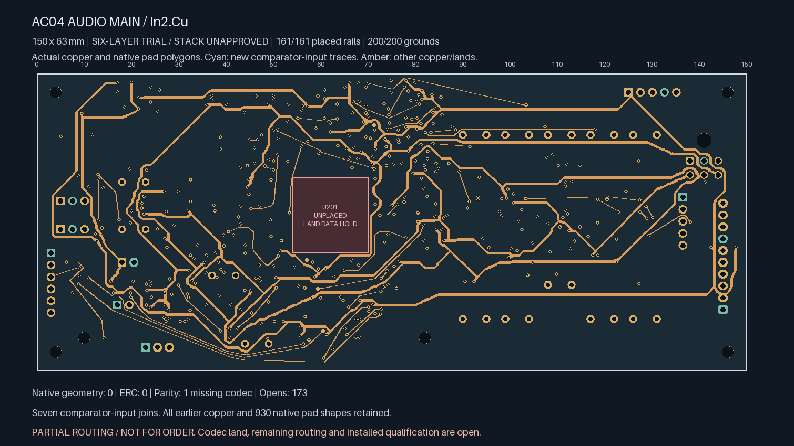
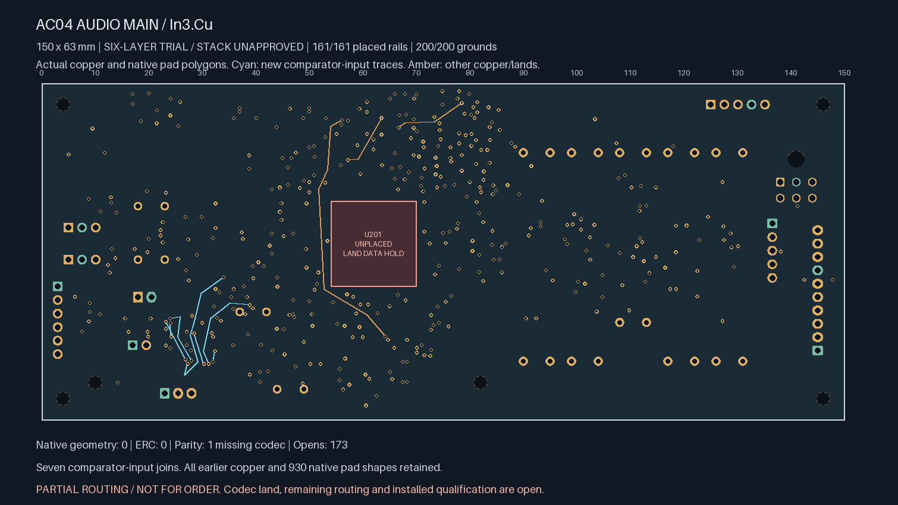
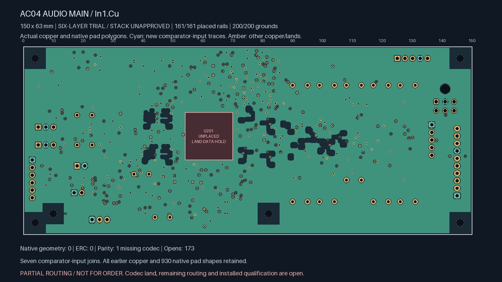

# Unselected six-layer comparator-input routing trial

**Not ready for fabrication.** This continues `audio-main-six-local-01` without
replacing the selected four-layer readiness snapshot.

Native Linux KiCad 10.0.7 confirms **173 open connections**, down from 180. Seven
new joins connect only the four explicitly named bias-window comparator input
nets. The delta adds 34 tracks at 0.20 mm and 14 conventional 0.60/0.30 mm vias.
Native geometry and ERC findings are zero, with no ignored categories. The known
parity warning remains: missing U201 / ES9292QPRO footprint.

Every existing copper object, component pose, authored zone, stack setting and
all 930 native pad shapes remain exact. The original 138 local pairs, 17 earlier
control pairs, 200 ground pads, 161 rail pads, 88 inherited witness rows and two
private timing pairs retain native connectivity. The witness-row count includes
earlier local links and repair receipts; it is not a count of unique global
control joins.

The new minimum drill-edge-to-SMD-copper distance is 0.175277293 mm. Both native
ground fills have 8010.786602 mm² of copper. These are geometric observations,
not return-impedance or signal-integrity qualification.

| Net | New joins | Total new planar length | New vias |
| --- | ---: | ---: | ---: |
| `/ADC/BIAS_SHIFT_L` | 3 | 45.798 mm | 6 |
| `/ADC/BIAS_SHIFT_R` | 2 | 28.133 mm | 4 |
| `/ADC/THRESH_UPPER` | 1 | 7.018 mm | 2 |
| `/ADC/THRESH_LOWER` | 1 | 17.064 mm | 2 |

Two comparator gaps remain: R136.2 on BIAS_SHIFT_R and U107.10 on THRESH_LOWER.
The route limit is the smaller of 40 mm and twice the physical endpoint distance
plus 6 mm, with at most two fresh vias and surface necks at most 3.5 mm. New signal
centre-lines retain 0.71 mm from the enumerated digital copper on their routed
layer. Additional drill, sensitive-region and both-ground-reference screens also
apply. This spacing policy does not establish adequate noise immunity.

The [TLV9024 datasheet](https://www.ti.com/lit/ds/symlink/tlv9024.pdf), revision H,
tables 4-3 and section 7.4, confirms the SOIC input pin roles and calls for
minimizing input/output coupling. Source netlist pin functions and physical lands
were checked for this route scope. Coupling, input capacitance/settling, threshold
accuracy and installed fault behavior remain qualification holds, especially for
the longer high-impedance BIAS_SHIFT_L branch. Differential ADC signals,
negative-bias supply routing, relay currents and timer SET/DIV wiring are outside
this delta.

`named-route-review.json` replays all new copper, route limits, complete native
endpoint witnesses and retained pad geometry. Seven mutation tests reject
changed existing power copper, narrower tracks, larger drills, weakened digital
spacing, relaxed route limits and false island merges.

The separate [preparation retention audit](../audio-main-six-control-01/preparation-retention-review.json)
checks the four-to-six-layer conversion, all 19 extended keepout polygons, the
retired nine-segment driver span, all other authored geometry and the extra
native inner lands. It also binds both planes to their native fill exports. Six
mutation tests reject changed keepouts, supply widths, plane clearances and
annuli. This preparation review does not approve the physical manufacturer stack
or qualify the added control routes' performance.

Actual copper views (bottom is mirrored as viewed from below):

| Top | Bottom |
| --- | --- |
|  |  |
| In2 supplies | In3 signals |
|  |  |
| In1 ground | In4 ground |
|  |  |

Missing codec land data, remaining routing, manufacturer stack/material/process
approval, electrical and mechanical review and the release checks remain open.
No manufacturing order or fabrication release is authorized by these artifacts.
