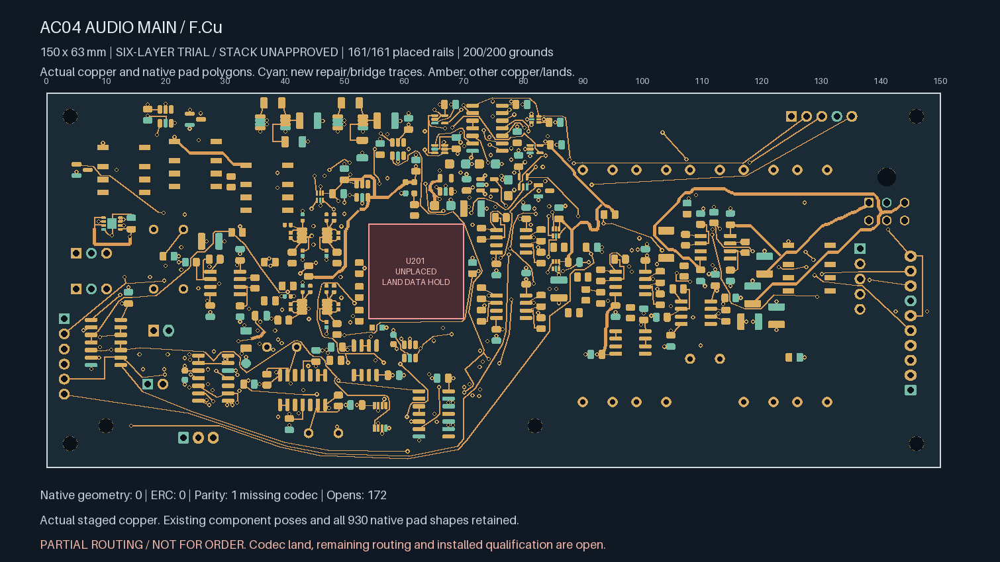
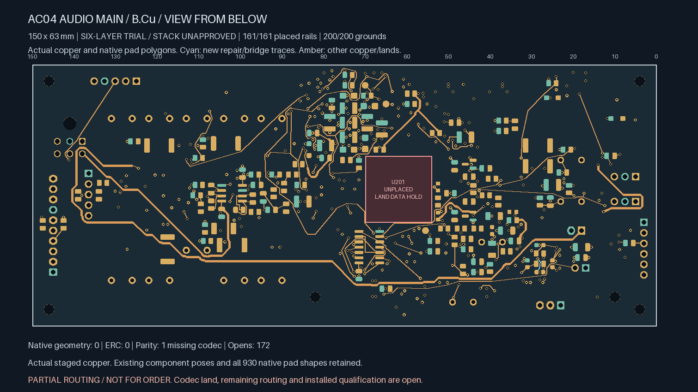
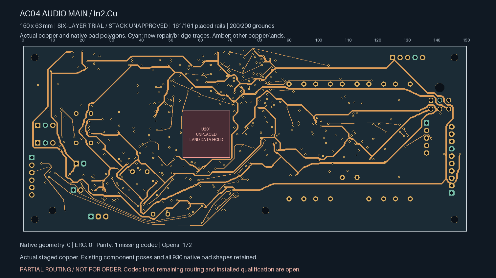
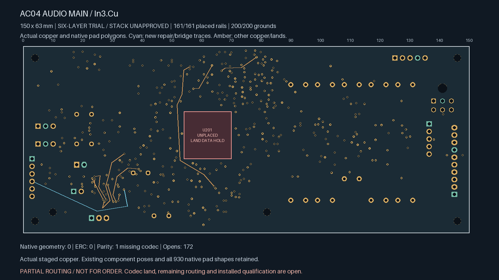
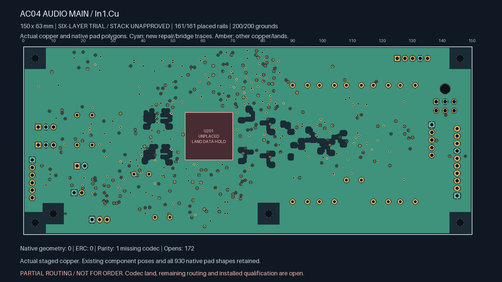

# Unselected GAIN_REQ clearance rework

**Not ready for fabrication.** This corrects the enlarged-spacing review for the
173-open comparator-input trial and continues its routing. It does not replace
the selected four-layer readiness snapshot.

The earlier routing screen searched only 0.5 mm around a candidate line while
trying to enforce 0.71 mm. Four trace/noisy-copper relationships were therefore
missed. The [measured erratum](previous-spacing-erratum.json) reproduces those
failures independently. Ordinary native DRC and the previous connectivity counts
remain valid; they did not establish this additional spacing policy.

The corrected screen searches to the largest actual clearance and applies the
enlarged margin to newly added centre-lines too. Four focused regression tests
include obstacles beyond the old half-millimetre search radius. A separate audit
measures every same-layer trace/noisy-copper pair without a spatial index.

The physical correction replaces only the 15-segment F.Cu GAIN_REQ branch between
R607.1 and J602.4. Its 41.228 mm replacement uses one 0.60/0.30 mm through via and
In3, remaining within the original ordinary-control length/four-via limits. A
3.605 mm B.Cu bridge joins an existing BIAS_SHIFT_R via to R136.2 without adding
another hole. The GAIN_REQ repair restores an existing connection and must not
be counted as an additional completed source-board connection.

Native Linux KiCad 10.0.7 confirms **172 opens**, down from 173 in the source.
Removing the old branch temporarily produces 174; the repair and new comparator
bridge return that to 172. There are seven new segments at 0.20 mm and one fresh
via. Native geometry and ERC findings are zero, all categories remain enabled,
and the only parity warning remains the missing U201 / ES9292QPRO footprint.

All unretired copper, component poses, authored zones and 930 native pad shapes
remain exact. All original 138 local pairs, 17 early control pairs, 200 ground
pads, 161 rail pads, 95 inherited witness rows and two private timing pairs retain
native connectivity. The witness count includes local links and repeated repair
receipts; it is not a count of unique global control joins.

The exhaustive final-native check measures **14,303 pairs across all 41
comparator-input tracks**, with no failures. Minimum trace-centreline to enumerated
noisy-copper distances are:

| Comparator input net | Minimum distance |
| --- | ---: |
| BIAS_SHIFT_L | 0.714111594 mm |
| BIAS_SHIFT_R | 0.941893371 mm |
| THRESH_LOWER | 0.949882025 mm |
| THRESH_UPPER | 1.116353255 mm |

This is a same-layer geometric policy, not electrical crosstalk/noise qualification
or a guarantee about pad-to-pad distances. The new minimum drill-edge-to-SMD gap
is 0.169980855 mm. Each native ground fill has 8009.995106 mm² of copper. Both fills
are bound to their native exports.

The remaining comparator input gap is U107.10 on THRESH_LOWER. It still has no
legal short via exit under the current source geometry and reference screens;
the digital-branch rework does not by itself close it. The rest of the board's
172 placed-board gaps, codec footprint, accepted manufacturer stack/materials,
remaining electrical/mechanical review and release checks are also unfinished.
Installed timing/noise/fault testing remains a qualification hold.

The [clearance repair review](clearance-repair-review.json) checks the exact retired
branch, unretired geometry, new routes, length/drill constraints, both fills,
complete endpoint witnesses and exhaustive final-native spacing. Twelve focused
tests reproduce the old failure and reject changed power copper, enlarged drills,
relaxed route limits and false source islands.

Actual copper views (bottom mirrored as viewed from below):

| Top | Bottom |
| --- | --- |
|  |  |
| In2 supplies | In3 signals |
|  |  |
| In1 ground | In4 ground |
|  |  |
