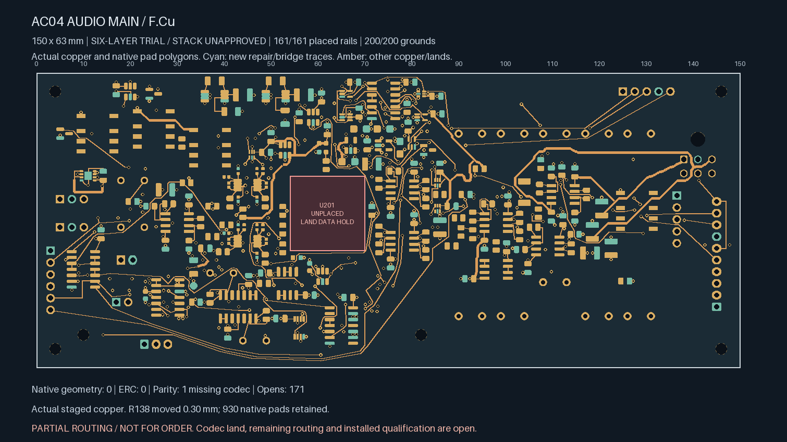
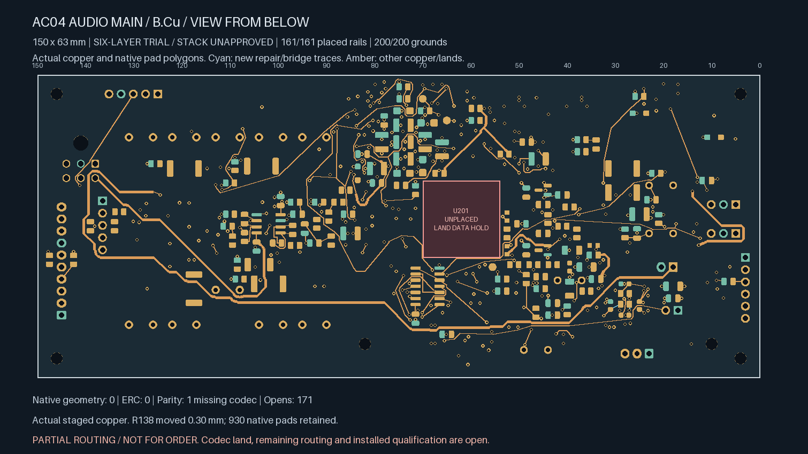
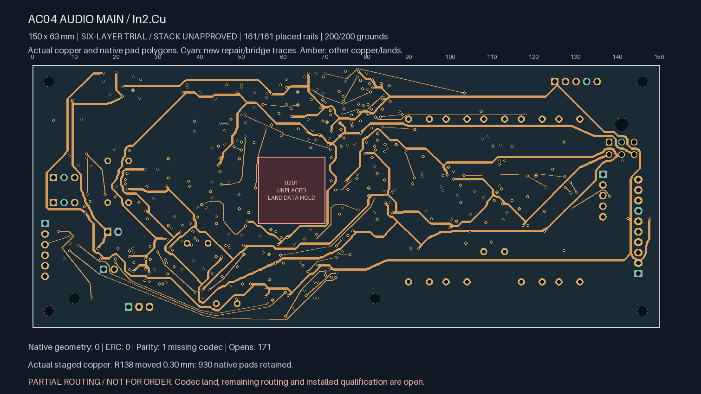
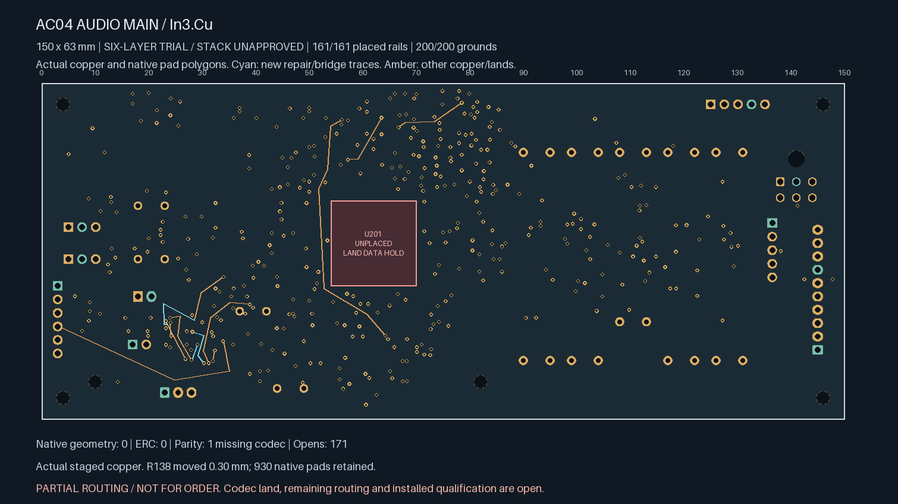
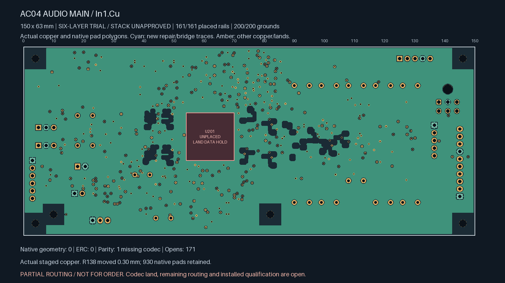

# Unselected comparator-input closure

**Partial routing; not ready for fabrication.** This continues the six-layer
audio trial. The selected four-layer, 208-open readiness checkpoint is unchanged.

All four comparator-input nets now have every placed terminal on one native
connection island. The final THRESH_LOWER connection to U107.10 is 4.503 mm long
and uses one standard 0.60/0.30 mm through via. Board-wide opens fall from 172 to
**171**. This is one additional completed connection, not five: four other route
records restore connections interrupted by the preparation.

R138 moves 0.30 mm on the bottom side to provide the exit. One existing right-bias
via moves from (28.5, 46.8) to (28.15, 46.6), with its surface spurs renewed.
Eight source segments and one unused left-bias entry via are retired. Both bias
routes are repaired together; each meets its retained input tree without a
nonterminal same-net contact. The left replacement ends at an existing track
junction rather than creating a parallel return to the removed via.

| Route | New copper length | Complete retained endpoint path / original cap |
| --- | ---: | ---: |
| R138 supply repair | 1.320 mm | 3.500 mm local cap |
| R138 upper-threshold repair | 2.371 mm | 4.294 mm local cap |
| Lower-threshold input | 4.503 mm | 13.223 mm cap |
| Right-bias span repair | 7.943 mm | 11.369 / 13.620 mm |
| Left-bias tree repair | 11.177 mm | 31.312 / 40.000 mm |

Native Linux KiCad 10.0.7 reports zero geometry findings, zero ERC findings and
no disabled categories. The sole schematic parity warning remains the missing
U201 / ES9292QPRO footprint. All original 138 local pairs, 17 earlier control
pairs, 200 grounds, 161 rail pads, 97 inherited witness rows and two private timing
pairs remain connected. Witness rows include repeated repair receipts and are
not a count of unique global joins.

The [independent closure review](comparator-closure-review.json) checks the exact
source delta, five route records, unchanged route budgets, both native fills,
930 native pad shapes, retained connections and native comparator islands. Seven
regression tests reject unrelated component movement, damaged power copper,
false source islands, relaxed length caps, enlarged drills and extra copper.

Exhaustive measurement of **15,024 same-layer pairs across 44 comparator-input
tracks** finds no violation of the 0.71 mm centreline-to-enumerated-noisy-copper
policy. Minimum distances are 0.825 mm for BIAS_SHIFT_L, 0.941893371 mm for
BIAS_SHIFT_R, 0.949882025 mm for THRESH_LOWER and 1.116353255 mm for THRESH_UPPER.
This is geometric evidence; installed electrical noise/fault performance remains
unqualified. Fresh/relocated drill-edge-to-SMD gaps are at least 0.261930669 /
0.419339134 mm respectively. Each ground plane contains 8009.917927 mm² of copper.

The remaining 171 gaps, codec land definition, manufacturer stack/material/cost
acceptance, mechanical/electrical release review and qualification remain open.

Actual staged copper (bottom mirrored as viewed from below):

| Top | Bottom |
| --- | --- |
|  |  |
| In2 supplies | In3 signals |
|  |  |
| In1 ground | In4 ground |
|  |  |
