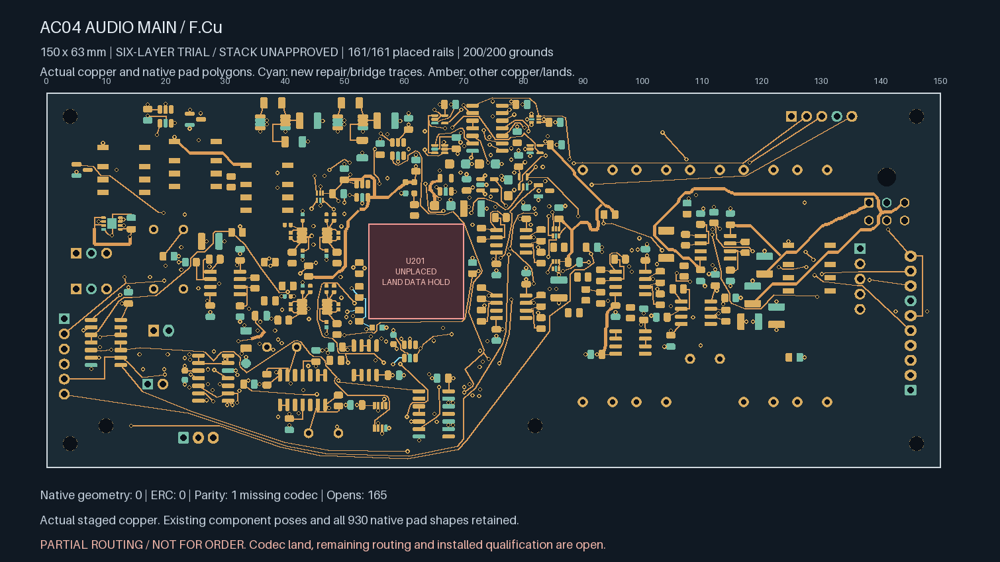
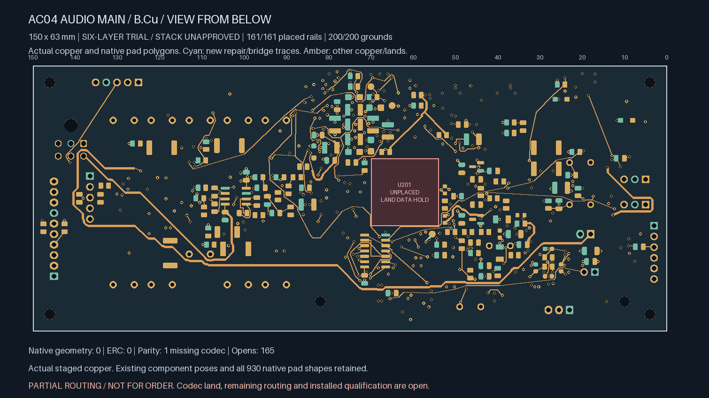
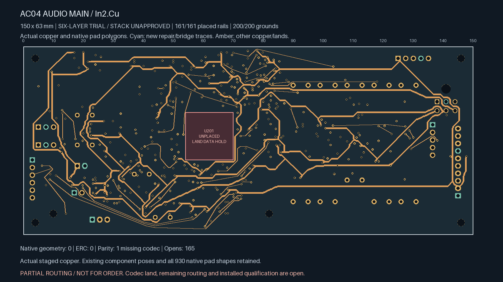
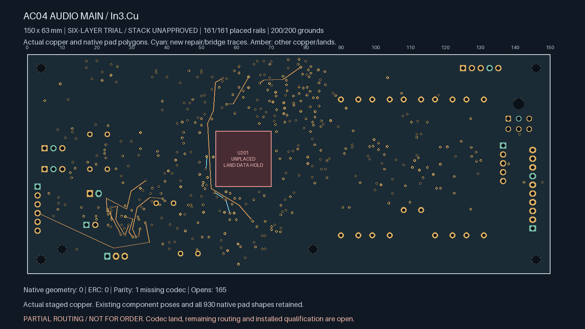
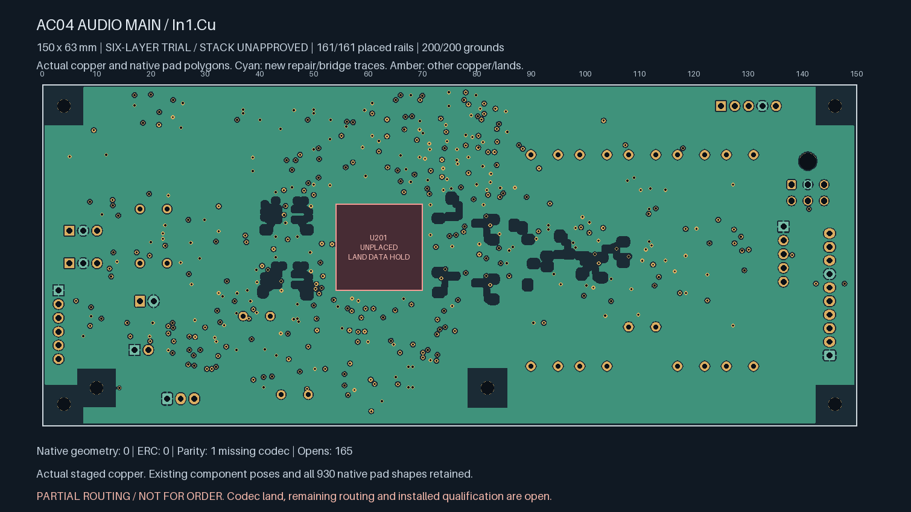

# Unselected ADC power-down bus routing

**Partial routing; not ready for fabrication.** This continues the 171-open
six-layer comparator trial. The selected four-layer readiness checkpoint remains
unchanged at 208 opens.

Six additional native connections bring this trial to **165 opens**. The complete
PD_GATED supervisor bus now joins U108.1, R143.2, R144.1, R114.1, R130.1 and TP403.1.
One right-channel divider link joins R130.2 to R131.1. **Three amplifier PD links
remain open:** two on PD_L and the U102.7 connection on PD_R. Connecting the bus
does not yet complete the amplifier shutdown circuit.

| Connection | New length | New through vias |
| --- | ---: | ---: |
| TP403.1 → R144.1 | 5.510 mm | 2 |
| R130.1 → R144.1 | 2.432 mm | 0 |
| R130.2 → R131.1 | 4.727 mm | 2 |
| R114.1 → R130.1 | 5.374 mm | 0 |
| R143.2 → R114.1 | 6.726 mm | 2 |
| U108.1 → TP403.1 | 8.721 mm | 2 |

There are 18 new 0.20 mm tracks and eight 0.60/0.30 mm vias. Each connection has
a construction limit of min(40 mm, twice its terminal distance + 6 mm), at most
two new vias and at most 3.5 mm per surface neck when using an inner layer.
The minimum new drill-edge-to-SMD gap is 0.374282202 mm. These are routing
construction limits; they do not establish a guaranteed electrical response time.

Native Linux KiCad 10.0.7 reports zero geometry findings, zero ERC findings and
no disabled categories. Its sole parity warning remains the missing U201 /
ES9292QPRO footprint. Every source track, via, component pose, pad, authored mask
and stack setting is retained exactly. All 930 native pad shapes remain unchanged.
Both refilled ground planes contain 8002.384364 mm² of copper.

All 138 original local pairs, 17 earlier control pairs, 200 grounds, 161 rail pads,
102 inherited witness rows and two private timing pairs remain connected. Witness
rows include repeated repairs and are not a count of unique global joins. All
four comparator-input nets remain on single native connection islands.

The [independent routing review](PD-routing-review.json) checks the actual copper,
native islands, unchanged source geometry, via/length limits, both fills and all
earlier witnesses. All amplifier-region routing masks remain in force; no special
FDA-entry exception is used for these six routes. Seven regression tests reject
damaged power copper, altered analog masks, enlarged drills, relaxed lengths and
false island merges, and check that unrelated supervisor routing cannot enter
the FDA protection region.

Exhaustive measurement of 15,768 same-layer pairs across 44 comparator-input
tracks finds no violation of the 0.71 mm trace-centreline policy. This includes the
new PD conductors as potentially noisy copper. The four minimum distances remain
0.825 / 0.941893371 / 0.949882025 / 1.116353255 mm for BIAS_SHIFT_L / BIAS_SHIFT_R /
THRESH_LOWER / THRESH_UPPER respectively. Electrical coupling remains unqualified.

Pin roles agree with the [TI THS4551 data sheet](https://www.ti.com/lit/ds/symlink/ths4551.pdf)
(VSSOP PD pin 7) and [TPS3808 data sheet](https://www.ti.com/lit/ds/symlink/tps3808.pdf)
(open-drain RESET). PD thresholds are referenced to the amplifier's negative
supply. The existing translation resistors and topology are unchanged. Power-down
is not analog isolation; partial-power, startup, shutdown and fault response need
complete-system review and later measurement.

Remaining release work includes the 165 gaps, the codec land, accepted six-layer
construction/material/cost inputs and electrical/mechanical fabrication review.

Actual staged copper (bottom mirrored as viewed from below):

| Top | Bottom |
| --- | --- |
|  |  |
| In2 supplies | In3 signals |
|  |  |
| In1 ground | In4 ground |
|  |  |
